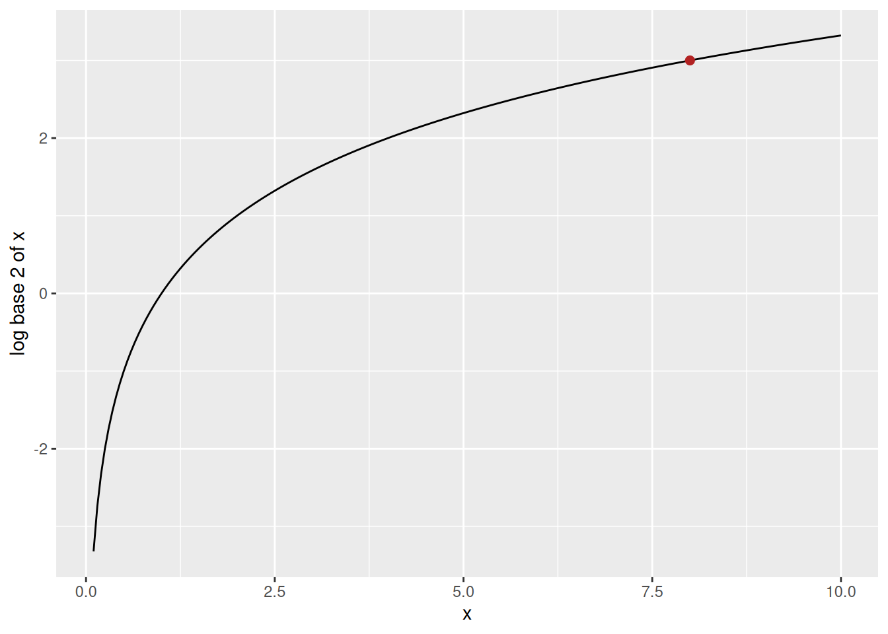

# Exponentials and Logarithms

Code

- [Show All Code](javascript:void(0))

- [Hide All Code](javascript:void(0))

- 

  ------------------------------------------------------------------------

- [View Source](javascript:void(0))

Published

Last modified: 2026-11-23 17:43:07 (PST)

# 1 Exponentials and Logarithms

> **NOTE:**
>
> **Definition 1 (Exponential function)**  
>
> The **exponential function** [\[1\]](#ref-wikipedia_exponential_function) $\operatorname{exp}: \mathbb{R}\to (0, \infty)$ is
>
> $${\operatorname{exp}\mathopen{}\left\{x\right\}\mathclose{}} \stackrel{\text{def}}{=}\lim_{n \to \infty} \mathopen{}\left(1 + \frac{x}{n}\right)\mathclose{}^n,$$
>
> the [limit](algebra-polynomials.llms.md#def-sequence-limit), as $n \to \infty$, of the [sequence](https://morrison-lab.github.io/mcs/functions.html#def-sequence) $\mathopen{}\left(1 + \frac{x}{1}\right)\mathclose{}^1, \mathopen{}\left(1 + \frac{x}{2}\right)\mathclose{}^2, \mathopen{}\left(1 + \frac{x}{3}\right)\mathclose{}^3, \ldots$. That limit exists for every real number $x$, and it is positive.

> **NOTE:**
>
> **Example 1 (Approximating** ${\operatorname{exp}\mathopen{}\left\{1\right\}\mathclose{}}$) For $x = 1$, the terms $\mathopen{}\left(1 + \frac{1}{n}\right)\mathclose{}^n$ are:
>
> |    $n$ | $\mathopen{}\left(1 + \frac{1}{n}\right)\mathclose{}^n$ |
> |-------:|:--------------------------------------------------------|
> |    $1$ | $2$                                                     |
> |   $10$ | $2.59374\ldots$                                         |
> |  $100$ | $2.70481\ldots$                                         |
> | $1000$ | $2.71692\ldots$                                         |
>
> They approach ${\operatorname{exp}\mathopen{}\left\{1\right\}\mathclose{}} = 2.71828\ldots$. For $x = 0$, every term is $\mathopen{}\left(1 + 0\right)\mathclose{}^n = 1$, so ${\operatorname{exp}\mathopen{}\left\{0\right\}\mathclose{}} = 1$.

> **NOTE:**
>
> **Definition 2 (Euler’s number)** **Euler’s number** [\[2\]](#ref-wikipedia_e_mathematical_constant) is
>
> $$e \stackrel{\text{def}}{=}{\operatorname{exp}\mathopen{}\left\{1\right\}\mathclose{}} = 2.71828\ldots$$

> **NOTE:**
>
> **Example 2 (Euler’s number is irrational)** $e = 2.71828\ldots$ is an [irrational number](https://morrison-lab.github.io/mcs/number-systems.html#def-irrational-numbers), so no fraction equals it exactly. The fraction $\frac{19}{7} = 2.714\ldots$ is close, but $\frac{19}{7} \ne e$ [\[2\]](#ref-wikipedia_e_mathematical_constant).

> **NOTE:**
>
> **Definition 3 (Natural logarithm)** For a real number $a > 0$, the **natural logarithm** of $a$, written ${\operatorname{log}\mathopen{}\left\{a\right\}\mathclose{}}$ [\[3\]](#ref-wikipedia_natural_logarithm), is the real number $y$ with ${\operatorname{exp}\mathopen{}\left\{y\right\}\mathclose{}} = a$. The exponential function takes each positive value at exactly one input, so there is exactly one such $y$, and $\log : (0, \infty) \to \mathbb{R}$ is the [inverse function](https://morrison-lab.github.io/mcs/functions.html#def-inverse-function) of $\operatorname{exp}$ ([Definition 1](#def-exponential-function)).

> **NOTE:**
>
> *Remark 1* (Other notations for the natural logarithm). In these notes, ${\operatorname{log}\mathopen{}\left\{x\right\}\mathclose{}}$ is always the natural logarithm, the logarithm with base $e$ ([Definition 2](#def-euler-number)) [\[4\]](#ref-wikipedia_logarithm). Some sources write $\ln x$ for the natural logarithm and reserve $\log x$ for the logarithm with base 10.

> **NOTE:**
>
> **Example 3 (Natural logarithms)**  
>
> - ${\operatorname{log}\mathopen{}\left\{1\right\}\mathclose{}} = 0$, because ${\operatorname{exp}\mathopen{}\left\{0\right\}\mathclose{}} = 1$ ([Example 1](#exm-exponential-function)).
> - ${\operatorname{log}\mathopen{}\left\{e\right\}\mathclose{}} = 1$, because ${\operatorname{exp}\mathopen{}\left\{1\right\}\mathclose{}} = e$ ([Definition 2](#def-euler-number)).
> - ${\operatorname{log}\mathopen{}\left\{0\right\}\mathclose{}}$ and ${\operatorname{log}\mathopen{}\left\{-2\right\}\mathclose{}}$ are not defined, because ${\operatorname{exp}\mathopen{}\left\{y\right\}\mathclose{}} > 0$ for every real $y$.

> **NOTE:**
>
> **Definition 4 (Power with a real exponent)** For a real number $a > 0$ and a real number $b$,
>
> $$a^b \stackrel{\text{def}}{=}{\operatorname{exp}\mathopen{}\left\{b \cdot{\operatorname{log}\mathopen{}\left\{a\right\}\mathclose{}}\right\}\mathclose{}}.$$
>
> When $b$ is an integer, this agrees with [Definition 4 in Equalities, Inequalities and Minimizers](algebra-basics.llms.md#def-power) and [Definition 8 in Equalities, Inequalities and Minimizers](algebra-basics.llms.md#def-power-integer).

> **NOTE:**
>
> **Example 4 (Real powers, and** $e^x$)  
>
> - $2^3 = {\operatorname{exp}\mathopen{}\left\{3 \cdot{\operatorname{log}\mathopen{}\left\{2\right\}\mathclose{}}\right\}\mathclose{}} \approx {\operatorname{exp}\mathopen{}\left\{3 \cdot 0.69315\right\}\mathclose{}} \approx {\operatorname{exp}\mathopen{}\left\{2.07944\right\}\mathclose{}} \approx 8$, which agrees with
>
>   $$\begin{aligned}
>   2^3 &= 2 \cdot 2 \cdot 2 \\
>   &= 8
>   \end{aligned}$$
>
>   from [Definition 4 in Equalities, Inequalities and Minimizers](algebra-basics.llms.md#def-power).
>
> - $2^{1/2} = {\operatorname{exp}\mathopen{}\left\{\frac{1}{2} \cdot{\operatorname{log}\mathopen{}\left\{2\right\}\mathclose{}}\right\}\mathclose{}} \approx {\operatorname{exp}\mathopen{}\left\{0.34657\right\}\mathclose{}} \approx 1.41421$, which is $\sqrt{2}$ ([Definition 9 in Equalities, Inequalities and Minimizers](algebra-basics.llms.md#def-square-root)).
>
> - For every real $x$, with base $e$ ([Definition 2](#def-euler-number)):
>
>   $$\begin{aligned}
>   e^x
>   &= {\operatorname{exp}\mathopen{}\left\{x \cdot{\operatorname{log}\mathopen{}\left\{e\right\}\mathclose{}}\right\}\mathclose{}}
>   && \text{(}\href{#def-real-power}{\text{Definition~4}}\text{, with } a = e \text{ and } b = x \text{)}
>   \\
>   &= {\operatorname{exp}\mathopen{}\left\{x \cdot 1\right\}\mathclose{}}
>   && \text{(}{\operatorname{log}\mathopen{}\left\{e\right\}\mathclose{}} = 1 \text{, by }\href{#exm-natural-log}{\text{Example~3}}\text{)}
>   \\
>   &= {\operatorname{exp}\mathopen{}\left\{x\right\}\mathclose{}}
>   && \text{(}\href{algebra-sums.qmd#thm-mult-one}{\text{Theorem~4 in Sums, Products and Quotients}}\text{)}
>   \end{aligned}$$
>
>   So $e^x$ and ${\operatorname{exp}\mathopen{}\left\{x\right\}\mathclose{}}$ are two names for the same number.

> **NOTE:**
>
> **Definition 5 (Logarithm)** Let $b$ be a positive [real number](https://morrison-lab.github.io/mcs/number-systems.html#def-real-numbers) with $b \ne 1$. For every real number $x > 0$, the **logarithm** of $x$ to the [base](algebra-basics.llms.md#def-power-base) $b$ [\[4\]](#ref-wikipedia_logarithm), written $\log_b x$, is the real number $y$ for which the [real power](#def-real-power) $b^y$ is $x$.

> **NOTE:**
>
> **Example 5 (Logarithms to other bases)**  
>
> - $\log_2 8 = 3$ by the [definition of the logarithm](#def-logarithm), because $2^3 = 8$.
> - $\log_{10} 0.01 = -2$, because $10^{-2} = 0.01$.
>
> The [graph](https://morrison-lab.github.io/mcs/functions.html#def-graph) of $\log_2 x$ passes through $(8, 3)$, the first of these two facts.
>
> Show code
>
> ``` downlit
> x <- seq(0.1, 10, length.out = 200)
> y <- log2(x)
> curve <- tibble::tibble(x = x, y = y)
> marked <- tibble::tibble(x = 8, y = 3)
>
> log_plot <- ggplot2::ggplot(curve, ggplot2::aes(x = x, y = y)) +
>   ggplot2::geom_line() +
>   ggplot2::geom_point(data = marked, colour = "firebrick", size = 2) +
>   ggplot2::labs(x = "x", y = "log base 2 of x")
>
> log_plot
> ```
>
> [](algebra-exponentials_files/figure-html/unnamed-chunk-1-1.png)

> **NOTE:**
>
> **Definition 6 (Real powers of zero and of negative numbers)** [Definition 4 in Equalities, Inequalities and Minimizers](algebra-basics.llms.md#def-power), [Definition 8 in Equalities, Inequalities and Minimizers](algebra-basics.llms.md#def-power-integer) and [Definition 4](#def-real-power) leave some powers $b^c$ with $b \le 0$ unassigned. We complete them as follows.
>
> - For a real number $c > 0$, $0^c \stackrel{\text{def}}{=}0$. For a natural number $c$, this agrees with [Definition 4 in Equalities, Inequalities and Minimizers](algebra-basics.llms.md#def-power).
> - For $b < 0$, $b^c$ is defined only when $c$ is an [integer](https://morrison-lab.github.io/mcs/number-systems.html#def-integers), by [Definition 4 in Equalities, Inequalities and Minimizers](algebra-basics.llms.md#def-power) and [Definition 8 in Equalities, Inequalities and Minimizers](algebra-basics.llms.md#def-power-integer); for $b < 0$ and a non-integer $c$, $b^c$ is undefined.

> **NOTE:**
>
> **Example 6 (Powers of zero and of negative numbers)**  
>
> - $0^{1/2} = 0$, which agrees with $\sqrt{0} = 0$ ([Definition 9 in Equalities, Inequalities and Minimizers](algebra-basics.llms.md#def-square-root)).
> - $(-8)^2 = 64$ and $(-8)^{-1} = -\tfrac{1}{8}$ are defined, since the exponents are integers.
> - $(-8)^{1/3}$ is undefined, even though $(-2)^3 = -8$. R follows the same convention: `(-8)^(1/3)` is `NaN`.

> **NOTE:**
>
> **Theorem 1 (**$\operatorname{exp}$ and $\operatorname{log}$ are mutual inverses)  
>
> 1.  For every $a > 0$: ${\operatorname{exp}\mathopen{}\left\{{\operatorname{log}\mathopen{}\left\{a\right\}\mathclose{}}\right\}\mathclose{}} = a$.
> 2.  For every $a \in \mathbb{R}$: ${\operatorname{log}\mathopen{}\left\{{\operatorname{exp}\mathopen{}\left\{a\right\}\mathclose{}}\right\}\mathclose{}} = a$.

> **NOTE:**
>
> *Remark 2* (The logarithm to base $b$ through the natural logarithm). For each $x > 0$, exactly one $y$ satisfies [Definition 5](#def-logarithm), and $$\log_b x = \frac{{\operatorname{log}\mathopen{}\left\{x\right\}\mathclose{}}}{{\operatorname{log}\mathopen{}\left\{b\right\}\mathclose{}}}.$$
>
> To see why, note that by [Definition 4](#def-real-power), $b^y = {\operatorname{exp}\mathopen{}\left\{y \cdot{\operatorname{log}\mathopen{}\left\{b\right\}\mathclose{}}\right\}\mathclose{}}$, so we need ${\operatorname{exp}\mathopen{}\left\{y \cdot{\operatorname{log}\mathopen{}\left\{b\right\}\mathclose{}}\right\}\mathclose{}} = x$. If $y \cdot{\operatorname{log}\mathopen{}\left\{b\right\}\mathclose{}} = {\operatorname{log}\mathopen{}\left\{x\right\}\mathclose{}}$, then ${\operatorname{exp}\mathopen{}\left\{y \cdot{\operatorname{log}\mathopen{}\left\{b\right\}\mathclose{}}\right\}\mathclose{}} = {\operatorname{exp}\mathopen{}\left\{{\operatorname{log}\mathopen{}\left\{x\right\}\mathclose{}}\right\}\mathclose{}} = x$, by part 1 of [Theorem 1](#thm-exp-log-inverse). Conversely, if ${\operatorname{exp}\mathopen{}\left\{y \cdot{\operatorname{log}\mathopen{}\left\{b\right\}\mathclose{}}\right\}\mathclose{}} = x$, then applying $\operatorname{log}$ to both sides gives $y \cdot{\operatorname{log}\mathopen{}\left\{b\right\}\mathclose{}} = {\operatorname{log}\mathopen{}\left\{x\right\}\mathclose{}}$, by part 2 of [Theorem 1](#thm-exp-log-inverse). Since $b \ne 1$, ${\operatorname{log}\mathopen{}\left\{b\right\}\mathclose{}} \ne 0$, so we can divide by it, and $y = \frac{{\operatorname{log}\mathopen{}\left\{x\right\}\mathclose{}}}{{\operatorname{log}\mathopen{}\left\{b\right\}\mathclose{}}}$ is the only solution.

> **NOTE:**
>
> **Theorem 2 (Logarithm of a product)** If $a > 0$ and $b > 0$, then
>
> $${\operatorname{log}\mathopen{}\left\{a \cdot b\right\}\mathclose{}} = {\operatorname{log}\mathopen{}\left\{a\right\}\mathclose{}} + {\operatorname{log}\mathopen{}\left\{b\right\}\mathclose{}}$$

> **NOTE:**
>
> **Corollary 1 (Logarithm of a quotient)** If $a > 0$ and $b > 0$, then
>
> $${\operatorname{log}\mathopen{}\left\{\frac{a}{b}\right\}\mathclose{}} = {\operatorname{log}\mathopen{}\left\{a\right\}\mathclose{}} - {\operatorname{log}\mathopen{}\left\{b\right\}\mathclose{}}$$

> **NOTE:**
>
> *Proof*. Since $a > 0$ and $b > 0$, the quotient $\frac{a}{b}$ is positive, so [Theorem 2](#thm-log-prod) applies to the product $\frac{a}{b} \cdot b$:
>
> $$\begin{aligned}
> {\operatorname{log}\mathopen{}\left\{a\right\}\mathclose{}}
> &= {\operatorname{log}\mathopen{}\left\{\frac{a}{b} \cdot b\right\}\mathclose{}}
> && \text{(} a = \tfrac{a}{b} \cdot b \text{)}
> \\
> &= {\operatorname{log}\mathopen{}\left\{\frac{a}{b}\right\}\mathclose{}} + {\operatorname{log}\mathopen{}\left\{b\right\}\mathclose{}}
> && \text{(logarithm of a product)}
> \end{aligned}$$
>
> The second step applies [Theorem 2](#thm-log-prod). Subtracting ${\operatorname{log}\mathopen{}\left\{b\right\}\mathclose{}}$ from both sides gives ${\operatorname{log}\mathopen{}\left\{a\right\}\mathclose{}} - {\operatorname{log}\mathopen{}\left\{b\right\}\mathclose{}} = {\operatorname{log}\mathopen{}\left\{\frac{a}{b}\right\}\mathclose{}}$.

> **NOTE:**
>
> **Corollary 2 (Logarithm of a reciprocal)** If $a > 0$, then the [natural logarithm](#def-natural-log) of $\frac{1}{a}$ is the negative of the natural logarithm of $a$:
>
> $${\operatorname{log}\mathopen{}\left\{\frac{1}{a}\right\}\mathclose{}} = -{\operatorname{log}\mathopen{}\left\{a\right\}\mathclose{}}$$

> **NOTE:**
>
> *Proof*. Since $1 > 0$ and $a > 0$, [Corollary 1](#cor-log-quot) applies to the [quotient](algebra-sums.llms.md#def-quotient) $\frac{1}{a}$:
>
> $$\begin{aligned}
> {\operatorname{log}\mathopen{}\left\{\frac{1}{a}\right\}\mathclose{}}
> &= {\operatorname{log}\mathopen{}\left\{1\right\}\mathclose{}} - {\operatorname{log}\mathopen{}\left\{a\right\}\mathclose{}}
> && \text{(logarithm of a quotient)}
> \\
> &= 0 - {\operatorname{log}\mathopen{}\left\{a\right\}\mathclose{}}
> && \text{(} {\operatorname{log}\mathopen{}\left\{1\right\}\mathclose{}} = 0 \text{)}
> \\
> &= -{\operatorname{log}\mathopen{}\left\{a\right\}\mathclose{}}
> && \text{(} 0 - c = -c \text{)}
> \end{aligned}$$
>
> The first step applies [Corollary 1](#cor-log-quot), and the second uses ${\operatorname{log}\mathopen{}\left\{1\right\}\mathclose{}} = 0$ from [Example 3](#exm-natural-log).

> **NOTE:**
>
> **Example 7 (The logarithm of** $\frac{1}{\text{e}}$) $$\begin{aligned}
> {\operatorname{log}\mathopen{}\left\{\frac{1}{\text{e}}\right\}\mathclose{}}
> &= -{\operatorname{log}\mathopen{}\left\{\text{e}\right\}\mathclose{}}
> && \text{(logarithm of a reciprocal)}
> \\
> &= -1
> && \text{(} {\operatorname{log}\mathopen{}\left\{\text{e}\right\}\mathclose{}} = 1 \text{)}
> \end{aligned}$$
>
> The first step applies [the logarithm of a reciprocal](#cor-log-recip), and the second uses ${\operatorname{log}\mathopen{}\left\{\text{e}\right\}\mathclose{}} = 1$ from [Example 3](#exm-natural-log).
>
> The [graph](https://morrison-lab.github.io/mcs/functions.html#def-graph) of ${\operatorname{log}\mathopen{}\left\{\frac{1}{x}\right\}\mathclose{}}$ is the graph of ${\operatorname{log}\mathopen{}\left\{x\right\}\mathclose{}}$ reflected across the horizontal axis. The dots mark $(\text{e}, 1)$ on the graph of ${\operatorname{log}\mathopen{}\left\{x\right\}\mathclose{}}$ and $(\text{e}, -1)$ on the graph of ${\operatorname{log}\mathopen{}\left\{\frac{1}{x}\right\}\mathclose{}}$.
>
> Show code
>
> ``` downlit
> x <- seq(0.1, 5, length.out = 200)
> log_x <- log(x)
> reciprocal <- 1 / x
> log_reciprocal <- log(reciprocal)
> log_curve <- tibble::tibble(x = x, y = log_x, curve = "log(x)")
> reciprocal_curve <- tibble::tibble(
>   x = x, y = log_reciprocal, curve = "log(1/x)"
> )
> curves <- dplyr::bind_rows(log_curve, reciprocal_curve)
>
> e_value <- exp(1)
> marked_y <- c(1, -1)
> marked_curve <- c("log(x)", "log(1/x)")
> marked <- tibble::tibble(x = e_value, y = marked_y, curve = marked_curve)
> line_types <- c("log(x)" = "solid", "log(1/x)" = "dashed")
>
> recip_plot <- curves |>
>   ggplot2::ggplot() +
>   ggplot2::aes(x = x, y = y, linetype = curve) +
>   ggplot2::geom_hline(yintercept = 0, colour = "grey60") +
>   ggplot2::geom_line() +
>   ggplot2::geom_point(data = marked, colour = "firebrick", size = 2) +
>   ggplot2::scale_linetype_manual(values = line_types) +
>   ggplot2::labs(x = "x", y = "value", linetype = NULL)
>
> recip_plot
> ```
>
> [](algebra-exponentials_files/figure-html/unnamed-chunk-2-1.png)

> **NOTE:**
>
> **Theorem 3 (Logarithm of a power)** If $a > 0$ and $b \in \mathbb{R}$, then
>
> $${\operatorname{log}\mathopen{}\left\{a^b\right\}\mathclose{}} = b \cdot{\operatorname{log}\mathopen{}\left\{a\right\}\mathclose{}}$$

> **NOTE:**
>
> **Theorem 4 (Exponential of a sum)** The exponential of a sum is equal to the product of the exponentials of its [terms](algebra-sums.llms.md#def-term):
>
> $${\operatorname{exp}\mathopen{}\left\{a+b\right\}\mathclose{}} = {\operatorname{exp}\mathopen{}\left\{a\right\}\mathclose{}} \cdot{\operatorname{exp}\mathopen{}\left\{b\right\}\mathclose{}}$$

> **NOTE:**
>
> **Example 8 (Exponential of a sum)** With $a = 2$ and $b = 3$, ${\operatorname{exp}\mathopen{}\left\{2 + 3\right\}\mathclose{}} = {\operatorname{exp}\mathopen{}\left\{5\right\}\mathclose{}} \approx 148.41$, and ${\operatorname{exp}\mathopen{}\left\{2\right\}\mathclose{}} \cdot{\operatorname{exp}\mathopen{}\left\{3\right\}\mathclose{}} \approx 7.3891 \cdot 20.0855 \approx 148.41$.

> **NOTE:**
>
> **Corollary 3 (Exponential of a difference)** The exponential of a difference is the exponential of the first term divided by the exponential of the second term:
>
> $${\operatorname{exp}\mathopen{}\left\{a-b\right\}\mathclose{}} = \frac{{\operatorname{exp}\mathopen{}\left\{a\right\}\mathclose{}}}{{\operatorname{exp}\mathopen{}\left\{b\right\}\mathclose{}}}$$

> **NOTE:**
>
> **Example 9 (Exponential of a difference)** With $a = 5$ and $b = 2$, ${\operatorname{exp}\mathopen{}\left\{5 - 2\right\}\mathclose{}} = {\operatorname{exp}\mathopen{}\left\{3\right\}\mathclose{}} \approx 20.09$, and $\frac{{\operatorname{exp}\mathopen{}\left\{5\right\}\mathclose{}}}{{\operatorname{exp}\mathopen{}\left\{2\right\}\mathclose{}}} \approx \frac{148.4132}{7.3891} \approx 20.09$.

> **NOTE:**
>
> **Theorem 5 (Powers of 1 and first powers)** For every $b \in \mathbb{R}$,
>
> $$1^b = 1,$$
>
> and for every $a \in \mathbb{R}$,
>
> $$a^1 = a.$$

> **NOTE:**
>
> **Theorem 6 (Power of a sum)** If $a > 0$ and $b, c \in \mathbb{R}$, then
>
> $$a^{b+c} = a^b \cdot a^c$$

> **NOTE:**
>
> **Example 10 (Power of a sum)** With $a = 2$, $b = 3$, and $c = 4$,
>
> $$\begin{aligned}
> 2^{3+4} &= 2^7 \\
> &= 128,
> \end{aligned}$$
>
> and
>
> $$\begin{aligned}
> 2^3 \cdot 2^4 &= 8 \cdot 16 \\
> &= 128.
> \end{aligned}$$

> **NOTE:**
>
> **Theorem 7 (Power of a product)** If $a, b > 0$ and $c \in \mathbb{R}$, then
>
> $$(ab)^c = a^c \cdot b^c$$
>
> When $c$ is a positive integer, the same identity holds for all $a, b \in \mathbb{R}$, because both sides are products of $c$ copies of $a$ and $c$ copies of $b$, which can be regrouped by [Theorem 5 in Sums, Products and Quotients](algebra-sums.llms.md#thm-prod-symmetric) and [Theorem 6 in Sums, Products and Quotients](algebra-sums.llms.md#thm-prod-assoc).

> **NOTE:**
>
> **Example 11 (Power of a product)** With $a = 2$, $b = 3$, and $c = 2$,
>
> $$\begin{aligned}
> (2 \cdot 3)^2 &= 6^2 \\
> &= 36,
> \end{aligned}$$
>
> and
>
> $$\begin{aligned}
> 2^2 \cdot 3^2 &= 4 \cdot 9 \\
> &= 36.
> \end{aligned}$$

> **NOTE:**
>
> **Theorem 8 (Power of a power)** If $a > 0$ and $b, c \in \mathbb{R}$, then
>
> $$\begin{aligned}
> a^{bc}
> &= \mathopen{}\left(a^b\right)\mathclose{}^c \\
> &= \mathopen{}\left(a^c\right)\mathclose{}^b
> \end{aligned}$$

> **NOTE:**
>
> **Example 12 (A negative base)** With $a = -1$, $b = 2$, and $c = \frac{1}{2}$:
>
> $$\begin{aligned}
> a^{bc}
> &= (-1)^{2 \cdot\frac{1}{2}}
> \\
> &= (-1)^{1}
> \\
> &= -1
> \end{aligned}$$
>
> but
>
> $$\begin{aligned}
> \mathopen{}\left(a^b\right)\mathclose{}^c
> &= \mathopen{}\left((-1)^2\right)\mathclose{}^{\frac{1}{2}}
> \\
> &= 1^{\frac{1}{2}}
> \\
> &= 1
> \end{aligned}$$
>
> So $a^{bc} \neq \mathopen{}\left(a^b\right)\mathclose{}^c$ here, which is why [Theorem 8](#thm-double-exp) requires $a > 0$. The third expression, $\mathopen{}\left(a^c\right)\mathclose{}^b = \mathopen{}\left((-1)^{\frac{1}{2}}\right)\mathclose{}^2$, is not even a real number.

> **NOTE:**
>
> **Corollary 4 (Natural exponential of a product)** $$\begin{aligned}
> {\operatorname{exp}\mathopen{}\left\{ab\right\}\mathclose{}}
> &= ({\operatorname{exp}\mathopen{}\left\{a\right\}\mathclose{}})^b \\
> &= ({\operatorname{exp}\mathopen{}\left\{b\right\}\mathclose{}})^a
> \end{aligned}$$

> **NOTE:**
>
> *Remark 3* (Tarski’s high school identities). Restricted to positive integers, the following results are Tarski’s eleven “high school” identities [\[5\]](#ref-wikipedia_tarskis_high_school_algebra_problem):
>
> - sums are symmetric and associative ([Theorem 2 in Sums, Products and Quotients](algebra-sums.llms.md#thm-sum-symmetric), [Theorem 3 in Sums, Products and Quotients](algebra-sums.llms.md#thm-sum-assoc));
> - multiplying by 1 changes nothing, products are symmetric and associative, and multiplication is distributive ([Theorem 4 in Sums, Products and Quotients](algebra-sums.llms.md#thm-mult-one), [Theorem 5 in Sums, Products and Quotients](algebra-sums.llms.md#thm-prod-symmetric), [Theorem 6 in Sums, Products and Quotients](algebra-sums.llms.md#thm-prod-assoc), [Theorem 8 in Sums, Products and Quotients](algebra-sums.llms.md#thm-mult-distr));
> - $1^b = 1$, $a^1 = a$, and the power of a sum, of a product, and of a power ([Theorem 5](#thm-power-one), [Theorem 6](#thm-power-sum), [Theorem 7](#thm-power-product), [Theorem 8](#thm-double-exp)).

> **NOTE:**
>
> *Remark 4* (Tarski’s identities are not complete). Tarski asked whether every identity in $+$, $\times$, exponentiation and 1 that is true for all positive integers can be derived from the eleven identities in [Remark 3](#rem-tarski-identities). It cannot: Wilkie found an identity that is true for all positive integers but does not follow from them. So this list is a useful core, not a complete rulebook.

> **NOTE:**
>
> **Definition 7 (Contour line)** For a function $g$ of two real variables $b$ and $c$ and a number $k$, the **contour line** [\[6\]](#ref-wikipedia_contour_line) of $g$ at height $k$ is the set of points where $g$ equals $k$:
>
> $$\mathopen{}\left\{(b, c) : g(b, c) = k\right\}\mathclose{}$$

> **NOTE:**
>
> **Example 13 (Contour lines of a bowl)** For $g(b, c) = b^2 + c^2$, the contour line at height $k = 4$ is $\mathopen{}\left\{(b, c) : b^2 + c^2 = 4\right\}\mathclose{}$, the circle of radius $2$ around $(0, 0)$: for example,
>
> $$\begin{aligned}
> g(2, 0) &= 4 + 0 \\
> &= 4
> \end{aligned}$$
>
> and
>
> $$\begin{aligned}
> g(0, -2) &= 0 + 4 \\
> &= 4.
> \end{aligned}$$
>
> The contour line at height $k = -1$ is empty, because $b^2 + c^2 \ge 0$ for all $b$ and $c$.
>
> > **NOTE:**
> >
> > Show code
> >
> > ``` downlit
> > library(ggplot2)
> >
> > # The bowl g(b, c) = b^2 + c^2 on a grid, and the two points of the example.
> > bowl <- expand.grid(
> >   b = seq(-3.5, 3.5, length.out = 200),
> >   c = seq(-3.5, 3.5, length.out = 200)
> > )
> > bowl$g <- bowl$b^2 + bowl$c^2
> > on_circle <- data.frame(b = c(2, 0), c = c(0, -2))
> >
> > contour_plot <- ggplot(bowl) +
> >   aes(b, c) +
> >   geom_contour(
> >     aes(z = g, colour = factor(after_stat(level))),
> >     breaks = c(1, 4, 9)
> >   ) +
> >   geom_point(data = on_circle, size = 2.5) +
> >   scale_colour_viridis_d(name = "height k", end = 0.85) +
> >   coord_fixed(expand = FALSE) +
> >   labs(x = "first coordinate, b", y = "second coordinate, c") +
> >   theme(legend.position = "bottom")
> >
> > if (knitr::is_html_output()) {
> >   htmltools::div(
> >     role = "img",
> >     `aria-label` = fig_alt_contour_bowl,
> >     plotly::ggplotly(contour_plot) |>
> >       plotly::layout(
> >         legend = list(orientation = "h", x = 0.5, xanchor = "center", y = -0.25)
> >       ) |>
> >       plotly::config(displaylogo = FALSE, responsive = TRUE)
> >   )
> > } else {
> >   contour_plot
> > }
> > ```
> >
> > Figure 1: The contour lines of $g(b, c) = b^2 + c^2$ at heights $1$, $4$ and $9$. The dots mark the points $(2, 0)$ and $(0, -2)$ of the example on the circle at height $4$.

> **NOTE:**
>
> Show code
>
> ``` downlit
> cl_b_sf <- seq(-3.5, 3.5, length.out = 101)
> cl_c_sf <- seq(-3.5, 3.5, length.out = 101)
> cl_grid_sf <- tidyr::expand_grid(b = cl_b_sf, c = cl_c_sf)
> cl_value_sf <- cl_grid_sf$b^2 + cl_grid_sf$c^2
> cl_n_sf <- length(cl_c_sf)
> cl_z_sf <- matrix(cl_value_sf, nrow = cl_n_sf)
> cl_angle_sf <- seq(0, 2 * pi, length.out = 101)
> cl_heights_sf <- c(1, 4, 9)
> cl_rings_sf <- tidyr::expand_grid(k = cl_heights_sf, angle = cl_angle_sf)
> cl_rings_sf$radius <- sqrt(cl_rings_sf$k)
> cl_rings_sf$b <- cl_rings_sf$radius * cos(cl_rings_sf$angle)
> cl_rings_sf$c <- cl_rings_sf$radius * sin(cl_rings_sf$angle)
> cl_marks_b_sf <- c(2, 0)
> cl_marks_c_sf <- c(0, -2)
> cl_marks_z_sf <- c(4, 4)
> cl_marks_sf <- tibble::tibble(
>   b = cl_marks_b_sf,
>   c = cl_marks_c_sf,
>   z = cl_marks_z_sf
> )
> cl_ring_line_sf <- list(color = "#D55E00", width = 5)
> cl_marker_sf <- list(color = "black", size = 5)
> cl_stops_sf <- c(0, 1)
> cl_cols_sf <- c("#CCE0F0", "#0072B2")
> cl_scale_sf <- list(cl_stops_sf, cl_cols_sf)
> cl_eye_sf <- list(x = 1.6, y = -1.6, z = 0.9)
> cl_camera_sf <- list(eye = cl_eye_sf)
> cl_xaxis_sf <- list(title = "b")
> cl_yaxis_sf <- list(title = "c")
> cl_zaxis_sf <- list(title = "g(b, c)")
> cl_scene_sf <- list(
>   xaxis = cl_xaxis_sf,
>   yaxis = cl_yaxis_sf,
>   zaxis = cl_zaxis_sf,
>   camera = cl_camera_sf
> )
> plotly::plot_ly() |>
>   plotly::add_surface(
>     x = cl_b_sf,
>     y = cl_c_sf,
>     z = cl_z_sf,
>     colorscale = cl_scale_sf,
>     showscale = FALSE,
>     opacity = 0.8
>   ) |>
>   plotly::add_trace(
>     data = cl_rings_sf,
>     x = ~b,
>     y = ~c,
>     z = ~k,
>     split = ~k,
>     type = "scatter3d",
>     mode = "lines",
>     line = cl_ring_line_sf,
>     showlegend = FALSE
>   ) |>
>   plotly::add_markers(
>     data = cl_marks_sf,
>     x = ~b,
>     y = ~c,
>     z = ~z,
>     showlegend = FALSE,
>     marker = cl_marker_sf
>   ) |>
>   plotly::layout(scene = cl_scene_sf)
> ```
>
> Show code
>
> ``` python
> import html
> import numpy as np
> import plotly.graph_objects as go
>
> fig_alt = (
>     "Surface plot of g(b, c) = b squared plus c squared for b and c from -3.5 "
>     "to 3.5. The surface is a bowl with its lowest point at the origin. Red "
>     "circles of radius 1, 2 and 3 around the vertical axis, at heights 1, 4 and "
>     "9, mark the contour lines. Two dots on the circle at height 4 mark the "
>     "points (2, 0) and (0, -2)."
> )
>
> cl_s_3d = np.linspace(-3.5, 3.5, 101)
> cl_b_3d, cl_c_3d = np.meshgrid(cl_s_3d, cl_s_3d)
> cl_g_3d = cl_b_3d**2 + cl_c_3d**2
> cl_angle_3d = np.linspace(0, 2 * np.pi, 101)
> fig = go.Figure(data=[
>     go.Surface(
>         x=cl_s_3d,
>         y=cl_s_3d,
>         z=cl_g_3d,
>         colorscale=[[0, "#CCE0F0"], [1, "#0072B2"]],
>         showscale=False,
>         opacity=0.6,
>         showlegend=False,
>     ),
> ])
> for k in [1, 4, 9]:
>     fig.add_trace(go.Scatter3d(
>         x=np.sqrt(k) * np.cos(cl_angle_3d),
>         y=np.sqrt(k) * np.sin(cl_angle_3d),
>         z=np.full_like(cl_angle_3d, k), mode="lines",
>         line=dict(color="#D55E00", width=5), showlegend=False));
> fig.add_trace(go.Scatter3d(
>     x=[2, 0], y=[0, -2], z=[4, 4], mode="markers",
>     marker=dict(color="black", size=4), showlegend=False));
> fig.update_layout(
>     scene=dict(
>         xaxis_title="b",
>         yaxis_title="c",
>         zaxis_title="g(b, c)",
>         camera=dict(eye=dict(x=1.6, y=-1.6, z=0.9)),
>     ),
>     showlegend=False,
> );
> print(
>     "```{=html}\n"
>     + f'<div role="img" aria-label="{html.escape(fig_alt)}">\n'
>     + fig.to_html(full_html=False, include_plotlyjs="cdn")
>     + "\n</div>\n```"
> )
> ```
>
> ## R
>
> ## Python
>
> Figure 2: The [graph](https://morrison-lab.github.io/mcs/functions.html#def-graph) of $g(b, c) = b^2 + c^2$, the surface whose [contour lines](#def-contour-line) are in [Figure 1](#fig-contour-line). The red circles are the contour lines at heights $1$, $4$ and $9$, and the dots are the points $(2, 0)$ and $(0, -2)$ of [Example 13](#exm-contour-line) on the one at height $4$.

> **NOTE:**
>
> *Remark 5* (Contour lines on a plot of a surface). On a plot of the surface $z = g(b, c)$, the [contour line](#def-contour-line) is the curve along which the surface has height $k$.

> **NOTE:**
>
> **Exercise 1 (Exponentiation versus multiplication)** For $b,c \in \mathbb{R}$, when does $b^c = bc$?

> **NOTE:**
>
> *Solution 1*. We only count a pair $(b, c)$ when $b^c$ is defined, so for $b < 0$ we only consider integer $c$ ([Definition 6](#def-power-nonpositive-base)). With that convention, $bc = b^c$ in each of the following cases:
>
> 1.  $c = 1$, for every $b$.
>
> 2.  $b = 0$ and $c > 0$, since then
>
>     $$\begin{aligned}
>     b^c &= 0 \\
>     &= bc.
>     \end{aligned}$$
>
>     ($b = 0$ and $c = 0$ fails, since $0^0 = 1 \neq 0$.)
>
> 3.  $b > 0$, $c > 0$, $c \neq 1$, and $b = {\operatorname{exp}\mathopen{}\left\{\frac{{\operatorname{log}\mathopen{}\left\{c\right\}\mathclose{}}}{c-1}\right\}\mathclose{}}$. For $b > 0$, dividing both sides of $b^c = bc$ by $b$ gives $b^{c-1} = c$, which needs $c > 0$ because $b^{c-1} > 0$; taking logarithms then gives $(c-1){\operatorname{log}\mathopen{}\left\{b\right\}\mathclose{}} = {\operatorname{log}\mathopen{}\left\{c\right\}\mathclose{}}$. For example, $c = 2$ gives $b = 2$, and indeed
>
>     $$\begin{aligned}
>     2^2 &= 4 \\
>     &= 2 \cdot 2.
>     \end{aligned}$$
>
> 4.  $b < 0$ and $c$ is an odd integer with $c \ge 3$, with $b = -c^{1/(c-1)}$; for example, $b = -\sqrt{3}$ and $c = 3$ give
>
>     $$\begin{aligned}
>     b^c &= -3\sqrt{3} \\
>     &= bc.
>     \end{aligned}$$
>
> 5.  $b < 0$ and $c$ is an even integer with $c \le -2$, with $b = -(-c)^{1/(c-1)}$; for example, $b = -2^{-1/3}$ and $c = -2$ give
>
>     $$\begin{aligned}
>     b^c &= 2^{2/3} \\
>     &= bc.
>     \end{aligned}$$
>
> For $b < 0$, cases 4 and 5 come from $b^{c-1} = c$ as well: when $c - 1$ is even, $b^{c-1} > 0$, so $c$ must be positive; when $c - 1$ is odd, $b^{c-1} < 0$, so $c$ must be negative.
>
> See the red contours in [Figure 4](#fig-double-exponential2) for a visualization of the $b \ge 0$ cases.

> **NOTE:**
>
> Show code
>
> ``` downlit
> mult_f <- function(b, c) b * c
> pow_f <- function(b, c) b^c
> values_b <- seq(0, 5, by = .01)
> values_c <- seq(-.5, 3, by = .01)
>
> mult_mat <- outer(values_b, values_c, mult_f)
> pow_mat <- outer(values_b, values_c, pow_f)
> pow_mat[is.infinite(pow_mat)] <- NA
>
> opacity <- .3
> z_min <- min(mult_mat, pow_mat, na.rm = TRUE)
> z_max <- 5
> plotly::plot_ly(
>   x = ~values_b,
>   y = ~values_c
> ) |>
>   plotly::add_surface(
>     z = ~ t(mult_mat),
>     contours = list(
>       z = list(
>         show = TRUE,
>         start = -1,
>         end = 1,
>         size = .1
>       )
>     ),
>     name = "b*c",
>     showscale = FALSE,
>     opacity = opacity,
>     colorscale = list(c(0, 1), c("green", "green"))
>   ) |>
>   plotly::add_surface(
>     opacity = opacity,
>     colorscale = list(c(0, 1), c("red", "red")),
>     z = ~ t(pow_mat),
>     contours = list(
>       z = list(
>         show = TRUE,
>         start = z_min,
>         end = z_max,
>         size = .2
>       )
>     ),
>     showscale = FALSE,
>     name = "b^c"
>   ) |>
>   plotly::layout(
>     scene = list(
>       xaxis = list(
>         # type = "log",
>         title = "First input, b"
>       ),
>       yaxis = list(
>         # type = "log",
>         title = "Second input, c"
>       ),
>       zaxis = list(
>         # type = "log",
>         range = c(z_min, z_max),
>         title = "outcome"
>       ),
>       camera = list(eye = list(x = -1.25, y = -1.25, z = 0.5)),
>       aspectratio = list(x = .9, y = .8, z = 0.7)
>     )
>   )
> ```
>
> Figure 3: Graph of $b*c$ and $b^c$

> **NOTE:**
>
> Show code
>
> ``` downlit
> pow_minus_mult_f <- function(b, c) pow_f(b, c) - mult_f(b, c)
>
> mat1 <- outer(values_b, values_c, pow_minus_mult_f)
> mat1[is.infinite(mat1)] <- NA
>
> opacity <- .3
> plotly::plot_ly(
>   x = ~values_b,
>   y = ~values_c
> ) |>
>   plotly::add_surface(
>     z = ~ t(mat1),
>     contours = list(
>       z = list(
>         show = TRUE,
>         start = 0,
>         end = 1,
>         size = 1,
>         color = "red"
>       )
>     ),
>     name = "b^c - b*c",
>     showscale = TRUE,
>     opacity = opacity
>   ) |>
>   plotly::layout(
>     scene = list(
>       xaxis = list(
>         # type = "log",
>         title = "First input, b"
>       ),
>       yaxis = list(
>         # type = "log",
>         title = "Second input, c"
>       ),
>       zaxis = list(
>         title = "outcome"
>       ),
>       camera = list(eye = list(x = -1.25, y = -1.25, z = 0.5)),
>       aspectratio = list(x = .9, y = .8, z = 0.7)
>     )
>   )
> ```
>
> Figure 4: **Graph of** $b^c - b*c$. The red [contour lines](#def-contour-line) are at heights $0$ and $1$; the ones at height $0$ show where $b^c = b*c$.

> **NOTE:**
>
> **Theorem 9 (When exponentiation equals multiplication)** Let $b, c \in \mathbb{R}$, where $b^c$ is defined (for $b < 0$, only integer $c$ is allowed; [Definition 6](#def-power-nonpositive-base)). Then $b^c = bc$ if and only if one of the following holds:
>
> 1.  $c = 1$;
> 2.  $b = 0$ and $c > 0$;
> 3.  $b > 0$, $c > 0$, $c \neq 1$, and $b = {\operatorname{exp}\mathopen{}\left\{\frac{{\operatorname{log}\mathopen{}\left\{c\right\}\mathclose{}}}{c-1}\right\}\mathclose{}}$;
> 4.  $b < 0$, $c$ is an odd integer with $c \ge 3$, and $b = -c^{1/(c-1)}$;
> 5.  $b < 0$, $c$ is an even integer with $c \le -2$, and $b = -(-c)^{1/(c-1)}$.

> **NOTE:**
>
> *Proof*. This is the solution to [Exercise 1](#exr-exp-vs-mult), worked in [Solution 1](#sol-exp-vs-mult).

> **NOTE:**
>
> **Exercise 2 (Repeated exponentiation)** For $a \ge 0,~b,c \in \mathbb{R}$, when does $(a^b)^c = a^{(b^c)}$?

> **NOTE:**
>
> *Solution 2*. Short answer: rarely (that’s all you need to know for this course).
>
> Long answer:
>
> Split on whether $a > 0$ or $a = 0$, because the logarithm we use for $a > 0$ is undefined at $a = 0$.
>
> **Case** $a > 0$. By [Theorem 8](#thm-double-exp), $(a^b)^c = a^{bc}$, so the question becomes when $a^{bc} = a^{(b^c)}$ (for pairs $(b, c)$ where $b^c$ is defined). Because $a > 0$, both sides are positive, and we can take logarithms ([Theorem 3](#thm-log-exp)):
>
> $$\begin{aligned}
> a^{bc} &= a^{(b^c)}
> \\
> {\operatorname{log}\mathopen{}\left\{a^{bc}\right\}\mathclose{}} &= {\operatorname{log}\mathopen{}\left\{a^{(b^c)}\right\}\mathclose{}}
> && \text{(take logarithms of both sides)}
> \\
> bc \cdot {\operatorname{log}\mathopen{}\left\{a\right\}\mathclose{}} &= b^c\cdot {\operatorname{log}\mathopen{}\left\{a\right\}\mathclose{}}
> && \text{(logarithm of a power)}
> \end{aligned}
> \tag{1}$$
>
> The last line of [Equation 1](#eq-double-exp-log-scale) holds exactly when
>
> 1.  $a = 1$ (so that ${\operatorname{log}\mathopen{}\left\{a\right\}\mathclose{}} = 0$), or
> 2.  $bc = b^c$ (see [Theorem 9](#thm-exp-vs-mult)).
>
> **Case** $a = 0$. Here we cannot take logarithms, so we work from the values of powers of $0$: $0^s = 0$ for $s > 0$ ([Definition 6](#def-power-nonpositive-base)), $0^0 = 1$, and $0^s$ is undefined for $s < 0$.
>
> - If $b < 0$, then $0^b$ is undefined, so $(a^b)^c$ is undefined.
>
> - If $b > 0$, then $(0^b)^c = 0^c$ and $b^c > 0$, so $0^{(b^c)} = 0$; the two sides agree exactly when $c > 0$.
>
> - If $b = 0$, then
>
>   $$\begin{aligned}
>   (0^0)^c &= 1^c \\
>   &= 1;
>   \end{aligned}$$
>
>   for $c > 0$,
>
>   $$\begin{aligned}
>   0^{(0^c)} &= 0^0 \\
>   &= 1,
>   \end{aligned}$$
>
>   so the two sides agree, and for $c \le 0$ they do not.
>
> So for $a = 0$, $(a^b)^c = a^{(b^c)}$ exactly when $b \ge 0$ and $c > 0$.
>
> In particular, when $a = 0$, $b \ge 0$, and $c = 0$, the two sides differ:
>
> $$\begin{aligned}
> (a^b)^c
> &= (0^b)^0
> \\
> &= 1
> \end{aligned}$$
>
> $$\begin{aligned}
> a^{(b^c)}
> &= 0^{(b^0)}
> \\
> &= 0^1
> \\
> &= 0
> \end{aligned}$$

> **NOTE:**
>
> **Theorem 10 (When repeated exponentiation is not reordered)** Let $a \ge 0$ and $b, c \in \mathbb{R}$, where $b^c$ is defined. Then $(a^b)^c = a^{(b^c)}$, with both sides defined, if and only if
>
> - $a > 0$ and either $a = 1$ or $bc = b^c$; or
> - $a = 0$, $b \ge 0$, and $c > 0$.

> **NOTE:**
>
> *Proof*. This is the solution to [Exercise 2](#exr-double-exponential), worked in [Solution 2](#sol-double-exponential).

# Definitions on this page

- [Definition 1 (Exponential function)](#def-exponential-function)
- [Definition 2 (Euler’s number)](#def-euler-number)
- [Definition 3 (Natural logarithm)](#def-natural-log)
- [Definition 4 (Power with a real exponent)](#def-real-power)
- [Definition 5 (Logarithm)](#def-logarithm)
- [Definition 6 (Real powers of zero and of negative numbers)](#def-power-nonpositive-base)
- [Definition 7 (Contour line)](#def-contour-line)

Back to top

## References

\[1\]

Wikipedia contributors, “Exponential function — Wikipedia, the free encyclopedia.” 2026. Available: <https://en.wikipedia.org/wiki/Exponential_function>

\[2\]

Wikipedia contributors, “E (mathematical constant) — Wikipedia, the free encyclopedia.” 2026. Available: <https://en.wikipedia.org/wiki/E_(mathematical_constant)>

\[3\]

Wikipedia contributors, “Natural logarithm — Wikipedia, the free encyclopedia.” 2026. Available: <https://en.wikipedia.org/wiki/Natural_logarithm>

\[4\]

Wikipedia contributors, “Logarithm — Wikipedia, the free encyclopedia.” 2026. Available: <https://en.wikipedia.org/wiki/Logarithm>

\[5\]

Wikipedia contributors, “Tarski’s high school algebra problem — Wikipedia, the free encyclopedia.” 2026. Available: <https://en.wikipedia.org/wiki/Tarski%27s_high_school_algebra_problem>

\[6\]

Wikipedia contributors, “Contour line — Wikipedia, the free encyclopedia.” 2026. Available: <https://en.wikipedia.org/wiki/Contour_line>
