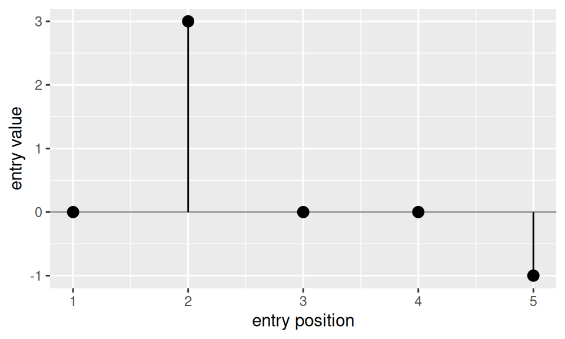
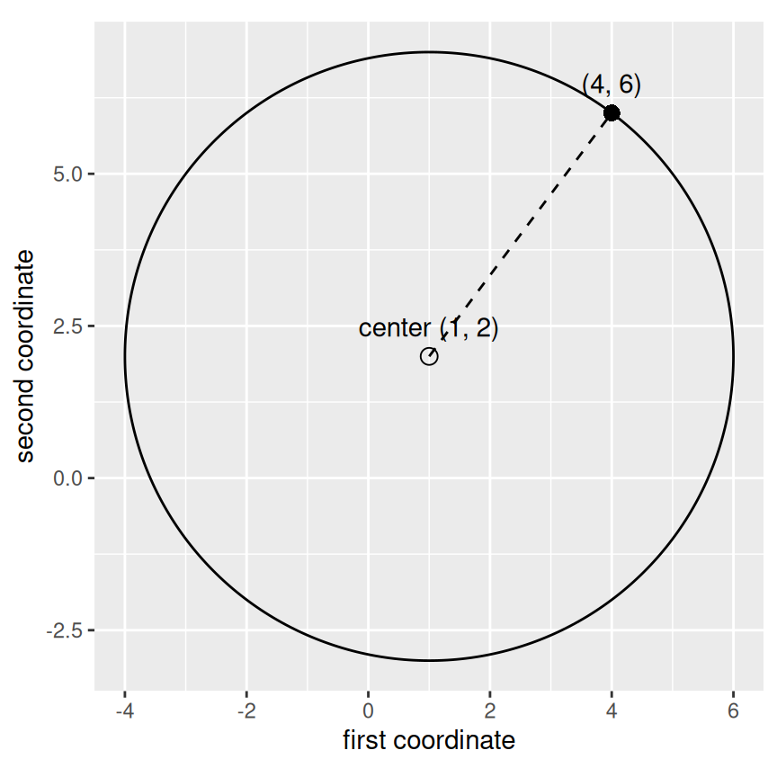

# Vectors

Code

Published

Last modified: 2026-11-23 17:43:07 (PST)

> **NOTE:**
>
> **Exercise 1 (Store a data point as one object)** A house has a floor area of $120$ square meters, $3$ bedrooms, and an age of $15$ years.
>
> 1.  Write these three numbers as a single vertical list $\mathord{\smash[b]{\underset{\raise.3ex\hbox{$\scriptstyle\sim$}}{x}}\vphantom{x}}$, in the order given, and call its entries $x_1$, $x_2$ and $x_3$. What is $x_2$?
> 2.  Does the list $(3, 120, 15)$ describe the same house?

> **NOTE:**
>
> *Solution 1*.
>
> 1.  Stacking the three numbers in order gives
>
>     $$\mathord{\smash[b]{\underset{\raise.3ex\hbox{$\scriptstyle\sim$}}{x}}\vphantom{x}}=
>     \begin{bmatrix}
>     120 \\
>     3 \\
>     15
>     \end{bmatrix},$$
>
>     so $x_2 = 3$, the number of bedrooms.
>
> 2.  No. The list $(3, 120, 15)$ would describe a house with $3$ square meters of floor area and $120$ bedrooms. An entry’s position says what it measures, so the order of the entries matters.

> **NOTE:**
>
> **Definition 1 (Column vector)** A **column vector** [\[1\]](#ref-wikipedia_row_and_column_vectors) of length $p$ is an ordered list of $p$ [real numbers](https://morrison-lab.github.io/mcs/number-systems.html#def-real-numbers), written vertically as a $p \times 1$ array:
>
> $$\mathord{\smash[b]{\underset{\raise.3ex\hbox{$\scriptstyle\sim$}}{x}}\vphantom{x}}=
> \begin{bmatrix}
> x_{1} \\
> x_{2} \\
> \vdots \\
> x_{p}
> \end{bmatrix}$$

> **NOTE:**
>
> *Remark 1* (Vectors are columns by default). In these notes, as in most statistics textbooks, a vector is a column vector unless stated otherwise. A vector written inline as a list in parentheses is still a column vector: for example, $\mathord{\smash[b]{\underset{\raise.3ex\hbox{$\scriptstyle\sim$}}{x}}\vphantom{x}}= (2, -1, 5)$ means
>
> $$\mathord{\smash[b]{\underset{\raise.3ex\hbox{$\scriptstyle\sim$}}{x}}\vphantom{x}}=
> \begin{bmatrix}
> 2 \\
> -1 \\
> 5
> \end{bmatrix}.$$

> **NOTE:**
>
> *Remark 2* (Why the vector mark sits under the symbol). In these notes, the mark that shows a symbol is a vector is a tilde under the letter, as in $\mathord{\smash[b]{\underset{\raise.3ex\hbox{$\scriptstyle\sim$}}{x}}\vphantom{x}}$. Many books instead use a bold letter or an arrow over the letter. We chose a mark underneath because bold letters are hard to write by hand on a board, and because the space above a letter is already used by the hat that marks an estimated value, as in $\hat{\mathord{\smash[b]{\underset{\raise.3ex\hbox{$\scriptstyle\sim$}}{\beta}}\vphantom{\beta}}}$. The [notation choices page](https://morrison-lab.github.io/macros/notation-choices.html#sec-vector-mark) gives the full reasons and an example of an estimated vector.

> **NOTE:**
>
> **Exercise 2 (Reading one entry of a column vector of temperatures)** A week of daily readings is often stored as a [column vector](#def-column-vector), with the reading for day $i$ in entry $i$. The noon temperatures on the Celsius scale on the first four days of a week are
>
> $$\mathord{\smash[b]{\underset{\raise.3ex\hbox{$\scriptstyle\sim$}}{x}}\vphantom{x}}= \begin{bmatrix}12 \\ 15 \\ 9 \\ 11\end{bmatrix}.$$
>
> Find $x_3$.
>
> > **TIP:**
> >
> > In [Definition 1](#def-column-vector), $x_i$ is the entry in position $i$, counting from the top.

> **NOTE:**
>
> *Solution 2*. $x_3 = 9$, the third entry from the top, so the noon temperature on day $3$ was $9$ on the Celsius scale.

> **NOTE:**
>
> **Definition 2 (The set** $\mathbb{R}^p$) For a [positive integer](https://morrison-lab.github.io/mcs/number-systems.html#def-positive-integer) $p$, $\mathbb{R}^p$ is the set of all [column vectors](#def-column-vector) of length $p$ whose entries are [real numbers](https://morrison-lab.github.io/mcs/number-systems.html#def-real-numbers).

> **NOTE:**
>
> *Remark 3* (Reading $\mathord{\smash[b]{\underset{\raise.3ex\hbox{$\scriptstyle\sim$}}{x}}\vphantom{x}}\in \mathbb{R}^p$). Writing $\mathord{\smash[b]{\underset{\raise.3ex\hbox{$\scriptstyle\sim$}}{x}}\vphantom{x}}\in \mathbb{R}^p$ says, in one symbol, that $\mathord{\smash[b]{\underset{\raise.3ex\hbox{$\scriptstyle\sim$}}{x}}\vphantom{x}}$ is a column vector with $p$ real entries. For example, $(1, -2, 0.5) \in \mathbb{R}^3$. The vector $(1, 2)$ is not in $\mathbb{R}^3$, because it has only $2$ entries; it is in $\mathbb{R}^2$. In [Exercise 1](#exr-list-as-vector), $\mathord{\smash[b]{\underset{\raise.3ex\hbox{$\scriptstyle\sim$}}{x}}\vphantom{x}}\in \mathbb{R}^3$.

> **NOTE:**
>
> **Exercise 3 (Testing whether a vector with entries** $\sqrt{2}$ and $\pi$ lies in $\mathbb{R}^3$) Entries such as $\sqrt{2}$ and $\pi$ have no exact decimal form, but they are still [real numbers](https://morrison-lab.github.io/mcs/number-systems.html#def-real-numbers). Let
>
> $$\mathord{\smash[b]{\underset{\raise.3ex\hbox{$\scriptstyle\sim$}}{v}}\vphantom{v}} = \begin{bmatrix}\sqrt{2} \\ \pi \\ -1\end{bmatrix}.$$
>
> Is $\mathord{\smash[b]{\underset{\raise.3ex\hbox{$\scriptstyle\sim$}}{v}}\vphantom{v}}$ in $\mathbb{R}^3$?
>
> > **TIP:**
> >
> > [Definition 2](#def-real-coordinate-space) has two conditions: the number of entries of the [column vector](#def-column-vector), and the kind of number in each entry.

> **NOTE:**
>
> *Solution 3*. Yes. $\mathord{\smash[b]{\underset{\raise.3ex\hbox{$\scriptstyle\sim$}}{v}}\vphantom{v}}$ is a [column vector](#def-column-vector) with $3$ entries, and each of $\sqrt{2}$, $\pi$ and $-1$ is a [real number](https://morrison-lab.github.io/mcs/number-systems.html#def-real-numbers), so $\mathord{\smash[b]{\underset{\raise.3ex\hbox{$\scriptstyle\sim$}}{v}}\vphantom{v}} \in \mathbb{R}^3$ by [Definition 2](#def-real-coordinate-space).

> **NOTE:**
>
> **Definition 3 (**$k$-sparse vector) For a vector $\mathord{\smash[b]{\underset{\raise.3ex\hbox{$\scriptstyle\sim$}}{x}}\vphantom{x}}$ in $\mathbb{R}^p$ and a whole number $k \le p$, $\mathord{\smash[b]{\underset{\raise.3ex\hbox{$\scriptstyle\sim$}}{x}}\vphantom{x}}$ is $k$-sparse if at most $k$ of its $p$ entries are nonzero.

> **NOTE:**
>
> **Example 1 (A** $2$-sparse vector) Take $\mathord{\smash[b]{\underset{\raise.3ex\hbox{$\scriptstyle\sim$}}{x}}\vphantom{x}}= {(0, 3, 0, 0, -1)}^{\top} \in \mathbb{R}^5$. It has two nonzero entries, $x_2 = 3$ and $x_5 = -1$, so it is $2$-sparse. It is also $3$-sparse, $4$-sparse and $5$-sparse, since “at most $k$” allows fewer. It is not $1$-sparse, because two of its entries are nonzero. [Figure 1](#fig-sparse-vector) draws each entry as a stem from zero.
>
> > **NOTE:**
> >
> > Show code
> >
> > ``` downlit
> > values <- c(0, 3, 0, 0, -1)
> > entries <- tibble::tibble(position = 1:5, value = values)
> >
> > entries |>
> >   ggplot2::ggplot() +
> >   ggplot2::aes(x = position, y = value) +
> >   ggplot2::geom_hline(yintercept = 0, colour = "grey60") +
> >   ggplot2::geom_segment(
> >     mapping = ggplot2::aes(xend = position, yend = 0)
> >   ) +
> >   ggplot2::geom_point(size = 3) +
> >   ggplot2::labs(x = "entry position", y = "entry value")
> > ```
> >
> > [](linear-algebra-vectors_files/figure-html/sparse-vector-plot-1.png "Figure 1: The entries of {(0, 3, 0, 0, -1)}^{\top}. Only two stems leave zero, so the vector is 2-sparse.")
> >
> > Figure 1: The entries of ${(0, 3, 0, 0, -1)}^{\top}$. Only two stems leave zero, so the vector is $2$-sparse.

> **NOTE:**
>
> **Definition 4 (Sparsity)** The **sparsity** of a vector $\mathord{\smash[b]{\underset{\raise.3ex\hbox{$\scriptstyle\sim$}}{x}}\vphantom{x}}$ in $\mathbb{R}^p$ [\[2\]](#ref-wikipedia_sparse_matrix) is the [fraction](algebra-sums.llms.md#def-quotient) of its $p$ entries that are zero.

> **NOTE:**
>
> **Example 2 (The sparsity of a** $2$-sparse vector) The vector ${(0, 3, 0, 0, -1)}^{\top}$ of [Example 1](#exm-sparse-vector) has three zero entries out of five, so its [sparsity](#def-sparsity) is $3/5$. In [Figure 1](#fig-sparse-vector), the three zero entries are the ones whose stems do not leave zero.

> **NOTE:**
>
> **Definition 5 (Scalar)** In linear algebra, a **scalar** [\[3\]](#ref-wikipedia_scalar_mathematics) is a single [real number](https://morrison-lab.github.io/mcs/number-systems.html#def-real-numbers), as opposed to a vector or a matrix, which holds several numbers.

> **NOTE:**
>
> **Example 3 (Scalars and a vector)** The numbers $5$ and $-0.2$ are scalars. The column vector $(5, -0.2)$ is not a scalar: it has $2$ entries, so it is in $\mathbb{R}^2$ ([Definition 2](#def-real-coordinate-space)), and each of its $2$ entries is a scalar.

> **NOTE:**
>
> **Exercise 4 (Picking out the scalars among class summaries)** A summary of a class of $30$ students can report single numbers or whole lists of numbers. Consider these three quantities:
>
> - the height of the tallest student in the class,
> - the list of every student’s height,
> - the number of students in the class.
>
> Which of these three quantities are [scalars](#def-scalar)?
>
> > **TIP:**
> >
> > By [Definition 5](#def-scalar), a [scalar](#def-scalar) is one [real number](https://morrison-lab.github.io/mcs/number-systems.html#def-real-numbers). Count the numbers in each quantity.

> **NOTE:**
>
> *Solution 4*. The tallest student’s height and the number of students are [scalars](#def-scalar): each is one [real number](https://morrison-lab.github.io/mcs/number-systems.html#def-real-numbers). The list of heights holds $30$ numbers, so it is a [column vector](#def-column-vector) in $\mathbb{R}^{30}$, not a scalar.

> **NOTE:**
>
> **Definition 6 (Real-valued function, scalar-valued function)** A [function](https://morrison-lab.github.io/mcs/functions.html#def-function) $f : A \to \mathbb{R}$, whose values are numbers, is **real-valued** (also called **scalar-valued**, since its values are [scalars](#def-scalar)).

> **NOTE:**
>
> **Definition 7 (Vector-valued function)** A function $f : A \to \mathbb{R}^m$, whose values are vectors ([Definition 2](#def-real-coordinate-space)), is **vector-valued**.

> **NOTE:**
>
> **Example 4 (A real-valued and a vector-valued function)** On $\mathbb{R}^2$, $f(\mathord{\smash[b]{\underset{\raise.3ex\hbox{$\scriptstyle\sim$}}{x}}\vphantom{x}}) = x_1 + x_2$ is real-valued and $g(\mathord{\smash[b]{\underset{\raise.3ex\hbox{$\scriptstyle\sim$}}{x}}\vphantom{x}}) = \begin{bmatrix}x_1 + x_2 \\ x_1 - x_2\end{bmatrix}$ is vector-valued:
>
> $$f\mathopen{}\left(\begin{bmatrix}3 \\ 4\end{bmatrix}\right)\mathclose{} = 3 + 4 = 7,
> \qquad
> g\mathopen{}\left(\begin{bmatrix}3 \\ 4\end{bmatrix}\right)\mathclose{} = \begin{bmatrix}3 + 4 \\ 3 - 4\end{bmatrix} = \begin{bmatrix}7 \\ -1\end{bmatrix}$$

> **NOTE:**
>
> **Exercise 5 (Testing whether a price prediction is real-valued)** A model predicts a house’s price from three of its features, stored in $\mathord{\smash[b]{\underset{\raise.3ex\hbox{$\scriptstyle\sim$}}{x}}\vphantom{x}}\in \mathbb{R}^3$, with the [function](https://morrison-lab.github.io/mcs/functions.html#def-function)
>
> $$f(\mathord{\smash[b]{\underset{\raise.3ex\hbox{$\scriptstyle\sim$}}{x}}\vphantom{x}}) = 2 x_1 + 5 x_2 - x_3.$$
>
> Is $f$ [real-valued](#def-real-vector-valued)?
>
> > **TIP:**
> >
> > Evaluate $f$ at one point, and count the numbers in the result.

> **NOTE:**
>
> *Solution 5*. Yes. For every $\mathord{\smash[b]{\underset{\raise.3ex\hbox{$\scriptstyle\sim$}}{x}}\vphantom{x}}\in \mathbb{R}^3$, $2 x_1 + 5 x_2 - x_3$ is one [real number](https://morrison-lab.github.io/mcs/number-systems.html#def-real-numbers), so $f : \mathbb{R}^3 \to \mathbb{R}$ is [real-valued](#def-real-vector-valued). For example, $f\mathopen{}\left(\begin{bmatrix}1 \\ 1 \\ 1\end{bmatrix}\right)\mathclose{} = 2 + 5 - 1 = 6$.

> **NOTE:**
>
> **Exercise 6 (Evaluating a vector-valued function at one input)** A [vector-valued function](#def-vector-valued) returns several numbers for one input. Let $g : \mathbb{R}^2 \to \mathbb{R}^3$ be
>
> $$g(\mathord{\smash[b]{\underset{\raise.3ex\hbox{$\scriptstyle\sim$}}{x}}\vphantom{x}}) = \begin{bmatrix}x_1 + x_2 \\ x_1 x_2 \\ x_1 - x_2\end{bmatrix}.$$
>
> Find $g\mathopen{}\left(\begin{bmatrix}2 \\ 3\end{bmatrix}\right)\mathclose{}$.
>
> > **TIP:**
> >
> > Substitute $x_1 = 2$ and $x_2 = 3$ into each entry, as in [Example 4](#exm-real-vector-valued).

> **NOTE:**
>
> *Solution 6*. Substituting $x_1 = 2$ and $x_2 = 3$,
>
> $$g\mathopen{}\left(\begin{bmatrix}2 \\ 3\end{bmatrix}\right)\mathclose{} = \begin{bmatrix}2 + 3 \\ 2 \cdot 3 \\ 2 - 3\end{bmatrix} = \begin{bmatrix}5 \\ 6 \\ -1\end{bmatrix},$$
>
> a [column vector](#def-column-vector) in $\mathbb{R}^3$.

> **NOTE:**
>
> **Definition 8 (Transpose)** The **transpose** of a column vector $\mathord{\smash[b]{\underset{\raise.3ex\hbox{$\scriptstyle\sim$}}{x}}\vphantom{x}}$ is the row vector with the same [sequence](https://morrison-lab.github.io/mcs/functions.html#def-sequence) of entries, written horizontally:
>
> $${\mathord{\smash[b]{\underset{\raise.3ex\hbox{$\scriptstyle\sim$}}{x}}\vphantom{x}}}^{\top} \equiv \mathord{\smash[b]{\underset{\raise.3ex\hbox{$\scriptstyle\sim$}}{x}}\vphantom{x}}' \equiv [x_1,\; x_2,\; \ldots,\; x_p]$$

> **NOTE:**
>
> **Example 5 (Transposing a column vector)** The transpose of the column vector with entries $2$, $-1$, $5$ is the row vector with the same entries:
>
> $${\begin{bmatrix} 2 \\ -1 \\ 5 \end{bmatrix}}^{\top}
> = [2,\; -1,\; 5].$$

> **NOTE:**
>
> **Exercise 7 (Writing one observation as a row vector)** A data table stores each observation on its own line, so an observation held as a [column vector](#def-column-vector) is written in the table as its [transpose](#def-transpose). Let
>
> $$\mathord{\smash[b]{\underset{\raise.3ex\hbox{$\scriptstyle\sim$}}{x}}\vphantom{x}}= \begin{bmatrix}4 \\ -1 \\ 0\end{bmatrix}.$$
>
> Find ${\mathord{\smash[b]{\underset{\raise.3ex\hbox{$\scriptstyle\sim$}}{x}}\vphantom{x}}}^{\top}$.
>
> > **TIP:**
> >
> > By [Definition 8](#def-transpose), keep the entries in the same order and write them horizontally.

> **NOTE:**
>
> *Solution 7*. By [Definition 8](#def-transpose),
>
> $${\mathord{\smash[b]{\underset{\raise.3ex\hbox{$\scriptstyle\sim$}}{x}}\vphantom{x}}}^{\top} = [4,\; -1,\; 0].$$

> **NOTE:**
>
> **Definition 9 (Vector addition)** The **sum** of two column vectors $\mathord{\smash[b]{\underset{\raise.3ex\hbox{$\scriptstyle\sim$}}{x}}\vphantom{x}}$ and $\mathord{\smash[b]{\underset{\raise.3ex\hbox{$\scriptstyle\sim$}}{y}}\vphantom{y}}$ of the same length $p$ is the column vector $\mathord{\smash[b]{\underset{\raise.3ex\hbox{$\scriptstyle\sim$}}{x}}\vphantom{x}}+ \mathord{\smash[b]{\underset{\raise.3ex\hbox{$\scriptstyle\sim$}}{y}}\vphantom{y}}$ of length $p$ obtained by adding entry by entry:
>
> $$(\mathord{\smash[b]{\underset{\raise.3ex\hbox{$\scriptstyle\sim$}}{x}}\vphantom{x}}+ \mathord{\smash[b]{\underset{\raise.3ex\hbox{$\scriptstyle\sim$}}{y}}\vphantom{y}})_i \stackrel{\text{def}}{=}x_i + y_i, \quad i = 1, \ldots, p$$

> **NOTE:**
>
> **Example 6 (Adding two vectors)** $$\begin{aligned}
> \begin{bmatrix} 1 \\ 2 \\ 3 \end{bmatrix}
> +
> \begin{bmatrix} 4 \\ 5 \\ 6 \end{bmatrix}
> &=
> \begin{bmatrix} 1 + 4 \\ 2 + 5 \\ 3 + 6 \end{bmatrix} \\
> &=
> \begin{bmatrix} 5 \\ 7 \\ 9 \end{bmatrix}
> \end{aligned}$$

> **NOTE:**
>
> **Exercise 8 (Adding two months of sales for three items)** A shop records how many units of each of three items it sells in a month, as a [column vector](#def-column-vector) in $\mathbb{R}^3$. In two months it sells
>
> $$\mathord{\smash[b]{\underset{\raise.3ex\hbox{$\scriptstyle\sim$}}{x}}\vphantom{x}}= \begin{bmatrix}12 \\ 5 \\ 8\end{bmatrix}
> \quad \text{and} \quad
> \mathord{\smash[b]{\underset{\raise.3ex\hbox{$\scriptstyle\sim$}}{y}}\vphantom{y}}= \begin{bmatrix}10 \\ 7 \\ 3\end{bmatrix}$$
>
> units.
>
> Find $\mathord{\smash[b]{\underset{\raise.3ex\hbox{$\scriptstyle\sim$}}{x}}\vphantom{x}}+ \mathord{\smash[b]{\underset{\raise.3ex\hbox{$\scriptstyle\sim$}}{y}}\vphantom{y}}$, the units of each item sold over both months.
>
> > **TIP:**
> >
> > Use [Definition 9](#def-vector-addition), as in [Example 6](#exm-vector-addition).

> **NOTE:**
>
> *Solution 8*. By [Definition 9](#def-vector-addition),
>
> $$\mathord{\smash[b]{\underset{\raise.3ex\hbox{$\scriptstyle\sim$}}{x}}\vphantom{x}}+ \mathord{\smash[b]{\underset{\raise.3ex\hbox{$\scriptstyle\sim$}}{y}}\vphantom{y}}= \begin{bmatrix}12 + 10 \\ 5 + 7 \\ 8 + 3\end{bmatrix} = \begin{bmatrix}22 \\ 12 \\ 11\end{bmatrix}.$$

> **NOTE:**
>
> **Definition 10 (Dot product)** For any two real-valued vectors $\mathord{\smash[b]{\underset{\raise.3ex\hbox{$\scriptstyle\sim$}}{x}}\vphantom{x}}= (x_1, \ldots, x_p)$ and $\mathord{\smash[b]{\underset{\raise.3ex\hbox{$\scriptstyle\sim$}}{y}}\vphantom{y}}= (y_1, \ldots, y_p)$ of the same length $p$, the **dot product** of $\mathord{\smash[b]{\underset{\raise.3ex\hbox{$\scriptstyle\sim$}}{x}}\vphantom{x}}$ and $\mathord{\smash[b]{\underset{\raise.3ex\hbox{$\scriptstyle\sim$}}{y}}\vphantom{y}}$ is:
>
> $$\mathord{\smash[b]{\underset{\raise.3ex\hbox{$\scriptstyle\sim$}}{x}}\vphantom{x}}\cdot \mathord{\smash[b]{\underset{\raise.3ex\hbox{$\scriptstyle\sim$}}{y}}\vphantom{y}}= \mathord{\smash[b]{\underset{\raise.3ex\hbox{$\scriptstyle\sim$}}{x}}\vphantom{x}}^{\top} \mathord{\smash[b]{\underset{\raise.3ex\hbox{$\scriptstyle\sim$}}{y}}\vphantom{y}}\stackrel{\text{def}}{=}\sum_{i=1}^px_i y_i \tag{1}$$

See also the definitions in:

- Dobson and Barnett [\[4\]](#ref-dobson4e), Section 1.3 (equation 1.1, page 7)

- Kaplan [\[5\]](#ref-mosaiccalc), chapter on vectors

- [wikipedia](https://en.wikipedia.org/wiki/Linear_combination)

The dot product has a different generalization for two matrices; see [wikipedia](https://en.wikipedia.org/wiki/Dot_product#Dyadics_and_matrices) for more.

> **NOTE:**
>
> **Example 7 (A dot product)** For $\mathord{\smash[b]{\underset{\raise.3ex\hbox{$\scriptstyle\sim$}}{x}}\vphantom{x}}= (1, 2, 3)$ and $\mathord{\smash[b]{\underset{\raise.3ex\hbox{$\scriptstyle\sim$}}{y}}\vphantom{y}}= (4, 5, 6)$:
>
> $$\begin{aligned}
> \mathord{\smash[b]{\underset{\raise.3ex\hbox{$\scriptstyle\sim$}}{x}}\vphantom{x}}\cdot \mathord{\smash[b]{\underset{\raise.3ex\hbox{$\scriptstyle\sim$}}{y}}\vphantom{y}}
> &= 1 \cdot 4 + 2 \cdot 5 + 3 \cdot 6
> && \text{(definition of the dot product)}
> \\
> &= 4 + 10 + 18
> && \text{(multiply)}
> \\
> &= 32
> && \text{(add)}
> \end{aligned}$$

> **NOTE:**
>
> **Definition 11 (Linear combination)** A **linear combination** of the numbers $a_1, \ldots, a_k$ with coefficients $c_1, \ldots, c_k$ is the [sum](algebra-sums.llms.md#def-summation)
>
> $$c_1 a_1 + \cdots + c_k a_k = \sum_{i=1}^{k} c_i a_i$$
>
> A linear combination of vectors $\mathord{\smash[b]{\underset{\raise.3ex\hbox{$\scriptstyle\sim$}}{v}}\vphantom{v}}_1, \ldots, \mathord{\smash[b]{\underset{\raise.3ex\hbox{$\scriptstyle\sim$}}{v}}\vphantom{v}}_k$ of the same length is defined entry by entry: entry $j$ of $\sum_{i=1}^{k} c_i \mathord{\smash[b]{\underset{\raise.3ex\hbox{$\scriptstyle\sim$}}{v}}\vphantom{v}}_i$ is the linear combination of the $j$th entries of $\mathord{\smash[b]{\underset{\raise.3ex\hbox{$\scriptstyle\sim$}}{v}}\vphantom{v}}_1, \ldots, \mathord{\smash[b]{\underset{\raise.3ex\hbox{$\scriptstyle\sim$}}{v}}\vphantom{v}}_k$ with the same coefficients.

> **NOTE:**
>
> **Definition 12 (Coefficients of a linear combination)** The numbers $c_1, \ldots, c_k$ in a linear combination ([Definition 11](#def-linear-combination)) $\sum_{i=1}^{k} c_i a_i$ are its **coefficients**.

> **NOTE:**
>
> **Example 8 (Coefficients of a linear combination of numbers)** The linear combination of the numbers $4$ and $5$ with coefficients $2$ and $3$ is $2 \cdot 4 + 3 \cdot 5 = 8 + 15 = 23$.

> **NOTE:**
>
> **Definition 13 (Weighted sum)** A **weighted sum** of the [numbers](https://morrison-lab.github.io/mcs/number-systems.html#def-real-numbers) $a_1, \ldots, a_k$ is a [linear combination](#def-linear-combination) of them, with [coefficients](#def-lincom-coefficient) $w_1, \ldots, w_k$:
>
> $$w_1 a_1 + \cdots + w_k a_k = \sum_{i=1}^{k} w_i a_i$$
>
> Multiply each $a_i$ by its coefficient $w_i$, then add.

> **NOTE:**
>
> **Definition 14 (Weight)** The [coefficients](#def-lincom-coefficient) $w_1, \ldots, w_k$ of a [weighted sum](#def-weighted-sum) $\sum_{i=1}^{k} w_i a_i$ are called its **weights**. The weight $w_i$ says how much $a_i$ counts.

> **NOTE:**
>
> **Example 9 (The total price of a shopping basket)** A basket holds $3$ items that cost $\$2$ each and $2$ items that cost $\$5$ each. The total price is the [weighted sum](#def-weighted-sum) of the prices $2$ and $5$ with [weights](#def-weight) $3$ and $2$, the count of items at each price:
>
> $$\begin{aligned}
> 3 \cdot 2 + 2 \cdot 5
> &= 6 + 10
> && \text{(multiply each price by its weight)}
> \\
> &= 16
> && \text{(add)}
> \end{aligned}$$

> **NOTE:**
>
> **Definition 15 (Weighted average, weighted mean)** A **weighted average** (or **weighted mean**) of the [numbers](https://morrison-lab.github.io/mcs/number-systems.html#def-real-numbers) $a_1, \ldots, a_k$ is a [weighted sum](#def-weighted-sum) of them whose [weights](#def-weight) $w_1, \ldots, w_k$ are non-negative and add to $1$:
>
> $$\sum_{i=1}^{k} w_i a_i
> \quad\text{with}\quad
> w_i \ge 0 \text{ for each } i
> \quad\text{and}\quad
> \sum_{i=1}^{k} w_i = 1$$
>
> An $a_i$ with a larger [weight](#def-weight) counts for more.

> **NOTE:**
>
> **Example 10 (A course grade)** A course grade counts the midterm for $1/4$ and the final for $3/4$. A student scores $70$ on the midterm and $90$ on the final. The [weights](#def-weight) $1/4$ and $3/4$ are non-negative and add to $1$, so the grade is a [weighted average](#def-weighted-average) of $70$ and $90$:
>
> $$\begin{aligned}
> \frac{1}{4} \cdot 70 + \frac{3}{4} \cdot 90
> &= 17.5 + 67.5
> && \text{(multiply each score by its weight)}
> \\
> &= 85
> && \text{(add)}
> \end{aligned}$$
>
> The grade $85$ lies between $70$ and $90$, and nearer to $90$, which has the larger [weight](#def-weight).

> **NOTE:**
>
> **Example 11 (A linear combination of two vectors)** The linear combination of ${(1, 0)}^{\top}$ and ${(0, 1)}^{\top}$ with coefficients $2$ and $3$ is ${(2 \cdot 1 + 3 \cdot 0,\ 2 \cdot 0 + 3 \cdot 1)}^{\top} = {(2, 3)}^{\top}$.

> **NOTE:**
>
> *Remark 4* (The dot product is a linear combination). The dot product $\mathord{\smash[b]{\underset{\raise.3ex\hbox{$\scriptstyle\sim$}}{x}}\vphantom{x}}\cdot \mathord{\smash[b]{\underset{\raise.3ex\hbox{$\scriptstyle\sim$}}{y}}\vphantom{y}}$ is a linear combination ([Definition 11](#def-linear-combination)) of the entries of $\mathord{\smash[b]{\underset{\raise.3ex\hbox{$\scriptstyle\sim$}}{y}}\vphantom{y}}$, with coefficients $x_1, \ldots, x_p$. In [Example 7](#exm-dot-product), $\mathord{\smash[b]{\underset{\raise.3ex\hbox{$\scriptstyle\sim$}}{x}}\vphantom{x}}\cdot \mathord{\smash[b]{\underset{\raise.3ex\hbox{$\scriptstyle\sim$}}{y}}\vphantom{y}}= 1 \cdot 4 + 2 \cdot 5 + 3 \cdot 6$ is the linear combination of $4$, $5$, and $6$ with coefficients $1$, $2$, and $3$.
>
> The dot product is also the standard *inner product* on $\mathbb{R}^p$; “inner product” is the general notion ([Definition 5 in Inner Products and the Cauchy-Schwarz Inequality](linear-algebra-inner-products.llms.md#def-inner-product), later in these notes), of which the dot product is one example.

> **NOTE:**
>
> **Theorem 1 (Dot product is symmetric)** The dot product is symmetric:
>
> $$\mathord{\smash[b]{\underset{\raise.3ex\hbox{$\scriptstyle\sim$}}{x}}\vphantom{x}}\cdot \mathord{\smash[b]{\underset{\raise.3ex\hbox{$\scriptstyle\sim$}}{y}}\vphantom{y}}= \mathord{\smash[b]{\underset{\raise.3ex\hbox{$\scriptstyle\sim$}}{y}}\vphantom{y}}\cdot \mathord{\smash[b]{\underset{\raise.3ex\hbox{$\scriptstyle\sim$}}{x}}\vphantom{x}}$$

> **NOTE:**
>
> *Proof*. $$\begin{aligned}
> \mathord{\smash[b]{\underset{\raise.3ex\hbox{$\scriptstyle\sim$}}{x}}\vphantom{x}}\cdot \mathord{\smash[b]{\underset{\raise.3ex\hbox{$\scriptstyle\sim$}}{y}}\vphantom{y}}
> &= \sum_{i=1}^px_i y_i
> && \text{(definition of the dot product)}
> \\
> &= \sum_{i=1}^py_i x_i
> && \text{(products of numbers are symmetric)}
> \\
> &= \mathord{\smash[b]{\underset{\raise.3ex\hbox{$\scriptstyle\sim$}}{y}}\vphantom{y}}\cdot \mathord{\smash[b]{\underset{\raise.3ex\hbox{$\scriptstyle\sim$}}{x}}\vphantom{x}}
> && \text{(definition of the dot product)}
> \end{aligned}$$

# 1 Special vectors

> **NOTE:**
>
> **Definition 16 (Zero vector)** The **zero vector** $\mathord{\smash[b]{\underset{\raise.3ex\hbox{$\scriptstyle\sim$}}{0}}\vphantom{0}}$ of length $p$ has all entries equal to zero:
>
> $$\mathord{\smash[b]{\underset{\raise.3ex\hbox{$\scriptstyle\sim$}}{0}}\vphantom{0}}=
> \begin{bmatrix}
> 0 \\
> 0 \\
> \vdots \\
> 0
> \end{bmatrix}$$

> **NOTE:**
>
> *Remark 5* (The zero vector is the additive identity). Adding the zero vector to a vector leaves it unchanged ([Definition 9](#def-vector-addition)): $\mathord{\smash[b]{\underset{\raise.3ex\hbox{$\scriptstyle\sim$}}{x}}\vphantom{x}}+ \mathord{\smash[b]{\underset{\raise.3ex\hbox{$\scriptstyle\sim$}}{0}}\vphantom{0}}= \mathord{\smash[b]{\underset{\raise.3ex\hbox{$\scriptstyle\sim$}}{x}}\vphantom{x}}$ for any vector $\mathord{\smash[b]{\underset{\raise.3ex\hbox{$\scriptstyle\sim$}}{x}}\vphantom{x}}$ of the same length, so $\mathord{\smash[b]{\underset{\raise.3ex\hbox{$\scriptstyle\sim$}}{0}}\vphantom{0}}$ is the [identity element](algebra-sums.llms.md#def-identity-element) for vector addition. For example,
>
> $$\begin{aligned}
> (2, -1) + (0, 0) &= (2 + 0, -1 + 0) \\
> &= (2, -1).
> \end{aligned}$$

> **NOTE:**
>
> **Exercise 9 (Picking the zero vector with three entries from three candidates)** A [zero vector](#def-zero-vector) has a number of entries as well as zero entries, so $\mathord{\smash[b]{\underset{\raise.3ex\hbox{$\scriptstyle\sim$}}{0}}\vphantom{0}}\in \mathbb{R}^2$ and $\mathord{\smash[b]{\underset{\raise.3ex\hbox{$\scriptstyle\sim$}}{0}}\vphantom{0}}\in \mathbb{R}^3$ are different vectors. Consider three candidates:
>
> $$\mathord{\smash[b]{\underset{\raise.3ex\hbox{$\scriptstyle\sim$}}{a}}\vphantom{a}} = \begin{bmatrix}0 \\ 0\end{bmatrix},
> \qquad
> \mathord{\smash[b]{\underset{\raise.3ex\hbox{$\scriptstyle\sim$}}{b}}\vphantom{b}} = \begin{bmatrix}0 \\ 0 \\ 0\end{bmatrix},
> \qquad
> \mathord{\smash[b]{\underset{\raise.3ex\hbox{$\scriptstyle\sim$}}{c}}\vphantom{c}} = \begin{bmatrix}0 \\ 1 \\ 0\end{bmatrix}.$$
>
> Which of the three candidates is the zero vector with $3$ entries?
>
> > **TIP:**
> >
> > [Definition 16](#def-zero-vector) has two conditions: $3$ entries, and $0$ in every entry.

> **NOTE:**
>
> *Solution 9*. Only $\mathord{\smash[b]{\underset{\raise.3ex\hbox{$\scriptstyle\sim$}}{b}}\vphantom{b}}$. $\mathord{\smash[b]{\underset{\raise.3ex\hbox{$\scriptstyle\sim$}}{a}}\vphantom{a}}$ has only $2$ entries, so it is the [zero vector](#def-zero-vector) in $\mathbb{R}^2$, and $\mathord{\smash[b]{\underset{\raise.3ex\hbox{$\scriptstyle\sim$}}{c}}\vphantom{c}}$ has a nonzero second entry.

> **NOTE:**
>
> **Definition 17 (Mean, average)** The **mean** [\[6\]](#ref-wikipedia_arithmetic_mean) (or **average**) of $n$ numbers $y_1, \ldots, y_n$ is their [sum](algebra-sums.llms.md#def-summation) divided by how many there are:
>
> $$\bar{y} \stackrel{\text{def}}{=}\frac{1}{n}\sum_{i=1}^ny_i$$

> **NOTE:**
>
> **Example 12 (The mean of three numbers)** For $y_1 = 2$, $y_2 = -1$ and $y_3 = 5$:
>
> $$\begin{aligned}
> \bar{y}
> &= \frac{1}{3}\,\mathopen{}\left(2 + (-1) + 5\right)\mathclose{}
> && \text{(definition of the mean, with } n = 3 \text{)}
> \\
> &= \frac{1}{3} \cdot 6
> && \text{(add)}
> \\
> &= 2
> && \text{(multiply)}
> \end{aligned}$$

> **NOTE:**
>
> *Remark 6* (The sample mean estimates the population mean). When the numbers are observed data values, $\bar{y}$ is also called the sample mean, an estimator of the [population mean](https://morrison-lab.github.io/pds/expectation.html#def-expectation).

> **NOTE:**
>
> **Exercise 10 (Finding the mean age of four siblings)** Four siblings are $3$, $7$, $10$ and $12$ years old.
>
> Find the [mean](#def-mean) of their ages.
>
> > **TIP:**
> >
> > Use [Definition 17](#def-mean) with $n = 4$, as in [Example 12](#exm-mean).

> **NOTE:**
>
> *Solution 10*. By [Definition 17](#def-mean) with $n = 4$,
>
> $$\bar{y} = \frac{1}{4}\,\mathopen{}\left(3 + 7 + 10 + 12\right)\mathclose{} = \frac{32}{4} = 8,$$
>
> so the [mean](#def-mean) age is $8$ years.

> **NOTE:**
>
> **Definition 18 (Harmonic mean)** The **harmonic mean** of two positive numbers $x$ and $y$ is the [reciprocal](https://morrison-lab.github.io/mcs/number-systems.html#def-reciprocal) of the [average](#def-mean) of their reciprocals:
>
> $$H(x, y) \stackrel{\text{def}}{=}\frac{2}{\frac{1}{x} + \frac{1}{y}} \tag{2}$$
>
> Source: Wikipedia contributors [\[7\]](#ref-wikipedia_harmonic_mean).

> **NOTE:**
>
> **Example 13 (Harmonic mean of 0.5 and 1)** By [Definition 18](#def-harmonic-mean):
>
> $$\begin{aligned}
> H(0.5, 1)
> &= \frac{2}{\frac{1}{0.5} + \frac{1}{1}}
> && \text{(definition of } H \text{)} \\
> &= \frac{2}{2 + 1}
> && \text{(take each reciprocal)} \\
> &= \frac{2}{3}
> && \text{(add)} \\
> &\approx 0.667
> && \text{(divide)}
> \end{aligned}
> \tag{3}$$
>
> The ordinary [average](#def-mean) of 0.5 and 1 is 0.75; the [harmonic mean](#def-harmonic-mean) sits closer to the smaller number.

> **NOTE:**
>
> **Definition 19 (Ones vector)** The **ones vector** $\mathord{\smash[b]{\underset{\raise.3ex\hbox{$\scriptstyle\sim$}}{1}}\vphantom{1}}$ of length $p$ has all entries equal to one:
>
> $$\mathord{\smash[b]{\underset{\raise.3ex\hbox{$\scriptstyle\sim$}}{1}}\vphantom{1}} =
> \begin{bmatrix}
> 1 \\
> 1 \\
> \vdots \\
> 1
> \end{bmatrix}$$

> **NOTE:**
>
> **Exercise 11 (Adding one to every entry with the ones vector)** Adding the [ones vector](#def-ones-vector) to a vector raises every entry by $1$, for example to shift a list of counts that start at $0$ so that they start at $1$. Let
>
> $$\mathord{\smash[b]{\underset{\raise.3ex\hbox{$\scriptstyle\sim$}}{x}}\vphantom{x}}= \begin{bmatrix}2 \\ 0 \\ -1\end{bmatrix}.$$
>
> Find $\mathord{\smash[b]{\underset{\raise.3ex\hbox{$\scriptstyle\sim$}}{x}}\vphantom{x}}+ \mathord{\smash[b]{\underset{\raise.3ex\hbox{$\scriptstyle\sim$}}{1}}\vphantom{1}}$, where $\mathord{\smash[b]{\underset{\raise.3ex\hbox{$\scriptstyle\sim$}}{1}}\vphantom{1}}$ has $3$ entries.
>
> > **TIP:**
> >
> > Write out $\mathord{\smash[b]{\underset{\raise.3ex\hbox{$\scriptstyle\sim$}}{1}}\vphantom{1}}$ with [Definition 19](#def-ones-vector), then use [Definition 9](#def-vector-addition).

> **NOTE:**
>
> *Solution 11*. By [Definition 19](#def-ones-vector), $\mathord{\smash[b]{\underset{\raise.3ex\hbox{$\scriptstyle\sim$}}{1}}\vphantom{1}} = {(1, 1, 1)}^{\top}$, so by [Definition 9](#def-vector-addition)
>
> $$\mathord{\smash[b]{\underset{\raise.3ex\hbox{$\scriptstyle\sim$}}{x}}\vphantom{x}}+ \mathord{\smash[b]{\underset{\raise.3ex\hbox{$\scriptstyle\sim$}}{1}}\vphantom{1}} = \begin{bmatrix}2 + 1 \\ 0 + 1 \\ -1 + 1\end{bmatrix} = \begin{bmatrix}3 \\ 1 \\ 0\end{bmatrix}.$$

> **NOTE:**
>
> **Definition 20 (Sum of the elements of a vector)** The **sum of the elements** of a vector $\mathord{\smash[b]{\underset{\raise.3ex\hbox{$\scriptstyle\sim$}}{x}}\vphantom{x}}\in \mathbb{R}^p$ is the [sum](algebra-sums.llms.md#def-summation) of its entries:
>
> $${s_{\mathord{\smash[b]{\underset{\raise.3ex\hbox{$\scriptstyle\sim$}}{x}}\vphantom{x}}}} \stackrel{\text{def}}{=}\sum_{i=1}^px_i.$$
>
> In words, ${s_{\mathord{\smash[b]{\underset{\raise.3ex\hbox{$\scriptstyle\sim$}}{x}}\vphantom{x}}}}$ is the entries of $\mathord{\smash[b]{\underset{\raise.3ex\hbox{$\scriptstyle\sim$}}{x}}\vphantom{x}}$ added together.

> **NOTE:**
>
> **Example 14 (The sum of the elements of a vector with three entries)** For $\mathord{\smash[b]{\underset{\raise.3ex\hbox{$\scriptstyle\sim$}}{x}}\vphantom{x}}= (2, -1, 5)$,
>
> $$\begin{aligned}
> {s_{\mathord{\smash[b]{\underset{\raise.3ex\hbox{$\scriptstyle\sim$}}{x}}\vphantom{x}}}}
> &= 2 + (-1) + 5
> && \text{(definition of the sum of the elements, with } p = 3 \text{)}
> \\
> &= 6.
> && \text{(add)}
> \end{aligned}$$

> **NOTE:**
>
> **Exercise 12 (Totaling the units sold across three items)** A shop sells $22$, $12$ and $11$ units of three items over two months, stored as
>
> $$\mathord{\smash[b]{\underset{\raise.3ex\hbox{$\scriptstyle\sim$}}{x}}\vphantom{x}}= \begin{bmatrix}22 \\ 12 \\ 11\end{bmatrix}.$$
>
> Find ${s_{\mathord{\smash[b]{\underset{\raise.3ex\hbox{$\scriptstyle\sim$}}{x}}\vphantom{x}}}}$, the [sum of the elements](#def-sum-of-elements) of $\mathord{\smash[b]{\underset{\raise.3ex\hbox{$\scriptstyle\sim$}}{x}}\vphantom{x}}$.
>
> > **TIP:**
> >
> > Use [Definition 20](#def-sum-of-elements) with $p = 3$, as in [Example 14](#exm-sum-of-elements).

> **NOTE:**
>
> *Solution 12*. By [Definition 20](#def-sum-of-elements),
>
> $${s_{\mathord{\smash[b]{\underset{\raise.3ex\hbox{$\scriptstyle\sim$}}{x}}\vphantom{x}}}} = 22 + 12 + 11 = 45,$$
>
> so the shop sold $45$ units in all.

> **NOTE:**
>
> **Theorem 2 (The ones vector sums the entries)** For every $\mathord{\smash[b]{\underset{\raise.3ex\hbox{$\scriptstyle\sim$}}{x}}\vphantom{x}}\in \mathbb{R}^p$, the [sum of the elements](#def-sum-of-elements) of $\mathord{\smash[b]{\underset{\raise.3ex\hbox{$\scriptstyle\sim$}}{x}}\vphantom{x}}$ is the [dot product](#def-dot-product) of the [ones vector](#def-ones-vector) with $\mathord{\smash[b]{\underset{\raise.3ex\hbox{$\scriptstyle\sim$}}{x}}\vphantom{x}}$:
>
> $${s_{\mathord{\smash[b]{\underset{\raise.3ex\hbox{$\scriptstyle\sim$}}{x}}\vphantom{x}}}} = \mathord{\smash[b]{\underset{\raise.3ex\hbox{$\scriptstyle\sim$}}{1}}\vphantom{1}} \cdot \mathord{\smash[b]{\underset{\raise.3ex\hbox{$\scriptstyle\sim$}}{x}}\vphantom{x}}.$$

> **NOTE:**
>
> *Proof*. $$\begin{aligned}
> \mathord{\smash[b]{\underset{\raise.3ex\hbox{$\scriptstyle\sim$}}{1}}\vphantom{1}} \cdot \mathord{\smash[b]{\underset{\raise.3ex\hbox{$\scriptstyle\sim$}}{x}}\vphantom{x}}
> &= \sum_{i=1}^p1 \cdot x_i
> && \text{(}\href{#def-dot-product}{\text{Definition~10}}\text{, with every entry of } \mathord{\smash[b]{\underset{\raise.3ex\hbox{$\scriptstyle\sim$}}{1}}\vphantom{1}} \text{ equal to } 1 \text{)}
> \\
> &= \sum_{i=1}^px_i
> && \text{(multiply each entry by } 1 \text{)}
> \\
> &= {s_{\mathord{\smash[b]{\underset{\raise.3ex\hbox{$\scriptstyle\sim$}}{x}}\vphantom{x}}}}.
> && \text{(}\href{#def-sum-of-elements}{\text{Definition~20}}\text{)}
> \end{aligned}$$

> **NOTE:**
>
> **Example 15 (The ones vector applied to a vector with three entries)** For $\mathord{\smash[b]{\underset{\raise.3ex\hbox{$\scriptstyle\sim$}}{x}}\vphantom{x}}= (2, -1, 5)$ and the [ones vector](#def-ones-vector) $\mathord{\smash[b]{\underset{\raise.3ex\hbox{$\scriptstyle\sim$}}{1}}\vphantom{1}}$ with three entries,
>
> $$\begin{aligned}
> \mathord{\smash[b]{\underset{\raise.3ex\hbox{$\scriptstyle\sim$}}{1}}\vphantom{1}} \cdot \mathord{\smash[b]{\underset{\raise.3ex\hbox{$\scriptstyle\sim$}}{x}}\vphantom{x}}
> &= 1 \cdot 2 + 1 \cdot(-1) + 1 \cdot 5
> && \text{(}\href{#def-dot-product}{\text{Definition~10}}\text{)}
> \\
> &= 6,
> && \text{(multiply and add)}
> \end{aligned}$$
>
> which is ${s_{\mathord{\smash[b]{\underset{\raise.3ex\hbox{$\scriptstyle\sim$}}{x}}\vphantom{x}}}}$, as in [Example 14](#exm-sum-of-elements). Dividing by $p = 3$ gives the [mean](#def-mean) of the entries, $6 / 3 = 2$.

> **NOTE:**
>
> **Exercise 13 (Summing entries with a dot product against the ones vector)** Software that computes [dot products](#def-dot-product) quickly can total the entries of a vector through [Theorem 2](#thm-sum-dot-ones). Let
>
> $$\mathord{\smash[b]{\underset{\raise.3ex\hbox{$\scriptstyle\sim$}}{x}}\vphantom{x}}= \begin{bmatrix}4 \\ -2 \\ 7 \\ 1\end{bmatrix},$$
>
> and let $\mathord{\smash[b]{\underset{\raise.3ex\hbox{$\scriptstyle\sim$}}{1}}\vphantom{1}}$ be the [ones vector](#def-ones-vector) with $4$ entries.
>
> Find $\mathord{\smash[b]{\underset{\raise.3ex\hbox{$\scriptstyle\sim$}}{1}}\vphantom{1}} \cdot \mathord{\smash[b]{\underset{\raise.3ex\hbox{$\scriptstyle\sim$}}{x}}\vphantom{x}}$.
>
> > **TIP:**
> >
> > By [Theorem 2](#thm-sum-dot-ones), $\mathord{\smash[b]{\underset{\raise.3ex\hbox{$\scriptstyle\sim$}}{1}}\vphantom{1}} \cdot \mathord{\smash[b]{\underset{\raise.3ex\hbox{$\scriptstyle\sim$}}{x}}\vphantom{x}}$ is the [sum of the elements](#def-sum-of-elements) of $\mathord{\smash[b]{\underset{\raise.3ex\hbox{$\scriptstyle\sim$}}{x}}\vphantom{x}}$.

> **NOTE:**
>
> *Solution 13*. By [Theorem 2](#thm-sum-dot-ones),
>
> $$\mathord{\smash[b]{\underset{\raise.3ex\hbox{$\scriptstyle\sim$}}{1}}\vphantom{1}} \cdot \mathord{\smash[b]{\underset{\raise.3ex\hbox{$\scriptstyle\sim$}}{x}}\vphantom{x}}= {s_{\mathord{\smash[b]{\underset{\raise.3ex\hbox{$\scriptstyle\sim$}}{x}}\vphantom{x}}}} = 4 + (-2) + 7 + 1 = 10.$$

> **NOTE:**
>
> **Definition 21 (Indicator vector, standard basis vector)** The $j$-th **indicator vector** (or **standard basis vector** [\[8\]](#ref-wikipedia_standard_basis) ) $\mathord{\smash[b]{\underset{\raise.3ex\hbox{$\scriptstyle\sim$}}{e}}\vphantom{e}}_j$ of length $p$ has a $1$ in position $j$ and $0$s elsewhere:
>
> $$(\mathord{\smash[b]{\underset{\raise.3ex\hbox{$\scriptstyle\sim$}}{e}}\vphantom{e}}_j)_i =
> \begin{cases}
> 1 & \text{if } i = j \\
> 0 & \text{if } i \neq j
> \end{cases}
> \qquad
> \mathord{\smash[b]{\underset{\raise.3ex\hbox{$\scriptstyle\sim$}}{e}}\vphantom{e}}_j =
> \begin{bmatrix}
> 0 \\
> \vdots \\
> 0 \\
> 1 \\
> 0 \\
> \vdots \\
> 0
> \end{bmatrix}
> \leftarrow \text{position } j$$

> **NOTE:**
>
> *Remark 7* (Indicator vectors build every vector). For $p = 3$, the indicator vectors are $\mathord{\smash[b]{\underset{\raise.3ex\hbox{$\scriptstyle\sim$}}{e}}\vphantom{e}}_1 = (1, 0, 0)$, $\mathord{\smash[b]{\underset{\raise.3ex\hbox{$\scriptstyle\sim$}}{e}}\vphantom{e}}_2 = (0, 1, 0)$, and $\mathord{\smash[b]{\underset{\raise.3ex\hbox{$\scriptstyle\sim$}}{e}}\vphantom{e}}_3 = (0, 0, 1)$. Every vector of length $3$ is a weighted sum $c_1\mathord{\smash[b]{\underset{\raise.3ex\hbox{$\scriptstyle\sim$}}{e}}\vphantom{e}}_1 + c_2\mathord{\smash[b]{\underset{\raise.3ex\hbox{$\scriptstyle\sim$}}{e}}\vphantom{e}}_2 + c_3\mathord{\smash[b]{\underset{\raise.3ex\hbox{$\scriptstyle\sim$}}{e}}\vphantom{e}}_3$ of them, with weights equal to its entries; for example, $(2, -1, 5) = 2\mathord{\smash[b]{\underset{\raise.3ex\hbox{$\scriptstyle\sim$}}{e}}\vphantom{e}}_1 - 1\mathord{\smash[b]{\underset{\raise.3ex\hbox{$\scriptstyle\sim$}}{e}}\vphantom{e}}_2 + 5\mathord{\smash[b]{\underset{\raise.3ex\hbox{$\scriptstyle\sim$}}{e}}\vphantom{e}}_3$. No other weights work: entry $j$ of $c_1\mathord{\smash[b]{\underset{\raise.3ex\hbox{$\scriptstyle\sim$}}{e}}\vphantom{e}}_1 + c_2\mathord{\smash[b]{\underset{\raise.3ex\hbox{$\scriptstyle\sim$}}{e}}\vphantom{e}}_2 + c_3\mathord{\smash[b]{\underset{\raise.3ex\hbox{$\scriptstyle\sim$}}{e}}\vphantom{e}}_3$ is $c_j$, so each weight $c_j$ must equal entry $j$ of the vector.

> **NOTE:**
>
> **Exercise 14 (Encoding the second of four categories as an indicator vector)** One-hot encoding stores a value that falls in one of $p$ categories as the [indicator vector](#def-indicator-vector) of its category. A survey answer falls in the second of $4$ categories.
>
> Find $\mathord{\smash[b]{\underset{\raise.3ex\hbox{$\scriptstyle\sim$}}{e}}\vphantom{e}}_2$ with $4$ entries, the one-hot encoding of that answer.
>
> > **TIP:**
> >
> > By [Definition 21](#def-indicator-vector), $\mathord{\smash[b]{\underset{\raise.3ex\hbox{$\scriptstyle\sim$}}{e}}\vphantom{e}}_2$ has a $1$ in position $2$ and $0$s elsewhere.

> **NOTE:**
>
> *Solution 14*. By [Definition 21](#def-indicator-vector) with $j = 2$ and $p = 4$,
>
> $$\mathord{\smash[b]{\underset{\raise.3ex\hbox{$\scriptstyle\sim$}}{e}}\vphantom{e}}_2 = \begin{bmatrix}0 \\ 1 \\ 0 \\ 0\end{bmatrix}.$$

> **NOTE:**
>
> **Theorem 3 (Indicator vectors select entries)** For any vector $\mathord{\smash[b]{\underset{\raise.3ex\hbox{$\scriptstyle\sim$}}{x}}\vphantom{x}}$ of length $p$ and any $j \in \{1, \ldots, p\}$:
>
> $$\mathord{\smash[b]{\underset{\raise.3ex\hbox{$\scriptstyle\sim$}}{e}}\vphantom{e}}_j \cdot \mathord{\smash[b]{\underset{\raise.3ex\hbox{$\scriptstyle\sim$}}{x}}\vphantom{x}}= x_j$$

> **NOTE:**
>
> *Proof*. Writing the dot product componentwise:
>
> $$\begin{aligned}
> \mathord{\smash[b]{\underset{\raise.3ex\hbox{$\scriptstyle\sim$}}{e}}\vphantom{e}}_j \cdot \mathord{\smash[b]{\underset{\raise.3ex\hbox{$\scriptstyle\sim$}}{x}}\vphantom{x}}
> &= \sum_{i=1}^p(\mathord{\smash[b]{\underset{\raise.3ex\hbox{$\scriptstyle\sim$}}{e}}\vphantom{e}}_j)_i\, x_i
> && \text{(definition of the dot product)}
> \\&= \sum_{i=1}^p
>    \begin{cases}
>    1 \cdot x_i & \text{if } i = j \\
>    0 \cdot x_i & \text{if } i \neq j
>    \end{cases}
> && \text{(definition of } \mathord{\smash[b]{\underset{\raise.3ex\hbox{$\scriptstyle\sim$}}{e}}\vphantom{e}}_j \text{)}
> \\&= x_j
> && \text{(only the } i = j \text{ term is nonzero)}
> \end{aligned}$$

> **NOTE:**
>
> **Exercise 15 (Selecting one entry with an indicator vector)** [Theorem 3](#thm-indicator-selection) turns reading one entry of a vector into a [dot product](#def-dot-product). Let
>
> $$\mathord{\smash[b]{\underset{\raise.3ex\hbox{$\scriptstyle\sim$}}{x}}\vphantom{x}}= \begin{bmatrix}5 \\ -1 \\ 8 \\ 2\end{bmatrix}.$$
>
> Find $\mathord{\smash[b]{\underset{\raise.3ex\hbox{$\scriptstyle\sim$}}{e}}\vphantom{e}}_3 \cdot \mathord{\smash[b]{\underset{\raise.3ex\hbox{$\scriptstyle\sim$}}{x}}\vphantom{x}}$, where $\mathord{\smash[b]{\underset{\raise.3ex\hbox{$\scriptstyle\sim$}}{e}}\vphantom{e}}_3$ is the [indicator vector](#def-indicator-vector) with $4$ entries.
>
> > **TIP:**
> >
> > Use [Theorem 3](#thm-indicator-selection) with $j = 3$.

> **NOTE:**
>
> *Solution 15*. By [Theorem 3](#thm-indicator-selection) with $j = 3$, $\mathord{\smash[b]{\underset{\raise.3ex\hbox{$\scriptstyle\sim$}}{e}}\vphantom{e}}_3 \cdot \mathord{\smash[b]{\underset{\raise.3ex\hbox{$\scriptstyle\sim$}}{x}}\vphantom{x}}= x_3 = 8$. Computing the [dot product](#def-dot-product) directly gives the same answer:
>
> $$\mathord{\smash[b]{\underset{\raise.3ex\hbox{$\scriptstyle\sim$}}{e}}\vphantom{e}}_3 \cdot \mathord{\smash[b]{\underset{\raise.3ex\hbox{$\scriptstyle\sim$}}{x}}\vphantom{x}}= 0 \cdot 5 + 0 \cdot(-1) + 1 \cdot 8 + 0 \cdot 2 = 8.$$

> **NOTE:**
>
> **Theorem 4 (A vector is a linear combination of indicator vectors)** Every vector $\mathord{\smash[b]{\underset{\raise.3ex\hbox{$\scriptstyle\sim$}}{x}}\vphantom{x}}\in \mathbb{R}^p$ is the linear combination ([Definition 11](#def-linear-combination)) of the indicator vectors $\mathord{\smash[b]{\underset{\raise.3ex\hbox{$\scriptstyle\sim$}}{e}}\vphantom{e}}_1, \ldots, \mathord{\smash[b]{\underset{\raise.3ex\hbox{$\scriptstyle\sim$}}{e}}\vphantom{e}}_p$ ([Definition 21](#def-indicator-vector)) with coefficients $x_1, \ldots, x_p$:
>
> $$\mathord{\smash[b]{\underset{\raise.3ex\hbox{$\scriptstyle\sim$}}{x}}\vphantom{x}}= \sum_{j=1}^px_j \mathord{\smash[b]{\underset{\raise.3ex\hbox{$\scriptstyle\sim$}}{e}}\vphantom{e}}_j$$

> **NOTE:**
>
> *Proof*. Compare the two sides entry by entry. For each $i \in \{1, \ldots, p\}$:
>
> $$\begin{aligned}
> \mathopen{}\left(\sum_{j=1}^px_j \mathord{\smash[b]{\underset{\raise.3ex\hbox{$\scriptstyle\sim$}}{e}}\vphantom{e}}_j\right)\mathclose{}_i
> &= \sum_{j=1}^px_j (\mathord{\smash[b]{\underset{\raise.3ex\hbox{$\scriptstyle\sim$}}{e}}\vphantom{e}}_j)_i
> && \text{(}\href{#def-linear-combination}{\text{Definition~11}}\text{, entry by entry)}
> \\&= \sum_{j=1}^p
>    \begin{cases}
>    x_j \cdot 1 & \text{if } j = i \\
>    x_j \cdot 0 & \text{if } j \neq i
>    \end{cases}
> && \text{(}\href{#def-indicator-vector}{\text{Definition~21}}\text{)}
> \\&= x_i \cdot 1 + \sum_{j \neq i} x_j \cdot 0
> && \text{(split off the } j = i \text{ term)}
> \\&= x_i + 0
> && \text{(times } 1 \text{ changes nothing; times } 0 \text{ gives } 0 \text{)}
> \\&= x_i
> && \text{(adding } 0 \text{ changes nothing)}
> \end{aligned}$$

> **NOTE:**
>
> **Example 16 (Expanding a vector in indicator vectors)** $$\begin{aligned}
> \begin{bmatrix}4 \\ -1 \\ 2\end{bmatrix}
> &= 4 \begin{bmatrix}1 \\ 0 \\ 0\end{bmatrix} + (-1) \begin{bmatrix}0 \\ 1 \\ 0\end{bmatrix} + 2 \begin{bmatrix}0 \\ 0 \\ 1\end{bmatrix} \\
> &= 4 \mathord{\smash[b]{\underset{\raise.3ex\hbox{$\scriptstyle\sim$}}{e}}\vphantom{e}}_1 - \mathord{\smash[b]{\underset{\raise.3ex\hbox{$\scriptstyle\sim$}}{e}}\vphantom{e}}_2 + 2 \mathord{\smash[b]{\underset{\raise.3ex\hbox{$\scriptstyle\sim$}}{e}}\vphantom{e}}_3
> \end{aligned}$$

> **NOTE:**
>
> **Exercise 16 (Writing a vector as a linear combination of indicator vectors)** By [Theorem 4](#thm-standard-basis-expansion), every vector in $\mathbb{R}^3$ is a [linear combination](#def-linear-combination) of the [indicator vectors](#def-indicator-vector) $\mathord{\smash[b]{\underset{\raise.3ex\hbox{$\scriptstyle\sim$}}{e}}\vphantom{e}}_1$, $\mathord{\smash[b]{\underset{\raise.3ex\hbox{$\scriptstyle\sim$}}{e}}\vphantom{e}}_2$ and $\mathord{\smash[b]{\underset{\raise.3ex\hbox{$\scriptstyle\sim$}}{e}}\vphantom{e}}_3$. Let
>
> $$\mathord{\smash[b]{\underset{\raise.3ex\hbox{$\scriptstyle\sim$}}{x}}\vphantom{x}}= \begin{bmatrix}-3 \\ 0 \\ 6\end{bmatrix}.$$
>
> Find the numbers $c_1$, $c_2$ and $c_3$ with $\mathord{\smash[b]{\underset{\raise.3ex\hbox{$\scriptstyle\sim$}}{x}}\vphantom{x}}= c_1 \mathord{\smash[b]{\underset{\raise.3ex\hbox{$\scriptstyle\sim$}}{e}}\vphantom{e}}_1 + c_2 \mathord{\smash[b]{\underset{\raise.3ex\hbox{$\scriptstyle\sim$}}{e}}\vphantom{e}}_2 + c_3 \mathord{\smash[b]{\underset{\raise.3ex\hbox{$\scriptstyle\sim$}}{e}}\vphantom{e}}_3$.
>
> > **TIP:**
> >
> > Use [Theorem 4](#thm-standard-basis-expansion), as in [Example 16](#exm-standard-basis-expansion).

> **NOTE:**
>
> *Solution 16*. By [Theorem 4](#thm-standard-basis-expansion), the numbers $c_j$ are the entries of $\mathord{\smash[b]{\underset{\raise.3ex\hbox{$\scriptstyle\sim$}}{x}}\vphantom{x}}$: $c_1 = -3$, $c_2 = 0$ and $c_3 = 6$. As a check,
>
> $$-3 \begin{bmatrix}1 \\ 0 \\ 0\end{bmatrix} + 0 \begin{bmatrix}0 \\ 1 \\ 0\end{bmatrix} + 6 \begin{bmatrix}0 \\ 0 \\ 1\end{bmatrix} = \begin{bmatrix}-3 \\ 0 \\ 6\end{bmatrix}.$$

# 2 Orthogonality

> **NOTE:**
>
> **Definition 22 (Orthogonal vectors)** Two vectors $\mathord{\smash[b]{\underset{\raise.3ex\hbox{$\scriptstyle\sim$}}{x}}\vphantom{x}}$ and $\mathord{\smash[b]{\underset{\raise.3ex\hbox{$\scriptstyle\sim$}}{y}}\vphantom{y}}$ of the same length are **orthogonal** [\[9\]](#ref-wikipedia_orthogonality) (written $\mathord{\smash[b]{\underset{\raise.3ex\hbox{$\scriptstyle\sim$}}{x}}\vphantom{x}}\perp \mathord{\smash[b]{\underset{\raise.3ex\hbox{$\scriptstyle\sim$}}{y}}\vphantom{y}}$) if their dot product ([Definition 10](#def-dot-product)) is zero:
>
> $$\mathord{\smash[b]{\underset{\raise.3ex\hbox{$\scriptstyle\sim$}}{x}}\vphantom{x}}\perp \mathord{\smash[b]{\underset{\raise.3ex\hbox{$\scriptstyle\sim$}}{y}}\vphantom{y}}\iff \mathord{\smash[b]{\underset{\raise.3ex\hbox{$\scriptstyle\sim$}}{x}}\vphantom{x}}\cdot \mathord{\smash[b]{\underset{\raise.3ex\hbox{$\scriptstyle\sim$}}{y}}\vphantom{y}}= 0$$

> **NOTE:**
>
> *Remark 8* (Orthogonal means perpendicular). Orthogonality extends the geometric idea of perpendicular lines to vectors with any number of entries. In the plane, $(1, 2)$ and $(-2, 1)$ are perpendicular, and their dot product is $1 \cdot(-2) + 2 \cdot 1 = 0$. The same test works in $\mathbb{R}^3$, where pictures are harder to draw:
>
> $$\begin{aligned}
> (1, 1, 0) \cdot (1, -1, 5) &= 1 - 1 + 0 \\
> &= 0,
> \end{aligned}$$
>
> so $(1, 1, 0) \perp (1, -1, 5)$.

> **NOTE:**
>
> **Example 17 (Vectors that are not orthogonal)** $$\begin{aligned}
> (1, 2) \cdot (1, 1) &= 1 \cdot 1 + 2 \cdot 1 \\
> &= 3 \\
> &\ne 0,
> \end{aligned}$$
>
> so $(1, 2)$ and $(1, 1)$ are not orthogonal.

> **NOTE:**
>
> **Exercise 17 (Choosing** $c$ to make two vectors orthogonal) Principal component analysis describes data along [orthogonal vectors](#def-orthogonal-vectors), so testing for orthogonality comes up often. For $c \in \mathbb{R}$, let
>
> $$\mathord{\smash[b]{\underset{\raise.3ex\hbox{$\scriptstyle\sim$}}{x}}\vphantom{x}}= \begin{bmatrix}2 \\ c \\ 1\end{bmatrix},
> \qquad
> \mathord{\smash[b]{\underset{\raise.3ex\hbox{$\scriptstyle\sim$}}{y}}\vphantom{y}}= \begin{bmatrix}1 \\ 3 \\ -5\end{bmatrix}.$$
>
> Find the value of $c$ for which $\mathord{\smash[b]{\underset{\raise.3ex\hbox{$\scriptstyle\sim$}}{x}}\vphantom{x}}\perp \mathord{\smash[b]{\underset{\raise.3ex\hbox{$\scriptstyle\sim$}}{y}}\vphantom{y}}$.
>
> > **TIP:**
> >
> > By [Definition 22](#def-orthogonal-vectors), solve $\mathord{\smash[b]{\underset{\raise.3ex\hbox{$\scriptstyle\sim$}}{x}}\vphantom{x}}\cdot \mathord{\smash[b]{\underset{\raise.3ex\hbox{$\scriptstyle\sim$}}{y}}\vphantom{y}}= 0$ for $c$, using [Definition 10](#def-dot-product).

> **NOTE:**
>
> *Solution 17*. $c = 1$. By [Definition 22](#def-orthogonal-vectors), $\mathord{\smash[b]{\underset{\raise.3ex\hbox{$\scriptstyle\sim$}}{x}}\vphantom{x}}\perp \mathord{\smash[b]{\underset{\raise.3ex\hbox{$\scriptstyle\sim$}}{y}}\vphantom{y}}$ exactly when
>
> $$\begin{aligned}
> 0
> &= \mathord{\smash[b]{\underset{\raise.3ex\hbox{$\scriptstyle\sim$}}{x}}\vphantom{x}}\cdot \mathord{\smash[b]{\underset{\raise.3ex\hbox{$\scriptstyle\sim$}}{y}}\vphantom{y}}
> && \text{(}\href{#def-orthogonal-vectors}{\text{Definition~22}}\text{)}
> \\
> &= 2 \cdot 1 + c \cdot 3 + 1 \cdot(-5)
> && \text{(}\href{#def-dot-product}{\text{Definition~10}}\text{)}
> \\
> &= 3c - 3,
> && \text{(multiply and collect terms)}
> \end{aligned}$$
>
> which holds only for $c = 1$.

> **NOTE:**
>
> **Definition 23 (Euclidean norm (length,** $L_2$ norm)) The **Euclidean norm** [\[10\]](#ref-wikipedia_euclidean_vector) (or **length**, also called the $L_2$ norm and written $\mathopen{}\left\lVert\mathord{\smash[b]{\underset{\raise.3ex\hbox{$\scriptstyle\sim$}}{x}}\vphantom{x}}\right\rVert\mathclose{}_2$) of a vector $\mathord{\smash[b]{\underset{\raise.3ex\hbox{$\scriptstyle\sim$}}{x}}\vphantom{x}}$ of length $p$ is the [square root](algebra-basics.llms.md#def-square-root) of the [sum](algebra-sums.llms.md#def-summation) of the [squares](algebra-basics.llms.md#def-square) of its entries:
>
> $$\mathopen{}\left\lVert\mathord{\smash[b]{\underset{\raise.3ex\hbox{$\scriptstyle\sim$}}{x}}\vphantom{x}}\right\rVert\mathclose{} \stackrel{\text{def}}{=}\sqrt{\sum_{i=1}^px_i^2} \tag{4}$$

> **NOTE:**
>
> **Example 18 (The length of a vector)** For $\mathord{\smash[b]{\underset{\raise.3ex\hbox{$\scriptstyle\sim$}}{x}}\vphantom{x}}= (3, 4)$:
>
> $$\begin{aligned}
> \mathopen{}\left\lVert\mathord{\smash[b]{\underset{\raise.3ex\hbox{$\scriptstyle\sim$}}{x}}\vphantom{x}}\right\rVert\mathclose{}
> &= \sqrt{3^2 + 4^2}
> && \text{(definition of the norm)}
> \\
> &= \sqrt{25}
> && \text{(square and add)}
> \\
> &= 5
> \end{aligned}$$
>
> The vector $(0.6, 0.8)$ has norm $\sqrt{0.36 + 0.64} = 1$.

> **NOTE:**
>
> **Theorem 5 (Euclidean norm from the dot product)** The [Euclidean norm](#def-euclidean-norm) of a vector $\mathord{\smash[b]{\underset{\raise.3ex\hbox{$\scriptstyle\sim$}}{x}}\vphantom{x}}$ is the [square root](algebra-basics.llms.md#def-square-root) of the [dot product](#def-dot-product) of $\mathord{\smash[b]{\underset{\raise.3ex\hbox{$\scriptstyle\sim$}}{x}}\vphantom{x}}$ with itself:
>
> $$\mathopen{}\left\lVert\mathord{\smash[b]{\underset{\raise.3ex\hbox{$\scriptstyle\sim$}}{x}}\vphantom{x}}\right\rVert\mathclose{} = \sqrt{\mathord{\smash[b]{\underset{\raise.3ex\hbox{$\scriptstyle\sim$}}{x}}\vphantom{x}}\cdot \mathord{\smash[b]{\underset{\raise.3ex\hbox{$\scriptstyle\sim$}}{x}}\vphantom{x}}} \tag{5}$$

> **NOTE:**
>
> *Proof*. $$\begin{aligned}
> \mathopen{}\left\lVert\mathord{\smash[b]{\underset{\raise.3ex\hbox{$\scriptstyle\sim$}}{x}}\vphantom{x}}\right\rVert\mathclose{}
> &= \sqrt{\sum_{i=1}^px_i^2}
> && \text{(}\href{#eq-l2-norm}{\text{Equation~4}}\text{)}
> \\
> &= \sqrt{\sum_{i=1}^px_i x_i}
> && \text{(} x_i^2 = x_i x_i \text{)}
> \\
> &= \sqrt{\mathord{\smash[b]{\underset{\raise.3ex\hbox{$\scriptstyle\sim$}}{x}}\vphantom{x}}\cdot \mathord{\smash[b]{\underset{\raise.3ex\hbox{$\scriptstyle\sim$}}{x}}\vphantom{x}}}
> && \text{(}\href{#eq-inner-product}{\text{Equation~1}}\text{, with } \mathord{\smash[b]{\underset{\raise.3ex\hbox{$\scriptstyle\sim$}}{y}}\vphantom{y}}= \mathord{\smash[b]{\underset{\raise.3ex\hbox{$\scriptstyle\sim$}}{x}}\vphantom{x}}\text{)}
> \end{aligned}$$

> **NOTE:**
>
> **Example 19 (The length of a vector from its dot product)** For $\mathord{\smash[b]{\underset{\raise.3ex\hbox{$\scriptstyle\sim$}}{x}}\vphantom{x}}= (3, 4)$ from [Example 18](#exm-euclidean-norm):
>
> $$\begin{aligned}
> \mathord{\smash[b]{\underset{\raise.3ex\hbox{$\scriptstyle\sim$}}{x}}\vphantom{x}}\cdot \mathord{\smash[b]{\underset{\raise.3ex\hbox{$\scriptstyle\sim$}}{x}}\vphantom{x}}
> &= 3 \cdot 3 + 4 \cdot 4
> && \text{(}\href{#eq-inner-product}{\text{Equation~1}}\text{)}
> \\
> &= 9 + 16
> && \text{(multiply)}
> \\
> &= 25
> && \text{(add)}
> \end{aligned}$$
>
> so [Theorem 5](#thm-norm-dot-product) gives $\mathopen{}\left\lVert\mathord{\smash[b]{\underset{\raise.3ex\hbox{$\scriptstyle\sim$}}{x}}\vphantom{x}}\right\rVert\mathclose{} = \sqrt{25} = 5$, the same [length](#def-euclidean-norm) that [Example 18](#exm-euclidean-norm) found from [Equation 4](#eq-l2-norm).

> **NOTE:**
>
> **Exercise 18 (Finding the norm of a vector with four entries)** The [Euclidean norm](#def-euclidean-norm) works the same way in $\mathbb{R}^4$ as in the plane, although there is no picture to draw. Let $\mathord{\smash[b]{\underset{\raise.3ex\hbox{$\scriptstyle\sim$}}{x}}\vphantom{x}}$ be the vector
>
> $$\mathord{\smash[b]{\underset{\raise.3ex\hbox{$\scriptstyle\sim$}}{x}}\vphantom{x}}= \begin{bmatrix}1 \\ 2 \\ 2 \\ 4\end{bmatrix}.$$
>
> Find $\mathopen{}\left\lVert\mathord{\smash[b]{\underset{\raise.3ex\hbox{$\scriptstyle\sim$}}{x}}\vphantom{x}}\right\rVert\mathclose{}$.
>
> > **TIP:**
> >
> > Use [Definition 23](#def-euclidean-norm) with $p = 4$, as in [Example 18](#exm-euclidean-norm).

> **NOTE:**
>
> *Solution 18*. By [Definition 23](#def-euclidean-norm),
>
> $$\mathopen{}\left\lVert\mathord{\smash[b]{\underset{\raise.3ex\hbox{$\scriptstyle\sim$}}{x}}\vphantom{x}}\right\rVert\mathclose{} = \sqrt{1^2 + 2^2 + 2^2 + 4^2} = \sqrt{25} = 5.$$

> **NOTE:**
>
> **Definition 24 (Unit vector)** A **unit vector** [\[11\]](#ref-wikipedia_unit_vector) is a vector whose Euclidean norm ([Definition 23](#def-euclidean-norm)) is $1$. A unit vector is said to have *unit length*.

> **NOTE:**
>
> **Example 20 (A unit vector and a vector that is not one)** For $\mathord{\smash[b]{\underset{\raise.3ex\hbox{$\scriptstyle\sim$}}{x}}\vphantom{x}}= (0.6, 0.8)$:
>
> $$\begin{aligned}
> \mathopen{}\left\lVert\mathord{\smash[b]{\underset{\raise.3ex\hbox{$\scriptstyle\sim$}}{x}}\vphantom{x}}\right\rVert\mathclose{}
> &= \sqrt{0.6^2 + 0.8^2}
> && \text{(definition of the norm)}
> \\
> &= \sqrt{0.36 + 0.64}
> && \text{(square)}
> \\
> &= \sqrt{1}
> && \text{(add)}
> \\
> &= 1
> && \text{(take the square root)}
> \end{aligned}$$
>
> so $(0.6, 0.8)$ is a unit vector. The vector $(1, 1)$ is not:
>
> $$\begin{aligned}
> \mathopen{}\left\lVert(1, 1)\right\rVert\mathclose{} &= \sqrt{1^2 + 1^2} \\
> &= \sqrt{2} \\
> &\ne 1.
> \end{aligned}$$

> **NOTE:**
>
> **Exercise 19 (How far apart are two points?)** Let $\mathord{\smash[b]{\underset{\raise.3ex\hbox{$\scriptstyle\sim$}}{x}}\vphantom{x}}= (1, 2)$ and $\mathord{\smash[b]{\underset{\raise.3ex\hbox{$\scriptstyle\sim$}}{y}}\vphantom{y}}= (4, 6)$.
>
> 1.  Compute the vector $\mathord{\smash[b]{\underset{\raise.3ex\hbox{$\scriptstyle\sim$}}{x}}\vphantom{x}}- \mathord{\smash[b]{\underset{\raise.3ex\hbox{$\scriptstyle\sim$}}{y}}\vphantom{y}}$.
> 2.  Compute the length of $\mathord{\smash[b]{\underset{\raise.3ex\hbox{$\scriptstyle\sim$}}{x}}\vphantom{x}}- \mathord{\smash[b]{\underset{\raise.3ex\hbox{$\scriptstyle\sim$}}{y}}\vphantom{y}}$, using the [Euclidean norm](#def-euclidean-norm).
> 3.  Is the result the same if you compute the length of $\mathord{\smash[b]{\underset{\raise.3ex\hbox{$\scriptstyle\sim$}}{y}}\vphantom{y}}- \mathord{\smash[b]{\underset{\raise.3ex\hbox{$\scriptstyle\sim$}}{x}}\vphantom{x}}$ instead?

> **NOTE:**
>
> *Solution 19*.
>
> 1.  $$\begin{aligned}
>     \mathord{\smash[b]{\underset{\raise.3ex\hbox{$\scriptstyle\sim$}}{x}}\vphantom{x}}- \mathord{\smash[b]{\underset{\raise.3ex\hbox{$\scriptstyle\sim$}}{y}}\vphantom{y}}&= (1 - 4, 2 - 6) \\
>     &= (-3, -4).
>     \end{aligned}$$
>
> 2.  $$\begin{aligned}
>     \mathopen{}\left\lVert\mathord{\smash[b]{\underset{\raise.3ex\hbox{$\scriptstyle\sim$}}{x}}\vphantom{x}}- \mathord{\smash[b]{\underset{\raise.3ex\hbox{$\scriptstyle\sim$}}{y}}\vphantom{y}}\right\rVert\mathclose{} &= \sqrt{(-3)^2 + (-4)^2} \\
>     &= \sqrt{25} \\
>     &= 5.
>     \end{aligned}$$
>
> 3.  $\mathord{\smash[b]{\underset{\raise.3ex\hbox{$\scriptstyle\sim$}}{y}}\vphantom{y}}- \mathord{\smash[b]{\underset{\raise.3ex\hbox{$\scriptstyle\sim$}}{x}}\vphantom{x}}= (3, 4)$, and
>
>     $$\begin{aligned}
>     \mathopen{}\left\lVert\mathord{\smash[b]{\underset{\raise.3ex\hbox{$\scriptstyle\sim$}}{y}}\vphantom{y}}- \mathord{\smash[b]{\underset{\raise.3ex\hbox{$\scriptstyle\sim$}}{x}}\vphantom{x}}\right\rVert\mathclose{} &= \sqrt{3^2 + 4^2} \\
>     &= 5.
>     \end{aligned}$$
>
>     Yes, the result is the same.

> **NOTE:**
>
> **Definition 25 (Euclidean distance)** The **Euclidean distance** [\[12\]](#ref-wikipedia_euclidean_distance) between two vectors $\mathord{\smash[b]{\underset{\raise.3ex\hbox{$\scriptstyle\sim$}}{x}}\vphantom{x}}$ and $\mathord{\smash[b]{\underset{\raise.3ex\hbox{$\scriptstyle\sim$}}{y}}\vphantom{y}}$ of length $p$ is the [Euclidean norm](#def-euclidean-norm) of their difference:
>
> $$d(\mathord{\smash[b]{\underset{\raise.3ex\hbox{$\scriptstyle\sim$}}{x}}\vphantom{x}}, \mathord{\smash[b]{\underset{\raise.3ex\hbox{$\scriptstyle\sim$}}{y}}\vphantom{y}}) \stackrel{\text{def}}{=}\mathopen{}\left\lVert\mathord{\smash[b]{\underset{\raise.3ex\hbox{$\scriptstyle\sim$}}{x}}\vphantom{x}}- \mathord{\smash[b]{\underset{\raise.3ex\hbox{$\scriptstyle\sim$}}{y}}\vphantom{y}}\right\rVert\mathclose{} = \sqrt{\sum_{i=1}^p(x_i - y_i)^2} \tag{6}$$

> **NOTE:**
>
> *Remark 9* (Distance from the origin). The distance from the origin $\mathord{\smash[b]{\underset{\raise.3ex\hbox{$\scriptstyle\sim$}}{0}}\vphantom{0}}$ to a vector $\mathord{\smash[b]{\underset{\raise.3ex\hbox{$\scriptstyle\sim$}}{x}}\vphantom{x}}$ is the norm of $\mathord{\smash[b]{\underset{\raise.3ex\hbox{$\scriptstyle\sim$}}{x}}\vphantom{x}}$:
>
> $$\begin{aligned}
> d(\mathord{\smash[b]{\underset{\raise.3ex\hbox{$\scriptstyle\sim$}}{x}}\vphantom{x}}, \mathord{\smash[b]{\underset{\raise.3ex\hbox{$\scriptstyle\sim$}}{0}}\vphantom{0}}) &= \mathopen{}\left\lVert\mathord{\smash[b]{\underset{\raise.3ex\hbox{$\scriptstyle\sim$}}{x}}\vphantom{x}}- \mathord{\smash[b]{\underset{\raise.3ex\hbox{$\scriptstyle\sim$}}{0}}\vphantom{0}}\right\rVert\mathclose{} \\
> &= \mathopen{}\left\lVert\mathord{\smash[b]{\underset{\raise.3ex\hbox{$\scriptstyle\sim$}}{x}}\vphantom{x}}\right\rVert\mathclose{}
> \end{aligned}$$
>
> [\[13, p. 39\]](#ref-goodfellow2016deep).
>
> For example, the distance from $\mathord{\smash[b]{\underset{\raise.3ex\hbox{$\scriptstyle\sim$}}{0}}\vphantom{0}}$ to $(3, 4)$ is $\mathopen{}\left\lVert(3, 4)\right\rVert\mathclose{} = 5$, as in [Example 18](#exm-euclidean-norm).

> **NOTE:**
>
> **Exercise 20 (Finding the distance between two customers’ feature vectors)** A nearest-neighbor method compares two customers through the [Euclidean distance](#def-euclidean-distance) between their feature vectors. Two customers have feature vectors
>
> $$\mathord{\smash[b]{\underset{\raise.3ex\hbox{$\scriptstyle\sim$}}{x}}\vphantom{x}}= \begin{bmatrix}1 \\ 0 \\ 3\end{bmatrix},
> \qquad
> \mathord{\smash[b]{\underset{\raise.3ex\hbox{$\scriptstyle\sim$}}{y}}\vphantom{y}}= \begin{bmatrix}3 \\ 1 \\ 1\end{bmatrix}.$$
>
> Find $d(\mathord{\smash[b]{\underset{\raise.3ex\hbox{$\scriptstyle\sim$}}{x}}\vphantom{x}}, \mathord{\smash[b]{\underset{\raise.3ex\hbox{$\scriptstyle\sim$}}{y}}\vphantom{y}})$.
>
> > **TIP:**
> >
> > Use [Definition 25](#def-euclidean-distance) with $p = 3$.

> **NOTE:**
>
> *Solution 20*. By [Definition 25](#def-euclidean-distance),
>
> $$\begin{aligned}
> d(\mathord{\smash[b]{\underset{\raise.3ex\hbox{$\scriptstyle\sim$}}{x}}\vphantom{x}}, \mathord{\smash[b]{\underset{\raise.3ex\hbox{$\scriptstyle\sim$}}{y}}\vphantom{y}})
> &= \sqrt{(1 - 3)^2 + (0 - 1)^2 + (3 - 1)^2}
> && \text{(}\href{#def-euclidean-distance}{\text{Definition~25}}\text{)}
> \\
> &= \sqrt{4 + 1 + 4}
> && \text{(subtract and square)}
> \\
> &= 3.
> && \text{(add and take the square root)}
> \end{aligned}$$

> **NOTE:**
>
> **Definition 26 (Circle)** For a [point](#def-real-coordinate-space) $\mathord{\smash[b]{\underset{\raise.3ex\hbox{$\scriptstyle\sim$}}{a}}\vphantom{a}}$ in the [real plane](#def-real-coordinate-space) $\mathbb{R}^2$ and a number $r > 0$, the **circle** [\[14\]](#ref-wikipedia_circle) with center $\mathord{\smash[b]{\underset{\raise.3ex\hbox{$\scriptstyle\sim$}}{a}}\vphantom{a}}$ and radius $r$ is the [set](https://morrison-lab.github.io/mcs/sets.html#def-set) of points in $\mathbb{R}^2$ at [Euclidean distance](#def-euclidean-distance) $r$ from $\mathord{\smash[b]{\underset{\raise.3ex\hbox{$\scriptstyle\sim$}}{a}}\vphantom{a}}$:
>
> $$\mathopen{}\left\{\mathord{\smash[b]{\underset{\raise.3ex\hbox{$\scriptstyle\sim$}}{x}}\vphantom{x}}\in \mathbb{R}^2 : \mathopen{}\left\lVert\mathord{\smash[b]{\underset{\raise.3ex\hbox{$\scriptstyle\sim$}}{x}}\vphantom{x}}- \mathord{\smash[b]{\underset{\raise.3ex\hbox{$\scriptstyle\sim$}}{a}}\vphantom{a}}\right\rVert\mathclose{} = r\right\}\mathclose{}$$

> **NOTE:**
>
> **Example 21 (Points on a circle)** Take the [circle](#def-circle) with center $\mathord{\smash[b]{\underset{\raise.3ex\hbox{$\scriptstyle\sim$}}{a}}\vphantom{a}}= (1, 2)$ and radius $r = 5$. The [point](#def-real-coordinate-space) $\mathord{\smash[b]{\underset{\raise.3ex\hbox{$\scriptstyle\sim$}}{x}}\vphantom{x}}= (4, 6)$ is on it:
>
> $$\begin{aligned}
> \mathopen{}\left\lVert\mathord{\smash[b]{\underset{\raise.3ex\hbox{$\scriptstyle\sim$}}{x}}\vphantom{x}}- \mathord{\smash[b]{\underset{\raise.3ex\hbox{$\scriptstyle\sim$}}{a}}\vphantom{a}}\right\rVert\mathclose{}
> &= \sqrt{(4 - 1)^2 + (6 - 2)^2}
> && \text{(}\href{#def-euclidean-distance}{\text{Definition~25}}\text{)}
> \\
> &= \sqrt{9 + 16}
> && \text{(subtract and square)}
> \\
> &= 5.
> && \text{(add and take the square root)}
> \end{aligned}$$
>
> The center $(1, 2)$ itself is not on the circle, because its distance from $\mathord{\smash[b]{\underset{\raise.3ex\hbox{$\scriptstyle\sim$}}{a}}\vphantom{a}}$ is $0$, not $5$.
>
> > **NOTE:**
> >
> > Show code
> >
> > ``` downlit
> > # The circle with center (1, 2) and radius 5, traced by its angle.
> > angle <- seq(0, 2 * pi, length.out = 400)
> > circle <- tibble::tibble(
> >   x1 = 1 + 5 * cos(angle),
> >   x2 = 2 + 5 * sin(angle)
> > )
> > marks <- tibble::tribble(
> >   ~x1, ~x2, ~label, ~kind,
> >   1, 2, "center (1, 2)", "center",
> >   4, 6, "(4, 6)", "on the circle"
> > )
> > radius <- tibble::tibble(x1 = 1, x2 = 2, x1_end = 4, x2_end = 6)
> > shapes <- c(center = 1, "on the circle" = 16)
> >
> > circle |>
> >   ggplot2::ggplot() +
> >   ggplot2::aes(x = x1, y = x2) +
> >   ggplot2::geom_path() +
> >   ggplot2::geom_segment(
> >     data = radius,
> >     mapping = ggplot2::aes(xend = x1_end, yend = x2_end),
> >     linetype = "dashed"
> >   ) +
> >   ggplot2::geom_point(
> >     data = marks,
> >     mapping = ggplot2::aes(shape = kind),
> >     size = 3
> >   ) +
> >   ggplot2::geom_text(
> >     data = marks,
> >     mapping = ggplot2::aes(label = label),
> >     vjust = -1
> >   ) +
> >   ggplot2::scale_shape_manual(values = shapes, guide = "none") +
> >   ggplot2::coord_fixed() +
> >   ggplot2::labs(x = "first coordinate", y = "second coordinate")
> > ```
> >
> > [](linear-algebra-vectors_files/figure-html/circle-example-plot-1.png "Figure 2: The circle with center (1, 2) and radius 5. The dashed segment from the center to (4, 6) is 5 units long.")
> >
> > Figure 2: The [circle](#def-circle) with center $(1, 2)$ and radius $5$. The dashed segment from the center to $(4, 6)$ is $5$ units long.

> **NOTE:**
>
> **Definition 27 (Ellipse)** For two [points](#def-real-coordinate-space) $\mathord{\smash[b]{\underset{\raise.3ex\hbox{$\scriptstyle\sim$}}{u}}\vphantom{u}}$ and $\mathord{\smash[b]{\underset{\raise.3ex\hbox{$\scriptstyle\sim$}}{v}}\vphantom{v}}$ in the [real plane](#def-real-coordinate-space) $\mathbb{R}^2$ and a number $s > \mathopen{}\left\lVert\mathord{\smash[b]{\underset{\raise.3ex\hbox{$\scriptstyle\sim$}}{u}}\vphantom{u}}- \mathord{\smash[b]{\underset{\raise.3ex\hbox{$\scriptstyle\sim$}}{v}}\vphantom{v}}\right\rVert\mathclose{}$, the **ellipse** [\[15\]](#ref-wikipedia_ellipse) with foci $\mathord{\smash[b]{\underset{\raise.3ex\hbox{$\scriptstyle\sim$}}{u}}\vphantom{u}}$ and $\mathord{\smash[b]{\underset{\raise.3ex\hbox{$\scriptstyle\sim$}}{v}}\vphantom{v}}$ is the [set](https://morrison-lab.github.io/mcs/sets.html#def-set) of points in $\mathbb{R}^2$ whose [Euclidean distances](#def-euclidean-distance) to $\mathord{\smash[b]{\underset{\raise.3ex\hbox{$\scriptstyle\sim$}}{u}}\vphantom{u}}$ and to $\mathord{\smash[b]{\underset{\raise.3ex\hbox{$\scriptstyle\sim$}}{v}}\vphantom{v}}$ add up to $s$:
>
> $$\mathopen{}\left\{\mathord{\smash[b]{\underset{\raise.3ex\hbox{$\scriptstyle\sim$}}{x}}\vphantom{x}}\in \mathbb{R}^2 : \mathopen{}\left\lVert\mathord{\smash[b]{\underset{\raise.3ex\hbox{$\scriptstyle\sim$}}{x}}\vphantom{x}}- \mathord{\smash[b]{\underset{\raise.3ex\hbox{$\scriptstyle\sim$}}{u}}\vphantom{u}}\right\rVert\mathclose{} + \mathopen{}\left\lVert\mathord{\smash[b]{\underset{\raise.3ex\hbox{$\scriptstyle\sim$}}{x}}\vphantom{x}}- \mathord{\smash[b]{\underset{\raise.3ex\hbox{$\scriptstyle\sim$}}{v}}\vphantom{v}}\right\rVert\mathclose{} = s\right\}\mathclose{}$$

> **NOTE:**
>
> **Example 22 (Points on an ellipse)** Take the [ellipse](#def-ellipse) with foci $\mathord{\smash[b]{\underset{\raise.3ex\hbox{$\scriptstyle\sim$}}{u}}\vphantom{u}}= (-4, 0)$ and $\mathord{\smash[b]{\underset{\raise.3ex\hbox{$\scriptstyle\sim$}}{v}}\vphantom{v}}= (4, 0)$ and $s = 10$, which is larger than $\mathopen{}\left\lVert\mathord{\smash[b]{\underset{\raise.3ex\hbox{$\scriptstyle\sim$}}{u}}\vphantom{u}}- \mathord{\smash[b]{\underset{\raise.3ex\hbox{$\scriptstyle\sim$}}{v}}\vphantom{v}}\right\rVert\mathclose{} = 8$. The [point](#def-real-coordinate-space) $\mathord{\smash[b]{\underset{\raise.3ex\hbox{$\scriptstyle\sim$}}{x}}\vphantom{x}}= (0, 3)$ is on it:
>
> $$\begin{aligned}
> \mathopen{}\left\lVert\mathord{\smash[b]{\underset{\raise.3ex\hbox{$\scriptstyle\sim$}}{x}}\vphantom{x}}- \mathord{\smash[b]{\underset{\raise.3ex\hbox{$\scriptstyle\sim$}}{u}}\vphantom{u}}\right\rVert\mathclose{} + \mathopen{}\left\lVert\mathord{\smash[b]{\underset{\raise.3ex\hbox{$\scriptstyle\sim$}}{x}}\vphantom{x}}- \mathord{\smash[b]{\underset{\raise.3ex\hbox{$\scriptstyle\sim$}}{v}}\vphantom{v}}\right\rVert\mathclose{}
> &= \sqrt{(0 + 4)^2 + 3^2} + \sqrt{(0 - 4)^2 + 3^2}
> && \text{(}\href{#def-euclidean-distance}{\text{Definition~25}}\text{)}
> \\
> &= \sqrt{25} + \sqrt{25}
> && \text{(square and add)}
> \\
> &= 10.
> && \text{(take the square roots and add)}
> \end{aligned}$$
>
> So is $(5, 0)$, whose distances to the foci are $9$ and $1$. When the foci coincide, $\mathord{\smash[b]{\underset{\raise.3ex\hbox{$\scriptstyle\sim$}}{u}}\vphantom{u}}= \mathord{\smash[b]{\underset{\raise.3ex\hbox{$\scriptstyle\sim$}}{v}}\vphantom{v}}$, both distances are $\mathopen{}\left\lVert\mathord{\smash[b]{\underset{\raise.3ex\hbox{$\scriptstyle\sim$}}{x}}\vphantom{x}}- \mathord{\smash[b]{\underset{\raise.3ex\hbox{$\scriptstyle\sim$}}{u}}\vphantom{u}}\right\rVert\mathclose{}$, so $2\mathopen{}\left\lVert\mathord{\smash[b]{\underset{\raise.3ex\hbox{$\scriptstyle\sim$}}{x}}\vphantom{x}}- \mathord{\smash[b]{\underset{\raise.3ex\hbox{$\scriptstyle\sim$}}{u}}\vphantom{u}}\right\rVert\mathclose{} = s$. Every point of the ellipse is therefore at distance $s / 2$ from $\mathord{\smash[b]{\underset{\raise.3ex\hbox{$\scriptstyle\sim$}}{u}}\vphantom{u}}$, so the ellipse is the [circle](#def-circle) with center $\mathord{\smash[b]{\underset{\raise.3ex\hbox{$\scriptstyle\sim$}}{u}}\vphantom{u}}$ and radius $s / 2$.
>
> > **NOTE:**
> >
> > Show code
> >
> > ``` downlit
> > # With foci (-4, 0) and (4, 0) and s = 10, the ellipse reaches s / 2 = 5 along
> > # the axis through the foci and sqrt(5^2 - 4^2) = 3 across it.
> > angle <- seq(0, 2 * pi, length.out = 400)
> > ellipse <- tibble::tibble(
> >   x1 = 5 * cos(angle),
> >   x2 = 3 * sin(angle)
> > )
> > marks <- tibble::tribble(
> >   ~x1, ~x2, ~label, ~kind, ~nudge,
> >   -4, 0, "focus (-4, 0)", "focus", -0.6,
> >   4, 0, "focus (4, 0)", "focus", -0.6,
> >   0, 3, "(0, 3)", "on the ellipse", 0.6,
> >   5, 0, "(5, 0)", "on the ellipse", 0.6
> > )
> > to_foci <- tibble::tribble(
> >   ~x1, ~x2, ~x1_end, ~x2_end,
> >   0, 3, -4, 0,
> >   0, 3, 4, 0
> > )
> > shapes <- c(focus = 1, "on the ellipse" = 16)
> >
> > ellipse |>
> >   ggplot2::ggplot() +
> >   ggplot2::aes(x = x1, y = x2) +
> >   ggplot2::geom_path() +
> >   ggplot2::geom_segment(
> >     data = to_foci,
> >     mapping = ggplot2::aes(xend = x1_end, yend = x2_end),
> >     linetype = "dashed"
> >   ) +
> >   ggplot2::geom_point(
> >     data = marks,
> >     mapping = ggplot2::aes(shape = kind),
> >     size = 3
> >   ) +
> >   ggplot2::geom_text(
> >     data = marks,
> >     mapping = ggplot2::aes(y = x2 + nudge, label = label)
> >   ) +
> >   ggplot2::scale_shape_manual(values = shapes, guide = "none") +
> >   ggplot2::coord_fixed() +
> >   ggplot2::labs(x = "first coordinate", y = "second coordinate")
> > ```
> >
> > [](linear-algebra-vectors_files/figure-html/ellipse-example-plot-1.png "Figure 3: The ellipse with foci (-4, 0) and (4, 0) and s = 10. The two dashed segments from (0, 3) to the foci are each 5 units long.")
> >
> > Figure 3: The [ellipse](#def-ellipse) with foci $(-4, 0)$ and $(4, 0)$ and $s = 10$. The two dashed segments from $(0, 3)$ to the foci are each $5$ units long.

> **NOTE:**
>
> **Definition 28 (Orthonormal vectors)** A set of vectors $\{\mathord{\smash[b]{\underset{\raise.3ex\hbox{$\scriptstyle\sim$}}{x}}\vphantom{x}}_1, \mathord{\smash[b]{\underset{\raise.3ex\hbox{$\scriptstyle\sim$}}{x}}\vphantom{x}}_2, \ldots, \mathord{\smash[b]{\underset{\raise.3ex\hbox{$\scriptstyle\sim$}}{x}}\vphantom{x}}_k\}$ is **orthonormal** if the vectors are mutually orthogonal ([Definition 22](#def-orthogonal-vectors)) and each has norm $1$ ([Definition 23](#def-euclidean-norm)), that is, [unit length](#def-unit-vector):
>
> $$\mathord{\smash[b]{\underset{\raise.3ex\hbox{$\scriptstyle\sim$}}{x}}\vphantom{x}}_i \cdot \mathord{\smash[b]{\underset{\raise.3ex\hbox{$\scriptstyle\sim$}}{x}}\vphantom{x}}_j =
> \begin{cases}
> 1 & \text{if } i = j \\
> 0 & \text{if } i \neq j
> \end{cases}$$

> **NOTE:**
>
> **Example 23 (Indicator vectors are orthonormal)** The indicator vectors $\mathord{\smash[b]{\underset{\raise.3ex\hbox{$\scriptstyle\sim$}}{e}}\vphantom{e}}_1, \mathord{\smash[b]{\underset{\raise.3ex\hbox{$\scriptstyle\sim$}}{e}}\vphantom{e}}_2, \ldots, \mathord{\smash[b]{\underset{\raise.3ex\hbox{$\scriptstyle\sim$}}{e}}\vphantom{e}}_p$ ([Definition 21](#def-indicator-vector)) form an orthonormal set. By [Theorem 3](#thm-indicator-selection), $\mathord{\smash[b]{\underset{\raise.3ex\hbox{$\scriptstyle\sim$}}{e}}\vphantom{e}}_i \cdot \mathord{\smash[b]{\underset{\raise.3ex\hbox{$\scriptstyle\sim$}}{e}}\vphantom{e}}_j$ is entry $i$ of $\mathord{\smash[b]{\underset{\raise.3ex\hbox{$\scriptstyle\sim$}}{e}}\vphantom{e}}_j$, which is $1$ if $i = j$ and $0$ if $i \neq j$. For $p = 2$:
>
> $$\begin{aligned}
> \mathord{\smash[b]{\underset{\raise.3ex\hbox{$\scriptstyle\sim$}}{e}}\vphantom{e}}_1 \cdot \mathord{\smash[b]{\underset{\raise.3ex\hbox{$\scriptstyle\sim$}}{e}}\vphantom{e}}_1 &= 1 \cdot 1 + 0 \cdot 0 \\
> &= 1,
> \end{aligned}$$
>
> $$\begin{aligned}
> \mathord{\smash[b]{\underset{\raise.3ex\hbox{$\scriptstyle\sim$}}{e}}\vphantom{e}}_2 \cdot \mathord{\smash[b]{\underset{\raise.3ex\hbox{$\scriptstyle\sim$}}{e}}\vphantom{e}}_2 &= 0 \cdot 0 + 1 \cdot 1 \\
> &= 1,
> \end{aligned}$$
>
> and
>
> $$\begin{aligned}
> \mathord{\smash[b]{\underset{\raise.3ex\hbox{$\scriptstyle\sim$}}{e}}\vphantom{e}}_1 \cdot \mathord{\smash[b]{\underset{\raise.3ex\hbox{$\scriptstyle\sim$}}{e}}\vphantom{e}}_2 &= 1 \cdot 0 + 0 \cdot 1 \\
> &= 0.
> \end{aligned}$$

> **NOTE:**
>
> **Example 24 (Two ways to fail to be orthonormal)**  
>
> - $(1, 1)$ and $(1, -1)$ are orthogonal, since $1 \cdot 1 + 1 \cdot(-1) = 0$, but not orthonormal: $(1, 1) \cdot (1, 1) = 2 \ne 1$.
>
> - $(1, 0)$ and $(0.6, 0.8)$ both have unit length, since $(1, 0) \cdot (1, 0) = 1$ and
>
>   $$\begin{aligned}
>   (0.6, 0.8) \cdot (0.6, 0.8) &= 0.36 + 0.64 \\
>   &= 1,
>   \end{aligned}$$
>
>   but they are not orthonormal: $(1, 0) \cdot (0.6, 0.8) = 0.6 \ne 0$.

> **NOTE:**
>
> **Exercise 21 (Compute an inner product and a norm)** Let
>
> $$\mathord{\smash[b]{\underset{\raise.3ex\hbox{$\scriptstyle\sim$}}{a}}\vphantom{a}}= \begin{bmatrix} 3 \\ -1 \\ 2 \end{bmatrix},
> \qquad
> \mathord{\smash[b]{\underset{\raise.3ex\hbox{$\scriptstyle\sim$}}{b}}\vphantom{b}} = \begin{bmatrix} 0 \\ 4 \\ -2 \end{bmatrix}$$
>
> Compute $\mathord{\smash[b]{\underset{\raise.3ex\hbox{$\scriptstyle\sim$}}{a}}\vphantom{a}}^{\top} \mathord{\smash[b]{\underset{\raise.3ex\hbox{$\scriptstyle\sim$}}{b}}\vphantom{b}}$ and $\mathopen{}\left\lVert\mathord{\smash[b]{\underset{\raise.3ex\hbox{$\scriptstyle\sim$}}{a}}\vphantom{a}}\right\rVert\mathclose{}_2$.

> **NOTE:**
>
> *Solution 21*. Multiply entry by entry and add:
>
> $$\begin{aligned}
> \mathord{\smash[b]{\underset{\raise.3ex\hbox{$\scriptstyle\sim$}}{a}}\vphantom{a}} \cdot \mathord{\smash[b]{\underset{\raise.3ex\hbox{$\scriptstyle\sim$}}{b}}\vphantom{b}}
> &=(3)(0) + (-1)(4) + (2)(-2) \\
> &= 0 - 4 - 4 \\
> &= -8
> \end{aligned}$$
>
> For the norm, take the inner product of $\mathord{\smash[b]{\underset{\raise.3ex\hbox{$\scriptstyle\sim$}}{a}}\vphantom{a}}$ with itself first:
>
> $$\begin{aligned}
> \mathord{\smash[b]{\underset{\raise.3ex\hbox{$\scriptstyle\sim$}}{a}}\vphantom{a}} \cdot \mathord{\smash[b]{\underset{\raise.3ex\hbox{$\scriptstyle\sim$}}{a}}\vphantom{a}}
> &= 3^2 + (-1)^2 + 2^2 \\
> &= 9 + 1 + 4 \\
> &= 14
> \end{aligned}$$
>
> so
>
> $$\mathopen{}\left\lVert\mathord{\smash[b]{\underset{\raise.3ex\hbox{$\scriptstyle\sim$}}{a}}\vphantom{a}}\right\rVert\mathclose{}_2 = \sqrt{14} \approx 3.742$$
>
> The inner product came out negative while the norm cannot: a norm is a square root of a sum of squares, so it is never below zero.
>
> Python has both operations built in, and R builds them from `sum`.
>
> ``` python
> import numpy as np
>
> a = np.array([3.0, -1.0, 2.0])
> b = np.array([0.0, 4.0, -2.0])
>
> inner = float(a @ b)
> norm_a = round(float(np.linalg.norm(a)), 3)
>
> print(inner, norm_a)
> #> -8.0 3.742
> ```
>
> ``` downlit
> a <- c(3, -1, 2)
> b <- c(0, 4, -2)
>
> print(c(sum(a * b), round(sqrt(sum(a^2)), 3)))
> #> [1] -8.000  3.742
> ```
>
> Both print -8 and 3.742.

> **TIP:**
>
> Hutchinson’s [Linear Function Basics](https://facultyweb.cs.wwu.edu/~hutchib2/video_lectures/data371/#linear_function_basics) (24 min) covers dot products and the Euclidean norm, and goes on to hyperplanes ([Definition 10 in Linear and Affine Maps](linear-algebra-linear-maps.llms.md#def-hyperplane)) and [level sets](vector-calculus-gradients.llms.md#def-level-set) [\[16\]](#ref-hutchinson_wwu_ml_videos). The login for the video site is posted [on Canvas](https://wwu.instructure.com/courses/1906010/modules#module_3922392).

# Definitions on this page

- [Definition 1 (Column vector)](#def-column-vector)
- [Definition 2 (The set](#def-real-coordinate-space) $\mathbb{R}^p$)
- [Definition 3 (](#def-sparse-vector)$k$-sparse vector)
- [Definition 4 (Sparsity)](#def-sparsity)
- [Definition 5 (Scalar)](#def-scalar)
- [Definition 6 (Real-valued function, scalar-valued function)](#def-real-vector-valued)
- [Definition 7 (Vector-valued function)](#def-vector-valued)
- [Definition 8 (Transpose)](#def-transpose)
- [Definition 9 (Vector addition)](#def-vector-addition)
- [Definition 10 (Dot product)](#def-dot-product)
- [Definition 11 (Linear combination)](#def-linear-combination)
- [Definition 12 (Coefficients of a linear combination)](#def-lincom-coefficient)
- [Definition 13 (Weighted sum)](#def-weighted-sum)
- [Definition 14 (Weight)](#def-weight)
- [Definition 15 (Weighted average, weighted mean)](#def-weighted-average)
- [Definition 16 (Zero vector)](#def-zero-vector)
- [Definition 17 (Mean, average)](#def-mean)
- [Definition 18 (Harmonic mean)](#def-harmonic-mean)
- [Definition 19 (Ones vector)](#def-ones-vector)
- [Definition 20 (Sum of the elements of a vector)](#def-sum-of-elements)
- [Definition 21 (Indicator vector, standard basis vector)](#def-indicator-vector)
- [Definition 22 (Orthogonal vectors)](#def-orthogonal-vectors)
- [Definition 23 (Euclidean norm (length,](#def-euclidean-norm) $L_2$ norm))
- [Definition 24 (Unit vector)](#def-unit-vector)
- [Definition 25 (Euclidean distance)](#def-euclidean-distance)
- [Definition 26 (Circle)](#def-circle)
- [Definition 27 (Ellipse)](#def-ellipse)
- [Definition 28 (Orthonormal vectors)](#def-orthonormal-vectors)

Back to top

## References

\[1\]

Wikipedia contributors, “Row and column vectors — Wikipedia, the free encyclopedia.” 2026. Available: <https://en.wikipedia.org/wiki/Row_and_column_vectors>

\[2\]

Wikipedia contributors, “Sparse matrix — Wikipedia, the free encyclopedia.” 2026. Available: <https://en.wikipedia.org/wiki/Sparse_matrix>

\[3\]

Wikipedia contributors, “Scalar (mathematics) — Wikipedia, the free encyclopedia.” 2026. Available: <https://en.wikipedia.org/wiki/Scalar_(mathematics)>

\[4\]

A. J. Dobson and A. G. Barnett, *An introduction to generalized linear models*, 4th ed. CRC press, 2018. doi: [10.1201/9781315182780](https://doi.org/10.1201/9781315182780).

\[5\]

D. Kaplan, *MOSAIC calculus*. www.mosaic-web.org, 2022. Available: [www.mosaic-web.org](https://www.mosaic-web.org)

\[6\]

Wikipedia contributors, “Arithmetic mean — Wikipedia, the free encyclopedia.” 2026. Available: <https://en.wikipedia.org/wiki/Arithmetic_mean>

\[7\]

Wikipedia contributors, “Harmonic mean — Wikipedia, the free encyclopedia.” 2026. Available: <https://en.wikipedia.org/wiki/Harmonic_mean>

\[8\]

Wikipedia contributors, “Standard basis — Wikipedia, the free encyclopedia.” 2026. Available: <https://en.wikipedia.org/wiki/Standard_basis>

\[9\]

Wikipedia contributors, “Orthogonality — Wikipedia, the free encyclopedia.” 2026. Available: <https://en.wikipedia.org/wiki/Orthogonality>

\[10\]

Wikipedia contributors, “Euclidean vector — Wikipedia, the free encyclopedia.” 2026. Available: <https://en.wikipedia.org/wiki/Euclidean_vector>

\[11\]

Wikipedia contributors, “Unit vector — Wikipedia, the free encyclopedia.” 2026. Available: <https://en.wikipedia.org/wiki/Unit_vector>

\[12\]

Wikipedia contributors, “Euclidean distance — Wikipedia, the free encyclopedia.” 2026. Available: <https://en.wikipedia.org/wiki/Euclidean_distance>

\[13\]

I. Goodfellow, Y. Bengio, and A. Courville, *Deep learning*. MIT Press, 2016. Available: <https://www.deeplearningbook.org/>

\[14\]

Wikipedia contributors, “Circle — Wikipedia, the free encyclopedia.” 2026. Available: <https://en.wikipedia.org/wiki/Circle>

\[15\]

Wikipedia contributors, “Ellipse — Wikipedia, the free encyclopedia.” 2026. Available: <https://en.wikipedia.org/wiki/Ellipse>

\[16\]

B. Hutchinson, “DATA 471/571 (machine learning) and CSCI 481/581 (deep learning) video lectures.” Western Washington University. Accessed: Sep. 28, 2026. \[Online\]. Available: <https://facultyweb.cs.wwu.edu/~hutchib2/video_lectures/data371/>
