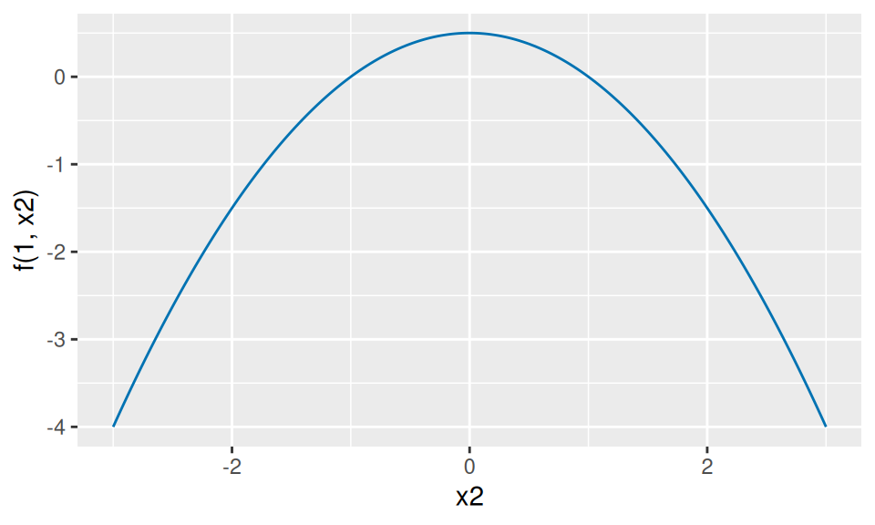
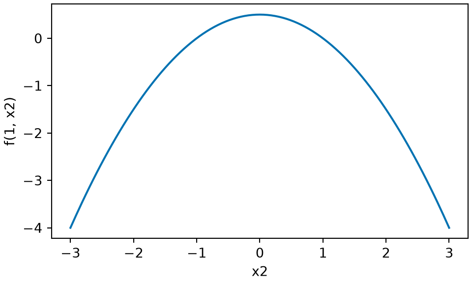

# Quadratic Minimization under Linear Constraints

Code

Published

Last modified: 2026-11-11 02:57:07 (PST)

> **NOTE:**
>
> This section is adapted from the Lagrange-multiplier part of Zhou [\[1\]](#ref-zhou2024optim), used under the MIT License (see the license text in [Linear Algebra](linear-algebra-subspaces.llms.md#sec-subspaces)). The source solves the stationarity equations of the Lagrangian and reports the solution; here the solution is also proved to be the unique minimizer, directly from the positive definiteness of the matrices involved. The source assumes only that $\mathbf{S}$ is positive definite; the added hypothesis that the columns of $\mathbf{A}$ are linearly independent makes ${\mathbf{A}}^{\top} \mathbf{S}^{-1} \mathbf{A}$ invertible. The source’s example with general coefficients $a_1, a_2, b$ is specialized here to $3, 4, 5$. These parts of the source are not part of this section:
>
> - the Lagrange multiplier method for constraints that are not linear, or objectives that are not quadratic, including its multinomial maximum likelihood example
> - the eigenvalues of the block matrix of the stationarity equations, and the convexity of the Lagrangian in $\mathord{\smash[b]{\underset{\raise.3ex\hbox{$\scriptstyle\sim$}}{x}}\vphantom{x}}$ and its concavity in the multipliers
> - its homework examples

> **NOTE:**
>
> **Definition 1 (Feasible set)** In a problem that looks for a best point among some allowed points of $\mathbb{R}^p$, the set $F \subseteq \mathbb{R}^p$ of allowed points is the **feasible set**, [\[2\]](#ref-wikipedia_feasible_region) and its points are feasible.

> **NOTE:**
>
> **Definition 2 (Constraints)** When the feasible set $F$ ([Definition 1](#def-feasible-set)) is the set of points that satisfy some equations or inequalities, those equations or inequalities are the **constraints**.

> **NOTE:**
>
> **Example 1 (A line as a feasible set)** With the single constraint $3 x_1 + 4 x_2 = 5$, the feasible set is the line $\mathopen{}\left\{\mathord{\smash[b]{\underset{\raise.3ex\hbox{$\scriptstyle\sim$}}{x}}\vphantom{x}}\in \mathbb{R}^2 : 3 x_1 + 4 x_2 = 5\right\}\mathclose{}$. ${(1, 0.5)}^{\top}$ is feasible, since
>
> $$\begin{aligned}
> 3 \cdot 1 + 4 \cdot 0.5 &= 3 + 2 \\
> &= 5;
> \end{aligned}$$
>
> $\mathord{\smash[b]{\underset{\raise.3ex\hbox{$\scriptstyle\sim$}}{0}}\vphantom{0}}$ is not feasible, since $3 \cdot 0 + 4 \cdot 0 = 0 \ne 5$.

> **NOTE:**
>
> **Definition 3 (Objective function, objective)** Let $f : \mathbb{R}^p \to \mathbb{R}$ and let $F \subseteq \mathbb{R}^p$ be a feasible set ([Definition 1](#def-feasible-set)). In the problem of minimizing $f$ over $F$, $f$ is the **objective function** (or **objective**).

> **NOTE:**
>
> **Definition 4 (Minimizer over a feasible set)** With $f$ and $F$ as in [Definition 3](#def-objective-function), a **minimizer of** $f$ over $F$ is a feasible $\mathord{\smash[b]{\underset{\raise.3ex\hbox{$\scriptstyle\sim$}}{x}}\vphantom{x}}^*$ with $f(\mathord{\smash[b]{\underset{\raise.3ex\hbox{$\scriptstyle\sim$}}{x}}\vphantom{x}}^*) \le f(\mathord{\smash[b]{\underset{\raise.3ex\hbox{$\scriptstyle\sim$}}{x}}\vphantom{x}})$ for every feasible $\mathord{\smash[b]{\underset{\raise.3ex\hbox{$\scriptstyle\sim$}}{x}}\vphantom{x}}$: a [global minimizer](algebra-basics.llms.md#def-global-minimizer) of $f$ with its domain restricted to $F$.

> **NOTE:**
>
> **Definition 5 (Minimization problem)** With $f$ and $F$ as in [Definition 3](#def-objective-function), the **minimization problem** [\[3\]](#ref-wikipedia_mathematical_optimization) is to find a minimizer of $f$ over $F$ ([Definition 4](#def-minimizer-over-feasible-set)). When $F$ is given by constraints ([Definition 2](#def-constraints)), the problem is to minimize $f$ subject to them.

> **NOTE:**
>
> **Example 2 (Minimizing over a line)** In the problem of minimizing $x_1^2 + x_2^2$ subject to $3 x_1 + 4 x_2 = 5$, the objective function is $f(\mathord{\smash[b]{\underset{\raise.3ex\hbox{$\scriptstyle\sim$}}{x}}\vphantom{x}}) = x_1^2 + x_2^2$, and the feasible set is the line of [Example 1](#exm-feasible-set). The feasible point ${(1, 0.5)}^{\top}$ has
>
> $$\begin{aligned}
> f(1, 0.5) &= 1 + 0.25 \\
> &= 1.25.
> \end{aligned}$$
>
> $\mathord{\smash[b]{\underset{\raise.3ex\hbox{$\scriptstyle\sim$}}{0}}\vphantom{0}}$ minimizes $f$ over all of $\mathbb{R}^2$, with $f(\mathord{\smash[b]{\underset{\raise.3ex\hbox{$\scriptstyle\sim$}}{0}}\vphantom{0}}) = 0$, but it is not a minimizer over the feasible set, because it is not feasible.

> **NOTE:**
>
> **Definition 6 (Optimization algorithm)** Let:
>
> - $f : \mathbb{R}^p \to \mathbb{R}$: an [objective function](#def-objective-function);
> - $F \subseteq \mathbb{R}^p$: a [feasible set](#def-feasible-set).
>
> An **optimization algorithm** [\[3\]](#ref-wikipedia_mathematical_optimization) is a step-by-step procedure that [maps](https://morrison-lab.github.io/mcs/functions.html#def-function) the pair $(f, F)$ to a feasible point $\mathord{\smash[b]{\underset{\raise.3ex\hbox{$\scriptstyle\sim$}}{x}}\vphantom{x}}^\dagger$:
>
> $$(f, F) \mapsto \mathord{\smash[b]{\underset{\raise.3ex\hbox{$\scriptstyle\sim$}}{x}}\vphantom{x}}^\dagger \in F.
> \tag{1}$$
>
> In words: given $(f, F)$, the procedure returns a feasible point $\mathord{\smash[b]{\underset{\raise.3ex\hbox{$\scriptstyle\sim$}}{x}}\vphantom{x}}^\dagger$ intended to make $f(\mathord{\smash[b]{\underset{\raise.3ex\hbox{$\scriptstyle\sim$}}{x}}\vphantom{x}}^\dagger)$ small.

> **NOTE:**
>
> **Example 3 (Exhaustive search over a finite feasible set)** Let $f(\mathord{\smash[b]{\underset{\raise.3ex\hbox{$\scriptstyle\sim$}}{x}}\vphantom{x}}) = x_1^2 + x_2^2$, with the [feasible set](#def-feasible-set) the three points $\mathopen{}\left\{{(1, 0.5)}^{\top}, {(3, -1)}^{\top}, {(-1, 2)}^{\top}\right\}\mathclose{}$ of the line of [Example 1](#exm-feasible-set). The procedure “evaluate $f$ at every feasible point; return the point with the smallest [value](https://morrison-lab.github.io/mcs/functions.html#def-value)” is an [optimization algorithm](#def-optimization-algorithm). Computing $f$ at each point gives
>
> $$\begin{aligned}
> f(1, 0.5) &= 1 + 0.25 = 1.25, \\
> f(3, -1) &= 9 + 1 = 10, \\
> f(-1, 2) &= 1 + 4 = 5,
> \end{aligned}$$
>
> so it returns ${(1, 0.5)}^{\top}$, a [minimizer of](#def-minimizer-over-feasible-set) $f$ over this feasible set.

Here the [objective](#def-objective-function) is a quadratic $f(\mathord{\smash[b]{\underset{\raise.3ex\hbox{$\scriptstyle\sim$}}{x}}\vphantom{x}}) = \tfrac{1}{2}\,{\mathord{\smash[b]{\underset{\raise.3ex\hbox{$\scriptstyle\sim$}}{x}}\vphantom{x}}}^{\top} \mathbf{S} \mathord{\smash[b]{\underset{\raise.3ex\hbox{$\scriptstyle\sim$}}{x}}\vphantom{x}}$ with $\mathbf{S}$ [positive definite](linear-algebra-special-matrices.llms.md#def-positive-definite), and the constraints ([Definition 2](#def-constraints)) are $m$ linear equations ${\mathbf{A}}^{\top} \mathord{\smash[b]{\underset{\raise.3ex\hbox{$\scriptstyle\sim$}}{x}}\vphantom{x}}= \mathord{\smash[b]{\underset{\raise.3ex\hbox{$\scriptstyle\sim$}}{b}}\vphantom{b}}$, where $\mathbf{A}$ is a $p \times m$ matrix and $\mathord{\smash[b]{\underset{\raise.3ex\hbox{$\scriptstyle\sim$}}{b}}\vphantom{b}} \in \mathbb{R}^m$. The only stationary point of the objective alone ([Definition 4 in Critical Points and Optimality Conditions](optimization-critical-points.llms.md#def-stationary-point)) is $\mathord{\smash[b]{\underset{\raise.3ex\hbox{$\scriptstyle\sim$}}{0}}\vphantom{0}}_{p \times 1}$ (its [gradient](vector-calculus.llms.md#def-vector-derivative) is $\nabla f(\mathord{\smash[b]{\underset{\raise.3ex\hbox{$\scriptstyle\sim$}}{x}}\vphantom{x}}) = \mathbf{S} \mathord{\smash[b]{\underset{\raise.3ex\hbox{$\scriptstyle\sim$}}{x}}\vphantom{x}}$, and $\mathbf{S}$ is [invertible](linear-algebra-special-matrices.llms.md#def-invertible-matrix)), which may not satisfy the constraints. A Lagrange multiplier adds one unknown per constraint, and the minimizer over the feasible set ([Definition 1](#def-feasible-set)) is then found among the stationary points of a new function of the extended set of unknowns.

> **NOTE:**
>
> **Definition 7 (Lagrangian)** For the problem of minimizing $f(\mathord{\smash[b]{\underset{\raise.3ex\hbox{$\scriptstyle\sim$}}{x}}\vphantom{x}})$ over $\mathord{\smash[b]{\underset{\raise.3ex\hbox{$\scriptstyle\sim$}}{x}}\vphantom{x}}\in \mathbb{R}^p$ subject to ${\mathbf{A}}^{\top} \mathord{\smash[b]{\underset{\raise.3ex\hbox{$\scriptstyle\sim$}}{x}}\vphantom{x}}= \mathord{\smash[b]{\underset{\raise.3ex\hbox{$\scriptstyle\sim$}}{b}}\vphantom{b}}$, with $\mathbf{A}$ a $p \times m$ matrix and $\mathord{\smash[b]{\underset{\raise.3ex\hbox{$\scriptstyle\sim$}}{b}}\vphantom{b}} \in \mathbb{R}^m$, the **Lagrangian** [\[4\]](#ref-wikipedia_lagrange_multiplier) is the function of $\mathord{\smash[b]{\underset{\raise.3ex\hbox{$\scriptstyle\sim$}}{x}}\vphantom{x}}\in \mathbb{R}^p$ and $\mathord{\smash[b]{\underset{\raise.3ex\hbox{$\scriptstyle\sim$}}{\lambda}}\vphantom{\lambda}}\in \mathbb{R}^m$
>
> $$L(\mathord{\smash[b]{\underset{\raise.3ex\hbox{$\scriptstyle\sim$}}{x}}\vphantom{x}}, \mathord{\smash[b]{\underset{\raise.3ex\hbox{$\scriptstyle\sim$}}{\lambda}}\vphantom{\lambda}}) \stackrel{\text{def}}{=}f(\mathord{\smash[b]{\underset{\raise.3ex\hbox{$\scriptstyle\sim$}}{x}}\vphantom{x}}) + {\mathord{\smash[b]{\underset{\raise.3ex\hbox{$\scriptstyle\sim$}}{\lambda}}\vphantom{\lambda}}}^{\top} \mathopen{}\left({\mathbf{A}}^{\top} \mathord{\smash[b]{\underset{\raise.3ex\hbox{$\scriptstyle\sim$}}{x}}\vphantom{x}}- \mathord{\smash[b]{\underset{\raise.3ex\hbox{$\scriptstyle\sim$}}{b}}\vphantom{b}}\right)\mathclose{}.$$

> **NOTE:**
>
> **Definition 8 (Lagrange multipliers)** In the Lagrangian $L(\mathord{\smash[b]{\underset{\raise.3ex\hbox{$\scriptstyle\sim$}}{x}}\vphantom{x}}, \mathord{\smash[b]{\underset{\raise.3ex\hbox{$\scriptstyle\sim$}}{\lambda}}\vphantom{\lambda}})$ ([Definition 7](#def-lagrangian)), the entries of $\mathord{\smash[b]{\underset{\raise.3ex\hbox{$\scriptstyle\sim$}}{\lambda}}\vphantom{\lambda}}$ are the **Lagrange multipliers** [\[4\]](#ref-wikipedia_lagrange_multiplier), one per constraint.

> **NOTE:**
>
> **Example 4 (The gradients of the Lagrangian of a quadratic)** Let $f(\mathord{\smash[b]{\underset{\raise.3ex\hbox{$\scriptstyle\sim$}}{x}}\vphantom{x}}) = \tfrac{1}{2}\,{\mathord{\smash[b]{\underset{\raise.3ex\hbox{$\scriptstyle\sim$}}{x}}\vphantom{x}}}^{\top} \mathbf{S} \mathord{\smash[b]{\underset{\raise.3ex\hbox{$\scriptstyle\sim$}}{x}}\vphantom{x}}$ with $\mathbf{S}$ symmetric and constant. By the [transpose of a product](linear-algebra-matrices.llms.md#thm-transpose-product), ${\mathord{\smash[b]{\underset{\raise.3ex\hbox{$\scriptstyle\sim$}}{\lambda}}\vphantom{\lambda}}}^{\top} {\mathbf{A}}^{\top} = {(\mathbf{A} \mathord{\smash[b]{\underset{\raise.3ex\hbox{$\scriptstyle\sim$}}{\lambda}}\vphantom{\lambda}})}^{\top}$, so
>
> $$\begin{aligned}
> L(\mathord{\smash[b]{\underset{\raise.3ex\hbox{$\scriptstyle\sim$}}{x}}\vphantom{x}}, \mathord{\smash[b]{\underset{\raise.3ex\hbox{$\scriptstyle\sim$}}{\lambda}}\vphantom{\lambda}})
> &= \tfrac{1}{2}\,{\mathord{\smash[b]{\underset{\raise.3ex\hbox{$\scriptstyle\sim$}}{x}}\vphantom{x}}}^{\top} \mathbf{S} \mathord{\smash[b]{\underset{\raise.3ex\hbox{$\scriptstyle\sim$}}{x}}\vphantom{x}} + {\mathord{\smash[b]{\underset{\raise.3ex\hbox{$\scriptstyle\sim$}}{\lambda}}\vphantom{\lambda}}}^{\top} {\mathbf{A}}^{\top} \mathord{\smash[b]{\underset{\raise.3ex\hbox{$\scriptstyle\sim$}}{x}}\vphantom{x}}- {\mathord{\smash[b]{\underset{\raise.3ex\hbox{$\scriptstyle\sim$}}{\lambda}}\vphantom{\lambda}}}^{\top} \mathord{\smash[b]{\underset{\raise.3ex\hbox{$\scriptstyle\sim$}}{b}}\vphantom{b}}
> && \text{(distribute)}
> \\
> &= \tfrac{1}{2}\,{\mathord{\smash[b]{\underset{\raise.3ex\hbox{$\scriptstyle\sim$}}{x}}\vphantom{x}}}^{\top} \mathbf{S} \mathord{\smash[b]{\underset{\raise.3ex\hbox{$\scriptstyle\sim$}}{x}}\vphantom{x}} + {(\mathbf{A} \mathord{\smash[b]{\underset{\raise.3ex\hbox{$\scriptstyle\sim$}}{\lambda}}\vphantom{\lambda}})}^{\top} \mathord{\smash[b]{\underset{\raise.3ex\hbox{$\scriptstyle\sim$}}{x}}\vphantom{x}}- {\mathord{\smash[b]{\underset{\raise.3ex\hbox{$\scriptstyle\sim$}}{\lambda}}\vphantom{\lambda}}}^{\top} \mathord{\smash[b]{\underset{\raise.3ex\hbox{$\scriptstyle\sim$}}{b}}\vphantom{b}},
> && \text{(transpose of a product)}
> \end{aligned}$$
>
> and, since ${\mathord{\smash[b]{\underset{\raise.3ex\hbox{$\scriptstyle\sim$}}{\lambda}}\vphantom{\lambda}}}^{\top} \mathopen{}\left({\mathbf{A}}^{\top} \mathord{\smash[b]{\underset{\raise.3ex\hbox{$\scriptstyle\sim$}}{x}}\vphantom{x}}- \mathord{\smash[b]{\underset{\raise.3ex\hbox{$\scriptstyle\sim$}}{b}}\vphantom{b}}\right)\mathclose{}$ is $1 \times 1$ and so equals its transpose,
>
> $$L(\mathord{\smash[b]{\underset{\raise.3ex\hbox{$\scriptstyle\sim$}}{x}}\vphantom{x}}, \mathord{\smash[b]{\underset{\raise.3ex\hbox{$\scriptstyle\sim$}}{\lambda}}\vphantom{\lambda}}) = \tfrac{1}{2}\,{\mathord{\smash[b]{\underset{\raise.3ex\hbox{$\scriptstyle\sim$}}{x}}\vphantom{x}}}^{\top} \mathbf{S} \mathord{\smash[b]{\underset{\raise.3ex\hbox{$\scriptstyle\sim$}}{x}}\vphantom{x}} + {\mathopen{}\left({\mathbf{A}}^{\top} \mathord{\smash[b]{\underset{\raise.3ex\hbox{$\scriptstyle\sim$}}{x}}\vphantom{x}}- \mathord{\smash[b]{\underset{\raise.3ex\hbox{$\scriptstyle\sim$}}{b}}\vphantom{b}}\right)\mathclose{}}^{\top} \mathord{\smash[b]{\underset{\raise.3ex\hbox{$\scriptstyle\sim$}}{\lambda}}\vphantom{\lambda}}.$$
>
> The partial derivatives of a sum are the sums of the partial derivatives, entry by entry. Using the first of these forms, the [derivative of a quadratic form](vector-calculus.llms.md#cor-quadratic-form-symmetric) applies to the first [term](algebra-sums.llms.md#def-term), the [derivative of a linear combination](vector-calculus.llms.md#cor-deriv-lincom-tp) to the second ($\mathbf{A} \mathord{\smash[b]{\underset{\raise.3ex\hbox{$\scriptstyle\sim$}}{\lambda}}\vphantom{\lambda}}$ is constant in $\mathord{\smash[b]{\underset{\raise.3ex\hbox{$\scriptstyle\sim$}}{x}}\vphantom{x}}$), and the third is [constant with respect to a vector](vector-calculus.llms.md#def-constant-wrt-vector),
>
> $$\begin{aligned}
> \frac{\partial}{\partial \mathord{\smash[b]{\underset{\raise.3ex\hbox{$\scriptstyle\sim$}}{x}}\vphantom{x}}} L(\mathord{\smash[b]{\underset{\raise.3ex\hbox{$\scriptstyle\sim$}}{x}}\vphantom{x}}, \mathord{\smash[b]{\underset{\raise.3ex\hbox{$\scriptstyle\sim$}}{\lambda}}\vphantom{\lambda}})
> &= \tfrac{1}{2}\,\frac{\partial}{\partial \mathord{\smash[b]{\underset{\raise.3ex\hbox{$\scriptstyle\sim$}}{x}}\vphantom{x}}} \mathopen{}\left({\mathord{\smash[b]{\underset{\raise.3ex\hbox{$\scriptstyle\sim$}}{x}}\vphantom{x}}}^{\top} \mathbf{S} \mathord{\smash[b]{\underset{\raise.3ex\hbox{$\scriptstyle\sim$}}{x}}\vphantom{x}}\right)\mathclose{} + \frac{\partial}{\partial \mathord{\smash[b]{\underset{\raise.3ex\hbox{$\scriptstyle\sim$}}{x}}\vphantom{x}}} \mathopen{}\left({(\mathbf{A} \mathord{\smash[b]{\underset{\raise.3ex\hbox{$\scriptstyle\sim$}}{\lambda}}\vphantom{\lambda}})}^{\top} \mathord{\smash[b]{\underset{\raise.3ex\hbox{$\scriptstyle\sim$}}{x}}\vphantom{x}}\right)\mathclose{} - \frac{\partial}{\partial \mathord{\smash[b]{\underset{\raise.3ex\hbox{$\scriptstyle\sim$}}{x}}\vphantom{x}}} \mathopen{}\left({\mathord{\smash[b]{\underset{\raise.3ex\hbox{$\scriptstyle\sim$}}{\lambda}}\vphantom{\lambda}}}^{\top} \mathord{\smash[b]{\underset{\raise.3ex\hbox{$\scriptstyle\sim$}}{b}}\vphantom{b}}\right)\mathclose{}
> && \text{(sum and constant multiple)}
> \\
> &= \tfrac{1}{2} \mathopen{}\left(2 \mathbf{S} \mathord{\smash[b]{\underset{\raise.3ex\hbox{$\scriptstyle\sim$}}{x}}\vphantom{x}}\right)\mathclose{} + \mathbf{A} \mathord{\smash[b]{\underset{\raise.3ex\hbox{$\scriptstyle\sim$}}{\lambda}}\vphantom{\lambda}}- \mathord{\smash[b]{\underset{\raise.3ex\hbox{$\scriptstyle\sim$}}{0}}\vphantom{0}}_{p \times 1}
> && \text{(the three derivatives)}
> \\
> &= \mathbf{S} \mathord{\smash[b]{\underset{\raise.3ex\hbox{$\scriptstyle\sim$}}{x}}\vphantom{x}}+ \mathbf{A} \mathord{\smash[b]{\underset{\raise.3ex\hbox{$\scriptstyle\sim$}}{\lambda}}\vphantom{\lambda}}.
> && \text{(simplify)}
> \end{aligned}$$
>
> Using the second form, in which $f(\mathord{\smash[b]{\underset{\raise.3ex\hbox{$\scriptstyle\sim$}}{x}}\vphantom{x}})$ and ${\mathbf{A}}^{\top} \mathord{\smash[b]{\underset{\raise.3ex\hbox{$\scriptstyle\sim$}}{x}}\vphantom{x}}- \mathord{\smash[b]{\underset{\raise.3ex\hbox{$\scriptstyle\sim$}}{b}}\vphantom{b}}$ are constant in $\mathord{\smash[b]{\underset{\raise.3ex\hbox{$\scriptstyle\sim$}}{\lambda}}\vphantom{\lambda}}$, and the [derivative of a linear combination](vector-calculus.llms.md#cor-deriv-lincom-tp) again,
>
> $$\begin{aligned}
> \frac{\partial}{\partial \mathord{\smash[b]{\underset{\raise.3ex\hbox{$\scriptstyle\sim$}}{\lambda}}\vphantom{\lambda}}} L(\mathord{\smash[b]{\underset{\raise.3ex\hbox{$\scriptstyle\sim$}}{x}}\vphantom{x}}, \mathord{\smash[b]{\underset{\raise.3ex\hbox{$\scriptstyle\sim$}}{\lambda}}\vphantom{\lambda}})
> &= \frac{\partial}{\partial \mathord{\smash[b]{\underset{\raise.3ex\hbox{$\scriptstyle\sim$}}{\lambda}}\vphantom{\lambda}}} f(\mathord{\smash[b]{\underset{\raise.3ex\hbox{$\scriptstyle\sim$}}{x}}\vphantom{x}}) + \frac{\partial}{\partial \mathord{\smash[b]{\underset{\raise.3ex\hbox{$\scriptstyle\sim$}}{\lambda}}\vphantom{\lambda}}} \mathopen{}\left({\mathopen{}\left({\mathbf{A}}^{\top} \mathord{\smash[b]{\underset{\raise.3ex\hbox{$\scriptstyle\sim$}}{x}}\vphantom{x}}- \mathord{\smash[b]{\underset{\raise.3ex\hbox{$\scriptstyle\sim$}}{b}}\vphantom{b}}\right)\mathclose{}}^{\top} \mathord{\smash[b]{\underset{\raise.3ex\hbox{$\scriptstyle\sim$}}{\lambda}}\vphantom{\lambda}}\right)\mathclose{}
> && \text{(sum)}
> \\
> &= \mathord{\smash[b]{\underset{\raise.3ex\hbox{$\scriptstyle\sim$}}{0}}\vphantom{0}}_{m \times 1} + \mathopen{}\left({\mathbf{A}}^{\top} \mathord{\smash[b]{\underset{\raise.3ex\hbox{$\scriptstyle\sim$}}{x}}\vphantom{x}}- \mathord{\smash[b]{\underset{\raise.3ex\hbox{$\scriptstyle\sim$}}{b}}\vphantom{b}}\right)\mathclose{}
> && \text{(the two derivatives)}
> \\
> &= {\mathbf{A}}^{\top} \mathord{\smash[b]{\underset{\raise.3ex\hbox{$\scriptstyle\sim$}}{x}}\vphantom{x}}- \mathord{\smash[b]{\underset{\raise.3ex\hbox{$\scriptstyle\sim$}}{b}}\vphantom{b}}.
> && \text{(simplify)}
> \end{aligned}$$
>
> So $(\mathord{\smash[b]{\underset{\raise.3ex\hbox{$\scriptstyle\sim$}}{x}}\vphantom{x}}, \mathord{\smash[b]{\underset{\raise.3ex\hbox{$\scriptstyle\sim$}}{\lambda}}\vphantom{\lambda}})$ makes the gradients equal $\mathord{\smash[b]{\underset{\raise.3ex\hbox{$\scriptstyle\sim$}}{0}}\vphantom{0}}_{p \times 1}$ and $\mathord{\smash[b]{\underset{\raise.3ex\hbox{$\scriptstyle\sim$}}{0}}\vphantom{0}}_{m \times 1}$ exactly when
>
> $$\mathbf{S} \mathord{\smash[b]{\underset{\raise.3ex\hbox{$\scriptstyle\sim$}}{x}}\vphantom{x}}+ \mathbf{A} \mathord{\smash[b]{\underset{\raise.3ex\hbox{$\scriptstyle\sim$}}{\lambda}}\vphantom{\lambda}}= \mathord{\smash[b]{\underset{\raise.3ex\hbox{$\scriptstyle\sim$}}{0}}\vphantom{0}}_{p \times 1}
> \quad \text{and} \quad
> {\mathbf{A}}^{\top} \mathord{\smash[b]{\underset{\raise.3ex\hbox{$\scriptstyle\sim$}}{x}}\vphantom{x}}= \mathord{\smash[b]{\underset{\raise.3ex\hbox{$\scriptstyle\sim$}}{b}}\vphantom{b}},
> \qquad\text{that is,}\qquad
> \underbrace{\begin{bmatrix} \mathbf{S} & \mathbf{A} \\ {\mathbf{A}}^{\top} & \mathord{\smash[b]{\underset{\raise.3ex\hbox{$\scriptstyle\sim$}}{0}}\vphantom{0}}_{m \times m} \end{bmatrix}}_{(p + m) \times (p + m)}
> \underbrace{\begin{bmatrix} \mathord{\smash[b]{\underset{\raise.3ex\hbox{$\scriptstyle\sim$}}{x}}\vphantom{x}}\\ \mathord{\smash[b]{\underset{\raise.3ex\hbox{$\scriptstyle\sim$}}{\lambda}}\vphantom{\lambda}}\end{bmatrix}}_{(p + m) \times 1}
> = \underbrace{\begin{bmatrix} \mathord{\smash[b]{\underset{\raise.3ex\hbox{$\scriptstyle\sim$}}{0}}\vphantom{0}}_{p \times 1} \\ \mathord{\smash[b]{\underset{\raise.3ex\hbox{$\scriptstyle\sim$}}{b}}\vphantom{b}} \end{bmatrix}}_{(p + m) \times 1},
> \tag{2}$$
>
> the second equation being the constraint itself.

> **NOTE:**
>
> **Theorem 1 (Minimizing a positive definite quadratic under linear constraints)** Let $\mathbf{S}$ be a $p \times p$ [positive definite](linear-algebra-special-matrices.llms.md#def-positive-definite) matrix, $\mathbf{A}$ a $p \times m$ matrix with [linearly independent](linear-algebra-subspaces.llms.md#def-linearly-independent) columns, and $\mathord{\smash[b]{\underset{\raise.3ex\hbox{$\scriptstyle\sim$}}{b}}\vphantom{b}} \in \mathbb{R}^m$. Then the $m \times m$ matrix $\mathbf{M} \stackrel{\text{def}}{=}{\mathbf{A}}^{\top} \mathbf{S}^{-1} \mathbf{A}$ is invertible, and $f(\mathord{\smash[b]{\underset{\raise.3ex\hbox{$\scriptstyle\sim$}}{x}}\vphantom{x}}) = \tfrac{1}{2}\,{\mathord{\smash[b]{\underset{\raise.3ex\hbox{$\scriptstyle\sim$}}{x}}\vphantom{x}}}^{\top} \mathbf{S} \mathord{\smash[b]{\underset{\raise.3ex\hbox{$\scriptstyle\sim$}}{x}}\vphantom{x}}$ has exactly one minimizer over the $\mathord{\smash[b]{\underset{\raise.3ex\hbox{$\scriptstyle\sim$}}{x}}\vphantom{x}}\in \mathbb{R}^p$ with ${\mathbf{A}}^{\top} \mathord{\smash[b]{\underset{\raise.3ex\hbox{$\scriptstyle\sim$}}{x}}\vphantom{x}}= \mathord{\smash[b]{\underset{\raise.3ex\hbox{$\scriptstyle\sim$}}{b}}\vphantom{b}}$, namely
>
> $$\mathord{\smash[b]{\underset{\raise.3ex\hbox{$\scriptstyle\sim$}}{x}}\vphantom{x}}^* = \mathbf{S}^{-1} \mathbf{A} \mathbf{M}^{-1} \mathord{\smash[b]{\underset{\raise.3ex\hbox{$\scriptstyle\sim$}}{b}}\vphantom{b}}.$$
>
> With $\mathord{\smash[b]{\underset{\raise.3ex\hbox{$\scriptstyle\sim$}}{\lambda}}\vphantom{\lambda}}^* \stackrel{\text{def}}{=}-\mathbf{M}^{-1} \mathord{\smash[b]{\underset{\raise.3ex\hbox{$\scriptstyle\sim$}}{b}}\vphantom{b}}$, the pair $(\mathord{\smash[b]{\underset{\raise.3ex\hbox{$\scriptstyle\sim$}}{x}}\vphantom{x}}^*, \mathord{\smash[b]{\underset{\raise.3ex\hbox{$\scriptstyle\sim$}}{\lambda}}\vphantom{\lambda}}^*)$ solves [Equation 2](#eq-kkt), and the minimum value is $f(\mathord{\smash[b]{\underset{\raise.3ex\hbox{$\scriptstyle\sim$}}{x}}\vphantom{x}}^*) = \tfrac{1}{2}\,{\mathord{\smash[b]{\underset{\raise.3ex\hbox{$\scriptstyle\sim$}}{b}}\vphantom{b}}}^{\top} \mathbf{M}^{-1} \mathord{\smash[b]{\underset{\raise.3ex\hbox{$\scriptstyle\sim$}}{b}}\vphantom{b}}$.

> **NOTE:**
>
> *Proof*. The steps marked “transpose of a product” use the [transpose of a product](linear-algebra-matrices.llms.md#thm-transpose-product), and $\mathbf{S}$ is symmetric because it is [positive definite](linear-algebra-special-matrices.llms.md#def-positive-definite).
>
> $\mathbf{M}$ is invertible. $\mathbf{S}^{-1}$ is positive definite, by the [positive definite inverse theorem](linear-algebra-special-matrices.llms.md#thm-pd-inverse), so $\mathbf{M} = {\mathbf{A}}^{\top} \mathbf{S}^{-1} \mathbf{A}$ is positive definite, by [operations that preserve definiteness](linear-algebra-diagonalization.llms.md#thm-pd-operations) (part 1), and so invertible, again by the positive definite inverse. $\mathbf{S}^{-1}$ and $\mathbf{M}^{-1}$ are symmetric, by the [inverse of a symmetric matrix](linear-algebra-special-matrices.llms.md#cor-inverse-symmetric), because $\mathbf{S}$ and $\mathbf{M}$ are.
>
> $\mathord{\smash[b]{\underset{\raise.3ex\hbox{$\scriptstyle\sim$}}{x}}\vphantom{x}}^*$ satisfies the constraint, and the pair solves [Equation 2](#eq-kkt).
>
> $$\begin{aligned}
> {\mathbf{A}}^{\top} \mathord{\smash[b]{\underset{\raise.3ex\hbox{$\scriptstyle\sim$}}{x}}\vphantom{x}}^*
> &= {\mathbf{A}}^{\top} \mathbf{S}^{-1} \mathbf{A} \mathbf{M}^{-1} \mathord{\smash[b]{\underset{\raise.3ex\hbox{$\scriptstyle\sim$}}{b}}\vphantom{b}}
> && \text{(substitute } \mathord{\smash[b]{\underset{\raise.3ex\hbox{$\scriptstyle\sim$}}{x}}\vphantom{x}}^* \text{)}
> \\
> &= \mathbf{M} \mathbf{M}^{-1} \mathord{\smash[b]{\underset{\raise.3ex\hbox{$\scriptstyle\sim$}}{b}}\vphantom{b}}
> && \text{(definition of } \mathbf{M} \text{)}
> \\
> &= \mathord{\smash[b]{\underset{\raise.3ex\hbox{$\scriptstyle\sim$}}{b}}\vphantom{b}},
> && \text{(} \mathbf{M} \mathbf{M}^{-1} = \mathbf{I}_m \text{)}
> \\
> \mathbf{S} \mathord{\smash[b]{\underset{\raise.3ex\hbox{$\scriptstyle\sim$}}{x}}\vphantom{x}}^* + \mathbf{A} \mathord{\smash[b]{\underset{\raise.3ex\hbox{$\scriptstyle\sim$}}{\lambda}}\vphantom{\lambda}}^*
> &= \mathbf{S} \mathbf{S}^{-1} \mathbf{A} \mathbf{M}^{-1} \mathord{\smash[b]{\underset{\raise.3ex\hbox{$\scriptstyle\sim$}}{b}}\vphantom{b}} - \mathbf{A} \mathbf{M}^{-1} \mathord{\smash[b]{\underset{\raise.3ex\hbox{$\scriptstyle\sim$}}{b}}\vphantom{b}}
> && \text{(substitute } \mathord{\smash[b]{\underset{\raise.3ex\hbox{$\scriptstyle\sim$}}{x}}\vphantom{x}}^* \text{ and } \mathord{\smash[b]{\underset{\raise.3ex\hbox{$\scriptstyle\sim$}}{\lambda}}\vphantom{\lambda}}^* \text{)}
> \\
> &= \mathbf{A} \mathbf{M}^{-1} \mathord{\smash[b]{\underset{\raise.3ex\hbox{$\scriptstyle\sim$}}{b}}\vphantom{b}} - \mathbf{A} \mathbf{M}^{-1} \mathord{\smash[b]{\underset{\raise.3ex\hbox{$\scriptstyle\sim$}}{b}}\vphantom{b}}
> && \text{(} \mathbf{S} \mathbf{S}^{-1} = \mathbf{I}_p \text{)}
> \\
> &= \mathord{\smash[b]{\underset{\raise.3ex\hbox{$\scriptstyle\sim$}}{0}}\vphantom{0}}_{p \times 1}.
> && \text{(subtract)}
> \end{aligned}$$
>
> $\mathord{\smash[b]{\underset{\raise.3ex\hbox{$\scriptstyle\sim$}}{x}}\vphantom{x}}^*$ is the unique minimizer. Let $\mathord{\smash[b]{\underset{\raise.3ex\hbox{$\scriptstyle\sim$}}{x}}\vphantom{x}}$ satisfy ${\mathbf{A}}^{\top} \mathord{\smash[b]{\underset{\raise.3ex\hbox{$\scriptstyle\sim$}}{x}}\vphantom{x}}= \mathord{\smash[b]{\underset{\raise.3ex\hbox{$\scriptstyle\sim$}}{b}}\vphantom{b}}$, and let $\mathord{\smash[b]{\underset{\raise.3ex\hbox{$\scriptstyle\sim$}}{d}}\vphantom{d}} \stackrel{\text{def}}{=}\mathord{\smash[b]{\underset{\raise.3ex\hbox{$\scriptstyle\sim$}}{x}}\vphantom{x}}- \mathord{\smash[b]{\underset{\raise.3ex\hbox{$\scriptstyle\sim$}}{x}}\vphantom{x}}^*$, so
>
> $$\begin{aligned}
> {\mathbf{A}}^{\top} \mathord{\smash[b]{\underset{\raise.3ex\hbox{$\scriptstyle\sim$}}{d}}\vphantom{d}} &= {\mathbf{A}}^{\top} \mathord{\smash[b]{\underset{\raise.3ex\hbox{$\scriptstyle\sim$}}{x}}\vphantom{x}}- {\mathbf{A}}^{\top} \mathord{\smash[b]{\underset{\raise.3ex\hbox{$\scriptstyle\sim$}}{x}}\vphantom{x}}^* \\
> &= \mathord{\smash[b]{\underset{\raise.3ex\hbox{$\scriptstyle\sim$}}{b}}\vphantom{b}} - \mathord{\smash[b]{\underset{\raise.3ex\hbox{$\scriptstyle\sim$}}{b}}\vphantom{b}} \\
> &= \mathord{\smash[b]{\underset{\raise.3ex\hbox{$\scriptstyle\sim$}}{0}}\vphantom{0}}_{m \times 1}
> \end{aligned}$$
>
> (matrix products distribute; both points satisfy the constraint). First, the cross term vanishes:
>
> $$\begin{aligned}
> {\mathord{\smash[b]{\underset{\raise.3ex\hbox{$\scriptstyle\sim$}}{d}}\vphantom{d}}}^{\top} \mathbf{S} \mathord{\smash[b]{\underset{\raise.3ex\hbox{$\scriptstyle\sim$}}{x}}\vphantom{x}}^*
> &= {\mathord{\smash[b]{\underset{\raise.3ex\hbox{$\scriptstyle\sim$}}{d}}\vphantom{d}}}^{\top} \mathbf{S} \mathbf{S}^{-1} \mathbf{A} \mathbf{M}^{-1} \mathord{\smash[b]{\underset{\raise.3ex\hbox{$\scriptstyle\sim$}}{b}}\vphantom{b}}
> && \text{(substitute } \mathord{\smash[b]{\underset{\raise.3ex\hbox{$\scriptstyle\sim$}}{x}}\vphantom{x}}^* \text{)}
> \\
> &= {\mathord{\smash[b]{\underset{\raise.3ex\hbox{$\scriptstyle\sim$}}{d}}\vphantom{d}}}^{\top} \mathbf{A} \mathbf{M}^{-1} \mathord{\smash[b]{\underset{\raise.3ex\hbox{$\scriptstyle\sim$}}{b}}\vphantom{b}}
> && \text{(} \mathbf{S} \mathbf{S}^{-1} = \mathbf{I}_p \text{)}
> \\
> &= {({\mathbf{A}}^{\top} \mathord{\smash[b]{\underset{\raise.3ex\hbox{$\scriptstyle\sim$}}{d}}\vphantom{d}})}^{\top} \mathbf{M}^{-1} \mathord{\smash[b]{\underset{\raise.3ex\hbox{$\scriptstyle\sim$}}{b}}\vphantom{b}}
> && \text{(transpose of a product; } {({\mathbf{A}}^{\top})}^{\top} = \mathbf{A} \text{)}
> \\
> &= {\mathord{\smash[b]{\underset{\raise.3ex\hbox{$\scriptstyle\sim$}}{0}}\vphantom{0}}_{m \times 1}}^{\top} \mathbf{M}^{-1} \mathord{\smash[b]{\underset{\raise.3ex\hbox{$\scriptstyle\sim$}}{b}}\vphantom{b}}
> && \text{(} {\mathbf{A}}^{\top} \mathord{\smash[b]{\underset{\raise.3ex\hbox{$\scriptstyle\sim$}}{d}}\vphantom{d}} = \mathord{\smash[b]{\underset{\raise.3ex\hbox{$\scriptstyle\sim$}}{0}}\vphantom{0}}_{m \times 1} \text{)}
> \\
> &= 0.
> && \text{(a product with a zero factor is zero)}
> \end{aligned}$$
>
> Then
>
> $$\begin{aligned}
> f(\mathord{\smash[b]{\underset{\raise.3ex\hbox{$\scriptstyle\sim$}}{x}}\vphantom{x}})
> &= \tfrac{1}{2}\,{(\mathord{\smash[b]{\underset{\raise.3ex\hbox{$\scriptstyle\sim$}}{x}}\vphantom{x}}^* + \mathord{\smash[b]{\underset{\raise.3ex\hbox{$\scriptstyle\sim$}}{d}}\vphantom{d}})}^{\top} \mathbf{S} (\mathord{\smash[b]{\underset{\raise.3ex\hbox{$\scriptstyle\sim$}}{x}}\vphantom{x}}^* + \mathord{\smash[b]{\underset{\raise.3ex\hbox{$\scriptstyle\sim$}}{d}}\vphantom{d}})
> && \text{(} \mathord{\smash[b]{\underset{\raise.3ex\hbox{$\scriptstyle\sim$}}{x}}\vphantom{x}}= \mathord{\smash[b]{\underset{\raise.3ex\hbox{$\scriptstyle\sim$}}{x}}\vphantom{x}}^* + \mathord{\smash[b]{\underset{\raise.3ex\hbox{$\scriptstyle\sim$}}{d}}\vphantom{d}} \text{)}
> \\
> &= \tfrac{1}{2} \mathopen{}\left({\mathord{\smash[b]{\underset{\raise.3ex\hbox{$\scriptstyle\sim$}}{x}}\vphantom{x}}^*{}}^{\top} + {\mathord{\smash[b]{\underset{\raise.3ex\hbox{$\scriptstyle\sim$}}{d}}\vphantom{d}}}^{\top}\right)\mathclose{} \mathbf{S} (\mathord{\smash[b]{\underset{\raise.3ex\hbox{$\scriptstyle\sim$}}{x}}\vphantom{x}}^* + \mathord{\smash[b]{\underset{\raise.3ex\hbox{$\scriptstyle\sim$}}{d}}\vphantom{d}})
> && \text{(the transpose of a sum is the sum of the transposes)}
> \\
> &= \tfrac{1}{2} \mathopen{}\left({\mathord{\smash[b]{\underset{\raise.3ex\hbox{$\scriptstyle\sim$}}{x}}\vphantom{x}}^*{}}^{\top} \mathbf{S} \mathord{\smash[b]{\underset{\raise.3ex\hbox{$\scriptstyle\sim$}}{x}}\vphantom{x}}^* + {\mathord{\smash[b]{\underset{\raise.3ex\hbox{$\scriptstyle\sim$}}{x}}\vphantom{x}}^*{}}^{\top} \mathbf{S} \mathord{\smash[b]{\underset{\raise.3ex\hbox{$\scriptstyle\sim$}}{d}}\vphantom{d}} + {\mathord{\smash[b]{\underset{\raise.3ex\hbox{$\scriptstyle\sim$}}{d}}\vphantom{d}}}^{\top} \mathbf{S} \mathord{\smash[b]{\underset{\raise.3ex\hbox{$\scriptstyle\sim$}}{x}}\vphantom{x}}^* + {\mathord{\smash[b]{\underset{\raise.3ex\hbox{$\scriptstyle\sim$}}{d}}\vphantom{d}}}^{\top} \mathbf{S} \mathord{\smash[b]{\underset{\raise.3ex\hbox{$\scriptstyle\sim$}}{d}}\vphantom{d}}\right)\mathclose{}
> && \text{(distribute)}
> \\
> &= \tfrac{1}{2} \mathopen{}\left({\mathord{\smash[b]{\underset{\raise.3ex\hbox{$\scriptstyle\sim$}}{x}}\vphantom{x}}^*{}}^{\top} \mathbf{S} \mathord{\smash[b]{\underset{\raise.3ex\hbox{$\scriptstyle\sim$}}{x}}\vphantom{x}}^* + {\mathord{\smash[b]{\underset{\raise.3ex\hbox{$\scriptstyle\sim$}}{d}}\vphantom{d}}}^{\top} {\mathbf{S}}^{\top} \mathord{\smash[b]{\underset{\raise.3ex\hbox{$\scriptstyle\sim$}}{x}}\vphantom{x}}^* + {\mathord{\smash[b]{\underset{\raise.3ex\hbox{$\scriptstyle\sim$}}{d}}\vphantom{d}}}^{\top} \mathbf{S} \mathord{\smash[b]{\underset{\raise.3ex\hbox{$\scriptstyle\sim$}}{x}}\vphantom{x}}^* + {\mathord{\smash[b]{\underset{\raise.3ex\hbox{$\scriptstyle\sim$}}{d}}\vphantom{d}}}^{\top} \mathbf{S} \mathord{\smash[b]{\underset{\raise.3ex\hbox{$\scriptstyle\sim$}}{d}}\vphantom{d}}\right)\mathclose{}
> && \text{(} 1 \times 1 \text{: } {\mathord{\smash[b]{\underset{\raise.3ex\hbox{$\scriptstyle\sim$}}{x}}\vphantom{x}}^*{}}^{\top} \mathbf{S} \mathord{\smash[b]{\underset{\raise.3ex\hbox{$\scriptstyle\sim$}}{d}}\vphantom{d}} = {({\mathord{\smash[b]{\underset{\raise.3ex\hbox{$\scriptstyle\sim$}}{x}}\vphantom{x}}^*{}}^{\top} \mathbf{S} \mathord{\smash[b]{\underset{\raise.3ex\hbox{$\scriptstyle\sim$}}{d}}\vphantom{d}})}^{\top} \text{; transpose of a product)}
> \\
> &= \tfrac{1}{2} \mathopen{}\left({\mathord{\smash[b]{\underset{\raise.3ex\hbox{$\scriptstyle\sim$}}{x}}\vphantom{x}}^*{}}^{\top} \mathbf{S} \mathord{\smash[b]{\underset{\raise.3ex\hbox{$\scriptstyle\sim$}}{x}}\vphantom{x}}^* + 2\,{\mathord{\smash[b]{\underset{\raise.3ex\hbox{$\scriptstyle\sim$}}{d}}\vphantom{d}}}^{\top} \mathbf{S} \mathord{\smash[b]{\underset{\raise.3ex\hbox{$\scriptstyle\sim$}}{x}}\vphantom{x}}^* + {\mathord{\smash[b]{\underset{\raise.3ex\hbox{$\scriptstyle\sim$}}{d}}\vphantom{d}}}^{\top} \mathbf{S} \mathord{\smash[b]{\underset{\raise.3ex\hbox{$\scriptstyle\sim$}}{d}}\vphantom{d}}\right)\mathclose{}
> && \text{(} {\mathbf{S}}^{\top} = \mathbf{S} \text{; combine)}
> \\
> &= \tfrac{1}{2}\,{\mathord{\smash[b]{\underset{\raise.3ex\hbox{$\scriptstyle\sim$}}{x}}\vphantom{x}}^*{}}^{\top} \mathbf{S} \mathord{\smash[b]{\underset{\raise.3ex\hbox{$\scriptstyle\sim$}}{x}}\vphantom{x}}^* + {\mathord{\smash[b]{\underset{\raise.3ex\hbox{$\scriptstyle\sim$}}{d}}\vphantom{d}}}^{\top} \mathbf{S} \mathord{\smash[b]{\underset{\raise.3ex\hbox{$\scriptstyle\sim$}}{x}}\vphantom{x}}^* + \tfrac{1}{2}\,{\mathord{\smash[b]{\underset{\raise.3ex\hbox{$\scriptstyle\sim$}}{d}}\vphantom{d}}}^{\top} \mathbf{S} \mathord{\smash[b]{\underset{\raise.3ex\hbox{$\scriptstyle\sim$}}{d}}\vphantom{d}}
> && \text{(distribute } \tfrac{1}{2} \text{)}
> \\
> &= f(\mathord{\smash[b]{\underset{\raise.3ex\hbox{$\scriptstyle\sim$}}{x}}\vphantom{x}}^*) + \tfrac{1}{2}\,{\mathord{\smash[b]{\underset{\raise.3ex\hbox{$\scriptstyle\sim$}}{d}}\vphantom{d}}}^{\top} \mathbf{S} \mathord{\smash[b]{\underset{\raise.3ex\hbox{$\scriptstyle\sim$}}{d}}\vphantom{d}}
> && \text{(the cross term is } 0 \text{)}
> \\
> &\ge f(\mathord{\smash[b]{\underset{\raise.3ex\hbox{$\scriptstyle\sim$}}{x}}\vphantom{x}}^*),
> && \text{(} \mathbf{S} \text{ is positive definite)}
> \end{aligned}$$
>
> with equality only when $\mathord{\smash[b]{\underset{\raise.3ex\hbox{$\scriptstyle\sim$}}{d}}\vphantom{d}} = \mathord{\smash[b]{\underset{\raise.3ex\hbox{$\scriptstyle\sim$}}{0}}\vphantom{0}}_{p \times 1}$, that is, $\mathord{\smash[b]{\underset{\raise.3ex\hbox{$\scriptstyle\sim$}}{x}}\vphantom{x}}= \mathord{\smash[b]{\underset{\raise.3ex\hbox{$\scriptstyle\sim$}}{x}}\vphantom{x}}^*$.
>
> **The minimum value.**
>
> $$\begin{aligned}
> f(\mathord{\smash[b]{\underset{\raise.3ex\hbox{$\scriptstyle\sim$}}{x}}\vphantom{x}}^*)
> &= \tfrac{1}{2}\,{(\mathbf{S}^{-1} \mathbf{A} \mathbf{M}^{-1} \mathord{\smash[b]{\underset{\raise.3ex\hbox{$\scriptstyle\sim$}}{b}}\vphantom{b}})}^{\top} \mathbf{S} \mathbf{S}^{-1} \mathbf{A} \mathbf{M}^{-1} \mathord{\smash[b]{\underset{\raise.3ex\hbox{$\scriptstyle\sim$}}{b}}\vphantom{b}}
> && \text{(substitute } \mathord{\smash[b]{\underset{\raise.3ex\hbox{$\scriptstyle\sim$}}{x}}\vphantom{x}}^* \text{)}
> \\
> &= \tfrac{1}{2}\,{\mathord{\smash[b]{\underset{\raise.3ex\hbox{$\scriptstyle\sim$}}{b}}\vphantom{b}}}^{\top}\,{(\mathbf{M}^{-1})}^{\top}\,{\mathbf{A}}^{\top}\,{(\mathbf{S}^{-1})}^{\top}\,\mathbf{S} \mathbf{S}^{-1} \mathbf{A} \mathbf{M}^{-1} \mathord{\smash[b]{\underset{\raise.3ex\hbox{$\scriptstyle\sim$}}{b}}\vphantom{b}}
> && \text{(transpose of a product, applied repeatedly)}
> \\
> &= \tfrac{1}{2}\,{\mathord{\smash[b]{\underset{\raise.3ex\hbox{$\scriptstyle\sim$}}{b}}\vphantom{b}}}^{\top} \mathbf{M}^{-1} {\mathbf{A}}^{\top} \mathbf{S}^{-1} \mathbf{S} \mathbf{S}^{-1} \mathbf{A} \mathbf{M}^{-1} \mathord{\smash[b]{\underset{\raise.3ex\hbox{$\scriptstyle\sim$}}{b}}\vphantom{b}}
> && \text{(} \mathbf{S}^{-1} \text{ and } \mathbf{M}^{-1} \text{ are symmetric)}
> \\
> &= \tfrac{1}{2}\,{\mathord{\smash[b]{\underset{\raise.3ex\hbox{$\scriptstyle\sim$}}{b}}\vphantom{b}}}^{\top} \mathbf{M}^{-1} {\mathbf{A}}^{\top} \mathbf{S}^{-1} \mathbf{A} \mathbf{M}^{-1} \mathord{\smash[b]{\underset{\raise.3ex\hbox{$\scriptstyle\sim$}}{b}}\vphantom{b}}
> && \text{(} \mathbf{S}^{-1} \mathbf{S} = \mathbf{I}_p \text{)}
> \\
> &= \tfrac{1}{2}\,{\mathord{\smash[b]{\underset{\raise.3ex\hbox{$\scriptstyle\sim$}}{b}}\vphantom{b}}}^{\top} \mathbf{M}^{-1} \mathbf{M} \mathbf{M}^{-1} \mathord{\smash[b]{\underset{\raise.3ex\hbox{$\scriptstyle\sim$}}{b}}\vphantom{b}}
> && \text{(definition of } \mathbf{M} \text{)}
> \\
> &= \tfrac{1}{2}\,{\mathord{\smash[b]{\underset{\raise.3ex\hbox{$\scriptstyle\sim$}}{b}}\vphantom{b}}}^{\top} \mathbf{M}^{-1} \mathord{\smash[b]{\underset{\raise.3ex\hbox{$\scriptstyle\sim$}}{b}}\vphantom{b}}.
> && \text{(} \mathbf{M}^{-1} \mathbf{M} = \mathbf{I}_m \text{)}
> \end{aligned}$$

> **NOTE:**
>
> **Example 5 (The closest point on a line to the origin)** Minimize $x_1^2 + x_2^2$ subject to $3 x_1 + 4 x_2 = 5$. In the form of [Theorem 1](#thm-qp-equality), $x_1^2 + x_2^2 = \tfrac{1}{2}\,{\mathord{\smash[b]{\underset{\raise.3ex\hbox{$\scriptstyle\sim$}}{x}}\vphantom{x}}}^{\top} (2 \mathbf{I}_2) \mathord{\smash[b]{\underset{\raise.3ex\hbox{$\scriptstyle\sim$}}{x}}\vphantom{x}}$, so $\mathbf{S} = 2 \mathbf{I}_2$, $\mathbf{A} = {(3, 4)}^{\top}$ ($p = 2$, $m = 1$) and $\mathord{\smash[b]{\underset{\raise.3ex\hbox{$\scriptstyle\sim$}}{b}}\vphantom{b}} = [5]$. The hypotheses hold: $2 \mathbf{I}_2$ is positive definite, and the single column ${(3, 4)}^{\top}$ is nonzero, so it is linearly independent. Also $\mathbf{S}^{-1} = \tfrac{1}{2} \mathbf{I}_2$. Then, from the formulas of [Theorem 1](#thm-qp-equality),
>
> $$\begin{aligned}
> \mathbf{M}
> &= {\mathbf{A}}^{\top}\,\tfrac{1}{2} \mathbf{I}_2\,\mathbf{A} \\
> &= \tfrac{1}{2}\,(3^2 + 4^2) \\
> &= \tfrac{25}{2},
> \\
> \mathord{\smash[b]{\underset{\raise.3ex\hbox{$\scriptstyle\sim$}}{x}}\vphantom{x}}^*
> &= \tfrac{1}{2} \mathbf{I}_2 \begin{bmatrix} 3 \\ 4 \end{bmatrix} \mathopen{}\left(\tfrac{2}{25}\right)\mathclose{} (5) \\
> &= \tfrac{5}{25} \begin{bmatrix} 3 \\ 4 \end{bmatrix} \\
> &= \begin{bmatrix} 0.6 \\ 0.8 \end{bmatrix},
> \\
> \mathord{\smash[b]{\underset{\raise.3ex\hbox{$\scriptstyle\sim$}}{\lambda}}\vphantom{\lambda}}^*
> &= -\mathopen{}\left(\tfrac{2}{25}\right)\mathclose{} (5) \\
> &= -0.4,
> \\
> f(\mathord{\smash[b]{\underset{\raise.3ex\hbox{$\scriptstyle\sim$}}{x}}\vphantom{x}}^*)
> &= \tfrac{1}{2} (5) \mathopen{}\left(\tfrac{2}{25}\right)\mathclose{} (5) \\
> &= 1.
> \end{aligned}$$
>
> Checks:
>
> - the constraint:
>
>   $$\begin{aligned}
>   3 (0.6) + 4 (0.8) &= 1.8 + 3.2 \\
>   &= 5;
>   \end{aligned}$$
>
> - the first block of [Equation 2](#eq-kkt):
>
>   $$\begin{aligned}
>   \mathbf{S} \mathord{\smash[b]{\underset{\raise.3ex\hbox{$\scriptstyle\sim$}}{x}}\vphantom{x}}^* + \mathbf{A} \mathord{\smash[b]{\underset{\raise.3ex\hbox{$\scriptstyle\sim$}}{\lambda}}\vphantom{\lambda}}^* &= {(1.2, 1.6)}^{\top} + {(3, 4)}^{\top} (-0.4) \\
>   &= {(1.2, 1.6)}^{\top} - {(1.2, 1.6)}^{\top} \\
>   &= \mathord{\smash[b]{\underset{\raise.3ex\hbox{$\scriptstyle\sim$}}{0}}\vphantom{0}}_{2 \times 1};
>   \end{aligned}$$
>
> - the value:
>
>   $$\begin{aligned}
>   0.6^2 + 0.8^2 &= 0.36 + 0.64 \\
>   &= 1.
>   \end{aligned}$$
>
> Geometrically, $\mathord{\smash[b]{\underset{\raise.3ex\hbox{$\scriptstyle\sim$}}{x}}\vphantom{x}}^*$ is the point of the line nearest the origin, at distance $1$.

> **NOTE:**
>
> Show code
>
> ``` downlit
> ll_theta_ll <- seq(0, 2 * pi, length.out = 201)
> ll_radii_ll <- c(0.5, 1, 1.5)
> ll_circles_ll <- expand.grid(theta = ll_theta_ll, radius = ll_radii_ll)
> ll_circles_ll$x1 <- ll_circles_ll$radius * cos(ll_circles_ll$theta)
> ll_circles_ll$x2 <- ll_circles_ll$radius * sin(ll_circles_ll$theta)
> ll_line_x1_ll <- c(-0.5, 2)
> ll_line_x2_ll <- (5 - 3 * ll_line_x1_ll) / 4
> ll_line_ll <- tibble::tibble(x1 = ll_line_x1_ll, x2 = ll_line_x2_ll)
> ll_point_ll <- tibble::tibble(x1 = 0.6, x2 = 0.8)
> ll_arrow_ll <- tibble::tibble(x = 0, y = 0, xend = 0.6, yend = 0.8)
> ll_aes_ll <- ggplot2::aes(x1, x2)
> ll_aes_circle_ll <- ggplot2::aes(x1, x2, group = radius)
> ll_aes_arrow_ll <- ggplot2::aes(x = x, y = y, xend = xend, yend = yend)
> ll_head_length_ll <- grid::unit(0.15, "inches")
> ll_head_ll <- grid::arrow(length = ll_head_length_ll)
> ll_lim_ll <- c(-1.6, 2)
> ggplot2::ggplot() +
>   ggplot2::geom_path(
>     data = ll_circles_ll, mapping = ll_aes_circle_ll, colour = "grey60"
>   ) +
>   ggplot2::geom_line(
>     data = ll_line_ll, mapping = ll_aes_ll, colour = "#0072B2"
>   ) +
>   ggplot2::geom_segment(
>     data = ll_arrow_ll, mapping = ll_aes_arrow_ll,
>     colour = "#D55E00", arrow = ll_head_ll
>   ) +
>   ggplot2::geom_point(
>     data = ll_point_ll, mapping = ll_aes_ll, colour = "#D55E00", size = 3
>   ) +
>   ggplot2::coord_fixed(xlim = ll_lim_ll, ylim = ll_lim_ll) +
>   ggplot2::labs(x = "x1", y = "x2")
> ```
>
> Show code
>
> ``` python
> import matplotlib.pyplot as plt
> import numpy as np
>
> ll_theta_ll = np.linspace(0, 2 * np.pi, 201)
> fig, ax = plt.subplots(figsize=(5, 4), layout="constrained")
> for ll_radius_ll in (0.5, 1, 1.5):
>     ax.plot(ll_radius_ll * np.cos(ll_theta_ll),
>             ll_radius_ll * np.sin(ll_theta_ll), color="grey")
> ll_x1_ll = np.array([-0.5, 2])
> ax.plot(ll_x1_ll, (5 - 3 * ll_x1_ll) / 4, color="#0072B2")
> ax.annotate("", xy=(0.6, 0.8), xytext=(0, 0),
>             arrowprops={"arrowstyle": "->", "color": "#D55E00"})
> ax.plot(0.6, 0.8, "o", color="#D55E00", markersize=8)
> ax.set_xlim(-1.6, 2)
> #> (-1.6, 2.0)
> ax.set_ylim(-1.6, 2)
> #> (-1.6, 2.0)
> ax.set_aspect("equal")
> ax.set_xlabel("x1")
> ax.set_ylabel("x2")
> plt.show();
> ```
>
> ## R
>
> [](optimization-constrained_files/figure-html/lagrange-line-r-1.png "Figure 1: The level curves x_1^2 + x_2^2 = c of the objective (circles) and the constraint line 3 x_1 + 4 x_2 = 5. The line touches the circle c = 1 at the minimizer {(0.6, 0.8)}^{\top} (Example 5), and the arrow from the origin to that point points along the gradient there, which is perpendicular to the line.")
>
> ## Python
>
> [](optimization-constrained_files/figure-html/lagrange-line-python-1.png "Figure 1: The level curves x_1^2 + x_2^2 = c of the objective (circles) and the constraint line 3 x_1 + 4 x_2 = 5. The line touches the circle c = 1 at the minimizer {(0.6, 0.8)}^{\top} (Example 5), and the arrow from the origin to that point points along the gradient there, which is perpendicular to the line.")
>
> Figure 1: The [level curves](vector-calculus.llms.md#def-level-curve) $x_1^2 + x_2^2 = c$ of the [objective](#def-objective-function) (circles) and the constraint line $3 x_1 + 4 x_2 = 5$. The line touches the circle $c = 1$ at the [minimizer](#def-minimizer-over-feasible-set) ${(0.6, 0.8)}^{\top}$ ([Example 5](#exm-qp-equality)), and the arrow from the origin to that point points along the [gradient](vector-calculus.llms.md#def-vector-derivative) there, which is perpendicular to the line.

> **NOTE:**
>
> Show code
>
> ``` downlit
> ll_x1_sf <- seq(-1.6, 2, length.out = 101)
> ll_x2_sf <- seq(-1.6, 2, length.out = 101)
> ll_grid_sf <- tidyr::expand_grid(x1 = ll_x1_sf, x2 = ll_x2_sf)
> ll_value_sf <- ll_grid_sf$x1^2 + ll_grid_sf$x2^2
> ll_n2_sf <- length(ll_x2_sf)
> ll_z_sf <- matrix(ll_value_sf, nrow = ll_n2_sf)
> ll_l_x1_sf <- seq(-0.5, 2, length.out = 101)
> ll_line_sf <- tibble::tibble(x1 = ll_l_x1_sf)
> ll_line_sf$x2 <- (5 - 3 * ll_line_sf$x1) / 4
> ll_line_sf$z <- ll_line_sf$x1^2 + ll_line_sf$x2^2
> ll_point_sf <- tibble::tibble(x1 = 0.6, x2 = 0.8, z = 1)
> ll_line_style_sf <- list(color = "#0072B2", width = 5)
> ll_mark_sf <- list(color = "#D55E00", size = 6, symbol = "circle")
> ll_stops_sf <- c(0, 1)
> ll_cols_sf <- c("#E5E5E5", "#808080")
> ll_scale_sf <- list(ll_stops_sf, ll_cols_sf)
> ll_eye_sf <- list(x = 1.6, y = -1.6, z = 0.9)
> ll_camera_sf <- list(eye = ll_eye_sf)
> ll_xaxis_sf <- list(title = "x1")
> ll_yaxis_sf <- list(title = "x2")
> ll_zaxis_sf <- list(title = "f(x)")
> ll_scene_sf <- list(
>   xaxis = ll_xaxis_sf,
>   yaxis = ll_yaxis_sf,
>   zaxis = ll_zaxis_sf,
>   camera = ll_camera_sf
> )
> ll_legend_sf <- list(orientation = "h")
> plotly::plot_ly() |>
>   plotly::add_surface(
>     x = ll_x1_sf,
>     y = ll_x2_sf,
>     z = ll_z_sf,
>     colorscale = ll_scale_sf,
>     showscale = FALSE,
>     opacity = 0.7
>   ) |>
>   plotly::add_trace(
>     data = ll_line_sf,
>     x = ~x1,
>     y = ~x2,
>     z = ~z,
>     type = "scatter3d",
>     mode = "lines",
>     line = ll_line_style_sf,
>     name = "constraint"
>   ) |>
>   plotly::add_markers(
>     data = ll_point_sf,
>     x = ~x1,
>     y = ~x2,
>     z = ~z,
>     marker = ll_mark_sf,
>     name = "minimizer"
>   ) |>
>   plotly::layout(scene = ll_scene_sf, legend = ll_legend_sf)
> ```
>
> Show code
>
> ``` python
> import html
> import numpy as np
> import plotly.graph_objects as go
>
> fig_alt = (
>     "Surface plot of x1 squared plus x2 squared over x1 and x2 from -1.6 to 2, "
>     "a bowl opening upward with its lowest point at the origin. A blue curve on "
>     "the bowl lies above the straight line 3 x1 plus 4 x2 equals 5, running "
>     "from upper left to lower right. Its lowest point, above (0.6, 0.8) at "
>     "height 1, is marked by a vermilion circle. That height is the smallest "
>     "value of x1 squared plus x2 squared on the line."
> )
>
> ll_x_3d = np.linspace(-1.6, 2, 101)
> ll_line_x1_3d = np.linspace(-0.5, 2, 101)
> ll_line_x2_3d = (5 - 3 * ll_line_x1_3d) / 4
> ll_line_z_3d = ll_line_x1_3d**2 + ll_line_x2_3d**2
> ll_xx_3d, ll_yy_3d = np.meshgrid(ll_x_3d, ll_x_3d)
> fig = go.Figure(data=[
>     go.Surface(
>         x=ll_x_3d,
>         y=ll_x_3d,
>         z=ll_xx_3d**2 + ll_yy_3d**2,
>         colorscale=[[0, "#E5E5E5"], [1, "#808080"]],
>         showscale=False,
>         opacity=0.6,
>         showlegend=False,
>     ),
>     go.Scatter3d(x=ll_line_x1_3d, y=ll_line_x2_3d, z=ll_line_z_3d,
>                  mode="lines", line=dict(color="#0072B2", width=5),
>                  name="constraint"),
>     go.Scatter3d(x=[0.6], y=[0.8], z=[1], mode="markers",
>                  marker=dict(color="#D55E00", size=4, symbol="circle"),
>                  name="minimizer"),
> ])
> fig.update_layout(
>     scene=dict(
>         xaxis_title="x1",
>         yaxis_title="x2",
>         zaxis_title="f(x)",
>         camera=dict(eye=dict(x=1.6, y=-1.6, z=0.9)),
>     ),
>     legend=dict(orientation="h"),
> );
> print(
>     "```{=html}\n"
>     + f'<div role="img" aria-label="{html.escape(fig_alt)}">\n'
>     + fig.to_html(full_html=False, include_plotlyjs="cdn")
>     + "\n</div>\n```"
> )
> ```
>
> ## R
>
> ## Python
>
> Figure 2: The [graph](https://morrison-lab.github.io/mcs/functions.html#def-graph) of the [objective](#def-objective-function) $x_1^2 + x_2^2$, the surface whose [level curves](vector-calculus.llms.md#def-level-curve) (circles) are in [Figure 1](#fig-lagrange-line), with the constraint line $3 x_1 + 4 x_2 = 5$ lifted onto it. Along the constraint the objective is lowest above the [minimizer](#def-minimizer-over-feasible-set) ${(0.6, 0.8)}^{\top}$ ([Example 5](#exm-qp-equality)), where the line touches the circle $c = 1$.

> **NOTE:**
>
> **Example 6 (The hypotheses are needed)**  
>
> - If $\mathbf{S}$ is not positive definite there may be no minimizer: with $\mathbf{S} = \begin{bmatrix} 1 & 0 \\ 0 & -1 \end{bmatrix}$ and the constraint $x_1 = 1$ ($\mathbf{A} = {(1, 0)}^{\top}$, $\mathord{\smash[b]{\underset{\raise.3ex\hbox{$\scriptstyle\sim$}}{b}}\vphantom{b}} = [1]$), $f(1, x_2) = \tfrac{1}{2} (1 - x_2^2)$ decreases without bound as $x_2$ grows.
>
> - If the columns of $\mathbf{A}$ are dependent, $\mathbf{M}$ is not invertible: with $\mathbf{S} = \mathbf{I}_2$ and $\mathbf{A} = \begin{bmatrix} 1 & 1 \\ 1 & 1 \end{bmatrix}$,
>
>   $$\begin{aligned}
>   \mathbf{M} &= {\mathbf{A}}^{\top} \mathbf{A} \\
>   &= \begin{bmatrix} 2 & 2 \\ 2 & 2 \end{bmatrix},
>   \end{aligned}$$
>
>   whose columns are equal. So $\mathbf{M} {(1, -1)}^{\top} = \mathord{\smash[b]{\underset{\raise.3ex\hbox{$\scriptstyle\sim$}}{0}}\vphantom{0}}_{2 \times 1}$, and $\mathbf{M}$ is not [invertible](linear-algebra-diagonalization.llms.md#thm-invertible-rank), since a [square matrix](linear-algebra-matrices.llms.md#def-square-matrix) is invertible exactly when its [null space](linear-algebra-rank-nullity.llms.md#def-null-space) is zero. The two constraints both read $x_1 + x_2 = b_i$, so they have no solution at all when $b_1 \ne b_2$. When $b_1 = b_2$ a unique minimizer still exists,
>
>   $$\begin{aligned}
>   x_1 &= x_2 \\
>   &= b_1 / 2,
>   \end{aligned}$$
>
>   but the formula of [Theorem 1](#thm-qp-equality) cannot produce it.

> **NOTE:**
>
> Show code
>
> ``` downlit
> qf_x2_qf <- seq(-3, 3, length.out = 201)
> qf_curve_qf <- tibble::tibble(x2 = qf_x2_qf, f = 0.5 * (1 - qf_x2_qf^2))
> ggplot2::ggplot(qf_curve_qf, ggplot2::aes(x2, f)) +
>   ggplot2::geom_line(colour = "#0072B2") +
>   ggplot2::labs(x = "x2", y = "f(1, x2)")
> ```
>
> Show code
>
> ``` python
> import matplotlib.pyplot as plt
> import numpy as np
>
> qf_x2_ax = np.linspace(-3, 3, 201)
> fig, ax = plt.subplots(figsize=(5, 3), layout="constrained")
> ax.plot(qf_x2_ax, 0.5 * (1 - qf_x2_ax**2), color="#0072B2")
> ax.set_xlabel("x2")
> ax.set_ylabel("f(1, x2)")
> plt.show();
> ```
>
> ## R
>
> [](optimization-constrained_files/figure-html/qp-equality-fails-fig-r-1.png "Figure 3: The first case of Example 6: with \mathbf{S} = \operatorname{diag}(1, -1), which is not positive definite, the value f(1, x_2) along the constraint x_1 = 1 falls without bound as \mathopen{}\left|x_2\right|\mathclose{} grows, so this problem has no minimizer.")
>
> ## Python
>
> [](optimization-constrained_files/figure-html/qp-equality-fails-fig-python-1.png "Figure 3: The first case of Example 6: with \mathbf{S} = \operatorname{diag}(1, -1), which is not positive definite, the value f(1, x_2) along the constraint x_1 = 1 falls without bound as \mathopen{}\left|x_2\right|\mathclose{} grows, so this problem has no minimizer.")
>
> Figure 3: The first case of [Example 6](#exm-qp-equality-fails): with $\mathbf{S} = \operatorname{diag}(1, -1)$, which is not [positive definite](linear-algebra-special-matrices.llms.md#def-positive-definite), the [value](https://morrison-lab.github.io/mcs/functions.html#def-value) $f(1, x_2)$ along the constraint $x_1 = 1$ falls without [bound](https://morrison-lab.github.io/mcs/sets.html#def-bound) as $\mathopen{}\left|x_2\right|\mathclose{}$ grows, so this problem has no [minimizer](algebra-basics.llms.md#def-global-minimizer).

> **NOTE:**
>
> **Definition 9 (Sensitivity)** Suppose a minimization problem ([Definition 5](#def-minimization-problem)) depends on a vector $\mathord{\smash[b]{\underset{\raise.3ex\hbox{$\scriptstyle\sim$}}{b}}\vphantom{b}} \in \mathbb{R}^m$, and let $f^*(\mathord{\smash[b]{\underset{\raise.3ex\hbox{$\scriptstyle\sim$}}{b}}\vphantom{b}})$ be its minimum value, as a function of $\mathord{\smash[b]{\underset{\raise.3ex\hbox{$\scriptstyle\sim$}}{b}}\vphantom{b}}$. Where $f^*$ has a [gradient](vector-calculus.llms.md#def-vector-derivative) $\frac{\partial}{\partial \mathord{\smash[b]{\underset{\raise.3ex\hbox{$\scriptstyle\sim$}}{b}}\vphantom{b}}} f^*(\mathord{\smash[b]{\underset{\raise.3ex\hbox{$\scriptstyle\sim$}}{b}}\vphantom{b}})$, that gradient is the **sensitivity** of the minimum value to $\mathord{\smash[b]{\underset{\raise.3ex\hbox{$\scriptstyle\sim$}}{b}}\vphantom{b}}$: by the definition of a [partial derivative](vector-calculus.llms.md#def-partial-derivative), its entry $i$ is the [limit](calculus-derivatives.llms.md#def-limit) as a change in $b_i$ alone shrinks to $0$, of the resulting change in the minimum value divided by the change in $b_i$.

> **NOTE:**
>
> **Example 7 (The sensitivity of a one-point problem)** Minimize $x^2$ subject to $x = b$, for a number $b$. The feasible set ([Definition 1](#def-feasible-set)) is $\mathopen{}\left\{b\right\}\mathclose{}$, so the minimum value is $f^*(b) = b^2$, and its sensitivity to $b$ is $\frac{d }{d b} f^*(b) = 2b$. At $b = 3$ the sensitivity is $6$: moving $b$ from $3$ to $3.1$ raises the minimum value from $9$ to $9.61$, an increase of $0.61$, close to $6 \times 0.1 = 0.6$.

> **NOTE:**
>
> **Corollary 1 (The multiplier is the sensitivity of the minimum value)** In [Theorem 1](#thm-qp-equality), write the minimum value as a function of $\mathord{\smash[b]{\underset{\raise.3ex\hbox{$\scriptstyle\sim$}}{b}}\vphantom{b}}$, $f^*(\mathord{\smash[b]{\underset{\raise.3ex\hbox{$\scriptstyle\sim$}}{b}}\vphantom{b}}) = \tfrac{1}{2}\,{\mathord{\smash[b]{\underset{\raise.3ex\hbox{$\scriptstyle\sim$}}{b}}\vphantom{b}}}^{\top} \mathbf{M}^{-1} \mathord{\smash[b]{\underset{\raise.3ex\hbox{$\scriptstyle\sim$}}{b}}\vphantom{b}}$. Its sensitivity to $\mathord{\smash[b]{\underset{\raise.3ex\hbox{$\scriptstyle\sim$}}{b}}\vphantom{b}}$ ([Definition 9](#def-sensitivity)) is
>
> $$\begin{aligned}
> \frac{\partial}{\partial \mathord{\smash[b]{\underset{\raise.3ex\hbox{$\scriptstyle\sim$}}{b}}\vphantom{b}}} f^*(\mathord{\smash[b]{\underset{\raise.3ex\hbox{$\scriptstyle\sim$}}{b}}\vphantom{b}})
> &= \mathbf{M}^{-1} \mathord{\smash[b]{\underset{\raise.3ex\hbox{$\scriptstyle\sim$}}{b}}\vphantom{b}} \\
> &= -\mathord{\smash[b]{\underset{\raise.3ex\hbox{$\scriptstyle\sim$}}{\lambda}}\vphantom{\lambda}}^*.
> \end{aligned}$$

> **NOTE:**
>
> *Proof*. $\mathbf{M}^{-1}$ is symmetric and does not depend on $\mathord{\smash[b]{\underset{\raise.3ex\hbox{$\scriptstyle\sim$}}{b}}\vphantom{b}}$, so [derivative of a quadratic form](vector-calculus.llms.md#cor-quadratic-form-symmetric) applies with $\mathbf{M}^{-1}$ in place of $\mathbf{S}$:
>
> $$\begin{aligned}
> \frac{\partial}{\partial \mathord{\smash[b]{\underset{\raise.3ex\hbox{$\scriptstyle\sim$}}{b}}\vphantom{b}}} f^*(\mathord{\smash[b]{\underset{\raise.3ex\hbox{$\scriptstyle\sim$}}{b}}\vphantom{b}})
> &= \tfrac{1}{2}\,\frac{\partial}{\partial \mathord{\smash[b]{\underset{\raise.3ex\hbox{$\scriptstyle\sim$}}{b}}\vphantom{b}}} \mathopen{}\left({\mathord{\smash[b]{\underset{\raise.3ex\hbox{$\scriptstyle\sim$}}{b}}\vphantom{b}}}^{\top} \mathbf{M}^{-1} \mathord{\smash[b]{\underset{\raise.3ex\hbox{$\scriptstyle\sim$}}{b}}\vphantom{b}}\right)\mathclose{}
> && \text{(constant multiple)}
> \\
> &= \tfrac{1}{2} \mathopen{}\left(2 \mathbf{M}^{-1} \mathord{\smash[b]{\underset{\raise.3ex\hbox{$\scriptstyle\sim$}}{b}}\vphantom{b}}\right)\mathclose{}
> && \text{(derivative of a quadratic form)}
> \\
> &= \mathbf{M}^{-1} \mathord{\smash[b]{\underset{\raise.3ex\hbox{$\scriptstyle\sim$}}{b}}\vphantom{b}}
> && \text{(simplify)}
> \\
> &= -\mathord{\smash[b]{\underset{\raise.3ex\hbox{$\scriptstyle\sim$}}{\lambda}}\vphantom{\lambda}}^*.
> && \text{(definition of } \mathord{\smash[b]{\underset{\raise.3ex\hbox{$\scriptstyle\sim$}}{\lambda}}\vphantom{\lambda}}^* \text{)}
> \end{aligned}$$

> **NOTE:**
>
> **Example 8 (Moving the line)** In [Example 5](#exm-qp-equality) with a general right side $b$ in place of $5$, $\mathbf{M}^{-1} = \tfrac{2}{25}$ and
>
> $$\begin{aligned}
> f^*(b) &= \tfrac{1}{2} \mathopen{}\left(\tfrac{2}{25}\right)\mathclose{}\,b^2 \\
> &= \tfrac{b^2}{25},
> \end{aligned}$$
>
> so $\frac{d }{d b} f^*(b) = \tfrac{2b}{25}$. At $b = 5$ this derivative is
>
> $$\begin{aligned}
> \tfrac{10}{25} &= 0.4 \\
> &= -\lambda^*:
> \end{aligned}$$
>
> moving the line $3 x_1 + 4 x_2 = b$ outward by a small step $\varepsilon$ in $b$ raises the minimum value by about $0.4\,\varepsilon$.

# Definitions on this page

- [Definition 1 (Feasible set)](#def-feasible-set)
- [Definition 2 (Constraints)](#def-constraints)
- [Definition 3 (Objective function, objective)](#def-objective-function)
- [Definition 4 (Minimizer over a feasible set)](#def-minimizer-over-feasible-set)
- [Definition 5 (Minimization problem)](#def-minimization-problem)
- [Definition 6 (Optimization algorithm)](#def-optimization-algorithm)
- [Definition 7 (Lagrangian)](#def-lagrangian)
- [Definition 8 (Lagrange multipliers)](#def-lagrange-multipliers)
- [Definition 9 (Sensitivity)](#def-sensitivity)

Back to top

## References

\[1\]

H. Zhou, “Optimization and multivariate calculus.” Lecture notes for Biostat 216, Mathematical Methods for Biostatistics, University of California, Los Angeles, 2024. Accessed: Oct. 05, 2026. \[Online\]. Available: <https://ucla-biostat-216.github.io/2024fall/slides/13-optim/13-optim.html>

\[2\]

Wikipedia contributors, “Feasible region — Wikipedia, the free encyclopedia.” 2026. Available: <https://en.wikipedia.org/wiki/Feasible_region>

\[3\]

Wikipedia contributors, “Mathematical optimization — Wikipedia, the free encyclopedia.” 2026. Available: <https://en.wikipedia.org/wiki/Mathematical_optimization>

\[4\]

Wikipedia contributors, “Lagrange multiplier — Wikipedia, the free encyclopedia.” 2026. Available: <https://en.wikipedia.org/wiki/Lagrange_multiplier>
