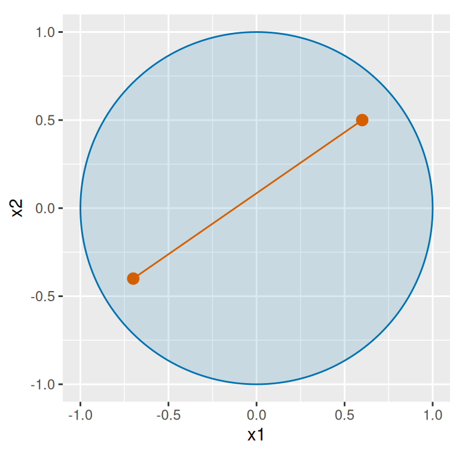
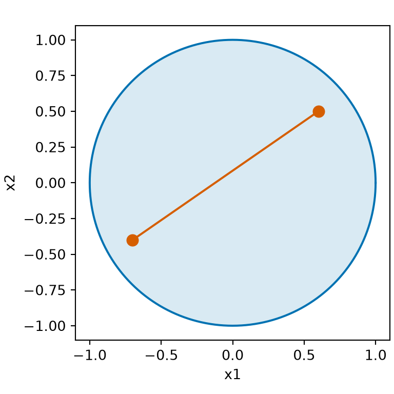
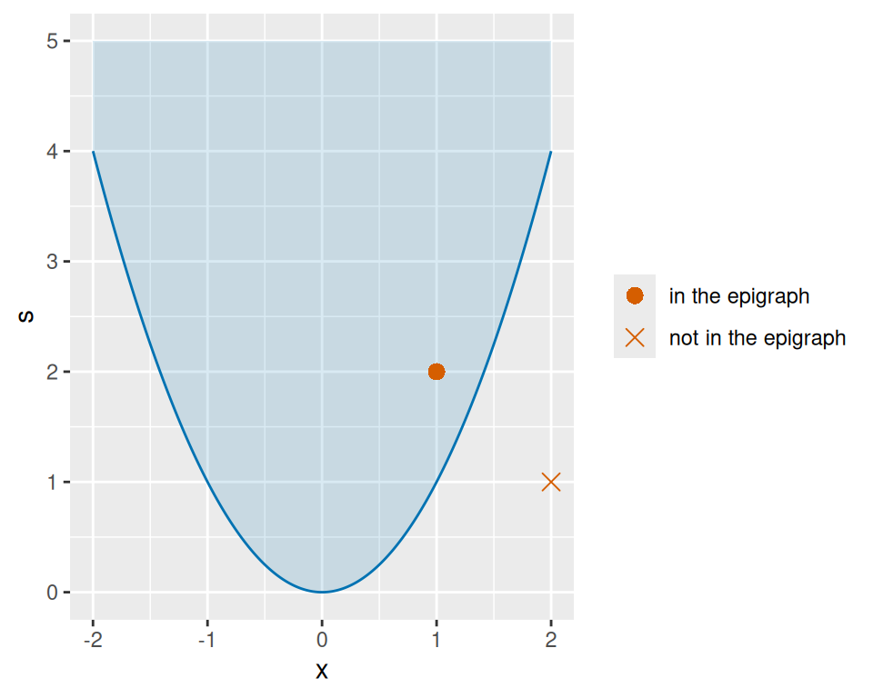
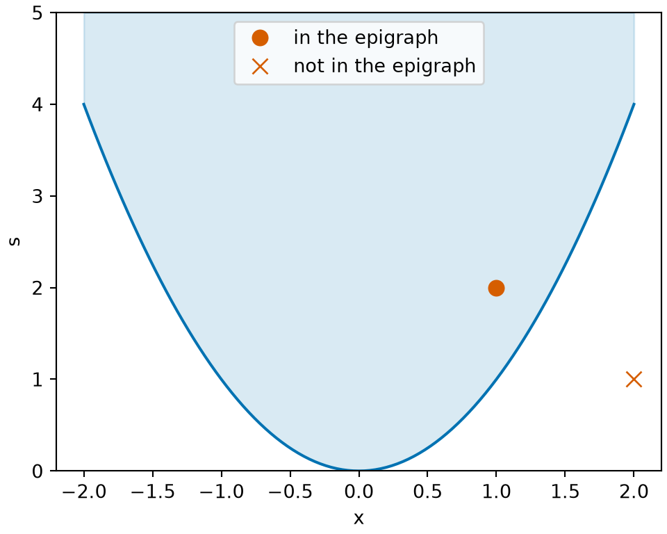

# Convexity in Several Variables

Code

Published

Last modified: 2026-10-30 02:22:19 (PDT)

## 0.1 Convexity in several variables

> **NOTE:**
>
> This section is adapted from the convexity part of Zhou [\[1\]](#ref-zhou2024optim), used under the MIT License (see the license text in [Linear Algebra](linear-algebra-subspaces.llms.md#sec-subspaces)). The source states the first-order test (in one direction) and the second-derivative test for convexity without proof; here both directions of the first-order test are proved, and the second-derivative test is proved from the Taylor theorem of [Section 2 in Critical Points and Optimality Conditions](optimization-critical-points.llms.md#sec-optimality-vector). The source defines both concave and strictly concave as “\\-f\\ is strictly convex”; here \\f\\ is concave when \\-f\\ is convex. The source states that an intersection of convex sets is convex and that a maximum of convex functions is convex for any finite number of them; here each is stated for two and the general case follows by induction. These parts of the source are not part of this section:
>
> - its catalogs of convex sets and convex functions, including the positive semidefinite matrices and \\-\log \det\\
> - intersections of infinitely many convex sets, and suprema of infinitely many convex functions
> - its examples, exercises and figures, including the multivariate normal maximum likelihood example

> **NOTE:**
>
> **Definition 1 (Convex set)** A set \\K \subseteq \mathbb{R}^p\\ is **convex** if [\[2\]](#ref-wikipedia_convex_set) for all \\\mathord{\smash\[b\]{\underset{\raise.3ex\hbox{\$\scriptstyle\sim\$}}{x}}\vphantom{x}}, \mathord{\smash\[b\]{\underset{\raise.3ex\hbox{\$\scriptstyle\sim\$}}{y}}\vphantom{y}}\in K\\ and all \\t \in \[0, 1\]\\, the point \\t \mathord{\smash\[b\]{\underset{\raise.3ex\hbox{\$\scriptstyle\sim\$}}{x}}\vphantom{x}}+ (1 - t) \mathord{\smash\[b\]{\underset{\raise.3ex\hbox{\$\scriptstyle\sim\$}}{y}}\vphantom{y}}\\ is in \\K\\: \\K\\ contains the whole line segment between any two of its points.

> **NOTE:**
>
> **Example 1 (Convex sets)**  
>
> - \\\mathbb{R}^p\\ is convex, and so is any set with at most one point.
>
> - The closed ball ([closed ball](vector-calculus.llms.md#def-closed-ball)) \\B = \mathopen{}\left\\\mathord{\smash\[b\]{\underset{\raise.3ex\hbox{\$\scriptstyle\sim\$}}{x}}\vphantom{x}}: \mathopen{}\left\lVert\mathord{\smash\[b\]{\underset{\raise.3ex\hbox{\$\scriptstyle\sim\$}}{x}}\vphantom{x}}\right\rVert\mathclose{} \le r\right\\\mathclose{}\\ is convex: for \\\mathord{\smash\[b\]{\underset{\raise.3ex\hbox{\$\scriptstyle\sim\$}}{x}}\vphantom{x}}, \mathord{\smash\[b\]{\underset{\raise.3ex\hbox{\$\scriptstyle\sim\$}}{y}}\vphantom{y}}\in B\\ and \\t \in \[0, 1\]\\,
>
>   \\ \begin{aligned} \mathopen{}\left\lVert t \mathord{\smash\[b\]{\underset{\raise.3ex\hbox{\$\scriptstyle\sim\$}}{x}}\vphantom{x}}+ (1 - t) \mathord{\smash\[b\]{\underset{\raise.3ex\hbox{\$\scriptstyle\sim\$}}{y}}\vphantom{y}}\right\rVert\mathclose{} &\le \mathopen{}\left\lVert t \mathord{\smash\[b\]{\underset{\raise.3ex\hbox{\$\scriptstyle\sim\$}}{x}}\vphantom{x}}\right\rVert\mathclose{} + \mathopen{}\left\lVert(1 - t) \mathord{\smash\[b\]{\underset{\raise.3ex\hbox{\$\scriptstyle\sim\$}}{y}}\vphantom{y}}\right\rVert\mathclose{} && \text{(triangle inequality)} \\ &= t\\\mathopen{}\left\lVert\mathord{\smash\[b\]{\underset{\raise.3ex\hbox{\$\scriptstyle\sim\$}}{x}}\vphantom{x}}\right\rVert\mathclose{} + (1 - t)\\\mathopen{}\left\lVert\mathord{\smash\[b\]{\underset{\raise.3ex\hbox{\$\scriptstyle\sim\$}}{y}}\vphantom{y}}\right\rVert\mathclose{} && \text{(norm of a multiple; } t, 1 - t \ge 0 \text{)} \\ &\le t\\r + (1 - t)\\r && \text{(} \mathord{\smash\[b\]{\underset{\raise.3ex\hbox{\$\scriptstyle\sim\$}}{x}}\vphantom{x}}, \mathord{\smash\[b\]{\underset{\raise.3ex\hbox{\$\scriptstyle\sim\$}}{y}}\vphantom{y}}\in B \text{)} \\ &= r. && \text{(arithmetic)} \end{aligned} \\
>
>   The first step is the [triangle inequality](linear-algebra-inner-products.llms.md#thm-triangle-inequality), and the second uses [the norm of a multiple](linear-algebra-inner-products.llms.md#thm-norm-properties).

> **NOTE:**
>
> **Example 2 (A set that is not convex)** \\K = \mathopen{}\left\\x \in \mathbb{R}: \mathopen{}\left\|x\right\|\mathclose{} \ge 1\right\\\mathclose{}\\ is not convex: \\-1\\ and \\1\\ are in \\K\\, but with \\t = \tfrac{1}{2}\\ the point \\\tfrac{1}{2}(-1) + \tfrac{1}{2}(1) = 0\\ is not.

> **NOTE:**
>
> Show R code
>
> ``` downlit
> cs_angle_fc <- seq(0, 2 * pi, length.out = 201)
> cs_cos_fc <- cos(cs_angle_fc)
> cs_sin_fc <- sin(cs_angle_fc)
> cs_disk_fc <- tibble::tibble(x1 = cs_cos_fc, x2 = cs_sin_fc)
> cs_points_x1_fc <- c(-0.7, 0.6)
> cs_points_x2_fc <- c(-0.4, 0.5)
> cs_points_fc <- tibble::tibble(x1 = cs_points_x1_fc, x2 = cs_points_x2_fc)
> cs_segment_fc <- tibble::tibble(
>   x1 = -0.7, x2 = -0.4, x1_end = 0.6, x2_end = 0.5
> )
> cs_aes_fc <- ggplot2::aes(x1, x2)
> cs_seg_aes_fc <- ggplot2::aes(xend = x1_end, yend = x2_end)
> ggplot2::ggplot(cs_disk_fc, cs_aes_fc) +
>   ggplot2::geom_polygon(fill = "#0072B2", alpha = 0.15, colour = "#0072B2") +
>   ggplot2::geom_segment(
>     data = cs_segment_fc, mapping = cs_seg_aes_fc, colour = "#D55E00"
>   ) +
>   ggplot2::geom_point(data = cs_points_fc, colour = "#D55E00", size = 3) +
>   ggplot2::coord_fixed() +
>   ggplot2::labs(x = "x1", y = "x2")
> ```
>
> Show R code
>
> ``` python
> import matplotlib.pyplot as plt
> import numpy as np
>
> cs_angle_fc = np.linspace(0, 2 * np.pi, 201)
> cs_x1_fc = np.array([-0.7, 0.6])
> cs_x2_fc = np.array([-0.4, 0.5])
> fig, ax = plt.subplots(figsize=(4, 4), layout="constrained")
> ax.fill(np.cos(cs_angle_fc), np.sin(cs_angle_fc), color="#0072B2", alpha=0.15)
> ax.plot(np.cos(cs_angle_fc), np.sin(cs_angle_fc), color="#0072B2")
> ax.plot(cs_x1_fc, cs_x2_fc, "o-", color="#D55E00", markersize=8)
> ax.set_aspect("equal")
> ax.set_xlabel("x1")
> ax.set_ylabel("x2")
> plt.show()
> ```
>
> ## R
>
> [](optimization-convexity_files/figure-html/convex-set-r-1.png "Figure 1: The closed ball of Example 1 in \mathbb{R}^2 with r = 1. The segment between two of its points stays in the ball, as a convex set requires.")
>
> ## Python
>
> [](optimization-convexity_files/figure-html/convex-set-python-1.png "Figure 1: The closed ball of Example 1 in \mathbb{R}^2 with r = 1. The segment between two of its points stays in the ball, as a convex set requires.")
>
> Figure 1: The [closed ball](vector-calculus.llms.md#def-closed-ball) of [Example 1](#exm-convex-set) in \\\mathbb{R}^2\\ with \\r = 1\\. The segment between two of its points stays in the ball, as a [convex set](#def-convex-set) requires.

> **NOTE:**
>
> **Definition 2 (Half-space)** Let \\\mathord{\smash\[b\]{\underset{\raise.3ex\hbox{\$\scriptstyle\sim\$}}{a}}\vphantom{a}} \in \mathbb{R}^p\\ be a nonzero vector and \\c\\ a real number. The set \\\mathopen{}\left\\\mathord{\smash\[b\]{\underset{\raise.3ex\hbox{\$\scriptstyle\sim\$}}{x}}\vphantom{x}}\in \mathbb{R}^p : \mathord{\smash\[b\]{\underset{\raise.3ex\hbox{\$\scriptstyle\sim\$}}{a}}\vphantom{a}} \cdot \mathord{\smash\[b\]{\underset{\raise.3ex\hbox{\$\scriptstyle\sim\$}}{x}}\vphantom{x}} \ge c\right\\\mathclose{}\\ is a (closed) **half-space**: the points on one side of the boundary \\\mathopen{}\left\\\mathord{\smash\[b\]{\underset{\raise.3ex\hbox{\$\scriptstyle\sim\$}}{x}}\vphantom{x}}: \mathord{\smash\[b\]{\underset{\raise.3ex\hbox{\$\scriptstyle\sim\$}}{a}}\vphantom{a}} \cdot \mathord{\smash\[b\]{\underset{\raise.3ex\hbox{\$\scriptstyle\sim\$}}{x}}\vphantom{x}} = c\right\\\mathclose{}\\, together with the boundary. In \\\mathbb{R}^2\\, a half-space is called a **half-plane**.

> **NOTE:**
>
> **Example 3 (The right half-plane)** With \\\mathord{\smash\[b\]{\underset{\raise.3ex\hbox{\$\scriptstyle\sim\$}}{a}}\vphantom{a}} = {(1, 0)}^{\top}\\ and \\c = 0\\, the half-plane \\\mathopen{}\left\\\mathord{\smash\[b\]{\underset{\raise.3ex\hbox{\$\scriptstyle\sim\$}}{x}}\vphantom{x}}\in \mathbb{R}^2 : x_1 \ge 0\right\\\mathclose{}\\ is the set of points on or to the right of the \\x_2\\-axis. \\{(1, 5)}^{\top}\\ is in it, since \\1 \ge 0\\; \\{(0, -3)}^{\top}\\ is in it, on the boundary; and \\{(-1, 0)}^{\top}\\ is not, since \\-1 \< 0\\.

> **NOTE:**
>
> **Theorem 1 (An intersection of convex sets is convex)** If \\K_1\\ and \\K_2\\ are convex subsets of \\\mathbb{R}^p\\ ([Definition 1](#def-convex-set)), then \\K_1 \cap K_2\\ is convex.

> **NOTE:**
>
> *Proof*. Let \\\mathord{\smash\[b\]{\underset{\raise.3ex\hbox{\$\scriptstyle\sim\$}}{x}}\vphantom{x}}, \mathord{\smash\[b\]{\underset{\raise.3ex\hbox{\$\scriptstyle\sim\$}}{y}}\vphantom{y}}\in K_1 \cap K_2\\ and \\t \in \[0, 1\]\\. Then \\\mathord{\smash\[b\]{\underset{\raise.3ex\hbox{\$\scriptstyle\sim\$}}{x}}\vphantom{x}}, \mathord{\smash\[b\]{\underset{\raise.3ex\hbox{\$\scriptstyle\sim\$}}{y}}\vphantom{y}}\in K_1\\, so \\t \mathord{\smash\[b\]{\underset{\raise.3ex\hbox{\$\scriptstyle\sim\$}}{x}}\vphantom{x}}+ (1 - t) \mathord{\smash\[b\]{\underset{\raise.3ex\hbox{\$\scriptstyle\sim\$}}{y}}\vphantom{y}}\in K_1\\, since \\K_1\\ is convex; in the same way \\t \mathord{\smash\[b\]{\underset{\raise.3ex\hbox{\$\scriptstyle\sim\$}}{x}}\vphantom{x}}+ (1 - t) \mathord{\smash\[b\]{\underset{\raise.3ex\hbox{\$\scriptstyle\sim\$}}{y}}\vphantom{y}}\in K_2\\. So \\t \mathord{\smash\[b\]{\underset{\raise.3ex\hbox{\$\scriptstyle\sim\$}}{x}}\vphantom{x}}+ (1 - t) \mathord{\smash\[b\]{\underset{\raise.3ex\hbox{\$\scriptstyle\sim\$}}{y}}\vphantom{y}}\in K_1 \cap K_2\\.

> **NOTE:**
>
> **Example 4 (Intersecting a ball with a half-plane)** The closed unit ball ([unit ball](vector-calculus.llms.md#def-unit-ball)) in \\\mathbb{R}^2\\ is convex ([Example 1](#exm-convex-set)), and so is the half-plane ([Definition 2](#def-half-space)) \\\mathopen{}\left\\\mathord{\smash\[b\]{\underset{\raise.3ex\hbox{\$\scriptstyle\sim\$}}{x}}\vphantom{x}}: x_1 \ge 0\right\\\mathclose{}\\: if \\x_1 \ge 0\\ and \\y_1 \ge 0\\, then \\t x_1 + (1 - t) y_1 \ge 0\\ for \\t \in \[0, 1\]\\. By [Theorem 1](#thm-convex-intersection), the closed half-disk \\\mathopen{}\left\\\mathord{\smash\[b\]{\underset{\raise.3ex\hbox{\$\scriptstyle\sim\$}}{x}}\vphantom{x}}: \mathopen{}\left\lVert\mathord{\smash\[b\]{\underset{\raise.3ex\hbox{\$\scriptstyle\sim\$}}{x}}\vphantom{x}}\right\rVert\mathclose{} \le 1,\\ x_1 \ge 0\right\\\mathclose{}\\ is convex. A union need not be convex: \\\mathopen{}\left\\x \in \mathbb{R}: x \le -1\right\\\mathclose{}\\ and \\\mathopen{}\left\\x \in \mathbb{R}: x \ge 1\right\\\mathclose{}\\ are convex, but their union is the set of [Example 2](#exm-not-convex-set).

> **NOTE:**
>
> **Definition 3 (Strictly convex function)** A function \\f : \mathbb{R}^p \to \mathbb{R}\\ is **strictly convex** if \\f(t \mathord{\smash\[b\]{\underset{\raise.3ex\hbox{\$\scriptstyle\sim\$}}{x}}\vphantom{x}}+ (1 - t) \mathord{\smash\[b\]{\underset{\raise.3ex\hbox{\$\scriptstyle\sim\$}}{y}}\vphantom{y}}) \< t f(\mathord{\smash\[b\]{\underset{\raise.3ex\hbox{\$\scriptstyle\sim\$}}{x}}\vphantom{x}}) + (1 - t) f(\mathord{\smash\[b\]{\underset{\raise.3ex\hbox{\$\scriptstyle\sim\$}}{y}}\vphantom{y}})\\ for all \\\mathord{\smash\[b\]{\underset{\raise.3ex\hbox{\$\scriptstyle\sim\$}}{x}}\vphantom{x}}\ne \mathord{\smash\[b\]{\underset{\raise.3ex\hbox{\$\scriptstyle\sim\$}}{y}}\vphantom{y}}\\ in \\\mathbb{R}^p\\ and all \\t \in (0, 1)\\.

> **NOTE:**
>
> **Definition 4 (Concave function)** A function \\f : \mathbb{R}^p \to \mathbb{R}\\ is **concave** if \\-f\\ is [convex](algebra-sums.llms.md#def-convex-function).

> **NOTE:**
>
> **Definition 5 (Strictly concave function)** A function \\f : \mathbb{R}^p \to \mathbb{R}\\ is **strictly concave** if \\-f\\ is strictly convex ([Definition 3](#def-strictly-convex)).

> **NOTE:**
>
> **Example 5 (Strictly convex, and convex but not strictly)**  
>
> - \\f(x) = x^2\\ is strictly convex:
>
>   \\ \begin{aligned} t x^2 + (1 - t) y^2 - (t x + (1 - t) y)^2 &= t x^2 + (1 - t) y^2 - t^2 x^2 - 2 t (1 - t) x y - (1 - t)^2 y^2 && \text{(expand the square)} \\ &= t (1 - t) x^2 - 2 t (1 - t) x y + t (1 - t) y^2 && \text{(} t - t^2 = t (1 - t) \text{, } (1 - t) - (1 - t)^2 = t (1 - t) \text{)} \\ &= t (1 - t) (x - y)^2, && \text{(factor)} \end{aligned} \\
>
>   which is positive when \\x \ne y\\ and \\t \in (0, 1)\\. At \\t \in \mathopen{}\left\\0, 1\right\\\mathclose{}\\ or \\x = y\\ it is \\0\\, so \\x^2\\ is also convex.
>
> - \\f(x) = 2x + 1\\ is convex but not strictly convex:
>
>   \\ \begin{aligned} f(t x + (1 - t) y) &= 2 t x + 2 (1 - t) y + 1 \\ &= t f(x) + (1 - t) f(y) \end{aligned} \\
>
>   for every \\x, y, t\\, so the inequality holds, but never strictly. It is also concave.

> **NOTE:**
>
> **Theorem 2 (The maximum of convex functions is convex)** If \\f_1\\ and \\f_2\\ are [convex](algebra-sums.llms.md#def-convex-function) functions on \\\mathbb{R}^p\\, then \\f(\mathord{\smash\[b\]{\underset{\raise.3ex\hbox{\$\scriptstyle\sim\$}}{x}}\vphantom{x}}) \stackrel{\text{def}}{=}\max\mathopen{}\left\\f_1(\mathord{\smash\[b\]{\underset{\raise.3ex\hbox{\$\scriptstyle\sim\$}}{x}}\vphantom{x}}), f_2(\mathord{\smash\[b\]{\underset{\raise.3ex\hbox{\$\scriptstyle\sim\$}}{x}}\vphantom{x}})\right\\\mathclose{}\\ is convex.

> **NOTE:**
>
> *Proof*. Let \\\mathord{\smash\[b\]{\underset{\raise.3ex\hbox{\$\scriptstyle\sim\$}}{x}}\vphantom{x}}, \mathord{\smash\[b\]{\underset{\raise.3ex\hbox{\$\scriptstyle\sim\$}}{y}}\vphantom{y}}\in \mathbb{R}^p\\ and \\t \in \[0, 1\]\\. For \\i = 1, 2\\,
>
> \\ \begin{aligned} f_i(t \mathord{\smash\[b\]{\underset{\raise.3ex\hbox{\$\scriptstyle\sim\$}}{x}}\vphantom{x}}+ (1 - t) \mathord{\smash\[b\]{\underset{\raise.3ex\hbox{\$\scriptstyle\sim\$}}{y}}\vphantom{y}}) &\le t f_i(\mathord{\smash\[b\]{\underset{\raise.3ex\hbox{\$\scriptstyle\sim\$}}{x}}\vphantom{x}}) + (1 - t) f_i(\mathord{\smash\[b\]{\underset{\raise.3ex\hbox{\$\scriptstyle\sim\$}}{y}}\vphantom{y}}) && \text{(} f_i \text{ is convex)} \\ &\le t f(\mathord{\smash\[b\]{\underset{\raise.3ex\hbox{\$\scriptstyle\sim\$}}{x}}\vphantom{x}}) + (1 - t) f(\mathord{\smash\[b\]{\underset{\raise.3ex\hbox{\$\scriptstyle\sim\$}}{y}}\vphantom{y}}). && \text{(} f_i \le f \text{, and } t, 1 - t \ge 0 \text{)} \end{aligned} \\
>
> Both \\f_1\\ and \\f_2\\ at \\t \mathord{\smash\[b\]{\underset{\raise.3ex\hbox{\$\scriptstyle\sim\$}}{x}}\vphantom{x}}+ (1 - t) \mathord{\smash\[b\]{\underset{\raise.3ex\hbox{\$\scriptstyle\sim\$}}{y}}\vphantom{y}}\\ are at most \\t f(\mathord{\smash\[b\]{\underset{\raise.3ex\hbox{\$\scriptstyle\sim\$}}{x}}\vphantom{x}}) + (1 - t) f(\mathord{\smash\[b\]{\underset{\raise.3ex\hbox{\$\scriptstyle\sim\$}}{y}}\vphantom{y}})\\, so their maximum \\f(t \mathord{\smash\[b\]{\underset{\raise.3ex\hbox{\$\scriptstyle\sim\$}}{x}}\vphantom{x}}+ (1 - t) \mathord{\smash\[b\]{\underset{\raise.3ex\hbox{\$\scriptstyle\sim\$}}{y}}\vphantom{y}})\\ is too.

> **NOTE:**
>
> **Example 6 (A maximum is convex; a minimum need not be)**  
>
> - \\f_1(x) = x\\ is convex, by the computation for \\2x + 1\\ in [Example 5](#exm-strictly-convex) with \\2\\ and \\1\\ replaced by \\1\\ and \\0\\, and \\f_2(x) = x^2\\ is convex by the same example, so \\\max\mathopen{}\left\\x, x^2\right\\\mathclose{}\\ is convex by [Theorem 2](#thm-convex-max).
>
> - The minimum of two convex functions need not be convex: \\g(x) = \min\mathopen{}\left\\x^2, (x - 2)^2\right\\\mathclose{}\\ has
>
>   \\ \begin{aligned} g(0) &= g(2) \\ &= 0, \end{aligned} \\
>
>   but at the midpoint
>
>   \\ \begin{aligned} g(1) &= \min\mathopen{}\left\\1, 1\right\\\mathclose{} \\ &= 1 \\ &\> \tfrac{1}{2} g(0) + \tfrac{1}{2} g(2) \\ &= 0. \end{aligned} \\

> **NOTE:**
>
> Show R code
>
> ``` downlit
> cm_x_fm <- seq(-1, 3, length.out = 201)
> cm_levels_fm <- c("max{x, x^2}", "min{x^2, (x - 2)^2}")
> cm_max_value_fm <- pmax(cm_x_fm, cm_x_fm^2)
> cm_min_value_fm <- pmin(cm_x_fm^2, (cm_x_fm - 2)^2)
> cm_max_fm <- tibble::tibble(
>   x = cm_x_fm, value = cm_max_value_fm, panel = cm_levels_fm[1]
> )
> cm_min_fm <- tibble::tibble(
>   x = cm_x_fm, value = cm_min_value_fm, panel = cm_levels_fm[2]
> )
> cm_main_fm <- dplyr::bind_rows(cm_max_fm, cm_min_fm)
> cm_main_fm$panel <- factor(cm_main_fm$panel, levels = cm_levels_fm)
> cm_square_value_fm <- cm_x_fm^2
> cm_line_fm <- tibble::tibble(
>   x = cm_x_fm, value = cm_x_fm, panel = cm_levels_fm[1], part = "x"
> )
> cm_square_fm <- tibble::tibble(
>   x = cm_x_fm, value = cm_square_value_fm, panel = cm_levels_fm[1],
>   part = "x^2"
> )
> cm_parts_fm <- dplyr::bind_rows(cm_line_fm, cm_square_fm)
> cm_parts_fm$panel <- factor(cm_parts_fm$panel, levels = cm_levels_fm)
> cm_chord_fm <- tibble::tibble(
>   x = 0, xend = 2, value = 0, panel = cm_levels_fm[2]
> )
> cm_chord_fm$panel <- factor(cm_chord_fm$panel, levels = cm_levels_fm)
> cm_mid_fm <- tibble::tibble(x = 1, value = 1, panel = cm_levels_fm[2])
> cm_mid_fm$panel <- factor(cm_mid_fm$panel, levels = cm_levels_fm)
> cm_aes_fm <- ggplot2::aes(x, value)
> cm_parts_aes_fm <- ggplot2::aes(group = part)
> cm_chord_aes_fm <- ggplot2::aes(xend = xend, yend = value)
> ggplot2::ggplot(cm_main_fm, cm_aes_fm) +
>   ggplot2::geom_line(
>     data = cm_parts_fm, mapping = cm_parts_aes_fm,
>     colour = "grey60", linewidth = 0.4
>   ) +
>   ggplot2::geom_line(colour = "#0072B2") +
>   ggplot2::geom_segment(
>     data = cm_chord_fm, mapping = cm_chord_aes_fm, colour = "#D55E00"
>   ) +
>   ggplot2::geom_point(data = cm_mid_fm, colour = "#D55E00", size = 3) +
>   ggplot2::facet_wrap(~panel, scales = "free_y") +
>   ggplot2::labs(x = "x", y = NULL)
> ```
>
> Show R code
>
> ``` python
> import matplotlib.pyplot as plt
> import numpy as np
>
> cm_x_fm = np.linspace(-1, 3, 201)
> fig, axes = plt.subplots(1, 2, figsize=(7, 3.5), layout="constrained")
> axes[0].plot(cm_x_fm, cm_x_fm, color="grey", linewidth=0.8)
> axes[0].plot(cm_x_fm, cm_x_fm**2, color="grey", linewidth=0.8)
> axes[0].plot(cm_x_fm, np.maximum(cm_x_fm, cm_x_fm**2), color="#0072B2")
> axes[0].set_title("max{x, x^2}")
> axes[1].plot(cm_x_fm, np.minimum(cm_x_fm**2, (cm_x_fm - 2)**2), color="#0072B2")
> axes[1].plot([0, 2], [0, 0], "o-", color="#D55E00", markersize=6)
> axes[1].plot(1, 1, "o", color="#D55E00", markersize=8)
> axes[1].set_title("min{x^2, (x - 2)^2}")
> for ax in axes:
>     ax.set_xlabel("x")
> plt.show()
> ```
>
> ## R
>
> [](optimization-convexity_files/figure-html/convex-max-r-3.png "Figure 2: The functions of Example 6. The maximum of the two convex functions on the left is again one. The minimum on the right is not: g(1) = 1 is above \tfrac{1}{2} g(0) + \tfrac{1}{2} g(2) = 0, the height of the segment.")
>
> ## Python
>
> [](optimization-convexity_files/figure-html/convex-max-python-1.png "Figure 2: The functions of Example 6. The maximum of the two convex functions on the left is again one. The minimum on the right is not: g(1) = 1 is above \tfrac{1}{2} g(0) + \tfrac{1}{2} g(2) = 0, the height of the segment.")
>
> Figure 2: The [functions](functions.llms.md#def-function) of [Example 6](#exm-convex-max). The [maximum](algebra-basics.llms.md#def-maximum) of the two [convex functions](algebra-sums.llms.md#def-convex-function) on the left is again one. The [minimum](algebra-basics.llms.md#def-minimum) on the right is not: \\g(1) = 1\\ is above \\\tfrac{1}{2} g(0) + \tfrac{1}{2} g(2) = 0\\, the height of the segment.

> **NOTE:**
>
> **Definition 6 (Epigraph)** The **epigraph** [\[3\]](#ref-wikipedia_epigraph_mathematics) of \\f : \mathbb{R}^p \to \mathbb{R}\\ is the set of points on or over its [graph](functions.llms.md#def-graph),
>
> \\ \operatorname{epi} f \stackrel{\text{def}}{=}\mathopen{}\left\\(\mathord{\smash\[b\]{\underset{\raise.3ex\hbox{\$\scriptstyle\sim\$}}{x}}\vphantom{x}}, s) : \mathord{\smash\[b\]{\underset{\raise.3ex\hbox{\$\scriptstyle\sim\$}}{x}}\vphantom{x}}\in \mathbb{R}^p,\\ s \in \mathbb{R},\\ f(\mathord{\smash\[b\]{\underset{\raise.3ex\hbox{\$\scriptstyle\sim\$}}{x}}\vphantom{x}}) \le s\right\\\mathclose{}. \\
>
> A pair \\(\mathord{\smash\[b\]{\underset{\raise.3ex\hbox{\$\scriptstyle\sim\$}}{x}}\vphantom{x}}, s)\\ is treated as the \\(p + 1)\\-vector with entries \\x_1, \ldots, x_p, s\\, so \\\operatorname{epi} f \subseteq \mathbb{R}^{p+1}\\, and sums and multiples of pairs are taken entry by entry.

> **NOTE:**
>
> **Example 7 (The epigraph of \\x^2\\)** For \\f(x) = x^2\\, \\\operatorname{epi} f = \mathopen{}\left\\(x, s) : x^2 \le s\right\\\mathclose{}\\, the points \\(x, s)\\ on the parabola \\s = x^2\\ or on the side of it where \\s\\ is larger. \\(1, 2)\\ is in it, since \\1^2 \le 2\\; \\(2, 1)\\ is not, since \\2^2 \> 1\\.

> **NOTE:**
>
> Show R code
>
> ``` downlit
> ep_x_fe <- seq(-2, 2, length.out = 201)
> ep_curve_fe <- tibble::tibble(x = ep_x_fe, s = ep_x_fe^2, top = 5)
> ep_marks_x_fe <- c(1, 2)
> ep_marks_s_fe <- c(2, 1)
> ep_marks_kind_fe <- c("in the epigraph", "not in the epigraph")
> ep_marks_fe <- tibble::tibble(
>   x = ep_marks_x_fe, s = ep_marks_s_fe, kind = ep_marks_kind_fe
> )
> ep_aes_fe <- ggplot2::aes(x, s)
> ep_ribbon_aes_fe <- ggplot2::aes(ymin = s, ymax = top)
> ep_marks_aes_fe <- ggplot2::aes(shape = kind)
> ep_shapes_fe <- c("in the epigraph" = 16, "not in the epigraph" = 4)
> ggplot2::ggplot(ep_curve_fe, ep_aes_fe) +
>   ggplot2::geom_ribbon(
>     mapping = ep_ribbon_aes_fe, fill = "#0072B2", alpha = 0.15
>   ) +
>   ggplot2::geom_line(colour = "#0072B2") +
>   ggplot2::geom_point(
>     data = ep_marks_fe, mapping = ep_marks_aes_fe,
>     colour = "#D55E00", size = 3
>   ) +
>   ggplot2::scale_shape_manual(values = ep_shapes_fe) +
>   ggplot2::labs(x = "x", y = "s", shape = NULL)
> ```
>
> Show R code
>
> ``` python
> import matplotlib.pyplot as plt
> import numpy as np
>
> ep_x_fe = np.linspace(-2, 2, 201)
> fig, ax = plt.subplots(figsize=(5, 4), layout="constrained")
> ax.fill_between(ep_x_fe, ep_x_fe**2, 5, color="#0072B2", alpha=0.15)
> ax.plot(ep_x_fe, ep_x_fe**2, color="#0072B2")
> ax.plot(1, 2, "o", color="#D55E00", markersize=8, label="in the epigraph")
> ax.plot(2, 1, "x", color="#D55E00", markersize=8, label="not in the epigraph")
> ax.set_ylim(0, 5)
> #> (0.0, 5.0)
> ax.set_xlabel("x")
> ax.set_ylabel("s")
> ax.legend(loc="upper center")
> plt.show()
> ```
>
> ## R
>
> [](optimization-convexity_files/figure-html/epigraph-r-3.png "Figure 3: The epigraph of f(x) = x^2 (Example 7): the shaded points on or above the parabola. (1, 2) is in it, and (2, 1) is not.")
>
> ## Python
>
> [](optimization-convexity_files/figure-html/epigraph-python-1.png "Figure 3: The epigraph of f(x) = x^2 (Example 7): the shaded points on or above the parabola. (1, 2) is in it, and (2, 1) is not.")
>
> Figure 3: The [epigraph](#def-epigraph) of \\f(x) = x^2\\ ([Example 7](#exm-def-epigraph)): the shaded points on or above the [parabola](algebra-exponentials.llms.md#def-parabola). \\(1, 2)\\ is in it, and \\(2, 1)\\ is not.

> **NOTE:**
>
> **Theorem 3 (Convexity through the epigraph)** \\f : \mathbb{R}^p \to \mathbb{R}\\ is [convex](algebra-sums.llms.md#def-convex-function) if and only if its epigraph ([Definition 6](#def-epigraph)) is convex ([Definition 1](#def-convex-set)).

> **NOTE:**
>
> *Proof*. **If.** Let \\\mathord{\smash\[b\]{\underset{\raise.3ex\hbox{\$\scriptstyle\sim\$}}{x}}\vphantom{x}}, \mathord{\smash\[b\]{\underset{\raise.3ex\hbox{\$\scriptstyle\sim\$}}{y}}\vphantom{y}}\in \mathbb{R}^p\\ and \\t \in \[0, 1\]\\. The points \\(\mathord{\smash\[b\]{\underset{\raise.3ex\hbox{\$\scriptstyle\sim\$}}{x}}\vphantom{x}}, f(\mathord{\smash\[b\]{\underset{\raise.3ex\hbox{\$\scriptstyle\sim\$}}{x}}\vphantom{x}}))\\ and \\(\mathord{\smash\[b\]{\underset{\raise.3ex\hbox{\$\scriptstyle\sim\$}}{y}}\vphantom{y}}, f(\mathord{\smash\[b\]{\underset{\raise.3ex\hbox{\$\scriptstyle\sim\$}}{y}}\vphantom{y}}))\\ are in \\\operatorname{epi} f\\, since \\f(\mathord{\smash\[b\]{\underset{\raise.3ex\hbox{\$\scriptstyle\sim\$}}{x}}\vphantom{x}}) \le f(\mathord{\smash\[b\]{\underset{\raise.3ex\hbox{\$\scriptstyle\sim\$}}{x}}\vphantom{x}})\\ and \\f(\mathord{\smash\[b\]{\underset{\raise.3ex\hbox{\$\scriptstyle\sim\$}}{y}}\vphantom{y}}) \le f(\mathord{\smash\[b\]{\underset{\raise.3ex\hbox{\$\scriptstyle\sim\$}}{y}}\vphantom{y}})\\. Since \\\operatorname{epi} f\\ is convex, it contains
>
> \\ t\\(\mathord{\smash\[b\]{\underset{\raise.3ex\hbox{\$\scriptstyle\sim\$}}{x}}\vphantom{x}}, f(\mathord{\smash\[b\]{\underset{\raise.3ex\hbox{\$\scriptstyle\sim\$}}{x}}\vphantom{x}})) + (1 - t)\\(\mathord{\smash\[b\]{\underset{\raise.3ex\hbox{\$\scriptstyle\sim\$}}{y}}\vphantom{y}}, f(\mathord{\smash\[b\]{\underset{\raise.3ex\hbox{\$\scriptstyle\sim\$}}{y}}\vphantom{y}})) = \mathopen{}\left(t \mathord{\smash\[b\]{\underset{\raise.3ex\hbox{\$\scriptstyle\sim\$}}{x}}\vphantom{x}}+ (1 - t) \mathord{\smash\[b\]{\underset{\raise.3ex\hbox{\$\scriptstyle\sim\$}}{y}}\vphantom{y}},\\ t f(\mathord{\smash\[b\]{\underset{\raise.3ex\hbox{\$\scriptstyle\sim\$}}{x}}\vphantom{x}}) + (1 - t) f(\mathord{\smash\[b\]{\underset{\raise.3ex\hbox{\$\scriptstyle\sim\$}}{y}}\vphantom{y}})\right)\mathclose{}, \\
>
> and by [Definition 6](#def-epigraph) that membership means \\f(t \mathord{\smash\[b\]{\underset{\raise.3ex\hbox{\$\scriptstyle\sim\$}}{x}}\vphantom{x}}+ (1 - t) \mathord{\smash\[b\]{\underset{\raise.3ex\hbox{\$\scriptstyle\sim\$}}{y}}\vphantom{y}}) \le t f(\mathord{\smash\[b\]{\underset{\raise.3ex\hbox{\$\scriptstyle\sim\$}}{x}}\vphantom{x}}) + (1 - t) f(\mathord{\smash\[b\]{\underset{\raise.3ex\hbox{\$\scriptstyle\sim\$}}{y}}\vphantom{y}})\\.
>
> **Only if.** Let \\(\mathord{\smash\[b\]{\underset{\raise.3ex\hbox{\$\scriptstyle\sim\$}}{x}}\vphantom{x}}, s)\\ and \\(\mathord{\smash\[b\]{\underset{\raise.3ex\hbox{\$\scriptstyle\sim\$}}{y}}\vphantom{y}}, u)\\ be in \\\operatorname{epi} f\\, so \\f(\mathord{\smash\[b\]{\underset{\raise.3ex\hbox{\$\scriptstyle\sim\$}}{x}}\vphantom{x}}) \le s\\ and \\f(\mathord{\smash\[b\]{\underset{\raise.3ex\hbox{\$\scriptstyle\sim\$}}{y}}\vphantom{y}}) \le u\\, and let \\t \in \[0, 1\]\\. Then
>
> \\ \begin{aligned} f(t \mathord{\smash\[b\]{\underset{\raise.3ex\hbox{\$\scriptstyle\sim\$}}{x}}\vphantom{x}}+ (1 - t) \mathord{\smash\[b\]{\underset{\raise.3ex\hbox{\$\scriptstyle\sim\$}}{y}}\vphantom{y}}) &\le t f(\mathord{\smash\[b\]{\underset{\raise.3ex\hbox{\$\scriptstyle\sim\$}}{x}}\vphantom{x}}) + (1 - t) f(\mathord{\smash\[b\]{\underset{\raise.3ex\hbox{\$\scriptstyle\sim\$}}{y}}\vphantom{y}}) && \text{(} f \text{ is convex)} \\ &\le t s + (1 - t) u, && \text{(} f(\mathord{\smash\[b\]{\underset{\raise.3ex\hbox{\$\scriptstyle\sim\$}}{x}}\vphantom{x}}) \le s \text{, } f(\mathord{\smash\[b\]{\underset{\raise.3ex\hbox{\$\scriptstyle\sim\$}}{y}}\vphantom{y}}) \le u \text{, and } t, 1 - t \ge 0 \text{)} \end{aligned} \\
>
> so \\t\\(\mathord{\smash\[b\]{\underset{\raise.3ex\hbox{\$\scriptstyle\sim\$}}{x}}\vphantom{x}}, s) + (1 - t)\\(\mathord{\smash\[b\]{\underset{\raise.3ex\hbox{\$\scriptstyle\sim\$}}{y}}\vphantom{y}}, u) = (t \mathord{\smash\[b\]{\underset{\raise.3ex\hbox{\$\scriptstyle\sim\$}}{x}}\vphantom{x}}+ (1 - t) \mathord{\smash\[b\]{\underset{\raise.3ex\hbox{\$\scriptstyle\sim\$}}{y}}\vphantom{y}},\\ t s + (1 - t) u)\\ is in \\\operatorname{epi} f\\.

> **NOTE:**
>
> **Example 8 (Two epigraphs)**  
>
> - The epigraph of \\f(x) = \mathopen{}\left\|x\right\|\mathclose{}\\ is \\\mathopen{}\left\\(x, s) : \mathopen{}\left\|x\right\|\mathclose{} \le s\right\\\mathclose{}\\, a wedge. It is the intersection of the half-planes \\\mathopen{}\left\\(x, s) : s - x \ge 0\right\\\mathclose{}\\ and \\\mathopen{}\left\\(x, s) : s + x \ge 0\right\\\mathclose{}\\. Each half-plane is convex: if \\s_1 - x_1 \ge 0\\ and \\s_2 - x_2 \ge 0\\, then \\(t s_1 + (1 - t) s_2) - (t x_1 + (1 - t) x_2) = t (s_1 - x_1) + (1 - t)(s_2 - x_2) \ge 0\\, and the same with \\+\\ for the other. So the wedge is convex ([Theorem 1](#thm-convex-intersection)), and \\\mathopen{}\left\|x\right\|\mathclose{}\\ is convex by [Theorem 3](#thm-epigraph).
> - The epigraph of \\g(x) = -x^2\\ is not convex: \\(-1, -1)\\ and \\(1, -1)\\ are in it, since \\g(\pm 1) = -1\\, but their midpoint \\(0, -1)\\ is not, since \\g(0) = 0 \> -1\\. So \\-x^2\\ is not convex.

> **NOTE:**
>
> **Definition 7 (Tangent plane)** Let \\f : \mathbb{R}^p \to \mathbb{R}\\ have a gradient at \\\mathord{\smash\[b\]{\underset{\raise.3ex\hbox{\$\scriptstyle\sim\$}}{y}}\vphantom{y}}\\ ([gradient](vector-calculus.llms.md#def-vector-derivative)). The **tangent plane** [\[4\]](#ref-wikipedia_tangent_space) to the [graph](functions.llms.md#def-graph) of \\f\\ at \\\mathord{\smash\[b\]{\underset{\raise.3ex\hbox{\$\scriptstyle\sim\$}}{y}}\vphantom{y}}\\ is the graph of the function
>
> \\ \mathord{\smash\[b\]{\underset{\raise.3ex\hbox{\$\scriptstyle\sim\$}}{x}}\vphantom{x}}\mapsto f(\mathord{\smash\[b\]{\underset{\raise.3ex\hbox{\$\scriptstyle\sim\$}}{y}}\vphantom{y}}) + {\mathopen{}\left(\frac{\partial}{\partial \mathord{\smash\[b\]{\underset{\raise.3ex\hbox{\$\scriptstyle\sim\$}}{x}}\vphantom{x}}} f(\mathord{\smash\[b\]{\underset{\raise.3ex\hbox{\$\scriptstyle\sim\$}}{y}}\vphantom{y}})\right)\mathclose{}}^{\top} (\mathord{\smash\[b\]{\underset{\raise.3ex\hbox{\$\scriptstyle\sim\$}}{x}}\vphantom{x}}- \mathord{\smash\[b\]{\underset{\raise.3ex\hbox{\$\scriptstyle\sim\$}}{y}}\vphantom{y}}), \\
>
> which takes the value \\f(\mathord{\smash\[b\]{\underset{\raise.3ex\hbox{\$\scriptstyle\sim\$}}{y}}\vphantom{y}})\\ at \\\mathord{\smash\[b\]{\underset{\raise.3ex\hbox{\$\scriptstyle\sim\$}}{x}}\vphantom{x}}= \mathord{\smash\[b\]{\underset{\raise.3ex\hbox{\$\scriptstyle\sim\$}}{y}}\vphantom{y}}\\ and has the same gradient as \\f\\ there.

> **NOTE:**
>
> **Example 9 (A tangent line and a tangent plane)**  
>
> - For \\f(x) = x^2\\ at \\y = 1\\, \\f(1) = 1\\ and \\f'(1) = 2\\, so the tangent line is
>
>   \\ \begin{aligned} s &= 1 + 2\\(x - 1) && \text{(substitute } f(1) \text{ and } f'(1) \text{)} \\ &= 1 + 2x - 2 && \text{(distribute)} \\ &= 2x - 1. && \text{(} 1 - 2 = -1 \text{)} \end{aligned} \\
>
> - For \\f(\mathord{\smash\[b\]{\underset{\raise.3ex\hbox{\$\scriptstyle\sim\$}}{x}}\vphantom{x}}) = x_1^2 + x_2^2\\ at \\\mathord{\smash\[b\]{\underset{\raise.3ex\hbox{\$\scriptstyle\sim\$}}{y}}\vphantom{y}}= {(1, 1)}^{\top}\\, \\f(\mathord{\smash\[b\]{\underset{\raise.3ex\hbox{\$\scriptstyle\sim\$}}{y}}\vphantom{y}}) = 2\\ and the gradient is \\{(2 y_1,\\ 2 y_2)}^{\top} = {(2, 2)}^{\top}\\, so the tangent plane is
>
>   \\ \begin{aligned} s &= 2 + 2\\(x_1 - 1) + 2\\(x_2 - 1) && \text{(substitute } f(\mathord{\smash\[b\]{\underset{\raise.3ex\hbox{\$\scriptstyle\sim\$}}{y}}\vphantom{y}}) \text{ and the gradient)} \\ &= 2 + 2 x_1 - 2 + 2 x_2 - 2 && \text{(distribute)} \\ &= 2 x_1 + 2 x_2 - 2. && \text{(} 2 - 2 - 2 = -2 \text{)} \end{aligned} \\

> **NOTE:**
>
> *Remark 1* (The tangent plane in one variable). For \\p = 1\\ the tangent plane is the [tangent line](calculus-derivatives.llms.md#def-tangent-line) \\s = f(y) + f'(y)\\(x - y)\\, the line through \\(y, f(y))\\ with slope \\f'(y)\\.

> **NOTE:**
>
> **Theorem 4 (First-order characterization of convexity)** Let \\f : \mathbb{R}^p \to \mathbb{R}\\ have first partial derivatives that are continuous on \\\mathbb{R}^p\\ ([continuity](vector-calculus.llms.md#def-continuous-on)). Then \\f\\ is [convex](algebra-sums.llms.md#def-convex-function) if and only if
>
> \\ f(\mathord{\smash\[b\]{\underset{\raise.3ex\hbox{\$\scriptstyle\sim\$}}{x}}\vphantom{x}}) \ge f(\mathord{\smash\[b\]{\underset{\raise.3ex\hbox{\$\scriptstyle\sim\$}}{y}}\vphantom{y}}) + {\mathopen{}\left(\frac{\partial}{\partial \mathord{\smash\[b\]{\underset{\raise.3ex\hbox{\$\scriptstyle\sim\$}}{x}}\vphantom{x}}} f(\mathord{\smash\[b\]{\underset{\raise.3ex\hbox{\$\scriptstyle\sim\$}}{y}}\vphantom{y}})\right)\mathclose{}}^{\top} (\mathord{\smash\[b\]{\underset{\raise.3ex\hbox{\$\scriptstyle\sim\$}}{x}}\vphantom{x}}- \mathord{\smash\[b\]{\underset{\raise.3ex\hbox{\$\scriptstyle\sim\$}}{y}}\vphantom{y}}) \qquad \text{for all } \mathord{\smash\[b\]{\underset{\raise.3ex\hbox{\$\scriptstyle\sim\$}}{x}}\vphantom{x}}, \mathord{\smash\[b\]{\underset{\raise.3ex\hbox{\$\scriptstyle\sim\$}}{y}}\vphantom{y}}\in \mathbb{R}^p: \tag{1}\\
>
> every tangent plane ([Definition 7](#def-tangent-plane)) lies on or under the graph. If the inequality is strict whenever \\\mathord{\smash\[b\]{\underset{\raise.3ex\hbox{\$\scriptstyle\sim\$}}{x}}\vphantom{x}}\ne \mathord{\smash\[b\]{\underset{\raise.3ex\hbox{\$\scriptstyle\sim\$}}{y}}\vphantom{y}}\\, then \\f\\ is strictly convex ([Definition 3](#def-strictly-convex)).

> **NOTE:**
>
> *Proof*. **Only if.** Let \\\mathord{\smash\[b\]{\underset{\raise.3ex\hbox{\$\scriptstyle\sim\$}}{x}}\vphantom{x}}, \mathord{\smash\[b\]{\underset{\raise.3ex\hbox{\$\scriptstyle\sim\$}}{y}}\vphantom{y}}\in \mathbb{R}^p\\, let \\\mathord{\smash\[b\]{\underset{\raise.3ex\hbox{\$\scriptstyle\sim\$}}{d}}\vphantom{d}} \stackrel{\text{def}}{=}\mathord{\smash\[b\]{\underset{\raise.3ex\hbox{\$\scriptstyle\sim\$}}{x}}\vphantom{x}}- \mathord{\smash\[b\]{\underset{\raise.3ex\hbox{\$\scriptstyle\sim\$}}{y}}\vphantom{y}}\\, and let \\g(t) \stackrel{\text{def}}{=}f(\mathord{\smash\[b\]{\underset{\raise.3ex\hbox{\$\scriptstyle\sim\$}}{y}}\vphantom{y}}+ t \mathord{\smash\[b\]{\underset{\raise.3ex\hbox{\$\scriptstyle\sim\$}}{d}}\vphantom{d}})\\. The inner function \\t \mapsto \mathord{\smash\[b\]{\underset{\raise.3ex\hbox{\$\scriptstyle\sim\$}}{y}}\vphantom{y}}+ t \mathord{\smash\[b\]{\underset{\raise.3ex\hbox{\$\scriptstyle\sim\$}}{d}}\vphantom{d}}\\ has derivative \\{\mathord{\smash\[b\]{\underset{\raise.3ex\hbox{\$\scriptstyle\sim\$}}{d}}\vphantom{d}}}^{\top}\\ ([vector-valued derivative](vector-calculus.llms.md#def-vector-valued-derivative)), so the vector chain rule ([vector chain rule](vector-calculus.llms.md#thm-chain-vec)) gives
>
> \\ \begin{aligned} g'(0) &= {\mathord{\smash\[b\]{\underset{\raise.3ex\hbox{\$\scriptstyle\sim\$}}{d}}\vphantom{d}}}^{\top}\\\frac{\partial}{\partial \mathord{\smash\[b\]{\underset{\raise.3ex\hbox{\$\scriptstyle\sim\$}}{x}}\vphantom{x}}} f(\mathord{\smash\[b\]{\underset{\raise.3ex\hbox{\$\scriptstyle\sim\$}}{y}}\vphantom{y}}) && \text{(vector chain rule)} \\ &= {\mathopen{}\left(\frac{\partial}{\partial \mathord{\smash\[b\]{\underset{\raise.3ex\hbox{\$\scriptstyle\sim\$}}{x}}\vphantom{x}}} f(\mathord{\smash\[b\]{\underset{\raise.3ex\hbox{\$\scriptstyle\sim\$}}{y}}\vphantom{y}})\right)\mathclose{}}^{\top} \mathord{\smash\[b\]{\underset{\raise.3ex\hbox{\$\scriptstyle\sim\$}}{d}}\vphantom{d}}. && \text{(a } 1 \times 1 \text{ matrix equals its transpose)} \end{aligned} \\
>
> For \\t \in (0, 1\]\\, \\\mathord{\smash\[b\]{\underset{\raise.3ex\hbox{\$\scriptstyle\sim\$}}{y}}\vphantom{y}}+ t \mathord{\smash\[b\]{\underset{\raise.3ex\hbox{\$\scriptstyle\sim\$}}{d}}\vphantom{d}} = t \mathord{\smash\[b\]{\underset{\raise.3ex\hbox{\$\scriptstyle\sim\$}}{x}}\vphantom{x}}+ (1 - t) \mathord{\smash\[b\]{\underset{\raise.3ex\hbox{\$\scriptstyle\sim\$}}{y}}\vphantom{y}}\\, so
>
> \\ \begin{aligned} g(t) - g(0) &= f(t \mathord{\smash\[b\]{\underset{\raise.3ex\hbox{\$\scriptstyle\sim\$}}{x}}\vphantom{x}}+ (1 - t) \mathord{\smash\[b\]{\underset{\raise.3ex\hbox{\$\scriptstyle\sim\$}}{y}}\vphantom{y}}) - f(\mathord{\smash\[b\]{\underset{\raise.3ex\hbox{\$\scriptstyle\sim\$}}{y}}\vphantom{y}}) && \text{(definition of } g \text{)} \\ &\le t f(\mathord{\smash\[b\]{\underset{\raise.3ex\hbox{\$\scriptstyle\sim\$}}{x}}\vphantom{x}}) + (1 - t) f(\mathord{\smash\[b\]{\underset{\raise.3ex\hbox{\$\scriptstyle\sim\$}}{y}}\vphantom{y}}) - f(\mathord{\smash\[b\]{\underset{\raise.3ex\hbox{\$\scriptstyle\sim\$}}{y}}\vphantom{y}}) && \text{(} f \text{ is convex)} \\ &= t\\(f(\mathord{\smash\[b\]{\underset{\raise.3ex\hbox{\$\scriptstyle\sim\$}}{x}}\vphantom{x}}) - f(\mathord{\smash\[b\]{\underset{\raise.3ex\hbox{\$\scriptstyle\sim\$}}{y}}\vphantom{y}})), && \text{(collect terms)} \end{aligned} \\
>
> and dividing by \\t \> 0\\, \\\dfrac{g(t) - g(0)}{t} \le f(\mathord{\smash\[b\]{\underset{\raise.3ex\hbox{\$\scriptstyle\sim\$}}{x}}\vphantom{x}}) - f(\mathord{\smash\[b\]{\underset{\raise.3ex\hbox{\$\scriptstyle\sim\$}}{y}}\vphantom{y}})\\. As \\t \to 0\\ from the right, the left side tends to \\g'(0)\\ (\\g\\ is differentiable at \\0\\, so the one-sided limit equals the two-sided derivative), and a limit of numbers that are all at most \\f(\mathord{\smash\[b\]{\underset{\raise.3ex\hbox{\$\scriptstyle\sim\$}}{x}}\vphantom{x}}) - f(\mathord{\smash\[b\]{\underset{\raise.3ex\hbox{\$\scriptstyle\sim\$}}{y}}\vphantom{y}})\\ is at most \\f(\mathord{\smash\[b\]{\underset{\raise.3ex\hbox{\$\scriptstyle\sim\$}}{x}}\vphantom{x}}) - f(\mathord{\smash\[b\]{\underset{\raise.3ex\hbox{\$\scriptstyle\sim\$}}{y}}\vphantom{y}})\\. So \\{\mathopen{}\left(\frac{\partial}{\partial \mathord{\smash\[b\]{\underset{\raise.3ex\hbox{\$\scriptstyle\sim\$}}{x}}\vphantom{x}}} f(\mathord{\smash\[b\]{\underset{\raise.3ex\hbox{\$\scriptstyle\sim\$}}{y}}\vphantom{y}})\right)\mathclose{}}^{\top} (\mathord{\smash\[b\]{\underset{\raise.3ex\hbox{\$\scriptstyle\sim\$}}{x}}\vphantom{x}}- \mathord{\smash\[b\]{\underset{\raise.3ex\hbox{\$\scriptstyle\sim\$}}{y}}\vphantom{y}}) \le f(\mathord{\smash\[b\]{\underset{\raise.3ex\hbox{\$\scriptstyle\sim\$}}{x}}\vphantom{x}}) - f(\mathord{\smash\[b\]{\underset{\raise.3ex\hbox{\$\scriptstyle\sim\$}}{y}}\vphantom{y}})\\, which rearranges to [Equation 1](#eq-supporting-hyperplane).
>
> **If.** Let \\\mathord{\smash\[b\]{\underset{\raise.3ex\hbox{\$\scriptstyle\sim\$}}{x}}\vphantom{x}}, \mathord{\smash\[b\]{\underset{\raise.3ex\hbox{\$\scriptstyle\sim\$}}{y}}\vphantom{y}}\in \mathbb{R}^p\\, \\t \in \[0, 1\]\\, \\\mathord{\smash\[b\]{\underset{\raise.3ex\hbox{\$\scriptstyle\sim\$}}{z}}\vphantom{z}} \stackrel{\text{def}}{=}t \mathord{\smash\[b\]{\underset{\raise.3ex\hbox{\$\scriptstyle\sim\$}}{x}}\vphantom{x}}+ (1 - t) \mathord{\smash\[b\]{\underset{\raise.3ex\hbox{\$\scriptstyle\sim\$}}{y}}\vphantom{y}}\\, and \\\mathord{\smash\[b\]{\underset{\raise.3ex\hbox{\$\scriptstyle\sim\$}}{g}}\vphantom{g}} \stackrel{\text{def}}{=}\frac{\partial}{\partial \mathord{\smash\[b\]{\underset{\raise.3ex\hbox{\$\scriptstyle\sim\$}}{x}}\vphantom{x}}} f(\mathord{\smash\[b\]{\underset{\raise.3ex\hbox{\$\scriptstyle\sim\$}}{z}}\vphantom{z}})\\. Applying [Equation 1](#eq-supporting-hyperplane) at the point \\\mathord{\smash\[b\]{\underset{\raise.3ex\hbox{\$\scriptstyle\sim\$}}{z}}\vphantom{z}}\\, once toward \\\mathord{\smash\[b\]{\underset{\raise.3ex\hbox{\$\scriptstyle\sim\$}}{x}}\vphantom{x}}\\ and once toward \\\mathord{\smash\[b\]{\underset{\raise.3ex\hbox{\$\scriptstyle\sim\$}}{y}}\vphantom{y}}\\,
>
> \\ f(\mathord{\smash\[b\]{\underset{\raise.3ex\hbox{\$\scriptstyle\sim\$}}{x}}\vphantom{x}}) \ge f(\mathord{\smash\[b\]{\underset{\raise.3ex\hbox{\$\scriptstyle\sim\$}}{z}}\vphantom{z}}) + {\mathord{\smash\[b\]{\underset{\raise.3ex\hbox{\$\scriptstyle\sim\$}}{g}}\vphantom{g}}}^{\top} (\mathord{\smash\[b\]{\underset{\raise.3ex\hbox{\$\scriptstyle\sim\$}}{x}}\vphantom{x}}- \mathord{\smash\[b\]{\underset{\raise.3ex\hbox{\$\scriptstyle\sim\$}}{z}}\vphantom{z}}), \qquad f(\mathord{\smash\[b\]{\underset{\raise.3ex\hbox{\$\scriptstyle\sim\$}}{y}}\vphantom{y}}) \ge f(\mathord{\smash\[b\]{\underset{\raise.3ex\hbox{\$\scriptstyle\sim\$}}{z}}\vphantom{z}}) + {\mathord{\smash\[b\]{\underset{\raise.3ex\hbox{\$\scriptstyle\sim\$}}{g}}\vphantom{g}}}^{\top} (\mathord{\smash\[b\]{\underset{\raise.3ex\hbox{\$\scriptstyle\sim\$}}{y}}\vphantom{y}}- \mathord{\smash\[b\]{\underset{\raise.3ex\hbox{\$\scriptstyle\sim\$}}{z}}\vphantom{z}}). \\
>
> Multiplying the first by \\t \ge 0\\ and the second by \\1 - t \ge 0\\ and adding,
>
> \\ \begin{aligned} t f(\mathord{\smash\[b\]{\underset{\raise.3ex\hbox{\$\scriptstyle\sim\$}}{x}}\vphantom{x}}) + (1 - t) f(\mathord{\smash\[b\]{\underset{\raise.3ex\hbox{\$\scriptstyle\sim\$}}{y}}\vphantom{y}}) &\ge t \mathopen{}\left(f(\mathord{\smash\[b\]{\underset{\raise.3ex\hbox{\$\scriptstyle\sim\$}}{z}}\vphantom{z}}) + {\mathord{\smash\[b\]{\underset{\raise.3ex\hbox{\$\scriptstyle\sim\$}}{g}}\vphantom{g}}}^{\top} (\mathord{\smash\[b\]{\underset{\raise.3ex\hbox{\$\scriptstyle\sim\$}}{x}}\vphantom{x}}- \mathord{\smash\[b\]{\underset{\raise.3ex\hbox{\$\scriptstyle\sim\$}}{z}}\vphantom{z}})\right)\mathclose{} + (1 - t) \mathopen{}\left(f(\mathord{\smash\[b\]{\underset{\raise.3ex\hbox{\$\scriptstyle\sim\$}}{z}}\vphantom{z}}) + {\mathord{\smash\[b\]{\underset{\raise.3ex\hbox{\$\scriptstyle\sim\$}}{g}}\vphantom{g}}}^{\top} (\mathord{\smash\[b\]{\underset{\raise.3ex\hbox{\$\scriptstyle\sim\$}}{y}}\vphantom{y}}- \mathord{\smash\[b\]{\underset{\raise.3ex\hbox{\$\scriptstyle\sim\$}}{z}}\vphantom{z}})\right)\mathclose{} && \text{(multiply by } t, 1 - t \ge 0 \text{ and add)} \\ &= (t + (1 - t))\\f(\mathord{\smash\[b\]{\underset{\raise.3ex\hbox{\$\scriptstyle\sim\$}}{z}}\vphantom{z}}) + t\\{\mathord{\smash\[b\]{\underset{\raise.3ex\hbox{\$\scriptstyle\sim\$}}{g}}\vphantom{g}}}^{\top} (\mathord{\smash\[b\]{\underset{\raise.3ex\hbox{\$\scriptstyle\sim\$}}{x}}\vphantom{x}}- \mathord{\smash\[b\]{\underset{\raise.3ex\hbox{\$\scriptstyle\sim\$}}{z}}\vphantom{z}}) + (1 - t)\\{\mathord{\smash\[b\]{\underset{\raise.3ex\hbox{\$\scriptstyle\sim\$}}{g}}\vphantom{g}}}^{\top} (\mathord{\smash\[b\]{\underset{\raise.3ex\hbox{\$\scriptstyle\sim\$}}{y}}\vphantom{y}}- \mathord{\smash\[b\]{\underset{\raise.3ex\hbox{\$\scriptstyle\sim\$}}{z}}\vphantom{z}}) && \text{(distribute } t \text{ and } 1 - t \text{)} \\ &= f(\mathord{\smash\[b\]{\underset{\raise.3ex\hbox{\$\scriptstyle\sim\$}}{z}}\vphantom{z}}) + t\\{\mathord{\smash\[b\]{\underset{\raise.3ex\hbox{\$\scriptstyle\sim\$}}{g}}\vphantom{g}}}^{\top} (\mathord{\smash\[b\]{\underset{\raise.3ex\hbox{\$\scriptstyle\sim\$}}{x}}\vphantom{x}}- \mathord{\smash\[b\]{\underset{\raise.3ex\hbox{\$\scriptstyle\sim\$}}{z}}\vphantom{z}}) + (1 - t)\\{\mathord{\smash\[b\]{\underset{\raise.3ex\hbox{\$\scriptstyle\sim\$}}{g}}\vphantom{g}}}^{\top} (\mathord{\smash\[b\]{\underset{\raise.3ex\hbox{\$\scriptstyle\sim\$}}{y}}\vphantom{y}}- \mathord{\smash\[b\]{\underset{\raise.3ex\hbox{\$\scriptstyle\sim\$}}{z}}\vphantom{z}}) && \text{(} t + (1 - t) = 1 \text{)} \\ &= f(\mathord{\smash\[b\]{\underset{\raise.3ex\hbox{\$\scriptstyle\sim\$}}{z}}\vphantom{z}}) + {\mathord{\smash\[b\]{\underset{\raise.3ex\hbox{\$\scriptstyle\sim\$}}{g}}\vphantom{g}}}^{\top} \mathopen{}\left(t (\mathord{\smash\[b\]{\underset{\raise.3ex\hbox{\$\scriptstyle\sim\$}}{x}}\vphantom{x}}- \mathord{\smash\[b\]{\underset{\raise.3ex\hbox{\$\scriptstyle\sim\$}}{z}}\vphantom{z}}) + (1 - t) (\mathord{\smash\[b\]{\underset{\raise.3ex\hbox{\$\scriptstyle\sim\$}}{y}}\vphantom{y}}- \mathord{\smash\[b\]{\underset{\raise.3ex\hbox{\$\scriptstyle\sim\$}}{z}}\vphantom{z}})\right)\mathclose{} && \text{(factor out } {\mathord{\smash\[b\]{\underset{\raise.3ex\hbox{\$\scriptstyle\sim\$}}{g}}\vphantom{g}}}^{\top} \text{; matrix products distribute)} \\ &= f(\mathord{\smash\[b\]{\underset{\raise.3ex\hbox{\$\scriptstyle\sim\$}}{z}}\vphantom{z}}) + {\mathord{\smash\[b\]{\underset{\raise.3ex\hbox{\$\scriptstyle\sim\$}}{g}}\vphantom{g}}}^{\top} \mathopen{}\left(t \mathord{\smash\[b\]{\underset{\raise.3ex\hbox{\$\scriptstyle\sim\$}}{x}}\vphantom{x}}+ (1 - t) \mathord{\smash\[b\]{\underset{\raise.3ex\hbox{\$\scriptstyle\sim\$}}{y}}\vphantom{y}}- \mathord{\smash\[b\]{\underset{\raise.3ex\hbox{\$\scriptstyle\sim\$}}{z}}\vphantom{z}}\right)\mathclose{} && \text{(collect terms)} \\ &= f(\mathord{\smash\[b\]{\underset{\raise.3ex\hbox{\$\scriptstyle\sim\$}}{z}}\vphantom{z}}). && \text{(definition of } \mathord{\smash\[b\]{\underset{\raise.3ex\hbox{\$\scriptstyle\sim\$}}{z}}\vphantom{z}} \text{)} \end{aligned} \\
>
> That inequality is the defining inequality of a [convex function](algebra-sums.llms.md#def-convex-function). If [Equation 1](#eq-supporting-hyperplane) is strict for distinct points, and \\\mathord{\smash\[b\]{\underset{\raise.3ex\hbox{\$\scriptstyle\sim\$}}{x}}\vphantom{x}}\ne \mathord{\smash\[b\]{\underset{\raise.3ex\hbox{\$\scriptstyle\sim\$}}{y}}\vphantom{y}}\\ and \\t \in (0, 1)\\, then:
>
> - \\\mathord{\smash\[b\]{\underset{\raise.3ex\hbox{\$\scriptstyle\sim\$}}{z}}\vphantom{z}}\\ differs from both \\\mathord{\smash\[b\]{\underset{\raise.3ex\hbox{\$\scriptstyle\sim\$}}{x}}\vphantom{x}}\\ and \\\mathord{\smash\[b\]{\underset{\raise.3ex\hbox{\$\scriptstyle\sim\$}}{y}}\vphantom{y}}\\, since \\\mathord{\smash\[b\]{\underset{\raise.3ex\hbox{\$\scriptstyle\sim\$}}{x}}\vphantom{x}}- \mathord{\smash\[b\]{\underset{\raise.3ex\hbox{\$\scriptstyle\sim\$}}{z}}\vphantom{z}} = (1 - t)(\mathord{\smash\[b\]{\underset{\raise.3ex\hbox{\$\scriptstyle\sim\$}}{x}}\vphantom{x}}- \mathord{\smash\[b\]{\underset{\raise.3ex\hbox{\$\scriptstyle\sim\$}}{y}}\vphantom{y}}) \ne \mathord{\smash\[b\]{\underset{\raise.3ex\hbox{\$\scriptstyle\sim\$}}{0}}\vphantom{0}}\\ and \\\mathord{\smash\[b\]{\underset{\raise.3ex\hbox{\$\scriptstyle\sim\$}}{y}}\vphantom{y}}- \mathord{\smash\[b\]{\underset{\raise.3ex\hbox{\$\scriptstyle\sim\$}}{z}}\vphantom{z}} = t (\mathord{\smash\[b\]{\underset{\raise.3ex\hbox{\$\scriptstyle\sim\$}}{y}}\vphantom{y}}- \mathord{\smash\[b\]{\underset{\raise.3ex\hbox{\$\scriptstyle\sim\$}}{x}}\vphantom{x}}) \ne \mathord{\smash\[b\]{\underset{\raise.3ex\hbox{\$\scriptstyle\sim\$}}{0}}\vphantom{0}}\\;
> - so both inequalities at \\\mathord{\smash\[b\]{\underset{\raise.3ex\hbox{\$\scriptstyle\sim\$}}{z}}\vphantom{z}}\\ are strict;
> - both multipliers \\t\\ and \\1 - t\\ are positive, so the first step of the display is strict, and \\f\\ is strictly convex.

> **NOTE:**
>
> **Example 10 (Tangent lines under a parabola)** For \\f(x) = x^2\\, the right side of [Equation 1](#eq-supporting-hyperplane) is \\y^2 + 2y (x - y) = 2xy - y^2\\, and
>
> \\ \begin{aligned} f(x) - (2xy - y^2) &= x^2 - 2xy + y^2 \\ &= (x - y)^2 \\ &\ge 0, \end{aligned} \\
>
> with equality only at \\x = y\\, confirming that \\x^2\\ is strictly convex. For \\g(x) = -x^2\\ the inequality fails: at \\y = 0\\ the tangent line is \\s = 0\\, and \\g(1) = -1 \< 0\\.

> **NOTE:**
>
> Show R code
>
> ``` downlit
> tl_x_ft <- seq(-1, 3, length.out = 201)
> tl_curve_ft <- tibble::tibble(x = tl_x_ft, s = tl_x_ft^2)
> tl_line_ft <- tibble::tibble(x = tl_x_ft, s = 2 * tl_x_ft - 1)
> tl_point_ft <- tibble::tibble(x = 1, s = 1)
> tl_aes_ft <- ggplot2::aes(x, s)
> ggplot2::ggplot(tl_curve_ft, tl_aes_ft) +
>   ggplot2::geom_line(colour = "#0072B2") +
>   ggplot2::geom_line(
>     data = tl_line_ft, colour = "#D55E00", linetype = "dashed"
>   ) +
>   ggplot2::geom_point(data = tl_point_ft, colour = "#D55E00", size = 3) +
>   ggplot2::labs(x = "x", y = "s")
> ```
>
> Show R code
>
> ``` python
> import matplotlib.pyplot as plt
> import numpy as np
>
> tl_x_ft = np.linspace(-1, 3, 201)
> fig, ax = plt.subplots(figsize=(5, 4), layout="constrained")
> ax.plot(tl_x_ft, tl_x_ft**2, color="#0072B2", label="f(x) = x^2")
> ax.plot(tl_x_ft, 2 * tl_x_ft - 1, "--", color="#D55E00",
>         label="tangent line at 1")
> ax.plot(1, 1, "o", color="#D55E00", markersize=8)
> ax.set_xlabel("x")
> ax.set_ylabel("s")
> ax.legend(loc="upper center")
> plt.show()
> ```
>
> ## R
>
> [](optimization-convexity_files/figure-html/tangent-line-r-3.png "Figure 4: The tangent line s = 2x - 1 of f(x) = x^2 at y = 1 (Example 9). It touches the graph at (1, 1) and lies below it everywhere else, as in Example 10.")
>
> ## Python
>
> [](optimization-convexity_files/figure-html/tangent-line-python-1.png "Figure 4: The tangent line s = 2x - 1 of f(x) = x^2 at y = 1 (Example 9). It touches the graph at (1, 1) and lies below it everywhere else, as in Example 10.")
>
> Figure 4: The [tangent line](calculus-derivatives.llms.md#def-tangent-line) \\s = 2x - 1\\ of \\f(x) = x^2\\ at \\y = 1\\ ([Example 9](#exm-tangent-plane)). It touches the [graph](functions.llms.md#def-graph) at \\(1, 1)\\ and lies below it everywhere else, as in [Example 10](#exm-convex-first-order).

> **NOTE:**
>
> **Theorem 5 (Second-derivative test for convexity)** Let \\f : \mathbb{R}^p \to \mathbb{R}\\ have first and second partial derivatives that are continuous on \\\mathbb{R}^p\\ ([continuity](vector-calculus.llms.md#def-continuous-on)).
>
> 1.  If \\\mathbf{H}\_f(\mathord{\smash\[b\]{\underset{\raise.3ex\hbox{\$\scriptstyle\sim\$}}{x}}\vphantom{x}})\\ is [positive semidefinite](linear-algebra-special-matrices.llms.md#def-positive-semidefinite) for every \\\mathord{\smash\[b\]{\underset{\raise.3ex\hbox{\$\scriptstyle\sim\$}}{x}}\vphantom{x}}\\, then \\f\\ is [convex](algebra-sums.llms.md#def-convex-function).
> 2.  If \\\mathbf{H}\_f(\mathord{\smash\[b\]{\underset{\raise.3ex\hbox{\$\scriptstyle\sim\$}}{x}}\vphantom{x}})\\ is [positive definite](linear-algebra-special-matrices.llms.md#def-positive-definite) for every \\\mathord{\smash\[b\]{\underset{\raise.3ex\hbox{\$\scriptstyle\sim\$}}{x}}\vphantom{x}}\\, then \\f\\ is strictly convex ([Definition 3](#def-strictly-convex)).

> **NOTE:**
>
> *Proof*. Let \\\mathord{\smash\[b\]{\underset{\raise.3ex\hbox{\$\scriptstyle\sim\$}}{x}}\vphantom{x}}, \mathord{\smash\[b\]{\underset{\raise.3ex\hbox{\$\scriptstyle\sim\$}}{y}}\vphantom{y}}\in \mathbb{R}^p\\. By [Theorem 6 in Critical Points and Optimality Conditions](optimization-critical-points.llms.md#thm-taylor-mv) with \\\mathord{\smash\[b\]{\underset{\raise.3ex\hbox{\$\scriptstyle\sim\$}}{z}}\vphantom{z}} = \mathord{\smash\[b\]{\underset{\raise.3ex\hbox{\$\scriptstyle\sim\$}}{y}}\vphantom{y}}\\ and \\\mathord{\smash\[b\]{\underset{\raise.3ex\hbox{\$\scriptstyle\sim\$}}{h}}\vphantom{h}} = \mathord{\smash\[b\]{\underset{\raise.3ex\hbox{\$\scriptstyle\sim\$}}{x}}\vphantom{x}}- \mathord{\smash\[b\]{\underset{\raise.3ex\hbox{\$\scriptstyle\sim\$}}{y}}\vphantom{y}}\\, there is a \\\tau\in (0, 1)\\ such that, with \\\mathord{\smash\[b\]{\underset{\raise.3ex\hbox{\$\scriptstyle\sim\$}}{w}}\vphantom{w}} \stackrel{\text{def}}{=}\mathord{\smash\[b\]{\underset{\raise.3ex\hbox{\$\scriptstyle\sim\$}}{y}}\vphantom{y}}+ \tau(\mathord{\smash\[b\]{\underset{\raise.3ex\hbox{\$\scriptstyle\sim\$}}{x}}\vphantom{x}}- \mathord{\smash\[b\]{\underset{\raise.3ex\hbox{\$\scriptstyle\sim\$}}{y}}\vphantom{y}})\\,
>
> \\ \begin{aligned} f(\mathord{\smash\[b\]{\underset{\raise.3ex\hbox{\$\scriptstyle\sim\$}}{x}}\vphantom{x}}) &= f(\mathord{\smash\[b\]{\underset{\raise.3ex\hbox{\$\scriptstyle\sim\$}}{y}}\vphantom{y}}) + {\mathopen{}\left(\frac{\partial}{\partial \mathord{\smash\[b\]{\underset{\raise.3ex\hbox{\$\scriptstyle\sim\$}}{x}}\vphantom{x}}} f(\mathord{\smash\[b\]{\underset{\raise.3ex\hbox{\$\scriptstyle\sim\$}}{y}}\vphantom{y}})\right)\mathclose{}}^{\top} (\mathord{\smash\[b\]{\underset{\raise.3ex\hbox{\$\scriptstyle\sim\$}}{x}}\vphantom{x}}- \mathord{\smash\[b\]{\underset{\raise.3ex\hbox{\$\scriptstyle\sim\$}}{y}}\vphantom{y}}) + \frac{1}{2}\\{(\mathord{\smash\[b\]{\underset{\raise.3ex\hbox{\$\scriptstyle\sim\$}}{x}}\vphantom{x}}- \mathord{\smash\[b\]{\underset{\raise.3ex\hbox{\$\scriptstyle\sim\$}}{y}}\vphantom{y}})}^{\top}\\\mathbf{H}\_f(\mathord{\smash\[b\]{\underset{\raise.3ex\hbox{\$\scriptstyle\sim\$}}{w}}\vphantom{w}})\\(\mathord{\smash\[b\]{\underset{\raise.3ex\hbox{\$\scriptstyle\sim\$}}{x}}\vphantom{x}}- \mathord{\smash\[b\]{\underset{\raise.3ex\hbox{\$\scriptstyle\sim\$}}{y}}\vphantom{y}}) && \text{(}\href{optimization-critical-points.qmd#thm-taylor-mv}{\text{Theorem~6 in Critical Points and Optimality Conditions}}\text{)} \\ &\ge f(\mathord{\smash\[b\]{\underset{\raise.3ex\hbox{\$\scriptstyle\sim\$}}{y}}\vphantom{y}}) + {\mathopen{}\left(\frac{\partial}{\partial \mathord{\smash\[b\]{\underset{\raise.3ex\hbox{\$\scriptstyle\sim\$}}{x}}\vphantom{x}}} f(\mathord{\smash\[b\]{\underset{\raise.3ex\hbox{\$\scriptstyle\sim\$}}{y}}\vphantom{y}})\right)\mathclose{}}^{\top} (\mathord{\smash\[b\]{\underset{\raise.3ex\hbox{\$\scriptstyle\sim\$}}{x}}\vphantom{x}}- \mathord{\smash\[b\]{\underset{\raise.3ex\hbox{\$\scriptstyle\sim\$}}{y}}\vphantom{y}}). && \text{(} \mathbf{H}\_f(\mathord{\smash\[b\]{\underset{\raise.3ex\hbox{\$\scriptstyle\sim\$}}{w}}\vphantom{w}}) \text{ is positive semidefinite)} \end{aligned} \\
>
> This inequality is [Equation 1](#eq-supporting-hyperplane), so \\f\\ is convex by [Theorem 4](#thm-convex-first-order). Under the hypothesis of part 2 and with \\\mathord{\smash\[b\]{\underset{\raise.3ex\hbox{\$\scriptstyle\sim\$}}{x}}\vphantom{x}}\ne \mathord{\smash\[b\]{\underset{\raise.3ex\hbox{\$\scriptstyle\sim\$}}{y}}\vphantom{y}}\\, the quadratic-form term is positive, so the inequality is strict, and \\f\\ is strictly convex by the last sentence of [Theorem 4](#thm-convex-first-order).

> **NOTE:**
>
> **Example 11 (Using the Hessian to show convexity)**  
>
> - For a symmetric positive semidefinite \\\mathbf{A}\\, \\f(\mathord{\smash\[b\]{\underset{\raise.3ex\hbox{\$\scriptstyle\sim\$}}{x}}\vphantom{x}}) = {\mathord{\smash\[b\]{\underset{\raise.3ex\hbox{\$\scriptstyle\sim\$}}{x}}\vphantom{x}}}^{\top} \mathbf{A} \mathord{\smash\[b\]{\underset{\raise.3ex\hbox{\$\scriptstyle\sim\$}}{x}}\vphantom{x}}\\ has Hessian \\2 \mathbf{A}\\ ([Hessian of a quadratic form](vector-calculus.llms.md#thm-hessian-quadratic)), which is positive semidefinite because \\{\mathord{\smash\[b\]{\underset{\raise.3ex\hbox{\$\scriptstyle\sim\$}}{h}}\vphantom{h}}}^{\top} (2 \mathbf{A}) \mathord{\smash\[b\]{\underset{\raise.3ex\hbox{\$\scriptstyle\sim\$}}{h}}\vphantom{h}} = 2\\{\mathord{\smash\[b\]{\underset{\raise.3ex\hbox{\$\scriptstyle\sim\$}}{h}}\vphantom{h}}}^{\top} \mathbf{A} \mathord{\smash\[b\]{\underset{\raise.3ex\hbox{\$\scriptstyle\sim\$}}{h}}\vphantom{h}} \ge 0\\; so \\f\\ is convex.
>
> - \\f(\mathord{\smash\[b\]{\underset{\raise.3ex\hbox{\$\scriptstyle\sim\$}}{x}}\vphantom{x}}) = x_1^2 + x_2^2 - 2 x_1\\ has Hessian \\2 \mathbf{I}\_2\\ ([Example 15 in Critical Points and Optimality Conditions](optimization-critical-points.llms.md#exm-second-order-condition)), which is positive definite, so \\f\\ is strictly convex.
>
> - \\f(\mathord{\smash\[b\]{\underset{\raise.3ex\hbox{\$\scriptstyle\sim\$}}{x}}\vphantom{x}}) = e^{2x_1 + x_2} - x_1\\ has Hessian \\e^{u} \begin{bmatrix} 4 & 2 \\ 2 & 1 \end{bmatrix}\\ with \\u = 2x_1 + x_2\\ ([Example](vector-calculus.llms.md#exm-hessian)), and
>
>   \\ \begin{aligned} {\mathord{\smash\[b\]{\underset{\raise.3ex\hbox{\$\scriptstyle\sim\$}}{h}}\vphantom{h}}}^{\top}\\\mathbf{H}\_f(\mathord{\smash\[b\]{\underset{\raise.3ex\hbox{\$\scriptstyle\sim\$}}{x}}\vphantom{x}})\\\mathord{\smash\[b\]{\underset{\raise.3ex\hbox{\$\scriptstyle\sim\$}}{h}}\vphantom{h}} &= e^{u} (4 h_1^2 + 4 h_1 h_2 + h_2^2) \\ &= e^{u} (2 h_1 + h_2)^2 \\ &\ge 0, \end{aligned} \\
>
>   so \\f\\ is convex. The Hessian is not positive definite (\\\mathord{\smash\[b\]{\underset{\raise.3ex\hbox{\$\scriptstyle\sim\$}}{h}}\vphantom{h}} = {(1, -2)}^{\top}\\ gives \\0\\), so part 2 does not apply, and in fact \\f\\ is not strictly convex: along \\\mathord{\smash\[b\]{\underset{\raise.3ex\hbox{\$\scriptstyle\sim\$}}{x}}\vphantom{x}}= t\\{(1, -2)}^{\top}\\,
>
>   \\ \begin{aligned} u &= 2t - 2t \\ &= 0 \end{aligned} \\
>
>   and \\f = 1 - t\\ is linear in \\t\\, so the convexity inequality holds with equality there.

> **NOTE:**
>
> **Example 12 (Strictly convex with a singular Hessian)** Part 2 is sufficient but not necessary. \\f(x) = x^4\\ has
>
> \\ \begin{aligned} f''(0) &= 12 \cdot 0^2 \\ &= 0, \end{aligned} \\
>
> so \\\mathbf{H}\_f(0) = \[0\]\\ is [singular](linear-algebra-special-matrices.llms.md#def-invertible-matrix) and not positive definite. Yet \\f\\ is strictly convex, by the strict form of [Equation 1](#eq-supporting-hyperplane): for \\x \ne y\\,
>
> \\ \begin{aligned} x^4 - y^4 - 4 y^3 (x - y) &= (x - y)(x^3 + x^2 y + x y^2 + y^3) - 4 y^3 (x - y) && \text{(factor } x^4 - y^4 \text{)} \\ &= (x - y)(x^3 + x^2 y + x y^2 - 3 y^3) && \text{(collect the } y^3 \text{ terms)} \\ &= (x - y)^2 (x^2 + 2 x y + 3 y^2) && \text{(} (x - y)(x^2 + 2 x y + 3 y^2) = x^3 + x^2 y + x y^2 - 3 y^3 \text{)} \\ &= (x - y)^2 \mathopen{}\left((x + y)^2 + 2 y^2\right)\mathclose{}, && \text{(complete the square)} \end{aligned} \\
>
> which is positive: \\(x - y)^2 \> 0\\, and \\(x + y)^2 + 2 y^2 = 0\\ would need \\y = 0\\ and then
>
> \\ \begin{aligned} x &= 0 \\ &= y. \end{aligned} \\

> **NOTE:**
>
> **Corollary 1 (Stationary points of a convex function are global minimizers)** If \\f\\ is as in [Theorem 4](#thm-convex-first-order) and convex, then every stationary point \\\mathord{\smash\[b\]{\underset{\raise.3ex\hbox{\$\scriptstyle\sim\$}}{x}}\vphantom{x}}^\*\\ of \\f\\ ([Definition 4 in Critical Points and Optimality Conditions](optimization-critical-points.llms.md#def-stationary-point)) is a [global minimizer](algebra-basics.llms.md#def-global-minimizer).

> **NOTE:**
>
> *Proof*. For every \\\mathord{\smash\[b\]{\underset{\raise.3ex\hbox{\$\scriptstyle\sim\$}}{x}}\vphantom{x}}\\,
>
> \\ \begin{aligned} f(\mathord{\smash\[b\]{\underset{\raise.3ex\hbox{\$\scriptstyle\sim\$}}{x}}\vphantom{x}}) &\ge f(\mathord{\smash\[b\]{\underset{\raise.3ex\hbox{\$\scriptstyle\sim\$}}{x}}\vphantom{x}}^\*) + {\mathopen{}\left(\frac{\partial}{\partial \mathord{\smash\[b\]{\underset{\raise.3ex\hbox{\$\scriptstyle\sim\$}}{x}}\vphantom{x}}} f(\mathord{\smash\[b\]{\underset{\raise.3ex\hbox{\$\scriptstyle\sim\$}}{x}}\vphantom{x}}^\*)\right)\mathclose{}}^{\top} (\mathord{\smash\[b\]{\underset{\raise.3ex\hbox{\$\scriptstyle\sim\$}}{x}}\vphantom{x}}- \mathord{\smash\[b\]{\underset{\raise.3ex\hbox{\$\scriptstyle\sim\$}}{x}}\vphantom{x}}^\*) && \text{(}\href{#eq-supporting-hyperplane}{\text{Equation~1}}\text{ with } \mathord{\smash\[b\]{\underset{\raise.3ex\hbox{\$\scriptstyle\sim\$}}{y}}\vphantom{y}}= \mathord{\smash\[b\]{\underset{\raise.3ex\hbox{\$\scriptstyle\sim\$}}{x}}\vphantom{x}}^\* \text{)} \\ &= f(\mathord{\smash\[b\]{\underset{\raise.3ex\hbox{\$\scriptstyle\sim\$}}{x}}\vphantom{x}}^\*) + {\mathord{\smash\[b\]{\underset{\raise.3ex\hbox{\$\scriptstyle\sim\$}}{0}}\vphantom{0}}}^{\top} (\mathord{\smash\[b\]{\underset{\raise.3ex\hbox{\$\scriptstyle\sim\$}}{x}}\vphantom{x}}- \mathord{\smash\[b\]{\underset{\raise.3ex\hbox{\$\scriptstyle\sim\$}}{x}}\vphantom{x}}^\*) && \text{(} \mathord{\smash\[b\]{\underset{\raise.3ex\hbox{\$\scriptstyle\sim\$}}{x}}\vphantom{x}}^\* \text{ is stationary)} \\ &= f(\mathord{\smash\[b\]{\underset{\raise.3ex\hbox{\$\scriptstyle\sim\$}}{x}}\vphantom{x}}^\*). && \text{(} \mathord{\smash\[b\]{\underset{\raise.3ex\hbox{\$\scriptstyle\sim\$}}{0}}\vphantom{0}} \cdot \mathord{\smash\[b\]{\underset{\raise.3ex\hbox{\$\scriptstyle\sim\$}}{v}}\vphantom{v}} = 0 \text{)} \end{aligned} \\

> **NOTE:**
>
> **Example 13 (A convex function, and a non-convex one)**  
>
> - \\f(\mathord{\smash\[b\]{\underset{\raise.3ex\hbox{\$\scriptstyle\sim\$}}{x}}\vphantom{x}}) = x_1^2 + x_2^2 - 2 x_1\\ is convex by [Theorem 5](#thm-convex-hessian), since its Hessian is \\2 \mathbf{I}\_2\\ ([Example 15 in Critical Points and Optimality Conditions](optimization-critical-points.llms.md#exm-second-order-condition)), so its stationary point \\{(1, 0)}^{\top}\\ ([Example 7 in Critical Points and Optimality Conditions](optimization-critical-points.llms.md#exm-stationary-point)) is a global minimizer, as completing the square showed in [Example 8 in Critical Points and Optimality Conditions](optimization-critical-points.llms.md#exm-first-order-condition).
> - Without convexity, a stationary point need not be a minimizer at all: \\x_1^2 - x_2^2\\ has the stationary point \\\mathord{\smash\[b\]{\underset{\raise.3ex\hbox{\$\scriptstyle\sim\$}}{0}}\vphantom{0}}\\, which is not a minimizer ([Example 8 in Critical Points and Optimality Conditions](optimization-critical-points.llms.md#exm-first-order-condition)).
> - The corollary says nothing about whether a minimizer exists: \\e^{2x_1 + x_2} - x_1\\ is convex ([Example 11](#exm-convex-hessian)) but has no stationary point, and so no local minimizer ([Example 8 in Critical Points and Optimality Conditions](optimization-critical-points.llms.md#exm-first-order-condition)).

# Definitions on this page

- [Definition 1 (Convex set)](#def-convex-set)
- [Definition 2 (Half-space)](#def-half-space)
- [Definition 3 (Strictly convex function)](#def-strictly-convex)
- [Definition 4 (Concave function)](#def-concave)
- [Definition 5 (Strictly concave function)](#def-strictly-concave)
- [Definition 6 (Epigraph)](#def-epigraph)
- [Definition 7 (Tangent plane)](#def-tangent-plane)

Back to top

## References

\[1\]

H. Zhou, “Optimization and multivariate calculus.” Lecture notes for Biostat 216, Mathematical Methods for Biostatistics, University of California, Los Angeles, 2024. Accessed: Oct. 05, 2026. \[Online\]. Available: <https://ucla-biostat-216.github.io/2024fall/slides/13-optim/13-optim.html>

\[2\]

Wikipedia contributors, “Convex set — Wikipedia, the free encyclopedia.” 2026. Available: <https://en.wikipedia.org/wiki/Convex_set>

\[3\]

Wikipedia contributors, “Epigraph (mathematics) — Wikipedia, the free encyclopedia.” 2026. Available: <https://en.wikipedia.org/wiki/Epigraph_(mathematics)>

\[4\]

Wikipedia contributors, “Tangent space — Wikipedia, the free encyclopedia.” 2026. Available: <https://en.wikipedia.org/wiki/Tangent_space>
