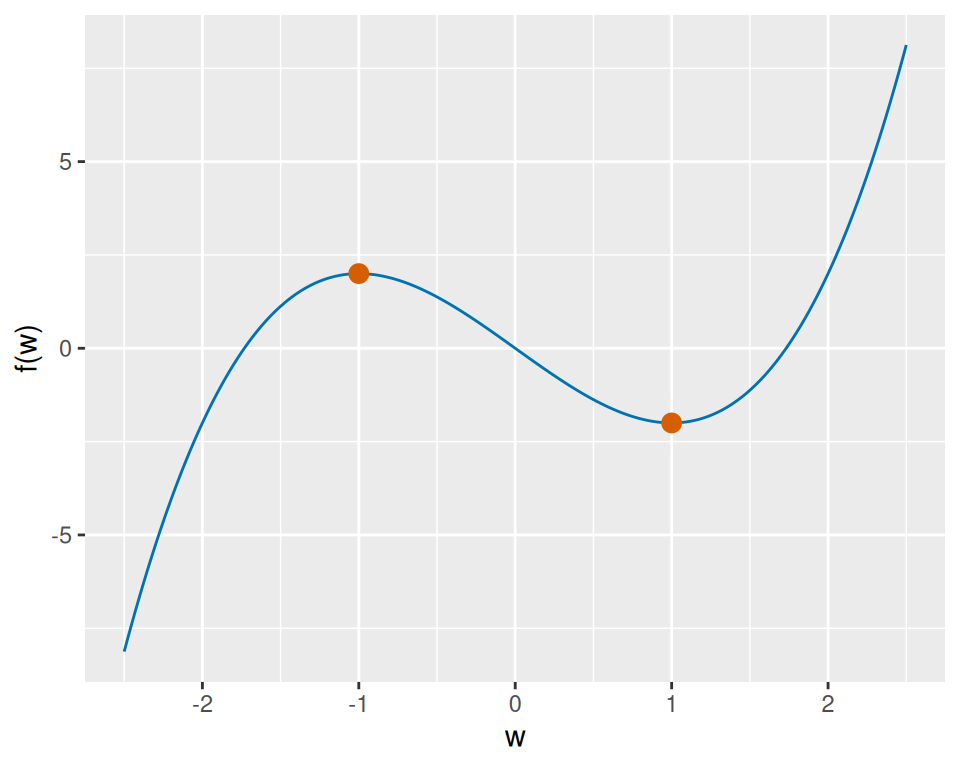
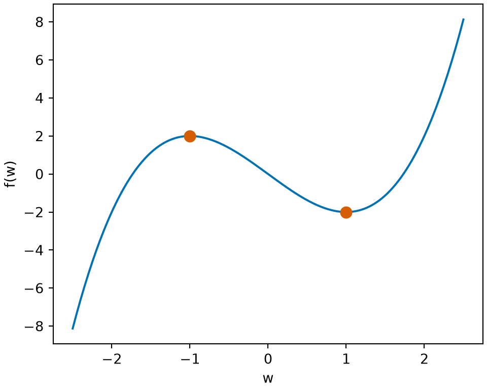

# Critical Points and Optimization

Code

Published

Last modified: 2026-11-24 09:19:45 (PST)

# 1 Critical points and optimization

> **NOTE:**
>
> **Definition 1 (Flat point (stationary point))** Let $f$ be [differentiable at](calculus-derivatives.llms.md#def-differentiable) $c$. If $f'(c) = 0$, then $c$ is a **flat point** of $f$ (also called a **stationary point**) [\[1\]](#ref-wikipedia_stationary_point).

> **NOTE:**
>
> **Example 1 (Flat points, and a point that is not one)**  
>
> - $f(w) = w^3$ has $f'(w) = 3w^2$, which is $0$ at $w = 0$, so $0$ is a flat point. Yet $f(0) = 0$ is neither the [minimum](algebra-basics.llms.md#def-minimum) nor the [maximum](algebra-basics.llms.md#def-maximum) of the [values](https://morrison-lab.github.io/mcs/functions.html#def-value) $f$ takes on any [open interval](https://morrison-lab.github.io/mcs/sets.html#def-open-interval) around $0$: $f(w) < 0$ for $w < 0$, and $f(w) > 0$ for $w > 0$.
> - $h(w) = w^2$ has $h'(1) = 2 \ne 0$, so $1$ is not a flat point.

> **NOTE:**
>
> Show code
>
> ``` downlit
> fp_w_ff <- seq(-2, 2, length.out = 201)
> fp_cube_ff <- tibble::tibble(
>   w = fp_w_ff, value = fp_w_ff^3, panel = "f(w) = w^3"
> )
> fp_square_ff <- tibble::tibble(
>   w = fp_w_ff, value = fp_w_ff^2, panel = "h(w) = w^2"
> )
> fp_curves_ff <- dplyr::bind_rows(fp_cube_ff, fp_square_ff)
> fp_marks_w_ff <- c(0, 1)
> fp_marks_panel_ff <- c("f(w) = w^3", "h(w) = w^2")
> fp_marks_kind_ff <- c("flat point", "not a flat point")
> fp_marks_ff <- tibble::tibble(
>   w = fp_marks_w_ff, value = fp_marks_w_ff,
>   panel = fp_marks_panel_ff, kind = fp_marks_kind_ff
> )
> fp_aes_ff <- ggplot2::aes(w, value)
> fp_marks_aes_ff <- ggplot2::aes(shape = kind)
> fp_shapes_ff <- c("flat point" = 16, "not a flat point" = 1)
> ggplot2::ggplot(fp_curves_ff, fp_aes_ff) +
>   ggplot2::geom_line(colour = "#0072B2") +
>   ggplot2::geom_point(
>     data = fp_marks_ff, mapping = fp_marks_aes_ff,
>     colour = "#D55E00", size = 3
>   ) +
>   ggplot2::scale_shape_manual(values = fp_shapes_ff) +
>   ggplot2::facet_wrap(~panel, scales = "free_y") +
>   ggplot2::labs(x = "w", y = NULL, shape = NULL)
> ```
>
> Show code
>
> ``` python
> import matplotlib.pyplot as plt
> import numpy as np
>
> fp_w_ff = np.linspace(-2, 2, 201)
> fig, axes = plt.subplots(1, 2, figsize=(6, 3.5), layout="constrained")
> axes[0].plot(fp_w_ff, fp_w_ff**3, color="#0072B2")
> axes[0].plot(0, 0, "o", color="#D55E00", markersize=8, label="flat point")
> axes[0].set_title("f(w) = w^3")
> axes[1].plot(fp_w_ff, fp_w_ff**2, color="#0072B2")
> axes[1].plot(1, 1, "o", color="#D55E00", markerfacecolor="none",
>              markersize=8, label="not a flat point")
> axes[1].set_title("h(w) = w^2")
> for ax in axes:
>     ax.set_xlabel("w")
>     ax.legend(loc="upper center")
> plt.show()
> ```
>
> ## R
>
> [](optimization-critical-points_files/figure-html/flat-point-r-1.png "Figure 1: These are the functions of Example 1.  The slope of f(w) = w^3 is 0 at w = 0, so 0 is a flat point, yet f keeps rising through it. The slope of h(w) = w^2 at w = 1 is 2, so 1 is not a flat point.")
>
> ## Python
>
> [](optimization-critical-points_files/figure-html/flat-point-python-1.png "Figure 1: These are the functions of Example 1.  The slope of f(w) = w^3 is 0 at w = 0, so 0 is a flat point, yet f keeps rising through it. The slope of h(w) = w^2 at w = 1 is 2, so 1 is not a flat point.")
>
> Figure 1: These are the [functions](https://morrison-lab.github.io/mcs/functions.html#def-function) of [Example 1](#exm-flat-point). The [slope](algebra-polynomials.llms.md#def-slope) of $f(w) = w^3$ is $0$ at $w = 0$, so $0$ is a [flat point](#def-flat-point), yet $f$ keeps rising through it. The slope of $h(w) = w^2$ at $w = 1$ is $2$, so $1$ is not a flat point.

> **NOTE:**
>
> **Exercise 1 (Differentiate a quadratic)** A [flat point](#def-flat-point) of a [function](https://morrison-lab.github.io/mcs/functions.html#def-function) is where its [derivative](calculus-derivatives.llms.md#def-derivative) is zero. The next exercises use the [parabola](algebra-polynomials.llms.md#def-parabola) $f(w) = w^2 - 4w + 7$ to find where $f$ is flat and to compare a [linear approximation](calculus-derivatives.llms.md#eq-linear-approx) with the exact [value](https://morrison-lab.github.io/mcs/functions.html#def-value).
>
> Differentiate $f$.

> **NOTE:**
>
> *Solution 1*. Differentiating each [term](algebra-sums.llms.md#def-term):
>
> $$\frac{df}{dw} = 2w - 4$$

> **NOTE:**
>
> **Exercise 2 (Find the flat point)** In the setting of [Exercise 1](#exr-flat-point), find the [flat point](#def-flat-point) $w$ of $f$.

> **NOTE:**
>
> *Solution 2*. The [derivative](calculus-derivatives.llms.md#def-derivative) is zero where $2w - 4 = 0$, which gives $w = 2$.

> **NOTE:**
>
> **Exercise 3 (Classify the flat point)** In the setting of [Exercise 1](#exr-flat-point), say whether $f(w)$ at the [flat point](#def-flat-point) is the [minimum](algebra-basics.llms.md#def-minimum) or the [maximum](algebra-basics.llms.md#def-maximum) of the values of $f$.

> **NOTE:**
>
> *Solution 3*. The [flat point](#def-flat-point) is $w = 2$, from [Solution 2](#sol-flat-point-find). Evaluating $f$ there gives
>
> $$\begin{aligned}
> f(2) &= 4 - 8 + 7 \\
> &= 3.
> \end{aligned}$$
>
> This value is the [minimum](algebra-basics.llms.md#def-minimum) of the [values](https://morrison-lab.github.io/mcs/functions.html#def-value) of $f$. Completing the square, $f(w) = (w - 2)^2 + 3$, since
>
> $$\begin{aligned}
> (w - 2)^2 + 3 &= w^2 - 4w + 4 + 3 \\
> &= w^2 - 4w + 7,
> \end{aligned}$$
>
> and $(w - 2)^2 \ge 0$, so $f(w) \ge 3 = f(2)$ for every $w$. Equivalently, the [derivative](calculus-derivatives.llms.md#def-derivative) is negative below $w = 2$ and positive above it, so the function falls into that point and rises out of it.

> **NOTE:**
>
> **Exercise 4 (Slope at** $w = 1$) In the setting of [Exercise 1](#exr-flat-point), evaluate the [derivative](calculus-derivatives.llms.md#def-derivative) at $w = 1$.

> **NOTE:**
>
> *Solution 4*. At $w = 1$ the [derivative](calculus-derivatives.llms.md#def-derivative) is $2(1) - 4 = -2$, so $f$ is falling there.

> **NOTE:**
>
> **Exercise 5 (Predict a nearby value)** In the setting of [Exercise 1](#exr-flat-point), use the [linear approximation](calculus-derivatives.llms.md#eq-linear-approx) and the [derivative](calculus-derivatives.llms.md#def-derivative) at $w = 1$ from [Exercise 4](#exr-flat-point-slope) to predict $f(1.01)$.

> **NOTE:**
>
> *Solution 5*. With $\varepsilon= 0.01$, the [linear approximation](calculus-derivatives.llms.md#eq-linear-approx) predicts a change of $(0.01)(-2) = -0.02$, from
>
> $$\begin{aligned}
> f(1) &= 1 - 4 + 7 \\
> &= 4
> \end{aligned}$$
>
> to $3.98$.

> **NOTE:**
>
> **Exercise 6 (Exact value)** In the setting of [Exercise 1](#exr-flat-point), find the exact [value](https://morrison-lab.github.io/mcs/functions.html#def-value) of $f(1.01)$.

> **NOTE:**
>
> *Solution 6*. The exact [value](https://morrison-lab.github.io/mcs/functions.html#def-value) is
>
> $$\begin{aligned}
> f(1.01)
> &= (1.01)^2 - 4(1.01) + 7 \\
> &= 1.0201 - 4.04 + 7 \\
> &= 3.9801
> \end{aligned}$$
>
> a change of $-0.0199$ from $f(1) = 4$.

> **NOTE:**
>
> **Exercise 7 (Check the prediction)** Compare the prediction in [Exercise 5](#exr-flat-point-predict) with the exact [value](https://morrison-lab.github.io/mcs/functions.html#def-value) of $f(1.01)$ from [Exercise 6](#exr-flat-point-exact).

> **NOTE:**
>
> *Solution 7*. The prediction $3.98$ ([Solution 5](#sol-flat-point-predict)) and the exact [value](https://morrison-lab.github.io/mcs/functions.html#def-value) $3.9801$ ([Solution 6](#sol-flat-point-exact)) differ by $0.0001$, which is $\varepsilon^2$. For this $f$, the difference between $f(w + \varepsilon)$ and its [linear approximation](calculus-derivatives.llms.md#def-linear-approximation) is, at any $w$, exactly
>
> $$f(w + \varepsilon) - [f(w) + f'(w)\,\varepsilon] = \varepsilon^2,$$
>
> so halving the step quarters that difference.
>
> A step of [gradient descent](optimization-gradient-descent.llms.md#def-gradient-descent) with [step length](optimization-gradient-descent.llms.md#def-gradient-descent) $s$ changes $w$ by $\varepsilon= -s f'(w)$. The linear approximation predicts the change $-s\,f'(w)^2$ in $f$, and the difference between $f(w + \varepsilon)$ and its linear approximation is $\varepsilon^2 = s^2 f'(w)^2$. The actual change in $f$ is therefore $-s\,f'(w)^2\,(1 - s)$. This change is negative exactly when $0 < s < 1$, for $f'(w) \ne 0$, so $f$ decreases only for those steps. For this $f$, the difference is smaller than the predicted decrease only when $s < 1$: the step must be short enough.

> **NOTE:**
>
> **Definition 2 (Critical point)** Let $f$ be a [function](https://morrison-lab.github.io/mcs/functions.html#def-function) defined on an [open interval](https://morrison-lab.github.io/mcs/sets.html#def-open-interval) containing $c$. The point $c$ is a **critical point** of $f$ if either $f'(c) = 0$ or $f$ is not [differentiable at](calculus-derivatives.llms.md#def-differentiable) $c$.

> **NOTE:**
>
> **Example 2 (Critical points that are and are not flat points)**  
>
> - $g(w) = \mathopen{}\left|w\right|\mathclose{}$ has no derivative at $w = 0$: its [one-sided derivatives](calculus-derivatives.llms.md#def-one-sided-derivative) there are $1$ and $-1$ (see the [one-sided derivative example](calculus-derivatives.llms.md#exm-one-sided-derivative)). So the [difference quotient](calculus-derivatives.llms.md#def-difference-quotient) $\tfrac{\mathopen{}\left|h\right|\mathclose{} - 0}{h}$ has no [limit](calculus-derivatives.llms.md#def-limit) as $h \to 0$, because the [one-sided limits](calculus-derivatives.llms.md#def-one-sided-limit) from the left and from the right differ. So $0$ is a critical point of $g$ but not a flat point.
>
> - $f(w) = w^3$ has
>
>   $$\begin{aligned}
>   f'(0) &= 3 \cdot 0^2 \\
>   &= 0,
>   \end{aligned}$$
>
>   so $0$ is a flat point of $f$, and hence a critical point.
>
> - $h(w) = w^2$ is differentiable everywhere, with $h'(w) = 2w$, which is $0$ only at $w = 0$. So $0$ is the only critical point of $h$. For example, $h'(1) = 2 \ne 0$, so $1$ is not one.

> **NOTE:**
>
> Show code
>
> ``` downlit
> cp_w_fc <- seq(-2, 2, length.out = 201)
> cp_abs_value_fc <- abs(cp_w_fc)
> cp_abs_fc <- tibble::tibble(w = cp_w_fc, value = cp_abs_value_fc, panel = "|w|")
> cp_cube_fc <- tibble::tibble(w = cp_w_fc, value = cp_w_fc^3, panel = "w^3")
> cp_square_fc <- tibble::tibble(w = cp_w_fc, value = cp_w_fc^2, panel = "w^2")
> cp_curves_fc <- dplyr::bind_rows(cp_abs_fc, cp_cube_fc, cp_square_fc)
> cp_levels_fc <- c("|w|", "w^3", "w^2")
> cp_curves_fc$panel <- factor(cp_curves_fc$panel, levels = cp_levels_fc)
> cp_kinds_fc <- c("not flat", "flat", "flat")
> cp_marks_fc <- tibble::tibble(
>   w = 0, value = 0, panel = cp_levels_fc, kind = cp_kinds_fc
> )
> cp_marks_fc$panel <- factor(cp_marks_fc$panel, levels = cp_levels_fc)
> cp_aes_fc <- ggplot2::aes(w, value)
> cp_marks_aes_fc <- ggplot2::aes(shape = kind)
> cp_shapes_fc <- c("flat" = 16, "not flat" = 17)
> ggplot2::ggplot(cp_curves_fc, cp_aes_fc) +
>   ggplot2::geom_line(colour = "#0072B2") +
>   ggplot2::geom_point(
>     data = cp_marks_fc, mapping = cp_marks_aes_fc,
>     colour = "#D55E00", size = 3
>   ) +
>   ggplot2::scale_shape_manual(values = cp_shapes_fc) +
>   ggplot2::facet_wrap(~panel, scales = "free_y") +
>   ggplot2::labs(x = "w", y = NULL, shape = "critical point")
> ```
>
> Show code
>
> ``` python
> import matplotlib.pyplot as plt
> import numpy as np
>
> cp_w_fc = np.linspace(-2, 2, 201)
> cp_curves_fc = [("|w|", np.abs(cp_w_fc), "^"),
>                 ("w^3", cp_w_fc**3, "o"),
>                 ("w^2", cp_w_fc**2, "o")]
> fig, axes = plt.subplots(1, 3, figsize=(7, 3), layout="constrained")
> for ax, (title, values, marker) in zip(axes, cp_curves_fc):
>     ax.plot(cp_w_fc, values, color="#0072B2")
>     ax.plot(0, 0, marker, color="#D55E00", markersize=8)
>     ax.set_title(title)
>     ax.set_xlabel("w")
> plt.show()
> ```
>
> ## R
>
> [](optimization-critical-points_files/figure-html/critical-point-r-3.png "Figure 2: These are the functions of Example 2,  with the critical point 0 marked on each. The corner of \mathopen{}\left|w\right|\mathclose{} at 0 is a critical point that is not a flat point (triangle). w^3 and w^2 are flat at 0 (circles).")
>
> ## Python
>
> [](optimization-critical-points_files/figure-html/critical-point-python-1.png "Figure 2: These are the functions of Example 2,  with the critical point 0 marked on each. The corner of \mathopen{}\left|w\right|\mathclose{} at 0 is a critical point that is not a flat point (triangle). w^3 and w^2 are flat at 0 (circles).")
>
> Figure 2: These are the [functions](https://morrison-lab.github.io/mcs/functions.html#def-function) of [Example 2](#exm-critical-point), with the [critical point](#def-critical-point) $0$ marked on each. The corner of $\mathopen{}\left|w\right|\mathclose{}$ at $0$ is a critical point that is not a [flat point](#def-flat-point) (triangle). $w^3$ and $w^2$ are flat at $0$ (circles).

> **NOTE:**
>
> **Theorem 1 (Every flat point is a critical point)** If $c$ is a flat point of $f$ ([Definition 1](#def-flat-point)), then $c$ is a critical point of $f$ ([Definition 2](#def-critical-point)).

> **NOTE:**
>
> *Proof*. A flat point $c$ has $f$ differentiable at $c$ and $f'(c) = 0$. The condition “$f'(c) = 0$” is the first alternative in [Definition 2](#def-critical-point), so $c$ is a critical point.

> **NOTE:**
>
> **Example 3 (The flat points of a cubic, and a critical point that is not flat)** For $f(w) = w^3 - 3w$, the derivative is $f'(w) = 3w^2 - 3$. The code differentiates $f$ with [`D()`](https://rdrr.io/r/stats/deriv.html) and evaluates $f'$ at several points. For $g(w) = \mathopen{}\left|w\right|\mathclose{}$, it computes the difference quotients at $0$ from both sides.
>
> ``` downlit
> f_prime <- D(quote(w^3 - 3 * w), "w")
> points <- c(-2, -1, 0, 1, 2)
> derivs <- data.frame(w = points, f_prime = eval(f_prime, list(w = points)))
> derivs
> ```
>
> ``` downlit
> flat <- derivs$w[derivs$f_prime == 0]
>
> h <- c(-1e-3, 1e-3)
> quotients <- abs(h) / h
> quotients
> #> [1] -1  1
> ```
>
> The derivative is $0$ at 2 of the 5 points, namely $w = -1$ and $w = 1$. Both points are [flat points](#def-flat-point) of $f$, since the derivative is $0$ there, so by [Theorem 1](#thm-flat-point-critical) they are [critical points](#def-critical-point). The difference quotients of $g$ at $0$ are -1 from the left and 1 from the right, so $g$ has no derivative at $0$. Thus $0$ is a critical point of $g$ ([Definition 2](#def-critical-point)), but not a flat point.

> **NOTE:**
>
> Show code
>
> ``` downlit
> fpc_w_fk <- seq(-2.5, 2.5, length.out = 201)
> fpc_curve_fk <- tibble::tibble(w = fpc_w_fk, value = fpc_w_fk^3 - 3 * fpc_w_fk)
> fpc_flat_w_fk <- c(-1, 1)
> fpc_flat_value_fk <- fpc_flat_w_fk^3 - 3 * fpc_flat_w_fk
> fpc_flat_fk <- tibble::tibble(w = fpc_flat_w_fk, value = fpc_flat_value_fk)
> fpc_aes_fk <- ggplot2::aes(w, value)
> ggplot2::ggplot(fpc_curve_fk, fpc_aes_fk) +
>   ggplot2::geom_line(colour = "#0072B2") +
>   ggplot2::geom_point(data = fpc_flat_fk, colour = "#D55E00", size = 3) +
>   ggplot2::labs(x = "w", y = "f(w)")
> ```
>
> Show code
>
> ``` python
> import matplotlib.pyplot as plt
> import numpy as np
>
> fpc_w_fk = np.linspace(-2.5, 2.5, 201)
> fpc_flat_fk = np.array([-1, 1])
> fig, ax = plt.subplots(figsize=(5, 4), layout="constrained")
> ax.plot(fpc_w_fk, fpc_w_fk**3 - 3 * fpc_w_fk, color="#0072B2")
> ax.plot(fpc_flat_fk, fpc_flat_fk**3 - 3 * fpc_flat_fk, "o",
>         color="#D55E00", markersize=8)
> ax.set_xlabel("w")
> ax.set_ylabel("f(w)")
> plt.show()
> ```
>
> ## R
>
> [](optimization-critical-points_files/figure-html/flat-point-critical-r-1.png "Figure 3: The cubic f(w) = w^3 - 3w of Example 3. Its flat points, where f'(w) = 3w^2 - 3 = 0, are w = -1 and w = 1 (circles): a local peak and a local trough.")
>
> ## Python
>
> [](optimization-critical-points_files/figure-html/flat-point-critical-python-1.png "Figure 3: The cubic f(w) = w^3 - 3w of Example 3. Its flat points, where f'(w) = 3w^2 - 3 = 0, are w = -1 and w = 1 (circles): a local peak and a local trough.")
>
> Figure 3: The [cubic](algebra-polynomials.llms.md#def-cubic-polynomial) $f(w) = w^3 - 3w$ of [Example 3](#exm-flat-point-critical). Its [flat points](#def-flat-point), where $f'(w) = 3w^2 - 3 = 0$, are $w = -1$ and $w = 1$ (circles): a local peak and a local trough.

> **NOTE:**
>
> **Theorem 2 (Second derivative test)** Let $c$ be a [flat point](#def-flat-point) of $f$, where the [second derivative](calculus-derivatives.llms.md#def-second-derivative) $f''(c)$ is defined.
>
> - If $f''(c) > 0$, then $f(x) > f(c)$ for every $x \ne c$ in some [open interval](https://morrison-lab.github.io/mcs/sets.html#def-open-interval) around $c$.
> - If $f''(c) < 0$, then $f(x) < f(c)$ for every $x \ne c$ in some open interval around $c$.

> **NOTE:**
>
> *Proof*. Suppose $f''(c) > 0$. Because $f'(c) = 0$, the [derivative](calculus-derivatives.llms.md#def-derivative) of $f'$ at $c$ is
>
> $$f''(c) = \lim_{x \to c} \frac{f'(x)}{x - c}.$$
>
> A [limit](calculus-derivatives.llms.md#def-limit) that is positive forces the [quotient](algebra-sums.llms.md#def-quotient) $f'(x)/(x - c)$ to be positive for $x$ near $c$. So $f'(x)$ has the same sign as $x - c$ on some [open interval](https://morrison-lab.github.io/mcs/sets.html#def-open-interval) around $c$. Hence $f' < 0$ to the left of $c$ and $f' > 0$ to the right of $c$, so $f$ is decreasing to the left of $c$ and increasing to the right of $c$. Therefore $f(x) > f(c)$ for every $x \ne c$ in that open interval.
>
> For $f''(c) < 0$, apply the same reasoning to $-f$, since $(-f)''(c) = -f''(c) > 0$. Then $-f(x) > -f(c)$ near $c$, which says $f(x) < f(c)$ near $c$.

> **NOTE:**
>
> **Example 4 (Second derivative test for powers of** $x$) The [function](https://morrison-lab.github.io/mcs/functions.html#def-function) $f(x) = x^2$ has the [flat point](#def-flat-point) $c = 0$ and [second derivative](calculus-derivatives.llms.md#def-second-derivative) $f''(0) = 2 > 0$, so $0$ is a [local minimizer](algebra-basics.llms.md#def-local-minimizer) by [Theorem 2](#thm-second-derivative-test).

> **NOTE:**
>
> *Remark 1* (The second derivative test can fail to decide). If $f''(c) = 0$ at a [flat point](#def-flat-point) $c$, the [second derivative test](#thm-second-derivative-test) does not decide: $f$ may be smallest at $c$ among nearby points, largest there, or neither ([Example 5](#exm-second-derivative-test-zero)).

> **NOTE:**
>
> **Example 5 (Three functions with second derivative** $0$ at a flat point) Take $f(x) = x^4$, $g(x) = -x^4$ and $h(x) = x^3$. Each has the [derivative](calculus-derivatives.llms.md#def-derivative) $0$ at $x = 0$:
>
> $$\begin{aligned}
> f'(x) &= 4x^3, & f'(0) &= 0, \\
> g'(x) &= -4x^3, & g'(0) &= 0, \\
> h'(x) &= 3x^2, & h'(0) &= 0.
> \end{aligned}$$
>
> So $0$ is a [flat point](#def-flat-point) of all three. Each has the [second derivative](calculus-derivatives.llms.md#def-second-derivative) $0$ there:
>
> $$\begin{aligned}
> f''(x) &= 12x^2, & f''(0) &= 0, \\
> g''(x) &= -12x^2, & g''(0) &= 0, \\
> h''(x) &= 6x, & h''(0) &= 0.
> \end{aligned}$$
>
> Because the second derivative is $0$ in all three cases, [Theorem 2](#thm-second-derivative-test) does not decide any of them. Yet the three behave differently near $0$ ([Figure 4](#fig-second-derivative-test-zero)):
>
> - $f(x) = x^4 > 0 = f(0)$ for every $x \ne 0$, so $0$ is a [local minimizer](algebra-basics.llms.md#def-local-minimizer).
> - $g(x) = -x^4 < 0 = g(0)$ for every $x \ne 0$, so $0$ is a [local maximizer](optimization-optimality.llms.md#def-local-maximizer).
> - $h(x) = x^3$ is negative for $x < 0$ and positive for $x > 0$, so $h(x) < h(0)$ to the left of $0$ and $h(x) > h(0)$ to the right of $0$. Thus $0$ is neither a local minimizer nor a local maximizer.
>
> > **NOTE:**
> >
> > Show code
> >
> > ``` downlit
> > sdz_x_fk <- seq(-1, 1, length.out = 201)
> > sdz_labels_fk <- c("x^4", "-x^4", "x^3")
> > sdz_values_fk <- c(sdz_x_fk^4, -sdz_x_fk^4, sdz_x_fk^3)
> > sdz_n_fk <- length(sdz_x_fk)
> > sdz_fn_fk <- rep(sdz_labels_fk, each = sdz_n_fk)
> > sdz_fn_fk <- factor(sdz_fn_fk, levels = sdz_labels_fk)
> > sdz_x_rep_fk <- rep(sdz_x_fk, 3)
> > sdz_curves_fk <- tibble::tibble(
> >   x = sdz_x_rep_fk, value = sdz_values_fk, fn = sdz_fn_fk
> > )
> > sdz_origin_fn_fk <- factor(sdz_labels_fk, levels = sdz_labels_fk)
> > sdz_origin_fk <- tibble::tibble(x = 0, value = 0, fn = sdz_origin_fn_fk)
> > sdz_aes_fk <- ggplot2::aes(x, value)
> > ggplot2::ggplot(sdz_curves_fk, sdz_aes_fk) +
> >   ggplot2::geom_line(colour = "#0072B2") +
> >   ggplot2::geom_point(data = sdz_origin_fk, colour = "#D55E00", size = 3) +
> >   ggplot2::facet_wrap(ggplot2::vars(fn)) +
> >   ggplot2::labs(x = "x", y = "function value")
> > ```
> >
> > Show code
> >
> > ``` python
> > import matplotlib.pyplot as plt
> > import numpy as np
> >
> > sdz_x_fk = np.linspace(-1, 1, 201)
> > sdz_curves_fk = [sdz_x_fk**4, -(sdz_x_fk**4), sdz_x_fk**3]
> > sdz_titles_fk = ["$x^4$", "$-x^4$", "$x^3$"]
> > fig, axes = plt.subplots(1, 3, figsize=(7, 3), layout="constrained")
> > for ax, curve, title in zip(axes, sdz_curves_fk, sdz_titles_fk):
> >     ax.plot(sdz_x_fk, curve, color="#0072B2")
> >     ax.plot(0, 0, "o", color="#D55E00", markersize=8)
> >     ax.set_title(title)
> >     ax.set_xlabel("x")
> > axes[0].set_ylabel("function value")
> > plt.show()
> > ```
> >
> > ## R
> >
> > [](optimization-critical-points_files/figure-html/second-derivative-test-zero-r-3.png "Figure 4: This figure shows the functions x^4, -x^4 and x^3 of Example 5. All three have a flat point at x = 0 (circles) where the second derivative is 0: a local minimizer, a local maximizer, and neither.")
> >
> > ## Python
> >
> > [](optimization-critical-points_files/figure-html/second-derivative-test-zero-python-1.png "Figure 4: This figure shows the functions x^4, -x^4 and x^3 of Example 5. All three have a flat point at x = 0 (circles) where the second derivative is 0: a local minimizer, a local maximizer, and neither.")
> >
> > Figure 4: This figure shows the [functions](https://morrison-lab.github.io/mcs/functions.html#def-function) $x^4$, $-x^4$ and $x^3$ of [Example 5](#exm-second-derivative-test-zero). All three have a [flat point](#def-flat-point) at $x = 0$ (circles) where the [second derivative](calculus-derivatives.llms.md#def-second-derivative) is $0$: a [local minimizer](algebra-basics.llms.md#def-local-minimizer), a [local maximizer](optimization-optimality.llms.md#def-local-maximizer), and neither.

> **NOTE:**
>
> **Definition 3 (Inflection point)** An **inflection point** of a [function](https://morrison-lab.github.io/mcs/functions.html#def-function) $f$ is a point $c$ such that, on some [open interval](https://morrison-lab.github.io/mcs/sets.html#def-open-interval) around $c$, the [second derivative](calculus-derivatives.llms.md#def-second-derivative) $f''$ is positive on one side of $c$ and negative on the other.

> **NOTE:**
>
> *Remark 2* (Inflection points change the curvature). At an [inflection point](#def-inflection-point), the [graph](https://morrison-lab.github.io/mcs/functions.html#def-graph) changes between curving up and curving down.

> **NOTE:**
>
> **Example 6 (An inflection point of** $x^3$) For $f(x) = x^3$, the [second derivative](calculus-derivatives.llms.md#def-second-derivative) is $f''(x) = 6x$, which is negative for $x < 0$ and positive for $x > 0$. So $0$ is an [inflection point](#def-inflection-point) of $f$.
>
> [Figure 5](#fig-inflection-point) shows $f$ and $f''$.
>
> > **NOTE:**
> >
> > Show code
> >
> > ``` downlit
> > ip_x_ip <- seq(-1, 1, length.out = 201)
> > ip_labels_ip <- c("f(x) = x^3", "f''(x) = 6x")
> > ip_values_ip <- c(ip_x_ip^3, 6 * ip_x_ip)
> > ip_n_ip <- length(ip_x_ip)
> > ip_fn_ip <- rep(ip_labels_ip, each = ip_n_ip)
> > ip_fn_ip <- factor(ip_fn_ip, levels = ip_labels_ip)
> > ip_x_rep_ip <- rep(ip_x_ip, 2)
> > ip_curves_ip <- tibble::tibble(
> >   x = ip_x_rep_ip, value = ip_values_ip, fn = ip_fn_ip
> > )
> > ip_origin_fn_ip <- factor(ip_labels_ip, levels = ip_labels_ip)
> > ip_origin_ip <- tibble::tibble(x = 0, value = 0, fn = ip_origin_fn_ip)
> > ip_aes_ip <- ggplot2::aes(x, value)
> > ip_facet_ip <- ggplot2::vars(fn)
> > ip_curves_ip |>
> >   ggplot2::ggplot() +
> >   ip_aes_ip +
> >   ggplot2::geom_line(colour = "#0072B2") +
> >   ggplot2::geom_point(data = ip_origin_ip, colour = "#D55E00", size = 3) +
> >   ggplot2::facet_wrap(ip_facet_ip, scales = "free_y") +
> >   ggplot2::labs(x = "x", y = "function value")
> > ```
> >
> > Show code
> >
> > ``` python
> > import matplotlib.pyplot as plt
> > import numpy as np
> >
> > ip_x_py = np.linspace(-1, 1, 201)
> > fig, axes = plt.subplots(1, 2, figsize=(6, 3), layout="constrained")
> > axes[0].plot(ip_x_py, ip_x_py**3, color="#0072B2")
> > axes[0].plot([0], [0], "o", color="#D55E00")
> > axes[0].set_title("f(x) = x^3")
> > axes[1].plot(ip_x_py, 6 * ip_x_py, color="#0072B2")
> > axes[1].plot([0], [0], "o", color="#D55E00")
> > axes[1].set_title("f''(x) = 6x")
> > for ax in axes:
> >     ax.set_xlabel("x")
> > plt.show();
> > ```
> >
> > ## R
> >
> > [](optimization-critical-points_files/figure-html/inflection-point-r-3.png "Figure 5: The second derivative 6x of f(x) = x^3 in Example 6 changes sign at 0, from negative to positive. So the curve f changes from bending downward to bending upward at the inflection point 0.")
> >
> > ## Python
> >
> > [](optimization-critical-points_files/figure-html/inflection-point-python-1.png "Figure 5: The second derivative 6x of f(x) = x^3 in Example 6 changes sign at 0, from negative to positive. So the curve f changes from bending downward to bending upward at the inflection point 0.")
> >
> > Figure 5: The [second derivative](calculus-derivatives.llms.md#def-second-derivative) $6x$ of $f(x) = x^3$ in [Example 6](#exm-inflection-point) changes sign at $0$, from negative to positive. So the curve $f$ changes from bending downward to bending upward at the [inflection point](#def-inflection-point) $0$.

> **NOTE:**
>
> **Exercise 8 (Maximizing a gamma-family kernel)** Adapted from Miller [\[2\]](#ref-problifesavercalc), Question 1.1.10.
>
> The [gamma density](https://en.wikipedia.org/wiki/Gamma_distribution) with shape $a > 0$ has the [kernel](https://morrison-lab.github.io/pds/random-variables.html#def-kernel) $x^{a-1} e^{-x}$ on $[0, \infty)$. [A kernel has the same mode as its density](https://morrison-lab.github.io/pds/random-variables.html#thm-kernel-same-mode), so maximizing the kernel finds the [mode](https://morrison-lab.github.io/pds/random-variables.html#def-mode) of the gamma density without computing the [normalizing constant](https://morrison-lab.github.io/pds/random-variables.html#def-normalizing-constant).
>
> For shape $a = 5$, the kernel is
>
> $$f(x) = x^4 e^{-x}.$$
>
> Find the [maximum](algebra-basics.llms.md#def-maximum) of $f$ on $[0, \infty)$.

> **NOTE:**
>
> *Solution 8*. Differentiate using the product rule:
>
> $$\begin{aligned}
> f'(x)
> &= 4x^3 e^{-x} - x^4 e^{-x} \\
> &= x^3 e^{-x}(4 - x)
> \end{aligned}$$
>
> On $[0, \infty)$, $e^{-x} > 0$, so $f'(x) = 0$ only at $x = 0$ and $x = 4$.
>
> Evaluate $f$ at the boundary and critical points:
>
> - At $x = 0$: $f(0) = 0$.
>
> - At $x = 4$:
>
>   $$\begin{aligned}
>   f(4) &= 4^4 e^{-4} \\
>   &= 256 e^{-4} \\
>   &\approx 4.6888.
>   \end{aligned}$$
>
> - As $x \to \infty$: exponential decay dominates polynomial growth, so $\lim_{x \to \infty} x^4 e^{-x} = 0$.
>
> Since $f(x) \ge 0$ for all $x \ge 0$ and $f(4) > 0$, the global maximum occurs at $x = 4$, with maximum value $256/e^4$.

> **NOTE:**
>
> **Exercise 9 (Classifying critical points with the second derivative test)** Adapted from Miller [\[2\]](#ref-problifesavercalc), Question 1.1.11.
>
> An [optimization algorithm](optimization-constrained.llms.md#def-optimization-algorithm) such as [Newton’s method](optimization-newton.llms.md#def-newton-method) or [gradient descent](optimization-gradient-descent.llms.md#def-gradient-descent) can stop at a [critical point](#def-critical-point), which may be a local [maximum](algebra-basics.llms.md#def-maximum), a local [minimum](algebra-basics.llms.md#def-minimum), or neither. The [second derivative test](#thm-second-derivative-test) tells these apart.
>
> Consider the [cubic](algebra-polynomials.llms.md#def-cubic-polynomial)
>
> $$f(x) = 4x^3 - 3x^2.$$
>
> Find its critical points, and decide whether each is a local maximum, a local minimum, or an [inflection point](#def-inflection-point).

> **NOTE:**
>
> *Solution 9*. Compute the first derivative:
>
> $$\begin{aligned}
> f'(x)
> &= 12x^2 - 6x \\
> &= 6x(2x - 1)
> \end{aligned}$$
>
> Setting $f'(x) = 0$ gives critical points at $x = 0$ and $x = 1/2$.
>
> Compute the second derivative:
>
> $$f''(x) = 24x - 6$$
>
> Apply the second derivative test at each critical point:
>
> - At $x = 0$: $f''(0) = -6 < 0$, so $x = 0$ is a strict local maximum.
>
> - At $x = 1/2$:
>
>   $$\begin{aligned}
>   f''(1/2) &= 24(1/2) - 6 \\
>   &= 6 \\
>   &> 0,
>   \end{aligned}$$
>
>   so $x = 1/2$ is a strict local minimum.
>
> Inflection points occur where the second derivative changes sign ($f''(x) = 0$ at $x = 1/4$). Because $f''$ is non-zero at both critical points, neither is an inflection point.

# Definitions on this page

- [Definition 1 (Flat point (stationary point))](#def-flat-point)
- [Definition 2 (Critical point)](#def-critical-point)
- [Definition 3 (Inflection point)](#def-inflection-point)

Back to top

## References

\[1\]

Wikipedia contributors, “Stationary point — Wikipedia, the free encyclopedia.” 2026. Available: <https://en.wikipedia.org/wiki/Stationary_point>

\[2\]

S. J. Miller, *The probability lifesaver: Calculus review problems*. 2016. Available: <https://web.williams.edu/Mathematics/sjmiller/public_html/probabilitylifesaver/index.htm#:~:text=http%3A//web.williams.edu/Mathematics/sjmiller/public_html/probabilitylifesaver/supplementalchap_calcreview.pdf>
