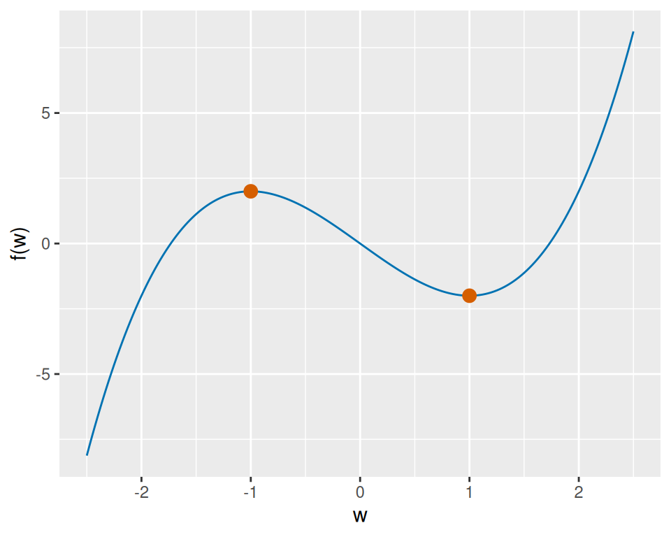
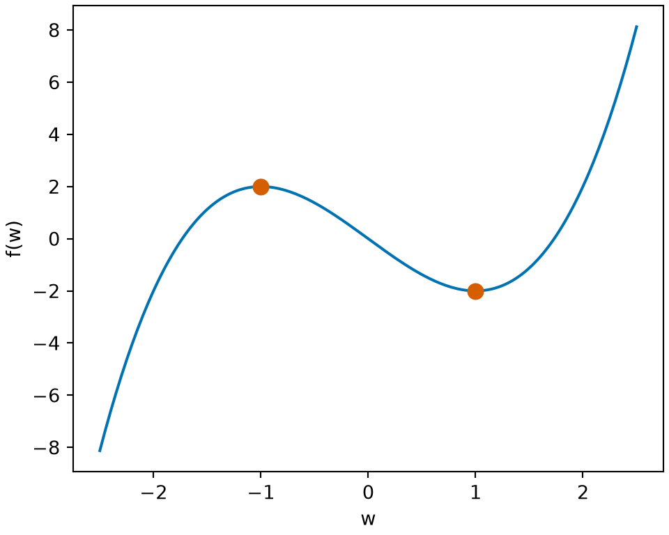

# Critical Points and Optimality Conditions

Code

Published

Last modified: 2026-10-30 15:15:50 (PDT)

## 0.1 Critical points and optimization

> **NOTE:**
>
> **Definition 1 (Flat point (stationary point))** Let \\f\\ be [differentiable at](calculus-derivatives.llms.md#def-differentiable) \\c\\. If \\f'(c) = 0\\, then \\c\\ is a **flat point** of \\f\\ (also called a **stationary point**) [\[1\]](#ref-wikipedia_stationary_point).

> **NOTE:**
>
> **Example 1 (Flat points, and a point that is not one)**  
>
> - \\f(w) = w^3\\ has \\f'(w) = 3w^2\\, which is \\0\\ at \\w = 0\\, so \\0\\ is a flat point. Yet \\f(0) = 0\\ is neither the [minimum](algebra-basics.llms.md#def-minimum) nor the [maximum](algebra-basics.llms.md#def-maximum) of the [values](functions.llms.md#def-value) \\f\\ takes on any [open interval](sets.llms.md#def-open-interval) around \\0\\: \\f(w) \< 0\\ for \\w \< 0\\, and \\f(w) \> 0\\ for \\w \> 0\\.
> - \\h(w) = w^2\\ has \\h'(1) = 2 \ne 0\\, so \\1\\ is not a flat point.

> **NOTE:**
>
> Show R code
>
> ``` downlit
> fp_w_ff <- seq(-2, 2, length.out = 201)
> fp_cube_ff <- tibble::tibble(
>   w = fp_w_ff, value = fp_w_ff^3, panel = "f(w) = w^3"
> )
> fp_square_ff <- tibble::tibble(
>   w = fp_w_ff, value = fp_w_ff^2, panel = "h(w) = w^2"
> )
> fp_curves_ff <- dplyr::bind_rows(fp_cube_ff, fp_square_ff)
> fp_marks_w_ff <- c(0, 1)
> fp_marks_panel_ff <- c("f(w) = w^3", "h(w) = w^2")
> fp_marks_kind_ff <- c("flat point", "not a flat point")
> fp_marks_ff <- tibble::tibble(
>   w = fp_marks_w_ff, value = fp_marks_w_ff,
>   panel = fp_marks_panel_ff, kind = fp_marks_kind_ff
> )
> fp_aes_ff <- ggplot2::aes(w, value)
> fp_marks_aes_ff <- ggplot2::aes(shape = kind)
> fp_shapes_ff <- c("flat point" = 16, "not a flat point" = 1)
> ggplot2::ggplot(fp_curves_ff, fp_aes_ff) +
>   ggplot2::geom_line(colour = "#0072B2") +
>   ggplot2::geom_point(
>     data = fp_marks_ff, mapping = fp_marks_aes_ff,
>     colour = "#D55E00", size = 3
>   ) +
>   ggplot2::scale_shape_manual(values = fp_shapes_ff) +
>   ggplot2::facet_wrap(~panel, scales = "free_y") +
>   ggplot2::labs(x = "w", y = NULL, shape = NULL)
> ```
>
> Show R code
>
> ``` python
> import matplotlib.pyplot as plt
> import numpy as np
>
> fp_w_ff = np.linspace(-2, 2, 201)
> fig, axes = plt.subplots(1, 2, figsize=(6, 3.5), layout="constrained")
> axes[0].plot(fp_w_ff, fp_w_ff**3, color="#0072B2")
> axes[0].plot(0, 0, "o", color="#D55E00", markersize=8, label="flat point")
> axes[0].set_title("f(w) = w^3")
> axes[1].plot(fp_w_ff, fp_w_ff**2, color="#0072B2")
> axes[1].plot(1, 1, "o", color="#D55E00", markerfacecolor="none",
>              markersize=8, label="not a flat point")
> axes[1].set_title("h(w) = w^2")
> for ax in axes:
>     ax.set_xlabel("w")
>     ax.legend(loc="upper center")
> plt.show()
> ```
>
> ## R
>
> [](optimization-critical-points_files/figure-html/flat-point-r-1.png "Figure 1: These are the functions of Example 1. The slope of f(w) = w^3 is 0 at w = 0, so 0 is a flat point, yet f keeps rising through it. The slope of h(w) = w^2 at w = 1 is 2, so 1 is not a flat point.")
>
> ## Python
>
> [](optimization-critical-points_files/figure-html/flat-point-python-1.png "Figure 1: These are the functions of Example 1. The slope of f(w) = w^3 is 0 at w = 0, so 0 is a flat point, yet f keeps rising through it. The slope of h(w) = w^2 at w = 1 is 2, so 1 is not a flat point.")
>
> Figure 1: These are the [functions](functions.llms.md#def-function) of [Example 1](#exm-flat-point). The [slope](algebra-exponentials.llms.md#def-slope) of \\f(w) = w^3\\ is \\0\\ at \\w = 0\\, so \\0\\ is a [flat point](#def-flat-point), yet \\f\\ keeps rising through it. The slope of \\h(w) = w^2\\ at \\w = 1\\ is \\2\\, so \\1\\ is not a flat point.

> **NOTE:**
>
> **Exercise 1 (Differentiate a quadratic)** A [flat point](#def-flat-point) of a [function](functions.llms.md#def-function) is where its [derivative](calculus-derivatives.llms.md#def-derivative) is zero. The next exercises use the [parabola](algebra-exponentials.llms.md#def-parabola) \\f(w) = w^2 - 4w + 7\\ to find where \\f\\ is flat and to compare a [linear approximation](calculus-derivatives.llms.md#eq-linear-approx) with the exact [value](functions.llms.md#def-value).
>
> Differentiate \\f\\.

> **NOTE:**
>
> *Solution 1*. Differentiating each [term](algebra-sums.llms.md#def-term):
>
> \\\frac{df}{dw} = 2w - 4\\

> **NOTE:**
>
> **Exercise 2 (Find the flat point)** In the setting of [Exercise 1](#exr-flat-point), find the [flat point](#def-flat-point) \\w\\ of \\f\\.

> **NOTE:**
>
> *Solution 2*. The [derivative](calculus-derivatives.llms.md#def-derivative) is zero where \\2w - 4 = 0\\, which gives \\w = 2\\.

> **NOTE:**
>
> **Exercise 3 (Classify the flat point)** In the setting of [Exercise 1](#exr-flat-point), say whether \\f(w)\\ at the [flat point](#def-flat-point) is the [minimum](algebra-basics.llms.md#def-minimum) or the [maximum](algebra-basics.llms.md#def-maximum) of the values of \\f\\.

> **NOTE:**
>
> *Solution 3*. The [flat point](#def-flat-point) is \\w = 2\\, from [Solution 2](#sol-flat-point-find). Evaluating \\f\\ there gives
>
> \\ \begin{aligned} f(2) &= 4 - 8 + 7 \\ &= 3. \end{aligned} \\
>
> This is the [minimum](algebra-basics.llms.md#def-minimum) of the [values](functions.llms.md#def-value) of \\f\\. Completing the square, \\f(w) = (w - 2)^2 + 3\\, since
>
> \\ \begin{aligned} (w - 2)^2 + 3 &= w^2 - 4w + 4 + 3 \\ &= w^2 - 4w + 7, \end{aligned} \\
>
> and \\(w - 2)^2 \ge 0\\, so \\f(w) \ge 3 = f(2)\\ for every \\w\\. Equivalently, the [derivative](calculus-derivatives.llms.md#def-derivative) is negative below \\w = 2\\ and positive above it, so the function falls into that point and rises out of it.

> **NOTE:**
>
> **Exercise 4 (Slope at \\w = 1\\)** In the setting of [Exercise 1](#exr-flat-point), evaluate the [derivative](calculus-derivatives.llms.md#def-derivative) at \\w = 1\\.

> **NOTE:**
>
> *Solution 4*. At \\w = 1\\ the [derivative](calculus-derivatives.llms.md#def-derivative) is \\2(1) - 4 = -2\\, so \\f\\ is falling there.

> **NOTE:**
>
> **Exercise 5 (Predict a nearby value)** In the setting of [Exercise 1](#exr-flat-point), use the [linear approximation](calculus-derivatives.llms.md#eq-linear-approx) and the [derivative](calculus-derivatives.llms.md#def-derivative) at \\w = 1\\ from [Exercise 4](#exr-flat-point-slope) to predict \\f(1.01)\\.

> **NOTE:**
>
> *Solution 5*. With \\\varepsilon= 0.01\\, the [linear approximation](calculus-derivatives.llms.md#eq-linear-approx) predicts a change of \\(0.01)(-2) = -0.02\\, from
>
> \\ \begin{aligned} f(1) &= 1 - 4 + 7 \\ &= 4 \end{aligned} \\
>
> to \\3.98\\.

> **NOTE:**
>
> **Exercise 6 (Exact value)** In the setting of [Exercise 1](#exr-flat-point), find the exact [value](functions.llms.md#def-value) of \\f(1.01)\\.

> **NOTE:**
>
> *Solution 6*. The exact [value](functions.llms.md#def-value) is
>
> \\ \begin{aligned} f(1.01) &= (1.01)^2 - 4(1.01) + 7 \\ &= 1.0201 - 4.04 + 7 \\ &= 3.9801 \end{aligned} \\
>
> a change of \\-0.0199\\ from \\f(1) = 4\\.

> **NOTE:**
>
> **Exercise 7 (Check the prediction)** Compare the prediction in [Exercise 5](#exr-flat-point-predict) with the exact [value](functions.llms.md#def-value) of \\f(1.01)\\ from [Exercise 6](#exr-flat-point-exact).

> **NOTE:**
>
> *Solution 7*. The prediction \\3.98\\ ([Solution 5](#sol-flat-point-predict)) and the exact [value](functions.llms.md#def-value) \\3.9801\\ ([Solution 6](#sol-flat-point-exact)) differ by \\0.0001\\, which is \\\varepsilon^2\\. For this \\f\\, the difference between \\f(w + \varepsilon)\\ and its [linear approximation](calculus-derivatives.llms.md#def-linear-approximation) is, at any \\w\\, exactly
>
> \\ f(w + \varepsilon) - \[f(w) + f'(w)\\\varepsilon\] = \varepsilon^2, \\
>
> so halving the step quarters that difference.
>
> A step of [gradient descent](optimization-gradient-descent.llms.md#def-gradient-descent) with [step length](optimization-gradient-descent.llms.md#def-gradient-descent) \\s\\ changes \\w\\ by \\\varepsilon= -s f'(w)\\. The linear approximation predicts the change \\-s\\f'(w)^2\\ in \\f\\, and the difference between \\f(w + \varepsilon)\\ and its linear approximation is \\\varepsilon^2 = s^2 f'(w)^2\\. The actual change in \\f\\ is therefore \\-s\\f'(w)^2\\(1 - s)\\. This change is negative exactly when \\0 \< s \< 1\\, for \\f'(w) \ne 0\\, so \\f\\ decreases only for those steps. For this \\f\\, the difference is smaller than the predicted decrease only when \\s \< 1\\: the step must be short enough.

> **NOTE:**
>
> **Definition 2 (Critical point)** Let \\f\\ be a function defined on an [open interval](sets.llms.md#def-open-interval) containing \\c\\. The point \\c\\ is a **critical point** of \\f\\ if either \\f'(c) = 0\\ or \\f\\ is not differentiable at \\c\\ ([Definition 6 in Derivatives and Taylor Series](calculus-derivatives.llms.md#def-differentiable)).

> **NOTE:**
>
> **Example 2 (Critical points that are and are not flat points)**  
>
> - \\g(w) = \mathopen{}\left\|w\right\|\mathclose{}\\ has no derivative at \\w = 0\\: its [one-sided derivatives](calculus-derivatives.llms.md#def-one-sided-derivative) there are \\1\\ and \\-1\\ ([worked example](calculus-derivatives.llms.md#exm-one-sided-derivative)). So the [difference quotient](calculus-derivatives.llms.md#def-difference-quotient) \\\tfrac{\mathopen{}\left\|h\right\|\mathclose{} - 0}{h}\\ has no [limit](calculus-derivatives.llms.md#def-limit) as \\h \to 0\\, because the limits from the left and from the right ([one-sided limits](calculus-derivatives.llms.md#def-one-sided-limit)) differ. So \\0\\ is a critical point of \\g\\ but not a flat point.
>
> - \\f(w) = w^3\\ has
>
>   \\ \begin{aligned} f'(0) &= 3 \cdot 0^2 \\ &= 0, \end{aligned} \\
>
>   so \\0\\ is a flat point of \\f\\, and hence a critical point.
>
> - \\h(w) = w^2\\ is differentiable everywhere, with \\h'(w) = 2w\\, which is \\0\\ only at \\w = 0\\. So \\0\\ is the only critical point of \\h\\. For example, \\h'(1) = 2 \ne 0\\, so \\1\\ is not one.

> **NOTE:**
>
> Show R code
>
> ``` downlit
> cp_w_fc <- seq(-2, 2, length.out = 201)
> cp_abs_value_fc <- abs(cp_w_fc)
> cp_abs_fc <- tibble::tibble(w = cp_w_fc, value = cp_abs_value_fc, panel = "|w|")
> cp_cube_fc <- tibble::tibble(w = cp_w_fc, value = cp_w_fc^3, panel = "w^3")
> cp_square_fc <- tibble::tibble(w = cp_w_fc, value = cp_w_fc^2, panel = "w^2")
> cp_curves_fc <- dplyr::bind_rows(cp_abs_fc, cp_cube_fc, cp_square_fc)
> cp_levels_fc <- c("|w|", "w^3", "w^2")
> cp_curves_fc$panel <- factor(cp_curves_fc$panel, levels = cp_levels_fc)
> cp_kinds_fc <- c("not flat", "flat", "flat")
> cp_marks_fc <- tibble::tibble(
>   w = 0, value = 0, panel = cp_levels_fc, kind = cp_kinds_fc
> )
> cp_marks_fc$panel <- factor(cp_marks_fc$panel, levels = cp_levels_fc)
> cp_aes_fc <- ggplot2::aes(w, value)
> cp_marks_aes_fc <- ggplot2::aes(shape = kind)
> cp_shapes_fc <- c("flat" = 16, "not flat" = 17)
> ggplot2::ggplot(cp_curves_fc, cp_aes_fc) +
>   ggplot2::geom_line(colour = "#0072B2") +
>   ggplot2::geom_point(
>     data = cp_marks_fc, mapping = cp_marks_aes_fc,
>     colour = "#D55E00", size = 3
>   ) +
>   ggplot2::scale_shape_manual(values = cp_shapes_fc) +
>   ggplot2::facet_wrap(~panel, scales = "free_y") +
>   ggplot2::labs(x = "w", y = NULL, shape = "critical point")
> ```
>
> Show R code
>
> ``` python
> import matplotlib.pyplot as plt
> import numpy as np
>
> cp_w_fc = np.linspace(-2, 2, 201)
> cp_curves_fc = [("|w|", np.abs(cp_w_fc), "^"),
>                 ("w^3", cp_w_fc**3, "o"),
>                 ("w^2", cp_w_fc**2, "o")]
> fig, axes = plt.subplots(1, 3, figsize=(7, 3), layout="constrained")
> for ax, (title, values, marker) in zip(axes, cp_curves_fc):
>     ax.plot(cp_w_fc, values, color="#0072B2")
>     ax.plot(0, 0, marker, color="#D55E00", markersize=8)
>     ax.set_title(title)
>     ax.set_xlabel("w")
> plt.show()
> ```
>
> ## R
>
> [](optimization-critical-points_files/figure-html/critical-point-r-3.png "Figure 2: These are the functions of Example 2, with the critical point 0 marked on each. The corner of \mathopen{}\left|w\right|\mathclose{} at 0 is a critical point that is not a flat point (triangle). w^3 and w^2 are flat at 0 (circles).")
>
> ## Python
>
> [](optimization-critical-points_files/figure-html/critical-point-python-1.png "Figure 2: These are the functions of Example 2, with the critical point 0 marked on each. The corner of \mathopen{}\left|w\right|\mathclose{} at 0 is a critical point that is not a flat point (triangle). w^3 and w^2 are flat at 0 (circles).")
>
> Figure 2: These are the [functions](functions.llms.md#def-function) of [Example 2](#exm-critical-point), with the [critical point](#def-critical-point) \\0\\ marked on each. The corner of \\\mathopen{}\left\|w\right\|\mathclose{}\\ at \\0\\ is a critical point that is not a [flat point](#def-flat-point) (triangle). \\w^3\\ and \\w^2\\ are flat at \\0\\ (circles).

> **NOTE:**
>
> **Theorem 1 (Every flat point is a critical point)** If \\c\\ is a flat point of \\f\\ ([Definition 1](#def-flat-point)), then \\c\\ is a critical point of \\f\\ ([Definition 2](#def-critical-point)).

> **NOTE:**
>
> *Proof*. A flat point \\c\\ has \\f\\ differentiable at \\c\\ and \\f'(c) = 0\\. The condition “\\f'(c) = 0\\” is the first alternative in [Definition 2](#def-critical-point), so \\c\\ is a critical point.

> **NOTE:**
>
> **Example 3 (The flat points of a cubic, and a critical point that is not flat)** For \\f(w) = w^3 - 3w\\, the derivative is \\f'(w) = 3w^2 - 3\\. The code differentiates \\f\\ with [`D()`](https://rdrr.io/r/stats/deriv.html) and evaluates \\f'\\ at several points. For \\g(w) = \mathopen{}\left\|w\right\|\mathclose{}\\, it computes the difference quotients at \\0\\ from both sides.
>
> ``` downlit
> f_prime <- D(quote(w^3 - 3 * w), "w")
> points <- c(-2, -1, 0, 1, 2)
> derivs <- data.frame(w = points, f_prime = eval(f_prime, list(w = points)))
> derivs
> ```
>
> ``` downlit
> flat <- derivs$w[derivs$f_prime == 0]
>
> h <- c(-1e-3, 1e-3)
> quotients <- abs(h) / h
> quotients
> #> [1] -1  1
> ```
>
> The derivative is \\0\\ at 2 of the 5 points, namely \\w = -1\\ and \\w = 1\\. Both points are [flat points](#def-flat-point) of \\f\\, since the derivative is \\0\\ there, so by [Theorem 1](#thm-flat-point-critical) they are [critical points](#def-critical-point). The difference quotients of \\g\\ at \\0\\ are -1 from the left and 1 from the right, so \\g\\ has no derivative at \\0\\. Thus \\0\\ is a critical point of \\g\\ ([Definition 2](#def-critical-point)), but not a flat point.

> **NOTE:**
>
> Show R code
>
> ``` downlit
> fpc_w_fk <- seq(-2.5, 2.5, length.out = 201)
> fpc_curve_fk <- tibble::tibble(w = fpc_w_fk, value = fpc_w_fk^3 - 3 * fpc_w_fk)
> fpc_flat_w_fk <- c(-1, 1)
> fpc_flat_value_fk <- fpc_flat_w_fk^3 - 3 * fpc_flat_w_fk
> fpc_flat_fk <- tibble::tibble(w = fpc_flat_w_fk, value = fpc_flat_value_fk)
> fpc_aes_fk <- ggplot2::aes(w, value)
> ggplot2::ggplot(fpc_curve_fk, fpc_aes_fk) +
>   ggplot2::geom_line(colour = "#0072B2") +
>   ggplot2::geom_point(data = fpc_flat_fk, colour = "#D55E00", size = 3) +
>   ggplot2::labs(x = "w", y = "f(w)")
> ```
>
> Show R code
>
> ``` python
> import matplotlib.pyplot as plt
> import numpy as np
>
> fpc_w_fk = np.linspace(-2.5, 2.5, 201)
> fpc_flat_fk = np.array([-1, 1])
> fig, ax = plt.subplots(figsize=(5, 4), layout="constrained")
> ax.plot(fpc_w_fk, fpc_w_fk**3 - 3 * fpc_w_fk, color="#0072B2")
> ax.plot(fpc_flat_fk, fpc_flat_fk**3 - 3 * fpc_flat_fk, "o",
>         color="#D55E00", markersize=8)
> ax.set_xlabel("w")
> ax.set_ylabel("f(w)")
> plt.show()
> ```
>
> ## R
>
> [](optimization-critical-points_files/figure-html/flat-point-critical-r-1.png "Figure 3: The cubic f(w) = w^3 - 3w of Example 3. Its flat points, where f'(w) = 3w^2 - 3 = 0, are w = -1 and w = 1 (circles): a local peak and a local trough.")
>
> ## Python
>
> [](optimization-critical-points_files/figure-html/flat-point-critical-python-1.png "Figure 3: The cubic f(w) = w^3 - 3w of Example 3. Its flat points, where f'(w) = 3w^2 - 3 = 0, are w = -1 and w = 1 (circles): a local peak and a local trough.")
>
> Figure 3: The [cubic](algebra-exponentials.llms.md#def-cubic-polynomial) \\f(w) = w^3 - 3w\\ of [Example 3](#exm-flat-point-critical). Its [flat points](#def-flat-point), where \\f'(w) = 3w^2 - 3 = 0\\, are \\w = -1\\ and \\w = 1\\ (circles): a local peak and a local trough.

> **NOTE:**
>
> **Theorem 2 (Second derivative test)** Let \\c\\ be a [flat point](#def-flat-point) of \\f\\, where the [second derivative](calculus-derivatives.llms.md#def-second-derivative) \\f''(c)\\ is defined.
>
> - If \\f''(c) \> 0\\, then \\f(x) \> f(c)\\ for every \\x \ne c\\ in some [open interval](sets.llms.md#def-open-interval) around \\c\\.
> - If \\f''(c) \< 0\\, then \\f(x) \< f(c)\\ for every \\x \ne c\\ in some open interval around \\c\\.

> **NOTE:**
>
> *Proof*. Suppose \\f''(c) \> 0\\. Because \\f'(c) = 0\\, the [derivative](calculus-derivatives.llms.md#def-derivative) of \\f'\\ at \\c\\ is
>
> \\f''(c) = \lim\_{x \to c} \frac{f'(x)}{x - c}.\\
>
> A [limit](calculus-derivatives.llms.md#def-limit) that is positive forces the [quotient](algebra-sums.llms.md#def-quotient) \\f'(x)/(x - c)\\ to be positive for \\x\\ near \\c\\. So \\f'(x)\\ has the same sign as \\x - c\\ on some [open interval](sets.llms.md#def-open-interval) around \\c\\. Hence \\f' \< 0\\ to the left of \\c\\ and \\f' \> 0\\ to the right of \\c\\, so \\f\\ is decreasing to the left of \\c\\ and increasing to the right of \\c\\. Therefore \\f(x) \> f(c)\\ for every \\x \ne c\\ in that open interval.
>
> For \\f''(c) \< 0\\, apply the same reasoning to \\-f\\, since \\(-f)''(c) = -f''(c) \> 0\\. Then \\-f(x) \> -f(c)\\ near \\c\\, which says \\f(x) \< f(c)\\ near \\c\\.

> **NOTE:**
>
> **Example 4 (Second derivative test for powers of \\x\\)** The [function](functions.llms.md#def-function) \\f(x) = x^2\\ has the [flat point](#def-flat-point) \\c = 0\\ and [second derivative](calculus-derivatives.llms.md#def-second-derivative) \\f''(0) = 2 \> 0\\, so \\0\\ is a [local minimizer](algebra-basics.llms.md#def-local-minimizer) by [Theorem 2](#thm-second-derivative-test).
>
> The [functions](functions.llms.md#def-function) \\x^3\\ and \\x^4\\ both have the flat point \\0\\ and second derivative \\0\\ there, so the test does not decide. Yet \\x^4\\ is smallest at \\0\\ among nearby points, while \\x^3\\ is smaller to the left of \\0\\ and larger to the right of \\0\\.

> **NOTE:**
>
> *Remark 1* (The second derivative test can fail to decide). If \\f''(c) = 0\\ at a [flat point](#def-flat-point) \\c\\, the [second derivative test](#thm-second-derivative-test) does not decide: \\f\\ may be smallest at \\c\\ among nearby points, largest there, or neither ([Example 4](#exm-second-derivative-test)).

> **NOTE:**
>
> **Definition 3 (Inflection point)** An **inflection point** of a [function](functions.llms.md#def-function) \\f\\ is a point \\c\\ such that, on some [open interval](sets.llms.md#def-open-interval) around \\c\\, the [second derivative](calculus-derivatives.llms.md#def-second-derivative) \\f''\\ is positive on one side of \\c\\ and negative on the other.

> **NOTE:**
>
> *Remark 2* (Inflection points change the curvature). At an [inflection point](#def-inflection-point), the [graph](functions.llms.md#def-graph) changes between curving up and curving down.

> **NOTE:**
>
> **Example 5 (An inflection point of \\x^3\\)** For \\f(x) = x^3\\, the [second derivative](calculus-derivatives.llms.md#def-second-derivative) is \\f''(x) = 6x\\, which is negative for \\x \< 0\\ and positive for \\x \> 0\\. So \\0\\ is an [inflection point](#def-inflection-point) of \\f\\.

> **NOTE:**
>
> **Exercise 8 (Maximizing a gamma-family kernel)** Adapted from Miller [\[2\]](#ref-problifesavercalc), Question 1.1.10.
>
> The [gamma distribution](https://en.wikipedia.org/wiki/Gamma_distribution) with shape \\a \> 0\\ has the [kernel](https://morrison-lab.github.io/pds/random-variables.html#def-kernel) \\x^{a-1} e^{-x}\\ on \\\[0, \infty)\\. A kernel has the same [mode](https://morrison-lab.github.io/pds/random-variables.html#def-mode) as its density ([why](https://morrison-lab.github.io/pds/random-variables.html#thm-kernel-same-mode)), so maximizing it finds the mode without computing the [normalizing constant](https://morrison-lab.github.io/pds/random-variables.html#def-normalizing-constant).
>
> For shape \\a = 5\\, the kernel is
>
> \\f(x) = x^4 e^{-x}.\\
>
> Find the [maximum](algebra-basics.llms.md#def-maximum) of \\f\\ on \\\[0, \infty)\\.

> **NOTE:**
>
> *Solution 8*. Differentiate using the product rule:
>
> \\ \begin{aligned} f'(x) &= 4x^3 e^{-x} - x^4 e^{-x} \\ &= x^3 e^{-x}(4 - x) \end{aligned} \\
>
> On \\\[0, \infty)\\, \\e^{-x} \> 0\\, so \\f'(x) = 0\\ only at \\x = 0\\ and \\x = 4\\.
>
> Evaluate \\f\\ at the boundary and critical points:
>
> - At \\x = 0\\: \\f(0) = 0\\.
>
> - At \\x = 4\\:
>
>   \\ \begin{aligned} f(4) &= 4^4 e^{-4} \\ &= 256 e^{-4} \\ &\approx 4.6888. \end{aligned} \\
>
> - As \\x \to \infty\\: exponential decay dominates polynomial growth, so \\\lim\_{x \to \infty} x^4 e^{-x} = 0\\.
>
> Since \\f(x) \ge 0\\ for all \\x \ge 0\\ and \\f(4) \> 0\\, the global maximum occurs at \\x = 4\\, with maximum value \\256/e^4\\.

> **NOTE:**
>
> **Exercise 9 (Classifying critical points with the second derivative test)** Adapted from Miller [\[2\]](#ref-problifesavercalc), Question 1.1.11.
>
> An [optimization algorithm](optimization-constrained.llms.md#def-optimization-algorithm) such as [Newton’s method](optimization-newton.llms.md#def-newton-method) or [gradient descent](optimization-gradient-descent.llms.md#def-gradient-descent) can stop at a [critical point](#def-critical-point), which may be a local [maximum](algebra-basics.llms.md#def-maximum), a local [minimum](algebra-basics.llms.md#def-minimum), or neither. The [second derivative test](#thm-second-derivative-test) tells these apart.
>
> Consider the [cubic](algebra-exponentials.llms.md#def-cubic-polynomial)
>
> \\f(x) = 4x^3 - 3x^2.\\
>
> Find its critical points, and decide whether each is a local maximum, a local minimum, or an [inflection point](#def-inflection-point).

> **NOTE:**
>
> *Solution 9*. Compute the first derivative:
>
> \\ \begin{aligned} f'(x) &= 12x^2 - 6x \\ &= 6x(2x - 1) \end{aligned} \\
>
> Setting \\f'(x) = 0\\ gives critical points at \\x = 0\\ and \\x = 1/2\\.
>
> Compute the second derivative:
>
> \\f''(x) = 24x - 6\\
>
> Apply the second derivative test at each critical point:
>
> - At \\x = 0\\: \\f''(0) = -6 \< 0\\, so \\x = 0\\ is a strict local maximum.
>
> - At \\x = 1/2\\:
>
>   \\ \begin{aligned} f''(1/2) &= 24(1/2) - 6 \\ &= 6 \\ &\> 0, \end{aligned} \\
>
>   so \\x = 1/2\\ is a strict local minimum.
>
> Inflection points occur where the second derivative changes sign (\\f''(x) = 0\\ at \\x = 1/4\\). Because \\f''\\ is non-zero at both critical points, neither is an inflection point.

## 0.2 Optimality conditions in several variables

> **NOTE:**
>
> This section is adapted from the multivariate calculus and optimality-condition parts of Zhou [\[3\]](#ref-zhou2024optim), used under the MIT License (see the license text in [Linear Algebra](linear-algebra-subspaces.llms.md#sec-subspaces)). The source states the second-order Taylor approximation and the optimality conditions without [proof](proof-writing.llms.md#def-proof); here they are proved from the one-variable Taylor theorem, and the approximation is made exact by evaluating the Hessian at a point between \\\mathord{\smash\[b\]{\underset{\raise.3ex\hbox{\$\scriptstyle\sim\$}}{z}}\vphantom{z}}\\ and \\\mathord{\smash\[b\]{\underset{\raise.3ex\hbox{\$\scriptstyle\sim\$}}{z}}\vphantom{z}} + \mathord{\smash\[b\]{\underset{\raise.3ex\hbox{\$\scriptstyle\sim\$}}{h}}\vphantom{h}}\\. The source calls points with zero gradient critical points; here they are stationary points, because [Definition 2](#def-critical-point) gives “critical point” a wider meaning. The source states these results for differentiable functions without saying how smooth; here the first-order results assume continuous first partial derivatives, and the second-order results continuous second partial derivatives. These parts of the source are not part of this section:
>
> - its remark that maximizing \\f\\ is minimizing \\-f\\, and its classification of constraints
> - its figure of local, strict local and global minima
> - its one-variable Taylor example and its plots
> - matrix calculus
> - convexity
> - Lagrange multipliers
> - Newton’s method and gradient descent

A local minimizer of a differentiable function on an open interval is a flat point ([Definition 1](#def-flat-point)), and, at a flat point, a positive [second derivative](calculus-derivatives.llms.md#def-second-derivative) guarantees a strict local minimum. This section extends both facts to a function \\f\\ of a \\p \times 1\\ vector \\\mathord{\smash\[b\]{\underset{\raise.3ex\hbox{\$\scriptstyle\sim\$}}{x}}\vphantom{x}}\\: the gradient \\\frac{\partial}{\partial \mathord{\smash\[b\]{\underset{\raise.3ex\hbox{\$\scriptstyle\sim\$}}{x}}\vphantom{x}}} f(\mathord{\smash\[b\]{\underset{\raise.3ex\hbox{\$\scriptstyle\sim\$}}{x}}\vphantom{x}})\\ ([gradient](vector-calculus.llms.md#def-vector-derivative)) takes the place of the first derivative, and a \\p \times p\\ matrix of second partial derivatives takes the place of the second; both facts are proved in this section, for every \\p \ge 1\\. Throughout, \\\frac{\partial}{\partial \mathord{\smash\[b\]{\underset{\raise.3ex\hbox{\$\scriptstyle\sim\$}}{x}}\vphantom{x}}} f(\mathord{\smash\[b\]{\underset{\raise.3ex\hbox{\$\scriptstyle\sim\$}}{z}}\vphantom{z}})\\ means the gradient evaluated at \\\mathord{\smash\[b\]{\underset{\raise.3ex\hbox{\$\scriptstyle\sim\$}}{x}}\vphantom{x}}= \mathord{\smash\[b\]{\underset{\raise.3ex\hbox{\$\scriptstyle\sim\$}}{z}}\vphantom{z}}\\.

> **NOTE:**
>
> **Theorem 3 (A minimizer has derivative zero)** Let \\g\\ be a [real](number-systems.llms.md#def-real-numbers)-valued function on an [open interval](sets.llms.md#def-open-interval) containing \\c\\, and let \\g\\ be [differentiable](calculus-derivatives.llms.md#def-differentiable) at \\c\\. If \\c\\ is a [local minimizer](algebra-basics.llms.md#def-local-minimizer) of \\g\\, then \\g'(c) = 0\\. [\[4\]](#ref-wikipedia_fermats_theorem_stationary_points)

> **NOTE:**
>
> *Proof*. Take \\\delta\> 0\\ as in the definition of a local minimizer, shrunk if needed so that \\(c - \delta, c + \delta)\\ lies inside the interval; then \\g(c) \le g(c + h)\\ whenever \\\mathopen{}\left\|h\right\|\mathclose{} \< \delta\\. For \\0 \< h \< \delta\\, the difference quotient is
>
> \\ \frac{g(c + h) - g(c)}{h} \ge 0, \\
>
> because its numerator is at least \\0\\ and its denominator is positive. As \\h \to 0\\ from the right, these quotients tend to \\g'(c)\\ (the two-sided limit exists, so the [one-sided limit](calculus-derivatives.llms.md#def-one-sided-limit) equals it), and a limit of numbers that are all at least \\0\\ is at least \\0\\; so \\g'(c) \ge 0\\. For \\-\delta\< h \< 0\\, the numerator is still at least \\0\\ but the denominator is negative, so the quotient is at most \\0\\, and in the same way, with \\h \to 0\\ from the left, \\g'(c) \le 0\\. Together, \\g'(c) = 0\\.

> **NOTE:**
>
> **Example 6 (Applying the test, and its limits)**  
>
> - \\g(x) = (x - 2)^2\\ has its minimizer at \\c = 2\\, and
>
>   \\ \begin{aligned} g'(2) &= 2 (2 - 2) \\ &= 0. \end{aligned} \\
>
> - The [converse](proof-writing.llms.md#def-converse) fails: \\g(x) = x^3\\ has
>
>   \\ \begin{aligned} g'(0) &= 3 \cdot 0^2 \\ &= 0, \end{aligned} \\
>
>   but \\0\\ is not a local minimizer, since
>
>   \\ \begin{aligned} g(-h) &= -h^3 \\ &\< 0 \\ &= g(0) \end{aligned} \\
>
>   for every \\h \> 0\\.
>
> - Differentiability is needed: \\g(x) = \mathopen{}\left\|x\right\|\mathclose{}\\ has its minimizer at \\0\\, but the difference quotient \\\mathopen{}\left\|h\right\|\mathclose{} / h\\ is \\1\\ for \\h \> 0\\ and \\-1\\ for \\h \< 0\\, so it has no limit and \\g'(0)\\ does not exist.

> **NOTE:**
>
> **Definition 4 (Stationary point)** Let \\f\\ be a scalar-valued function of a \\p \times 1\\ vector \\\mathord{\smash\[b\]{\underset{\raise.3ex\hbox{\$\scriptstyle\sim\$}}{x}}\vphantom{x}}\\. A point \\\mathord{\smash\[b\]{\underset{\raise.3ex\hbox{\$\scriptstyle\sim\$}}{z}}\vphantom{z}}\\ at which the gradient exists and
>
> \\ \frac{\partial}{\partial \mathord{\smash\[b\]{\underset{\raise.3ex\hbox{\$\scriptstyle\sim\$}}{x}}\vphantom{x}}} f(\mathord{\smash\[b\]{\underset{\raise.3ex\hbox{\$\scriptstyle\sim\$}}{z}}\vphantom{z}}) = \mathord{\smash\[b\]{\underset{\raise.3ex\hbox{\$\scriptstyle\sim\$}}{0}}\vphantom{0}}\_{p \times 1} \\
>
> is a **stationary point** of \\f\\.

> **NOTE:**
>
> **Example 7 (A stationary point, and a point that is not one)** Let \\f(\mathord{\smash\[b\]{\underset{\raise.3ex\hbox{\$\scriptstyle\sim\$}}{x}}\vphantom{x}}) = x_1^2 + x_2^2 - 2 x_1\\. Its gradient is \\{(2 x_1 - 2,\\ 2 x_2)}^{\top}\\, which is \\\mathord{\smash\[b\]{\underset{\raise.3ex\hbox{\$\scriptstyle\sim\$}}{0}}\vphantom{0}}\_{2 \times 1}\\ exactly when \\x_1 = 1\\ and \\x_2 = 0\\. So \\{(1, 0)}^{\top}\\ is its only stationary point, and \\\mathord{\smash\[b\]{\underset{\raise.3ex\hbox{\$\scriptstyle\sim\$}}{0}}\vphantom{0}}\\ is not one: the gradient there is \\{(-2, 0)}^{\top}\\.

> **NOTE:**
>
> Show R code
>
> ``` downlit
> sp_x1_fs <- seq(-1, 3, length.out = 101)
> sp_x2_fs <- seq(-2, 2, length.out = 101)
> sp_grid_fs <- expand.grid(x1 = sp_x1_fs, x2 = sp_x2_fs)
> sp_grid_fs$value <- sp_grid_fs$x1^2 + sp_grid_fs$x2^2 - 2 * sp_grid_fs$x1
> sp_marks_x1_fs <- c(1, 0)
> sp_marks_kind_fs <- c("stationary point", "not stationary")
> sp_marks_fs <- tibble::tibble(
>   x1 = sp_marks_x1_fs, x2 = 0, kind = sp_marks_kind_fs
> )
> sp_aes_fs <- ggplot2::aes(x1, x2, z = value)
> sp_marks_aes_fs <- ggplot2::aes(x1, x2, shape = kind, z = NULL)
> sp_shapes_fs <- c("stationary point" = 16, "not stationary" = 17)
> ggplot2::ggplot(sp_grid_fs, sp_aes_fs) +
>   ggplot2::geom_contour(colour = "#0072B2") +
>   ggplot2::geom_point(
>     data = sp_marks_fs, mapping = sp_marks_aes_fs,
>     colour = "#D55E00", size = 3, inherit.aes = FALSE
>   ) +
>   ggplot2::scale_shape_manual(values = sp_shapes_fs) +
>   ggplot2::coord_fixed() +
>   ggplot2::labs(x = "x1", y = "x2", shape = NULL)
> ```
>
> Show R code
>
> ``` python
> import matplotlib.pyplot as plt
> import numpy as np
>
> sp_x1_fs = np.linspace(-1, 3, 101)
> sp_x2_fs = np.linspace(-2, 2, 101)
> sp_x1_grid_fs, sp_x2_grid_fs = np.meshgrid(sp_x1_fs, sp_x2_fs)
> sp_value_fs = sp_x1_grid_fs**2 + sp_x2_grid_fs**2 - 2 * sp_x1_grid_fs
> fig, ax = plt.subplots(figsize=(5, 4), layout="constrained")
> ax.contour(sp_x1_grid_fs, sp_x2_grid_fs, sp_value_fs, colors="#0072B2")
> ax.plot(1, 0, "o", color="#D55E00", markersize=8, label="stationary point")
> ax.plot(0, 0, "^", color="#D55E00", markersize=8, label="not stationary")
> ax.set_aspect("equal")
> ax.set_xlabel("x1")
> ax.set_ylabel("x2")
> ax.legend(loc="upper right")
> plt.show()
> ```
>
> ## R
>
> [](optimization-critical-points_files/figure-html/stationary-point-r-3.png "Figure 4: Level curves of the function of Example 7. The gradient is \mathord{\smash[b]{\underset{\raise.3ex\hbox{$\scriptstyle\sim$}}{0}}\vphantom{0}} only at the center (1, 0) of the circles, the stationary point (circle). At the origin (triangle) the gradient is {(-2, 0)}^{\top}, which is not \mathord{\smash[b]{\underset{\raise.3ex\hbox{$\scriptstyle\sim$}}{0}}\vphantom{0}}.")
>
> ## Python
>
> [](optimization-critical-points_files/figure-html/stationary-point-python-1.png "Figure 4: Level curves of the function of Example 7. The gradient is \mathord{\smash[b]{\underset{\raise.3ex\hbox{$\scriptstyle\sim$}}{0}}\vphantom{0}} only at the center (1, 0) of the circles, the stationary point (circle). At the origin (triangle) the gradient is {(-2, 0)}^{\top}, which is not \mathord{\smash[b]{\underset{\raise.3ex\hbox{$\scriptstyle\sim$}}{0}}\vphantom{0}}.")
>
> Figure 4: [Level curves](vector-calculus.llms.md#def-level-curve) of the [function](functions.llms.md#def-function) of [Example 7](#exm-stationary-point). The [gradient](vector-calculus.llms.md#def-vector-derivative) is \\\mathord{\smash\[b\]{\underset{\raise.3ex\hbox{\$\scriptstyle\sim\$}}{0}}\vphantom{0}}\\ only at the center \\(1, 0)\\ of the circles, the [stationary point](#def-stationary-point) (circle). At the origin (triangle) the gradient is \\{(-2, 0)}^{\top}\\, which is not \\\mathord{\smash\[b\]{\underset{\raise.3ex\hbox{\$\scriptstyle\sim\$}}{0}}\vphantom{0}}\\.

> **NOTE:**
>
> *Remark 3* (Stationary points in one variable). For \\p = 1\\, a [stationary point](#def-stationary-point) is a flat point ([Definition 1](#def-flat-point)).

> **NOTE:**
>
> **Theorem 4 (First-order necessary condition)** Let \\f : \mathbb{R}^p \to \mathbb{R}\\. If \\\mathord{\smash\[b\]{\underset{\raise.3ex\hbox{\$\scriptstyle\sim\$}}{x}}\vphantom{x}}^\*\\ is a [local minimizer](algebra-basics.llms.md#def-local-minimizer) of \\f\\ and the gradient of \\f\\ exists at \\\mathord{\smash\[b\]{\underset{\raise.3ex\hbox{\$\scriptstyle\sim\$}}{x}}\vphantom{x}}^\*\\, then \\\mathord{\smash\[b\]{\underset{\raise.3ex\hbox{\$\scriptstyle\sim\$}}{x}}\vphantom{x}}^\*\\ is a stationary point of \\f\\ ([Definition 4](#def-stationary-point)).

> **NOTE:**
>
> *Proof*. Take \\\delta\> 0\\ as in the definition of a local minimizer. Let \\i \in \mathopen{}\left\\1, \ldots, p\right\\\mathclose{}\\, let \\\mathord{\smash\[b\]{\underset{\raise.3ex\hbox{\$\scriptstyle\sim\$}}{e}}\vphantom{e}}\_i\\ be the vector with \\1\\ in entry \\i\\ and \\0\\ elsewhere, and let \\g_i(t) \stackrel{\text{def}}{=}f(\mathord{\smash\[b\]{\underset{\raise.3ex\hbox{\$\scriptstyle\sim\$}}{x}}\vphantom{x}}^\* + t\\\mathord{\smash\[b\]{\underset{\raise.3ex\hbox{\$\scriptstyle\sim\$}}{e}}\vphantom{e}}\_i)\\ for \\t \in \mathbb{R}\\. For \\\mathopen{}\left\|t\right\|\mathclose{} \< \delta\\,
>
> \\ \begin{aligned} \mathopen{}\left\lVert(\mathord{\smash\[b\]{\underset{\raise.3ex\hbox{\$\scriptstyle\sim\$}}{x}}\vphantom{x}}^\* + t\\\mathord{\smash\[b\]{\underset{\raise.3ex\hbox{\$\scriptstyle\sim\$}}{e}}\vphantom{e}}\_i) - \mathord{\smash\[b\]{\underset{\raise.3ex\hbox{\$\scriptstyle\sim\$}}{x}}\vphantom{x}}^\*\right\rVert\mathclose{} &= \mathopen{}\left\|t\right\|\mathclose{}\\\mathopen{}\left\lVert\mathord{\smash\[b\]{\underset{\raise.3ex\hbox{\$\scriptstyle\sim\$}}{e}}\vphantom{e}}\_i\right\rVert\mathclose{} \\ &= \mathopen{}\left\|t\right\|\mathclose{} \\ &\< \delta, \end{aligned} \\
>
> so
>
> \\ \begin{aligned} g_i(0) &= f(\mathord{\smash\[b\]{\underset{\raise.3ex\hbox{\$\scriptstyle\sim\$}}{x}}\vphantom{x}}^\*) \\ &\le f(\mathord{\smash\[b\]{\underset{\raise.3ex\hbox{\$\scriptstyle\sim\$}}{x}}\vphantom{x}}^\* + t\\\mathord{\smash\[b\]{\underset{\raise.3ex\hbox{\$\scriptstyle\sim\$}}{e}}\vphantom{e}}\_i) \\ &= g_i(t): \end{aligned} \\
>
> \\0\\ is a local minimizer of \\g_i\\. Moving \\\mathord{\smash\[b\]{\underset{\raise.3ex\hbox{\$\scriptstyle\sim\$}}{x}}\vphantom{x}}\\ from \\\mathord{\smash\[b\]{\underset{\raise.3ex\hbox{\$\scriptstyle\sim\$}}{x}}\vphantom{x}}^\*\\ along \\\mathord{\smash\[b\]{\underset{\raise.3ex\hbox{\$\scriptstyle\sim\$}}{e}}\vphantom{e}}\_i\\ changes only \\x_i\\, so \\g_i'(0)\\ is the partial derivative \\\frac{\partial}{\partial x_i} f(\mathord{\smash\[b\]{\underset{\raise.3ex\hbox{\$\scriptstyle\sim\$}}{x}}\vphantom{x}}^\*)\\, which exists because the gradient does. By [Theorem 3](#thm-fermat),
>
> \\ \begin{aligned} \frac{\partial}{\partial x_i} f(\mathord{\smash\[b\]{\underset{\raise.3ex\hbox{\$\scriptstyle\sim\$}}{x}}\vphantom{x}}^\*) &= g_i'(0) \\ &= 0. \end{aligned} \\
>
> The equation \\g_i'(0) = 0\\ holds for every \\i\\, so every entry of the gradient at \\\mathord{\smash\[b\]{\underset{\raise.3ex\hbox{\$\scriptstyle\sim\$}}{x}}\vphantom{x}}^\*\\ is \\0\\ ([vector derivative](vector-calculus.llms.md#def-vector-derivative)).

> **NOTE:**
>
> **Example 8 (Using the condition to locate, and to rule out, minimizers)**  
>
> - For \\f(\mathord{\smash\[b\]{\underset{\raise.3ex\hbox{\$\scriptstyle\sim\$}}{x}}\vphantom{x}}) = x_1^2 + x_2^2 - 2 x_1\\ of [Example 7](#exm-stationary-point), any local minimizer must be the stationary point \\{(1, 0)}^{\top}\\. It is one: completing the square,
>
>   \\ \begin{aligned} f(\mathord{\smash\[b\]{\underset{\raise.3ex\hbox{\$\scriptstyle\sim\$}}{x}}\vphantom{x}}) &= (x_1 - 1)^2 + x_2^2 - 1 \\ &\ge -1 \\ &= f(1, 0). \end{aligned} \\
>
> - For \\f(\mathord{\smash\[b\]{\underset{\raise.3ex\hbox{\$\scriptstyle\sim\$}}{x}}\vphantom{x}}) = e^{2x_1 + x_2} - x_1\\ of [Example](vector-calculus.llms.md#exm-hessian), the second entry of the gradient is \\e^{2x_1 + x_2} \> 0\\, so \\f\\ has no stationary point, and so no local minimizer.
>
> - The converse fails: \\f(\mathord{\smash\[b\]{\underset{\raise.3ex\hbox{\$\scriptstyle\sim\$}}{x}}\vphantom{x}}) = x_1^2 - x_2^2\\ has gradient \\{(2 x_1,\\ -2 x_2)}^{\top}\\, so \\\mathord{\smash\[b\]{\underset{\raise.3ex\hbox{\$\scriptstyle\sim\$}}{0}}\vphantom{0}}\\ is a stationary point, but
>
>   \\ \begin{aligned} f(0, t) &= -t^2 \\ &\< 0 \\ &= f(\mathord{\smash\[b\]{\underset{\raise.3ex\hbox{\$\scriptstyle\sim\$}}{0}}\vphantom{0}}) \end{aligned} \\
>
>   for every \\t \ne 0\\, so \\\mathord{\smash\[b\]{\underset{\raise.3ex\hbox{\$\scriptstyle\sim\$}}{0}}\vphantom{0}}\\ is not a local minimizer.

> **NOTE:**
>
> **Example 9 (A stationary point of the sum of squared errors, on real data)** The Auto data record the horsepower and fuel economy (miles per gallon) of 392 car models sold between 1970 and 1982. They come from the StatLib library at Carnegie Mellon University and ship with the book *An Introduction to Statistical Learning*, in the Python package [`ISLP`](https://islp.readthedocs.io/) (`ISLP.load_data("Auto")`) and the R package [`ISLR2`](https://cran.r-project.org/package=ISLR2) (`ISLR2::Auto`). This site has a copy at [`data/auto.csv`](data/auto.csv), and both code tabs below read that file.
>
> Let \\y_i\\ be the miles per gallon and \\x_i\\ the horsepower of car \\i\\. To predict miles per gallon from horsepower with a line, write \\\mathord{\smash\[b\]{\underset{\raise.3ex\hbox{\$\scriptstyle\sim\$}}{\beta}}\vphantom{\beta}}= {(\beta\_{0}, \beta\_{1})}^{\top}\\ and let \\\mathbf{X}\\ be the matrix whose row \\i\\ is \\(1, x_i)\\. The sum of squared errors is
>
> \\ f(\mathord{\smash\[b\]{\underset{\raise.3ex\hbox{\$\scriptstyle\sim\$}}{\beta}}\vphantom{\beta}}) = \mathopen{}\left\lVert\mathord{\smash\[b\]{\underset{\raise.3ex\hbox{\$\scriptstyle\sim\$}}{y}}\vphantom{y}}- \mathbf{X}\mathord{\smash\[b\]{\underset{\raise.3ex\hbox{\$\scriptstyle\sim\$}}{\beta}}\vphantom{\beta}}\right\rVert\mathclose{}^2, \\
>
> a scalar-valued function of the \\2 \times 1\\ vector \\\mathord{\smash\[b\]{\underset{\raise.3ex\hbox{\$\scriptstyle\sim\$}}{\beta}}\vphantom{\beta}}\\. Its gradient is \\-2\\{\mathbf{X}}^{\top}(\mathord{\smash\[b\]{\underset{\raise.3ex\hbox{\$\scriptstyle\sim\$}}{y}}\vphantom{y}}- \mathbf{X}\mathord{\smash\[b\]{\underset{\raise.3ex\hbox{\$\scriptstyle\sim\$}}{\beta}}\vphantom{\beta}})\\. By [Theorem 4](#thm-first-order-condition), a minimizer of \\f\\ must make this gradient \\\mathord{\smash\[b\]{\underset{\raise.3ex\hbox{\$\scriptstyle\sim\$}}{0}}\vphantom{0}}\\, which is the equation \\{\mathbf{X}}^{\top}\mathbf{X}\mathord{\smash\[b\]{\underset{\raise.3ex\hbox{\$\scriptstyle\sim\$}}{\beta}}\vphantom{\beta}}= {\mathbf{X}}^{\top}\mathord{\smash\[b\]{\underset{\raise.3ex\hbox{\$\scriptstyle\sim\$}}{y}}\vphantom{y}}\\. The code below solves that equation and evaluates the gradient at the solution and at \\\mathord{\smash\[b\]{\underset{\raise.3ex\hbox{\$\scriptstyle\sim\$}}{\beta}}\vphantom{\beta}}= \mathord{\smash\[b\]{\underset{\raise.3ex\hbox{\$\scriptstyle\sim\$}}{0}}\vphantom{0}}\\.
>
> ## Python
>
> ``` python
> import numpy as np
> import pandas as pd
>
> auto = pd.read_csv("data/auto.csv")
> y = auto["mpg"].to_numpy(dtype=float)
> X = np.column_stack([np.ones(len(auto)), auto["horsepower"].to_numpy(dtype=float)])
>
> def grad(beta):
>     return -2 * X.T @ (y - X @ beta)
>
> beta_hat = np.linalg.solve(X.T @ X, X.T @ y)
> grad_hat = grad(beta_hat)
> grad_zero = grad(np.zeros(2))
>
> pd.DataFrame(
>     {"beta": [beta_hat, np.zeros(2)], "gradient": [grad_hat, grad_zero]},
>     index=["solution", "zero vector"],
> )
> #>                                beta                gradient
> #> solution     [39.935861, -0.157845]              [0.0, 0.0]
> #> zero vector              [0.0, 0.0]  [-18381.6, -1737437.6]
> ```
>
> A library fit gives the same coefficients:
>
> ``` python
> import numpy as np
>
> # np.polyfit returns the slope first, so reverse to (intercept, slope).
> beta_polyfit = np.polyfit(auto["horsepower"], auto["mpg"], deg=1)[::-1]
> beta_polyfit
> #> array([39.93586102, -0.15784473])
> ```
>
> ## R
>
> ``` downlit
> auto <- read.csv("data/auto.csv")
> y <- auto$mpg
> X <- cbind(1, auto$horsepower)
>
> grad <- function(beta) -2 * t(X) %*% (y - X %*% beta)
>
> beta_hat <- solve(t(X) %*% X, t(X) %*% y)
> grad_hat <- grad(beta_hat)
> grad_zero <- grad(c(0, 0))
>
> list(
>   solution = list(beta = c(beta_hat), gradient = c(grad_hat)),
>   zero_vector = list(beta = c(0, 0), gradient = c(grad_zero))
> )
> #> $solution
> #> $solution$beta
> #> [1] 39.9358610 -0.1578447
> #> 
> #> $solution$gradient
> #> [1] 1.071498e-11 1.673470e-10
> #> 
> #> 
> #> $zero_vector
> #> $zero_vector$beta
> #> [1] 0 0
> #> 
> #> $zero_vector$gradient
> #> [1]   -18381.6 -1737437.6
> ```
>
> A library fit gives the same coefficients:
>
> ``` downlit
> coef(lm(mpg ~ horsepower, data = auto))
> #> (Intercept)  horsepower 
> #>  39.9358610  -0.1578447
> ```
>
> The solution is an intercept of 39.9 miles per gallon and a slope of -0.158 miles per gallon per unit of horsepower. The largest entry of the gradient there is 1.7e-10, zero up to rounding error, against 1,737,438 at the zero vector. So the solution is a stationary point ([Definition 4](#def-stationary-point)), and the zero vector is not. The library fits above agree with the solution of that equation.

> **NOTE:**
>
> **Theorem 5 (Taylor’s theorem with a second-order remainder)** Let \\a \< b\\, and let \\g\\ be a real-valued function on \\\[a, b\]\\ whose derivative \\g'\\ is [continuous](calculus-integration.llms.md#def-continuous) on \\\[a, b\]\\ and whose [second derivative](calculus-derivatives.llms.md#def-second-derivative) \\g''\\ exists at every point of \\(a, b)\\. Then there is a \\\tau\in (a, b)\\ with [\[5\]](#ref-wikipedia_taylors_theorem)
>
> \\ g(b) = g(a) + g'(a)\\(b - a) + \frac{1}{2}\\g''(\tau)\\(b - a)^2. \\

This theorem is the case \\n = 2\\ of [\[6\]](#ref-rudin1976principles), Theorem 5.15; its proof uses the mean value theorem, which these notes do not develop.

> **NOTE:**
>
> **Example 10 (The remainder point for \\e^x\\)** Take \\g(x) = e^x\\ on \\\[0, 1\]\\, so
>
> \\ \begin{aligned} g' &= g'' \\ &= g. \end{aligned} \\
>
> [Theorem 5](#thm-taylor-1d) says \\e = 1 + 1 + \tfrac{1}{2}\\e^{\tau}\\ for some \\\tau\in (0, 1)\\. Solving,
>
> \\ \begin{aligned} e^{\tau} &= 2 (e - 2) \\ &\approx 2 \times 0.71828 \\ &= 1.43656, \end{aligned} \\
>
> so \\\tau= \log 1.43656 \approx 0.362\\ ([natural logarithm](algebra-exponentials.llms.md#def-natural-log)), which is in \\(0, 1)\\.

> **NOTE:**
>
> **Theorem 6 (Second-order Taylor theorem in several variables)** Let \\f : \mathbb{R}^p \to \mathbb{R}\\ have first and second partial derivatives that are continuous on \\\mathbb{R}^p\\ ([continuity](vector-calculus.llms.md#def-continuous-on)), and let \\\mathord{\smash\[b\]{\underset{\raise.3ex\hbox{\$\scriptstyle\sim\$}}{z}}\vphantom{z}}, \mathord{\smash\[b\]{\underset{\raise.3ex\hbox{\$\scriptstyle\sim\$}}{h}}\vphantom{h}} \in \mathbb{R}^p\\. Then there is a \\\tau\in (0, 1)\\ with [\[5\]](#ref-wikipedia_taylors_theorem)
>
> \\ f(\mathord{\smash\[b\]{\underset{\raise.3ex\hbox{\$\scriptstyle\sim\$}}{z}}\vphantom{z}} + \mathord{\smash\[b\]{\underset{\raise.3ex\hbox{\$\scriptstyle\sim\$}}{h}}\vphantom{h}}) = f(\mathord{\smash\[b\]{\underset{\raise.3ex\hbox{\$\scriptstyle\sim\$}}{z}}\vphantom{z}}) + {\mathopen{}\left(\frac{\partial}{\partial \mathord{\smash\[b\]{\underset{\raise.3ex\hbox{\$\scriptstyle\sim\$}}{x}}\vphantom{x}}} f(\mathord{\smash\[b\]{\underset{\raise.3ex\hbox{\$\scriptstyle\sim\$}}{z}}\vphantom{z}})\right)\mathclose{}}^{\top} \mathord{\smash\[b\]{\underset{\raise.3ex\hbox{\$\scriptstyle\sim\$}}{h}}\vphantom{h}} + \frac{1}{2}\\{\mathord{\smash\[b\]{\underset{\raise.3ex\hbox{\$\scriptstyle\sim\$}}{h}}\vphantom{h}}}^{\top}\\\mathbf{H}\_f(\mathord{\smash\[b\]{\underset{\raise.3ex\hbox{\$\scriptstyle\sim\$}}{z}}\vphantom{z}} + \tau\mathord{\smash\[b\]{\underset{\raise.3ex\hbox{\$\scriptstyle\sim\$}}{h}}\vphantom{h}})\\\mathord{\smash\[b\]{\underset{\raise.3ex\hbox{\$\scriptstyle\sim\$}}{h}}\vphantom{h}}. \\

> **NOTE:**
>
> *Proof*. Let \\g(t) \stackrel{\text{def}}{=}f(\mathord{\smash\[b\]{\underset{\raise.3ex\hbox{\$\scriptstyle\sim\$}}{z}}\vphantom{z}} + t \mathord{\smash\[b\]{\underset{\raise.3ex\hbox{\$\scriptstyle\sim\$}}{h}}\vphantom{h}})\\ for \\t \in \mathbb{R}\\, the values of \\f\\ along the line through \\\mathord{\smash\[b\]{\underset{\raise.3ex\hbox{\$\scriptstyle\sim\$}}{z}}\vphantom{z}}\\ in the direction \\\mathord{\smash\[b\]{\underset{\raise.3ex\hbox{\$\scriptstyle\sim\$}}{h}}\vphantom{h}}\\. The [inner function](functions.llms.md#def-inner-function) \\\mathord{\smash\[b\]{\underset{\raise.3ex\hbox{\$\scriptstyle\sim\$}}{y}}\vphantom{y}}(t) = \mathord{\smash\[b\]{\underset{\raise.3ex\hbox{\$\scriptstyle\sim\$}}{z}}\vphantom{z}} + t \mathord{\smash\[b\]{\underset{\raise.3ex\hbox{\$\scriptstyle\sim\$}}{h}}\vphantom{h}}\\ has entries \\y_j = z_j + t h_j\\, so \\\frac{\partial}{\partial t} y_j = h_j\\, and its derivative ([vector-valued derivative](vector-calculus.llms.md#def-vector-valued-derivative)) is the \\1 \times p\\ matrix \\{\mathord{\smash\[b\]{\underset{\raise.3ex\hbox{\$\scriptstyle\sim\$}}{h}}\vphantom{h}}}^{\top}\\. By the vector chain rule ([vector chain rule](vector-calculus.llms.md#thm-chain-vec), with its input \\t\\ of length \\1\\, its inner function \\\mathord{\smash\[b\]{\underset{\raise.3ex\hbox{\$\scriptstyle\sim\$}}{y}}\vphantom{y}}(t) = \mathord{\smash\[b\]{\underset{\raise.3ex\hbox{\$\scriptstyle\sim\$}}{z}}\vphantom{z}} + t \mathord{\smash\[b\]{\underset{\raise.3ex\hbox{\$\scriptstyle\sim\$}}{h}}\vphantom{h}}\\, and its outer function \\f\\),
>
> \\ \begin{aligned} g'(t) &= {\mathord{\smash\[b\]{\underset{\raise.3ex\hbox{\$\scriptstyle\sim\$}}{h}}\vphantom{h}}}^{\top}\\\frac{\partial}{\partial \mathord{\smash\[b\]{\underset{\raise.3ex\hbox{\$\scriptstyle\sim\$}}{x}}\vphantom{x}}} f(\mathord{\smash\[b\]{\underset{\raise.3ex\hbox{\$\scriptstyle\sim\$}}{z}}\vphantom{z}} + t \mathord{\smash\[b\]{\underset{\raise.3ex\hbox{\$\scriptstyle\sim\$}}{h}}\vphantom{h}}) && \text{(vector chain rule)} \\ &= \sum\_{j=1}^ph_j\\\frac{\partial}{\partial x_j} f(\mathord{\smash\[b\]{\underset{\raise.3ex\hbox{\$\scriptstyle\sim\$}}{z}}\vphantom{z}} + t \mathord{\smash\[b\]{\underset{\raise.3ex\hbox{\$\scriptstyle\sim\$}}{h}}\vphantom{h}}). && \text{(matrix product)} \end{aligned} \\
>
> The second step writes out the [matrix product](linear-algebra-matrices.llms.md#def-matrix-mult). \\g'\\ is continuous ([continuity](vector-calculus.llms.md#def-continuous-several)): \\t \mapsto \mathord{\smash\[b\]{\underset{\raise.3ex\hbox{\$\scriptstyle\sim\$}}{z}}\vphantom{z}} + t \mathord{\smash\[b\]{\underset{\raise.3ex\hbox{\$\scriptstyle\sim\$}}{h}}\vphantom{h}}\\ is continuous, since \\\mathopen{}\left\lVert(\mathord{\smash\[b\]{\underset{\raise.3ex\hbox{\$\scriptstyle\sim\$}}{z}}\vphantom{z}} + s \mathord{\smash\[b\]{\underset{\raise.3ex\hbox{\$\scriptstyle\sim\$}}{h}}\vphantom{h}}) - (\mathord{\smash\[b\]{\underset{\raise.3ex\hbox{\$\scriptstyle\sim\$}}{z}}\vphantom{z}} + t \mathord{\smash\[b\]{\underset{\raise.3ex\hbox{\$\scriptstyle\sim\$}}{h}}\vphantom{h}})\right\rVert\mathclose{} = \mathopen{}\left\|s - t\right\|\mathclose{}\\\mathopen{}\left\lVert\mathord{\smash\[b\]{\underset{\raise.3ex\hbox{\$\scriptstyle\sim\$}}{h}}\vphantom{h}}\right\rVert\mathclose{}\\, each \\\frac{\partial}{\partial x_j} f\\ is continuous by assumption, and compositions, sums and constant multiples of continuous functions are continuous. Each \\\frac{\partial}{\partial x_j} f\\ has continuous partial derivatives, the second partial derivatives of \\f\\, so the same chain-rule computation applies to it: \\\frac{\partial}{\partial t} \mathopen{}\left\[\frac{\partial}{\partial x_j} f(\mathord{\smash\[b\]{\underset{\raise.3ex\hbox{\$\scriptstyle\sim\$}}{z}}\vphantom{z}} + t \mathord{\smash\[b\]{\underset{\raise.3ex\hbox{\$\scriptstyle\sim\$}}{h}}\vphantom{h}})\right\]\mathclose{} = \sum\_{i=1}^ph_i\\\frac{\partial}{\partial x_i} \mathopen{}\left(\frac{\partial}{\partial x_j} f(\mathord{\smash\[b\]{\underset{\raise.3ex\hbox{\$\scriptstyle\sim\$}}{z}}\vphantom{z}} + t \mathord{\smash\[b\]{\underset{\raise.3ex\hbox{\$\scriptstyle\sim\$}}{h}}\vphantom{h}})\right)\mathclose{}\\. So
>
> \\ \begin{aligned} g''(t) &= \sum\_{j=1}^ph_j \sum\_{i=1}^ph_i\\\frac{\partial}{\partial x_i} \mathopen{}\left(\frac{\partial}{\partial x_j} f(\mathord{\smash\[b\]{\underset{\raise.3ex\hbox{\$\scriptstyle\sim\$}}{z}}\vphantom{z}} + t \mathord{\smash\[b\]{\underset{\raise.3ex\hbox{\$\scriptstyle\sim\$}}{h}}\vphantom{h}})\right)\mathclose{} && \text{(differentiate each term of } g'(t) \text{)} \\ &= \sum\_{i=1}^p\sum\_{j=1}^ph_i\\\mathopen{}\left\[\mathbf{H}\_f(\mathord{\smash\[b\]{\underset{\raise.3ex\hbox{\$\scriptstyle\sim\$}}{z}}\vphantom{z}} + t \mathord{\smash\[b\]{\underset{\raise.3ex\hbox{\$\scriptstyle\sim\$}}{h}}\vphantom{h}})\right\]\mathclose{}\_{ij}\\h_j && \text{(definition of the Hessian; reorder the finite sums)} \\ &= {\mathord{\smash\[b\]{\underset{\raise.3ex\hbox{\$\scriptstyle\sim\$}}{h}}\vphantom{h}}}^{\top}\\\mathbf{H}\_f(\mathord{\smash\[b\]{\underset{\raise.3ex\hbox{\$\scriptstyle\sim\$}}{z}}\vphantom{z}} + t \mathord{\smash\[b\]{\underset{\raise.3ex\hbox{\$\scriptstyle\sim\$}}{h}}\vphantom{h}})\\\mathord{\smash\[b\]{\underset{\raise.3ex\hbox{\$\scriptstyle\sim\$}}{h}}\vphantom{h}}. && \text{(matrix product)} \end{aligned} \\
>
> The last step is again the [matrix product](linear-algebra-matrices.llms.md#def-matrix-mult). Now apply [Theorem 5](#thm-taylor-1d) to \\g\\ on \\\[0, 1\]\\: there is a \\\tau\in (0, 1)\\ with
>
> \\ \begin{aligned} f(\mathord{\smash\[b\]{\underset{\raise.3ex\hbox{\$\scriptstyle\sim\$}}{z}}\vphantom{z}} + \mathord{\smash\[b\]{\underset{\raise.3ex\hbox{\$\scriptstyle\sim\$}}{h}}\vphantom{h}}) &= g(1) && \text{(definition of } g \text{)} \\ &= g(0) + g'(0)\\(1 - 0) + \frac{1}{2}\\g''(\tau)\\(1 - 0)^2 && \text{(}\href{#thm-taylor-1d}{\text{Theorem~5}}\text{, with } a = 0, b = 1 \text{)} \\ &= g(0) + g'(0) + \frac{1}{2}\\g''(\tau) && \text{(} 1 - 0 = 1 \text{)} \\ &= f(\mathord{\smash\[b\]{\underset{\raise.3ex\hbox{\$\scriptstyle\sim\$}}{z}}\vphantom{z}}) + {\mathord{\smash\[b\]{\underset{\raise.3ex\hbox{\$\scriptstyle\sim\$}}{h}}\vphantom{h}}}^{\top}\\\frac{\partial}{\partial \mathord{\smash\[b\]{\underset{\raise.3ex\hbox{\$\scriptstyle\sim\$}}{x}}\vphantom{x}}} f(\mathord{\smash\[b\]{\underset{\raise.3ex\hbox{\$\scriptstyle\sim\$}}{z}}\vphantom{z}}) + \frac{1}{2}\\{\mathord{\smash\[b\]{\underset{\raise.3ex\hbox{\$\scriptstyle\sim\$}}{h}}\vphantom{h}}}^{\top}\\\mathbf{H}\_f(\mathord{\smash\[b\]{\underset{\raise.3ex\hbox{\$\scriptstyle\sim\$}}{z}}\vphantom{z}} + \tau\mathord{\smash\[b\]{\underset{\raise.3ex\hbox{\$\scriptstyle\sim\$}}{h}}\vphantom{h}})\\\mathord{\smash\[b\]{\underset{\raise.3ex\hbox{\$\scriptstyle\sim\$}}{h}}\vphantom{h}} && \text{(substitute } g(0), g'(0), g''(\tau) \text{)} \\ &= f(\mathord{\smash\[b\]{\underset{\raise.3ex\hbox{\$\scriptstyle\sim\$}}{z}}\vphantom{z}}) + {\mathopen{}\left(\frac{\partial}{\partial \mathord{\smash\[b\]{\underset{\raise.3ex\hbox{\$\scriptstyle\sim\$}}{x}}\vphantom{x}}} f(\mathord{\smash\[b\]{\underset{\raise.3ex\hbox{\$\scriptstyle\sim\$}}{z}}\vphantom{z}})\right)\mathclose{}}^{\top} \mathord{\smash\[b\]{\underset{\raise.3ex\hbox{\$\scriptstyle\sim\$}}{h}}\vphantom{h}} + \frac{1}{2}\\{\mathord{\smash\[b\]{\underset{\raise.3ex\hbox{\$\scriptstyle\sim\$}}{h}}\vphantom{h}}}^{\top}\\\mathbf{H}\_f(\mathord{\smash\[b\]{\underset{\raise.3ex\hbox{\$\scriptstyle\sim\$}}{z}}\vphantom{z}} + \tau\mathord{\smash\[b\]{\underset{\raise.3ex\hbox{\$\scriptstyle\sim\$}}{h}}\vphantom{h}})\\\mathord{\smash\[b\]{\underset{\raise.3ex\hbox{\$\scriptstyle\sim\$}}{h}}\vphantom{h}}. && \text{(a } 1 \times 1 \text{ matrix equals its transpose)} \end{aligned} \\

> **NOTE:**
>
> **Example 11 (For a quadratic form the expansion is exact)** Let \\f(\mathord{\smash\[b\]{\underset{\raise.3ex\hbox{\$\scriptstyle\sim\$}}{x}}\vphantom{x}}) = {\mathord{\smash\[b\]{\underset{\raise.3ex\hbox{\$\scriptstyle\sim\$}}{x}}\vphantom{x}}}^{\top} \mathbf{S} \mathord{\smash\[b\]{\underset{\raise.3ex\hbox{\$\scriptstyle\sim\$}}{x}}\vphantom{x}}\\ with \\\mathbf{S}\\ symmetric and constant. Its gradient is \\2 \mathbf{S} \mathord{\smash\[b\]{\underset{\raise.3ex\hbox{\$\scriptstyle\sim\$}}{x}}\vphantom{x}}\\ ([derivative of a quadratic form](vector-calculus.llms.md#cor-quadratic-form-symmetric)) and its Hessian is \\2 \mathbf{S}\\ at every point ([Hessian of a quadratic form](vector-calculus.llms.md#thm-hessian-quadratic)), so whatever \\\tau\\ is, [Theorem 6](#thm-taylor-mv) reads
>
> \\ \begin{aligned} f(\mathord{\smash\[b\]{\underset{\raise.3ex\hbox{\$\scriptstyle\sim\$}}{z}}\vphantom{z}} + \mathord{\smash\[b\]{\underset{\raise.3ex\hbox{\$\scriptstyle\sim\$}}{h}}\vphantom{h}}) &= {\mathord{\smash\[b\]{\underset{\raise.3ex\hbox{\$\scriptstyle\sim\$}}{z}}\vphantom{z}}}^{\top} \mathbf{S} \mathord{\smash\[b\]{\underset{\raise.3ex\hbox{\$\scriptstyle\sim\$}}{z}}\vphantom{z}} + {(2 \mathbf{S} \mathord{\smash\[b\]{\underset{\raise.3ex\hbox{\$\scriptstyle\sim\$}}{z}}\vphantom{z}})}^{\top} \mathord{\smash\[b\]{\underset{\raise.3ex\hbox{\$\scriptstyle\sim\$}}{h}}\vphantom{h}} + \frac{1}{2}\\{\mathord{\smash\[b\]{\underset{\raise.3ex\hbox{\$\scriptstyle\sim\$}}{h}}\vphantom{h}}}^{\top} (2 \mathbf{S}) \mathord{\smash\[b\]{\underset{\raise.3ex\hbox{\$\scriptstyle\sim\$}}{h}}\vphantom{h}} \\ &= {\mathord{\smash\[b\]{\underset{\raise.3ex\hbox{\$\scriptstyle\sim\$}}{z}}\vphantom{z}}}^{\top} \mathbf{S} \mathord{\smash\[b\]{\underset{\raise.3ex\hbox{\$\scriptstyle\sim\$}}{z}}\vphantom{z}} + 2\\{\mathord{\smash\[b\]{\underset{\raise.3ex\hbox{\$\scriptstyle\sim\$}}{z}}\vphantom{z}}}^{\top} \mathbf{S} \mathord{\smash\[b\]{\underset{\raise.3ex\hbox{\$\scriptstyle\sim\$}}{h}}\vphantom{h}} + {\mathord{\smash\[b\]{\underset{\raise.3ex\hbox{\$\scriptstyle\sim\$}}{h}}\vphantom{h}}}^{\top} \mathbf{S} \mathord{\smash\[b\]{\underset{\raise.3ex\hbox{\$\scriptstyle\sim\$}}{h}}\vphantom{h}}, \end{aligned} \\
>
> using
>
> \\ \begin{aligned} {(2 \mathbf{S} \mathord{\smash\[b\]{\underset{\raise.3ex\hbox{\$\scriptstyle\sim\$}}{z}}\vphantom{z}})}^{\top} &= 2\\{\mathord{\smash\[b\]{\underset{\raise.3ex\hbox{\$\scriptstyle\sim\$}}{z}}\vphantom{z}}}^{\top}\\{\mathbf{S}}^{\top} \\ &= 2\\{\mathord{\smash\[b\]{\underset{\raise.3ex\hbox{\$\scriptstyle\sim\$}}{z}}\vphantom{z}}}^{\top} \mathbf{S}. \end{aligned} \\
>
> Multiplying out directly gives the same:
>
> \\ \begin{aligned} {(\mathord{\smash\[b\]{\underset{\raise.3ex\hbox{\$\scriptstyle\sim\$}}{z}}\vphantom{z}} + \mathord{\smash\[b\]{\underset{\raise.3ex\hbox{\$\scriptstyle\sim\$}}{h}}\vphantom{h}})}^{\top} \mathbf{S} (\mathord{\smash\[b\]{\underset{\raise.3ex\hbox{\$\scriptstyle\sim\$}}{z}}\vphantom{z}} + \mathord{\smash\[b\]{\underset{\raise.3ex\hbox{\$\scriptstyle\sim\$}}{h}}\vphantom{h}}) &= {\mathord{\smash\[b\]{\underset{\raise.3ex\hbox{\$\scriptstyle\sim\$}}{z}}\vphantom{z}}}^{\top} \mathbf{S} \mathord{\smash\[b\]{\underset{\raise.3ex\hbox{\$\scriptstyle\sim\$}}{z}}\vphantom{z}} + {\mathord{\smash\[b\]{\underset{\raise.3ex\hbox{\$\scriptstyle\sim\$}}{z}}\vphantom{z}}}^{\top} \mathbf{S} \mathord{\smash\[b\]{\underset{\raise.3ex\hbox{\$\scriptstyle\sim\$}}{h}}\vphantom{h}} + {\mathord{\smash\[b\]{\underset{\raise.3ex\hbox{\$\scriptstyle\sim\$}}{h}}\vphantom{h}}}^{\top} \mathbf{S} \mathord{\smash\[b\]{\underset{\raise.3ex\hbox{\$\scriptstyle\sim\$}}{z}}\vphantom{z}} + {\mathord{\smash\[b\]{\underset{\raise.3ex\hbox{\$\scriptstyle\sim\$}}{h}}\vphantom{h}}}^{\top} \mathbf{S} \mathord{\smash\[b\]{\underset{\raise.3ex\hbox{\$\scriptstyle\sim\$}}{h}}\vphantom{h}} && \text{(distribute)} \\ &= {\mathord{\smash\[b\]{\underset{\raise.3ex\hbox{\$\scriptstyle\sim\$}}{z}}\vphantom{z}}}^{\top} \mathbf{S} \mathord{\smash\[b\]{\underset{\raise.3ex\hbox{\$\scriptstyle\sim\$}}{z}}\vphantom{z}} + 2\\{\mathord{\smash\[b\]{\underset{\raise.3ex\hbox{\$\scriptstyle\sim\$}}{z}}\vphantom{z}}}^{\top} \mathbf{S} \mathord{\smash\[b\]{\underset{\raise.3ex\hbox{\$\scriptstyle\sim\$}}{h}}\vphantom{h}} + {\mathord{\smash\[b\]{\underset{\raise.3ex\hbox{\$\scriptstyle\sim\$}}{h}}\vphantom{h}}}^{\top} \mathbf{S} \mathord{\smash\[b\]{\underset{\raise.3ex\hbox{\$\scriptstyle\sim\$}}{h}}\vphantom{h}}. && \text{(} {\mathord{\smash\[b\]{\underset{\raise.3ex\hbox{\$\scriptstyle\sim\$}}{h}}\vphantom{h}}}^{\top} \mathbf{S} \mathord{\smash\[b\]{\underset{\raise.3ex\hbox{\$\scriptstyle\sim\$}}{z}}\vphantom{z}} = {({\mathord{\smash\[b\]{\underset{\raise.3ex\hbox{\$\scriptstyle\sim\$}}{h}}\vphantom{h}}}^{\top} \mathbf{S} \mathord{\smash\[b\]{\underset{\raise.3ex\hbox{\$\scriptstyle\sim\$}}{z}}\vphantom{z}})}^{\top} \text{, which equals } {\mathord{\smash\[b\]{\underset{\raise.3ex\hbox{\$\scriptstyle\sim\$}}{z}}\vphantom{z}}}^{\top} \mathbf{S} \mathord{\smash\[b\]{\underset{\raise.3ex\hbox{\$\scriptstyle\sim\$}}{h}}\vphantom{h}} \text{)} \end{aligned} \\

> **NOTE:**
>
> **Definition 5 (Strict local minimizer)** Let \\f : \mathbb{R}^p \to \mathbb{R}\\. A point \\\mathord{\smash\[b\]{\underset{\raise.3ex\hbox{\$\scriptstyle\sim\$}}{x}}\vphantom{x}}^\*\\ is a **strict local minimizer** of \\f\\ if there is a number \\\delta\> 0\\ such that \\f(\mathord{\smash\[b\]{\underset{\raise.3ex\hbox{\$\scriptstyle\sim\$}}{x}}\vphantom{x}}^\*) \< f(\mathord{\smash\[b\]{\underset{\raise.3ex\hbox{\$\scriptstyle\sim\$}}{x}}\vphantom{x}})\\ for every \\\mathord{\smash\[b\]{\underset{\raise.3ex\hbox{\$\scriptstyle\sim\$}}{x}}\vphantom{x}}\ne \mathord{\smash\[b\]{\underset{\raise.3ex\hbox{\$\scriptstyle\sim\$}}{x}}\vphantom{x}}^\*\\ with \\\mathopen{}\left\lVert\mathord{\smash\[b\]{\underset{\raise.3ex\hbox{\$\scriptstyle\sim\$}}{x}}\vphantom{x}}- \mathord{\smash\[b\]{\underset{\raise.3ex\hbox{\$\scriptstyle\sim\$}}{x}}\vphantom{x}}^\*\right\rVert\mathclose{} \< \delta\\.

> **NOTE:**
>
> **Example 12 (Strict and non-strict local minimizers)**  
>
> - \\f(x) = (x - 2)^2\\ has
>
>   \\ \begin{aligned} f(2) &= 0 \\ &\< (x - 2)^2 \\ &= f(x) \end{aligned} \\
>
>   for every \\x \ne 2\\, so \\2\\ is a strict local minimizer (any \\\delta\> 0\\ works).
>
> - A constant function \\f(\mathord{\smash\[b\]{\underset{\raise.3ex\hbox{\$\scriptstyle\sim\$}}{x}}\vphantom{x}}) = 0\\ has \\f(\mathord{\smash\[b\]{\underset{\raise.3ex\hbox{\$\scriptstyle\sim\$}}{x}}\vphantom{x}}^\*) \le f(\mathord{\smash\[b\]{\underset{\raise.3ex\hbox{\$\scriptstyle\sim\$}}{x}}\vphantom{x}})\\ for all \\\mathord{\smash\[b\]{\underset{\raise.3ex\hbox{\$\scriptstyle\sim\$}}{x}}\vphantom{x}}^\*\\ and \\\mathord{\smash\[b\]{\underset{\raise.3ex\hbox{\$\scriptstyle\sim\$}}{x}}\vphantom{x}}\\, so every point is a [local minimizer](algebra-basics.llms.md#def-local-minimizer), but no point is a strict one: \\f(\mathord{\smash\[b\]{\underset{\raise.3ex\hbox{\$\scriptstyle\sim\$}}{x}}\vphantom{x}}^\*) \< f(\mathord{\smash\[b\]{\underset{\raise.3ex\hbox{\$\scriptstyle\sim\$}}{x}}\vphantom{x}})\\ never holds.

> **NOTE:**
>
> **Lemma 1 (A quadratic form is at least the smallest eigenvalue times the squared length)** Let \\\mathbf{A}\\ be a symmetric \\p \times p\\ matrix, and let \\\lambda\_{\min}\\ be the smallest of its eigenvalues ([eigendecomposition](linear-algebra-special-matrices.llms.md#def-eigendecomposition)). Then \\{\mathord{\smash\[b\]{\underset{\raise.3ex\hbox{\$\scriptstyle\sim\$}}{h}}\vphantom{h}}}^{\top} \mathbf{A} \mathord{\smash\[b\]{\underset{\raise.3ex\hbox{\$\scriptstyle\sim\$}}{h}}\vphantom{h}} \ge \lambda\_{\min}\\\mathopen{}\left\lVert\mathord{\smash\[b\]{\underset{\raise.3ex\hbox{\$\scriptstyle\sim\$}}{h}}\vphantom{h}}\right\rVert\mathclose{}^2\\ for every \\\mathord{\smash\[b\]{\underset{\raise.3ex\hbox{\$\scriptstyle\sim\$}}{h}}\vphantom{h}} \in \mathbb{R}^p\\.

> **NOTE:**
>
> *Proof*. Write \\\mathbf{A} = \mathbf{Q} \mathbf{\Lambda} {\mathbf{Q}}^{\top}\\ with \\\mathbf{Q}\\ orthogonal and \\\mathbf{\Lambda} = \operatorname{diag}(\lambda_1, \ldots, \lambda_p)\\ ([spectral theorem](linear-algebra-special-matrices.llms.md#thm-spectral)), and let \\\mathord{\smash\[b\]{\underset{\raise.3ex\hbox{\$\scriptstyle\sim\$}}{y}}\vphantom{y}} \stackrel{\text{def}}{=}{\mathbf{Q}}^{\top} \mathord{\smash\[b\]{\underset{\raise.3ex\hbox{\$\scriptstyle\sim\$}}{h}}\vphantom{h}}\\. Then
>
> \\ \begin{aligned} {\mathord{\smash\[b\]{\underset{\raise.3ex\hbox{\$\scriptstyle\sim\$}}{h}}\vphantom{h}}}^{\top} \mathbf{A} \mathord{\smash\[b\]{\underset{\raise.3ex\hbox{\$\scriptstyle\sim\$}}{h}}\vphantom{h}} &= {\mathord{\smash\[b\]{\underset{\raise.3ex\hbox{\$\scriptstyle\sim\$}}{h}}\vphantom{h}}}^{\top} \mathbf{Q} \mathbf{\Lambda} {\mathbf{Q}}^{\top} \mathord{\smash\[b\]{\underset{\raise.3ex\hbox{\$\scriptstyle\sim\$}}{h}}\vphantom{h}} && \text{(substitute the eigendecomposition)} \\ &= {\mathord{\smash\[b\]{\underset{\raise.3ex\hbox{\$\scriptstyle\sim\$}}{y}}\vphantom{y}}}^{\top} \mathbf{\Lambda} \mathord{\smash\[b\]{\underset{\raise.3ex\hbox{\$\scriptstyle\sim\$}}{y}}\vphantom{y}} && \text{(} {\mathord{\smash\[b\]{\underset{\raise.3ex\hbox{\$\scriptstyle\sim\$}}{h}}\vphantom{h}}}^{\top} \mathbf{Q} = {({\mathbf{Q}}^{\top} \mathord{\smash\[b\]{\underset{\raise.3ex\hbox{\$\scriptstyle\sim\$}}{h}}\vphantom{h}})}^{\top} \text{, transpose of a product)} \\ &= \sum\_{i=1}^p\lambda_i\\y_i^2 && \text{(} \mathbf{\Lambda} \text{ is diagonal)} \\ &\ge \sum\_{i=1}^p\lambda\_{\min}\\y_i^2 && \text{(} \lambda_i \ge \lambda\_{\min} \text{ and } y_i^2 \ge 0 \text{)} \\ &= \lambda\_{\min}\\\mathopen{}\left\lVert\mathord{\smash\[b\]{\underset{\raise.3ex\hbox{\$\scriptstyle\sim\$}}{y}}\vphantom{y}}\right\rVert\mathclose{}^2 && \text{(the squared length is the sum of squares)} \\ &= \lambda\_{\min}\\\mathopen{}\left\lVert\mathord{\smash\[b\]{\underset{\raise.3ex\hbox{\$\scriptstyle\sim\$}}{h}}\vphantom{h}}\right\rVert\mathclose{}^2. && \text{(orthogonal matrices preserve length)} \end{aligned} \\
>
> The second step is the [transpose of a product](linear-algebra-matrices.llms.md#thm-transpose-product). The last step applies [orthogonal matrices preserve length](linear-algebra-special-matrices.llms.md#thm-orthogonal-norm) to \\{\mathbf{Q}}^{\top}\\, which is orthogonal because
>
> \\ \begin{aligned} {\mathbf{Q}}^{\top} \mathbf{Q} &= \mathbf{Q} {\mathbf{Q}}^{\top} \\ &= \mathbf{I}\_p \end{aligned} \\
>
> ([orthogonal matrix](linear-algebra-special-matrices.llms.md#def-orthogonal-matrix)).

> **NOTE:**
>
> **Example 13 (Checking the bound)** \\\mathbf{A} = \begin{bmatrix} 2 & 1 \\ 1 & 2 \end{bmatrix}\\ has eigenvalues \\3\\ and \\1\\ ([eigenvalue example](linear-algebra-special-matrices.llms.md#exm-eigenvalue)), so \\\lambda\_{\min} = 1\\. At \\\mathord{\smash\[b\]{\underset{\raise.3ex\hbox{\$\scriptstyle\sim\$}}{h}}\vphantom{h}} = {(1, 0)}^{\top}\\, \\{\mathord{\smash\[b\]{\underset{\raise.3ex\hbox{\$\scriptstyle\sim\$}}{h}}\vphantom{h}}}^{\top} \mathbf{A} \mathord{\smash\[b\]{\underset{\raise.3ex\hbox{\$\scriptstyle\sim\$}}{h}}\vphantom{h}} = 2 \ge 1 \cdot 1\\. At \\\mathord{\smash\[b\]{\underset{\raise.3ex\hbox{\$\scriptstyle\sim\$}}{h}}\vphantom{h}} = {(1, -1)}^{\top}\\,
>
> \\ \begin{aligned} {\mathord{\smash\[b\]{\underset{\raise.3ex\hbox{\$\scriptstyle\sim\$}}{h}}\vphantom{h}}}^{\top} \mathbf{A} \mathord{\smash\[b\]{\underset{\raise.3ex\hbox{\$\scriptstyle\sim\$}}{h}}\vphantom{h}} &= 2 - 1 - 1 + 2 \\ &= 2 \\ &= 1 \cdot 2: \end{aligned} \\
>
> the bound holds with equality, since this \\\mathord{\smash\[b\]{\underset{\raise.3ex\hbox{\$\scriptstyle\sim\$}}{h}}\vphantom{h}}\\ is an eigenvector for \\\lambda\_{\min}\\.

> **NOTE:**
>
> **Lemma 2 (A quadratic form with small entries is small)** Let \\\mathbf{E}\\ be a \\p \times p\\ matrix whose entries all satisfy \\\mathopen{}\left\|e\_{ij}\right\|\mathclose{} \le m\\. Then \\\mathopen{}\left\|{\mathord{\smash\[b\]{\underset{\raise.3ex\hbox{\$\scriptstyle\sim\$}}{h}}\vphantom{h}}}^{\top} \mathbf{E} \mathord{\smash\[b\]{\underset{\raise.3ex\hbox{\$\scriptstyle\sim\$}}{h}}\vphantom{h}}\right\|\mathclose{} \le p\\m\\\mathopen{}\left\lVert\mathord{\smash\[b\]{\underset{\raise.3ex\hbox{\$\scriptstyle\sim\$}}{h}}\vphantom{h}}\right\rVert\mathclose{}^2\\ for every \\\mathord{\smash\[b\]{\underset{\raise.3ex\hbox{\$\scriptstyle\sim\$}}{h}}\vphantom{h}} \in \mathbb{R}^p\\.

> **NOTE:**
>
> *Proof*. Let \\\mathord{\smash\[b\]{\underset{\raise.3ex\hbox{\$\scriptstyle\sim\$}}{a}}\vphantom{a}} \stackrel{\text{def}}{=}{(\mathopen{}\left\|h_1\right\|\mathclose{}, \ldots, \mathopen{}\left\|h_p\right\|\mathclose{})}^{\top}\\ and \\\mathord{\smash\[b\]{\underset{\raise.3ex\hbox{\$\scriptstyle\sim\$}}{1}}\vphantom{1}} \stackrel{\text{def}}{=}{(1, \ldots, 1)}^{\top}\\, both in \\\mathbb{R}^p\\. Then
>
> \\ \begin{aligned} \mathopen{}\left\|{\mathord{\smash\[b\]{\underset{\raise.3ex\hbox{\$\scriptstyle\sim\$}}{h}}\vphantom{h}}}^{\top} \mathbf{E} \mathord{\smash\[b\]{\underset{\raise.3ex\hbox{\$\scriptstyle\sim\$}}{h}}\vphantom{h}}\right\|\mathclose{} &= \mathopen{}\left\|\sum\_{i=1}^p\sum\_{j=1}^ph_i\\e\_{ij}\\h_j\right\|\mathclose{} && \text{(matrix product)} \\ &\le \sum\_{i=1}^p\sum\_{j=1}^p\mathopen{}\left\|h_i\right\|\mathclose{}\\\mathopen{}\left\|e\_{ij}\right\|\mathclose{}\\\mathopen{}\left\|h_j\right\|\mathclose{} && \text{(triangle inequality for numbers)} \\ &\le m \sum\_{i=1}^p\sum\_{j=1}^p\mathopen{}\left\|h_i\right\|\mathclose{}\\\mathopen{}\left\|h_j\right\|\mathclose{} && \text{(} \mathopen{}\left\|e\_{ij}\right\|\mathclose{} \le m \text{)} \\ &= m\\\mathopen{}\left(\sum\_{i=1}^p\mathopen{}\left\|h_i\right\|\mathclose{}\right)\mathclose{}^2 && \text{(the double sum factors)} \\ &= m\\(\mathord{\smash\[b\]{\underset{\raise.3ex\hbox{\$\scriptstyle\sim\$}}{1}}\vphantom{1}} \cdot \mathord{\smash\[b\]{\underset{\raise.3ex\hbox{\$\scriptstyle\sim\$}}{a}}\vphantom{a}})^2 && \text{(dot product)} \\ &\le m\\\mathopen{}\left\lVert\mathord{\smash\[b\]{\underset{\raise.3ex\hbox{\$\scriptstyle\sim\$}}{1}}\vphantom{1}}\right\rVert\mathclose{}^2\\\mathopen{}\left\lVert\mathord{\smash\[b\]{\underset{\raise.3ex\hbox{\$\scriptstyle\sim\$}}{a}}\vphantom{a}}\right\rVert\mathclose{}^2 && \text{(Cauchy-Schwarz, squared)} \\ &= m\\p\\\mathopen{}\left\lVert\mathord{\smash\[b\]{\underset{\raise.3ex\hbox{\$\scriptstyle\sim\$}}{h}}\vphantom{h}}\right\rVert\mathclose{}^2. && \text{(} \mathopen{}\left\lVert\mathord{\smash\[b\]{\underset{\raise.3ex\hbox{\$\scriptstyle\sim\$}}{1}}\vphantom{1}}\right\rVert\mathclose{}^2 = p \text{ and } \mathopen{}\left\lVert\mathord{\smash\[b\]{\underset{\raise.3ex\hbox{\$\scriptstyle\sim\$}}{a}}\vphantom{a}}\right\rVert\mathclose{}^2 = \textstyle\sum_i h_i^2 \text{, which equals } \mathopen{}\left\lVert\mathord{\smash\[b\]{\underset{\raise.3ex\hbox{\$\scriptstyle\sim\$}}{h}}\vphantom{h}}\right\rVert\mathclose{}^2 \text{)} \end{aligned} \\
>
> The steps use the [matrix product](linear-algebra-matrices.llms.md#def-matrix-mult), the [dot product](linear-algebra-vectors.llms.md#def-dot-product) and the [Cauchy-Schwarz inequality](linear-algebra-inner-products.llms.md#thm-cauchy-schwarz).

> **NOTE:**
>
> **Example 14 (Checking the bound)** Let \\\mathbf{E} = \begin{bmatrix} 0.1 & -0.2 \\ -0.2 & 0.1 \end{bmatrix}\\, so \\m = 0.2\\ works, and \\\mathord{\smash\[b\]{\underset{\raise.3ex\hbox{\$\scriptstyle\sim\$}}{h}}\vphantom{h}} = {(1, 1)}^{\top}\\, so \\\mathopen{}\left\lVert\mathord{\smash\[b\]{\underset{\raise.3ex\hbox{\$\scriptstyle\sim\$}}{h}}\vphantom{h}}\right\rVert\mathclose{}^2 = 2\\. Then
>
> \\ \begin{aligned} {\mathord{\smash\[b\]{\underset{\raise.3ex\hbox{\$\scriptstyle\sim\$}}{h}}\vphantom{h}}}^{\top} \mathbf{E} \mathord{\smash\[b\]{\underset{\raise.3ex\hbox{\$\scriptstyle\sim\$}}{h}}\vphantom{h}} &= 0.1 - 0.2 - 0.2 + 0.1 \\ &= -0.2, \end{aligned} \\
>
> and
>
> \\ \begin{aligned} \mathopen{}\left\|-0.2\right\|\mathclose{} &= 0.2 \\ &\le 2 \cdot 0.2 \cdot 2 \\ &= 0.8. \end{aligned} \\

> **NOTE:**
>
> **Theorem 7 (Second-order sufficient condition)** Let \\f : \mathbb{R}^p \to \mathbb{R}\\ have first and second partial derivatives that are continuous on \\\mathbb{R}^p\\ ([continuity](vector-calculus.llms.md#def-continuous-on)). If \\\mathord{\smash\[b\]{\underset{\raise.3ex\hbox{\$\scriptstyle\sim\$}}{x}}\vphantom{x}}^\*\\ is a stationary point of \\f\\ ([Definition 4](#def-stationary-point)) and \\\mathbf{H}\_f(\mathord{\smash\[b\]{\underset{\raise.3ex\hbox{\$\scriptstyle\sim\$}}{x}}\vphantom{x}}^\*)\\ is [positive definite](linear-algebra-special-matrices.llms.md#def-positive-definite), then \\\mathord{\smash\[b\]{\underset{\raise.3ex\hbox{\$\scriptstyle\sim\$}}{x}}\vphantom{x}}^\*\\ is a strict local minimizer of \\f\\ ([Definition 5](#def-strict-local-minimizer)).

> **NOTE:**
>
> *Proof*. \\\mathbf{H}\_f(\mathord{\smash\[b\]{\underset{\raise.3ex\hbox{\$\scriptstyle\sim\$}}{x}}\vphantom{x}}^\*)\\ is positive definite, and so symmetric, so its smallest eigenvalue \\\lambda\\ is positive ([definiteness and eigenvalues](linear-algebra-special-matrices.llms.md#thm-definite-eigenvalues)). Each of the \\p^2\\ entries of \\\mathbf{H}\_f\\ is continuous at \\\mathord{\smash\[b\]{\underset{\raise.3ex\hbox{\$\scriptstyle\sim\$}}{x}}\vphantom{x}}^\*\\ ([continuity](vector-calculus.llms.md#def-continuous-several)): for \\\varepsilon= \lambda/ (2p)\\ there is a \\\delta\_{ij} \> 0\\ with \\\mathopen{}\left\|\mathopen{}\left\[\mathbf{H}\_f(\mathord{\smash\[b\]{\underset{\raise.3ex\hbox{\$\scriptstyle\sim\$}}{y}}\vphantom{y}})\right\]\mathclose{}\_{ij} - \mathopen{}\left\[\mathbf{H}\_f(\mathord{\smash\[b\]{\underset{\raise.3ex\hbox{\$\scriptstyle\sim\$}}{x}}\vphantom{x}}^\*)\right\]\mathclose{}\_{ij}\right\|\mathclose{} \< \lambda/ (2p)\\ whenever \\\mathopen{}\left\lVert\mathord{\smash\[b\]{\underset{\raise.3ex\hbox{\$\scriptstyle\sim\$}}{y}}\vphantom{y}}- \mathord{\smash\[b\]{\underset{\raise.3ex\hbox{\$\scriptstyle\sim\$}}{x}}\vphantom{x}}^\*\right\rVert\mathclose{} \< \delta\_{ij}\\. Let \\\delta\\ be the smallest of these \\p^2\\ numbers.
>
> Now let \\0 \< \mathopen{}\left\lVert\mathord{\smash\[b\]{\underset{\raise.3ex\hbox{\$\scriptstyle\sim\$}}{h}}\vphantom{h}}\right\rVert\mathclose{} \< \delta\\. By [Theorem 6](#thm-taylor-mv) there is a \\\tau\in (0, 1)\\ for which the first step of the next display holds; let \\\mathord{\smash\[b\]{\underset{\raise.3ex\hbox{\$\scriptstyle\sim\$}}{y}}\vphantom{y}}\stackrel{\text{def}}{=}\mathord{\smash\[b\]{\underset{\raise.3ex\hbox{\$\scriptstyle\sim\$}}{x}}\vphantom{x}}^\* + \tau\mathord{\smash\[b\]{\underset{\raise.3ex\hbox{\$\scriptstyle\sim\$}}{h}}\vphantom{h}}\\ and \\\mathbf{E} \stackrel{\text{def}}{=}\mathbf{H}\_f(\mathord{\smash\[b\]{\underset{\raise.3ex\hbox{\$\scriptstyle\sim\$}}{y}}\vphantom{y}}) - \mathbf{H}\_f(\mathord{\smash\[b\]{\underset{\raise.3ex\hbox{\$\scriptstyle\sim\$}}{x}}\vphantom{x}}^\*)\\. Since \\\mathopen{}\left\lVert\mathord{\smash\[b\]{\underset{\raise.3ex\hbox{\$\scriptstyle\sim\$}}{y}}\vphantom{y}}- \mathord{\smash\[b\]{\underset{\raise.3ex\hbox{\$\scriptstyle\sim\$}}{x}}\vphantom{x}}^\*\right\rVert\mathclose{} = \tau\\\mathopen{}\left\lVert\mathord{\smash\[b\]{\underset{\raise.3ex\hbox{\$\scriptstyle\sim\$}}{h}}\vphantom{h}}\right\rVert\mathclose{} \< \delta\\, every entry of \\\mathbf{E}\\ has absolute value less than \\\lambda/ (2p)\\, so [Lemma 2](#lem-qf-entry-bound) applies with \\m = \lambda/ (2p)\\:
>
> \\ \begin{aligned} f(\mathord{\smash\[b\]{\underset{\raise.3ex\hbox{\$\scriptstyle\sim\$}}{x}}\vphantom{x}}^\* + \mathord{\smash\[b\]{\underset{\raise.3ex\hbox{\$\scriptstyle\sim\$}}{h}}\vphantom{h}}) - f(\mathord{\smash\[b\]{\underset{\raise.3ex\hbox{\$\scriptstyle\sim\$}}{x}}\vphantom{x}}^\*) &= {\mathopen{}\left(\frac{\partial}{\partial \mathord{\smash\[b\]{\underset{\raise.3ex\hbox{\$\scriptstyle\sim\$}}{x}}\vphantom{x}}} f(\mathord{\smash\[b\]{\underset{\raise.3ex\hbox{\$\scriptstyle\sim\$}}{x}}\vphantom{x}}^\*)\right)\mathclose{}}^{\top} \mathord{\smash\[b\]{\underset{\raise.3ex\hbox{\$\scriptstyle\sim\$}}{h}}\vphantom{h}} + \frac{1}{2}\\{\mathord{\smash\[b\]{\underset{\raise.3ex\hbox{\$\scriptstyle\sim\$}}{h}}\vphantom{h}}}^{\top}\\\mathbf{H}\_f(\mathord{\smash\[b\]{\underset{\raise.3ex\hbox{\$\scriptstyle\sim\$}}{y}}\vphantom{y}})\\\mathord{\smash\[b\]{\underset{\raise.3ex\hbox{\$\scriptstyle\sim\$}}{h}}\vphantom{h}} && \text{(}\href{#thm-taylor-mv}{\text{Theorem~6}}\text{)} \\ &= \frac{1}{2}\\{\mathord{\smash\[b\]{\underset{\raise.3ex\hbox{\$\scriptstyle\sim\$}}{h}}\vphantom{h}}}^{\top}\\\mathbf{H}\_f(\mathord{\smash\[b\]{\underset{\raise.3ex\hbox{\$\scriptstyle\sim\$}}{y}}\vphantom{y}})\\\mathord{\smash\[b\]{\underset{\raise.3ex\hbox{\$\scriptstyle\sim\$}}{h}}\vphantom{h}} && \text{(} \mathord{\smash\[b\]{\underset{\raise.3ex\hbox{\$\scriptstyle\sim\$}}{x}}\vphantom{x}}^\* \text{ is stationary)} \\ &= \frac{1}{2}\\{\mathord{\smash\[b\]{\underset{\raise.3ex\hbox{\$\scriptstyle\sim\$}}{h}}\vphantom{h}}}^{\top}\\\mathbf{H}\_f(\mathord{\smash\[b\]{\underset{\raise.3ex\hbox{\$\scriptstyle\sim\$}}{x}}\vphantom{x}}^\*)\\\mathord{\smash\[b\]{\underset{\raise.3ex\hbox{\$\scriptstyle\sim\$}}{h}}\vphantom{h}} + \frac{1}{2}\\{\mathord{\smash\[b\]{\underset{\raise.3ex\hbox{\$\scriptstyle\sim\$}}{h}}\vphantom{h}}}^{\top}\\\mathbf{E}\\\mathord{\smash\[b\]{\underset{\raise.3ex\hbox{\$\scriptstyle\sim\$}}{h}}\vphantom{h}} && \text{(} \mathbf{H}\_f(\mathord{\smash\[b\]{\underset{\raise.3ex\hbox{\$\scriptstyle\sim\$}}{y}}\vphantom{y}}) = \mathbf{H}\_f(\mathord{\smash\[b\]{\underset{\raise.3ex\hbox{\$\scriptstyle\sim\$}}{x}}\vphantom{x}}^\*) + \mathbf{E} \text{; distribute)} \\ &\ge \frac{1}{2}\\\lambda\\\mathopen{}\left\lVert\mathord{\smash\[b\]{\underset{\raise.3ex\hbox{\$\scriptstyle\sim\$}}{h}}\vphantom{h}}\right\rVert\mathclose{}^2 + \frac{1}{2}\\{\mathord{\smash\[b\]{\underset{\raise.3ex\hbox{\$\scriptstyle\sim\$}}{h}}\vphantom{h}}}^{\top}\\\mathbf{E}\\\mathord{\smash\[b\]{\underset{\raise.3ex\hbox{\$\scriptstyle\sim\$}}{h}}\vphantom{h}} && \text{(}\href{#lem-qf-eigen-bound}{\text{Lemma~1}}\text{)} \\ &\ge \frac{1}{2}\\\lambda\\\mathopen{}\left\lVert\mathord{\smash\[b\]{\underset{\raise.3ex\hbox{\$\scriptstyle\sim\$}}{h}}\vphantom{h}}\right\rVert\mathclose{}^2 - \frac{1}{2}\\\mathopen{}\left\|{\mathord{\smash\[b\]{\underset{\raise.3ex\hbox{\$\scriptstyle\sim\$}}{h}}\vphantom{h}}}^{\top}\\\mathbf{E}\\\mathord{\smash\[b\]{\underset{\raise.3ex\hbox{\$\scriptstyle\sim\$}}{h}}\vphantom{h}}\right\|\mathclose{} && \text{(a number is at least minus its absolute value)} \\ &\ge \frac{1}{2}\\\lambda\\\mathopen{}\left\lVert\mathord{\smash\[b\]{\underset{\raise.3ex\hbox{\$\scriptstyle\sim\$}}{h}}\vphantom{h}}\right\rVert\mathclose{}^2 - \frac{1}{2}\\p\\\frac{\lambda}{2p}\\\mathopen{}\left\lVert\mathord{\smash\[b\]{\underset{\raise.3ex\hbox{\$\scriptstyle\sim\$}}{h}}\vphantom{h}}\right\rVert\mathclose{}^2 && \text{(}\href{#lem-qf-entry-bound}{\text{Lemma~2}}\text{, } m = \lambda/ (2p) \text{)} \\ &= \frac{\lambda}{4}\\\mathopen{}\left\lVert\mathord{\smash\[b\]{\underset{\raise.3ex\hbox{\$\scriptstyle\sim\$}}{h}}\vphantom{h}}\right\rVert\mathclose{}^2 && \text{(arithmetic)} \\ &\> 0. && \text{(} \lambda\> 0 \text{ and } \mathord{\smash\[b\]{\underset{\raise.3ex\hbox{\$\scriptstyle\sim\$}}{h}}\vphantom{h}} \ne \mathord{\smash\[b\]{\underset{\raise.3ex\hbox{\$\scriptstyle\sim\$}}{0}}\vphantom{0}}\text{)} \end{aligned} \\
>
> So \\f(\mathord{\smash\[b\]{\underset{\raise.3ex\hbox{\$\scriptstyle\sim\$}}{x}}\vphantom{x}}^\*) \< f(\mathord{\smash\[b\]{\underset{\raise.3ex\hbox{\$\scriptstyle\sim\$}}{x}}\vphantom{x}})\\ whenever \\0 \< \mathopen{}\left\lVert\mathord{\smash\[b\]{\underset{\raise.3ex\hbox{\$\scriptstyle\sim\$}}{x}}\vphantom{x}}- \mathord{\smash\[b\]{\underset{\raise.3ex\hbox{\$\scriptstyle\sim\$}}{x}}\vphantom{x}}^\*\right\rVert\mathclose{} \< \delta\\ (take \\\mathord{\smash\[b\]{\underset{\raise.3ex\hbox{\$\scriptstyle\sim\$}}{h}}\vphantom{h}} = \mathord{\smash\[b\]{\underset{\raise.3ex\hbox{\$\scriptstyle\sim\$}}{x}}\vphantom{x}}- \mathord{\smash\[b\]{\underset{\raise.3ex\hbox{\$\scriptstyle\sim\$}}{x}}\vphantom{x}}^\*\\).

> **NOTE:**
>
> **Example 15 (Classifying stationary points)**  
>
> - \\f(\mathord{\smash\[b\]{\underset{\raise.3ex\hbox{\$\scriptstyle\sim\$}}{x}}\vphantom{x}}) = x_1^2 + x_2^2 - 2 x_1\\ has the stationary point \\{(1, 0)}^{\top}\\ ([Example 7](#exm-stationary-point)), and its Hessian is
>
>   \\ \begin{aligned} \mathbf{H}\_f(\mathord{\smash\[b\]{\underset{\raise.3ex\hbox{\$\scriptstyle\sim\$}}{x}}\vphantom{x}}) &= \begin{bmatrix} 2 & 0 \\ 0 & 2 \end{bmatrix} \\ &= 2 \mathbf{I}\_2, \end{aligned} \\
>
>   which is positive definite, so \\{(1, 0)}^{\top}\\ is a strict local minimizer.
>
> - \\f(\mathord{\smash\[b\]{\underset{\raise.3ex\hbox{\$\scriptstyle\sim\$}}{x}}\vphantom{x}}) = x_1^2 - x_2^2\\ has the stationary point \\\mathord{\smash\[b\]{\underset{\raise.3ex\hbox{\$\scriptstyle\sim\$}}{0}}\vphantom{0}}\\ and Hessian \\\begin{bmatrix} 2 & 0 \\ 0 & -2 \end{bmatrix}\\, which is not positive definite (\\{(0, 1)}^{\top}\\ gives \\-2\\), and indeed \\\mathord{\smash\[b\]{\underset{\raise.3ex\hbox{\$\scriptstyle\sim\$}}{0}}\vphantom{0}}\\ is not a local minimizer ([Example 8](#exm-first-order-condition)).

> **NOTE:**
>
> **Example 16 (The condition is sufficient, not necessary)** \\f(\mathord{\smash\[b\]{\underset{\raise.3ex\hbox{\$\scriptstyle\sim\$}}{x}}\vphantom{x}}) = x_1^2 + x_2^4\\ and \\g(\mathord{\smash\[b\]{\underset{\raise.3ex\hbox{\$\scriptstyle\sim\$}}{x}}\vphantom{x}}) = x_1^2 - x_2^4\\ both have gradient \\\mathord{\smash\[b\]{\underset{\raise.3ex\hbox{\$\scriptstyle\sim\$}}{0}}\vphantom{0}}\\ at \\\mathord{\smash\[b\]{\underset{\raise.3ex\hbox{\$\scriptstyle\sim\$}}{0}}\vphantom{0}}\\ and the same Hessian there, \\\begin{bmatrix} 2 & 0 \\ 0 & 0 \end{bmatrix}\\, since
>
> \\ \begin{aligned} \frac{\partial}{\partial x_2} \mathopen{}\left(\frac{\partial}{\partial x_2} (\pm x_2^4)\right)\mathclose{} &= \pm 12 x_2^2 \\ &= 0 \end{aligned} \\
>
> at \\x_2 = 0\\. That Hessian is not positive definite (\\{(0, 1)}^{\top}\\ gives \\0\\), so [Theorem 7](#thm-second-order-condition) says nothing about either function. In fact \\\mathord{\smash\[b\]{\underset{\raise.3ex\hbox{\$\scriptstyle\sim\$}}{0}}\vphantom{0}}\\ is a strict local minimizer of \\f\\, since \\f(\mathord{\smash\[b\]{\underset{\raise.3ex\hbox{\$\scriptstyle\sim\$}}{x}}\vphantom{x}}) \> 0 = f(\mathord{\smash\[b\]{\underset{\raise.3ex\hbox{\$\scriptstyle\sim\$}}{0}}\vphantom{0}})\\ for \\\mathord{\smash\[b\]{\underset{\raise.3ex\hbox{\$\scriptstyle\sim\$}}{x}}\vphantom{x}}\ne \mathord{\smash\[b\]{\underset{\raise.3ex\hbox{\$\scriptstyle\sim\$}}{0}}\vphantom{0}}\\, but not a local minimizer of \\g\\, since
>
> \\ \begin{aligned} g(0, t) &= -t^4 \\ &\< 0 \\ &= g(\mathord{\smash\[b\]{\underset{\raise.3ex\hbox{\$\scriptstyle\sim\$}}{0}}\vphantom{0}}) \end{aligned} \\
>
> for \\t \ne 0\\.

> **NOTE:**
>
> **Definition 6 (Local maximizer)** Let \\f : \mathbb{R}^p \to \mathbb{R}\\. A point \\\mathord{\smash\[b\]{\underset{\raise.3ex\hbox{\$\scriptstyle\sim\$}}{x}}\vphantom{x}}^\* \in \mathbb{R}^p\\ is a **local maximizer** of \\f\\ if there is a number \\\delta\> 0\\ such that \\f(\mathord{\smash\[b\]{\underset{\raise.3ex\hbox{\$\scriptstyle\sim\$}}{x}}\vphantom{x}}^\*) \ge f(\mathord{\smash\[b\]{\underset{\raise.3ex\hbox{\$\scriptstyle\sim\$}}{x}}\vphantom{x}})\\ for all \\\mathord{\smash\[b\]{\underset{\raise.3ex\hbox{\$\scriptstyle\sim\$}}{x}}\vphantom{x}}\in \mathbb{R}^p\\ with \\\mathopen{}\left\lVert\mathord{\smash\[b\]{\underset{\raise.3ex\hbox{\$\scriptstyle\sim\$}}{x}}\vphantom{x}}- \mathord{\smash\[b\]{\underset{\raise.3ex\hbox{\$\scriptstyle\sim\$}}{x}}\vphantom{x}}^\*\right\rVert\mathclose{} \< \delta\\.

> **NOTE:**
>
> **Example 17 (A local maximizer)** Let \\f(x) = 1 - x^2\\. For every \\x \in \mathbb{R}\\,
>
> \\ \begin{aligned} f(0) - f(x) &= 1 - (1 - x^2) && \text{(substitute)} \\ &= x^2 && \text{(simplify)} \\ &\ge 0, && \text{(a square)} \end{aligned} \\
>
> so \\f(0) \ge f(x)\\ for all \\x\\, and \\0\\ is a local maximizer of \\f\\ with any \\\delta\> 0\\.

> **NOTE:**
>
> **Definition 7 (Saddle point)** Let \\f : \mathbb{R}^p \to \mathbb{R}\\. A [stationary point](#def-stationary-point) of \\f\\ that is neither a [local minimizer](algebra-basics.llms.md#def-local-minimizer) nor a [local maximizer](#def-local-maximizer) of \\f\\ is a **saddle point** of \\f\\ [\[7\]](#ref-wikipedia_saddle_point).

> **NOTE:**
>
> **Example 18 (A saddle point)** Let \\f(\mathord{\smash\[b\]{\underset{\raise.3ex\hbox{\$\scriptstyle\sim\$}}{x}}\vphantom{x}}) = x_1^2 - x_2^2\\. Its gradient is \\{(2 x_1,\\ -2 x_2)}^{\top}\\, which is \\\mathord{\smash\[b\]{\underset{\raise.3ex\hbox{\$\scriptstyle\sim\$}}{0}}\vphantom{0}}\_{2 \times 1}\\ only at \\\mathord{\smash\[b\]{\underset{\raise.3ex\hbox{\$\scriptstyle\sim\$}}{x}}\vphantom{x}}= \mathord{\smash\[b\]{\underset{\raise.3ex\hbox{\$\scriptstyle\sim\$}}{0}}\vphantom{0}}\_{2 \times 1}\\, so \\\mathord{\smash\[b\]{\underset{\raise.3ex\hbox{\$\scriptstyle\sim\$}}{0}}\vphantom{0}}\_{2 \times 1}\\ is a stationary point. For every \\t \ne 0\\,
>
> \\ \begin{aligned} f(t, 0) &= t^2 && \text{(substitute)} \\ &\> 0 && \text{(} t \ne 0 \text{)} \\ &= f(\mathord{\smash\[b\]{\underset{\raise.3ex\hbox{\$\scriptstyle\sim\$}}{0}}\vphantom{0}}\_{2 \times 1}), && \text{(substitute)} \\ f(0, t) &= -t^2 && \text{(substitute)} \\ &\< 0 && \text{(} t \ne 0 \text{)} \\ &= f(\mathord{\smash\[b\]{\underset{\raise.3ex\hbox{\$\scriptstyle\sim\$}}{0}}\vphantom{0}}\_{2 \times 1}). && \text{(substitute)} \end{aligned} \\
>
> So every ball around \\\mathord{\smash\[b\]{\underset{\raise.3ex\hbox{\$\scriptstyle\sim\$}}{0}}\vphantom{0}}\_{2 \times 1}\\ contains a point with a larger value of \\f\\ and a point with a smaller one. Hence \\\mathord{\smash\[b\]{\underset{\raise.3ex\hbox{\$\scriptstyle\sim\$}}{0}}\vphantom{0}}\_{2 \times 1}\\ is neither a local minimizer nor a local maximizer, and it is a saddle point.

# Definitions on this page

- [Definition 1 (Flat point (stationary point))](#def-flat-point)
- [Definition 2 (Critical point)](#def-critical-point)
- [Definition 3 (Inflection point)](#def-inflection-point)
- [Definition 4 (Stationary point)](#def-stationary-point)
- [Definition 5 (Strict local minimizer)](#def-strict-local-minimizer)
- [Definition 6 (Local maximizer)](#def-local-maximizer)
- [Definition 7 (Saddle point)](#def-saddle-point)

Back to top

## References

\[1\]

Wikipedia contributors, “Stationary point — Wikipedia, the free encyclopedia.” 2026. Available: <https://en.wikipedia.org/wiki/Stationary_point>

\[2\]

S. J. Miller, *The probability lifesaver: Calculus review problems*. 2016. Available: <https://web.williams.edu/Mathematics/sjmiller/public_html/probabilitylifesaver/index.htm#:~:text=http%3A//web.williams.edu/Mathematics/sjmiller/public_html/probabilitylifesaver/supplementalchap_calcreview.pdf>

\[3\]

H. Zhou, “Optimization and multivariate calculus.” Lecture notes for Biostat 216, Mathematical Methods for Biostatistics, University of California, Los Angeles, 2024. Accessed: Oct. 05, 2026. \[Online\]. Available: <https://ucla-biostat-216.github.io/2024fall/slides/13-optim/13-optim.html>

\[4\]

Wikipedia contributors, “Fermat’s theorem (stationary points) — Wikipedia, the free encyclopedia.” 2026. Available: <https://en.wikipedia.org/wiki/Fermat%27s_theorem_(stationary_points)>

\[5\]

Wikipedia contributors, “Taylor’s theorem — Wikipedia, the free encyclopedia.” 2026. Available: <https://en.wikipedia.org/wiki/Taylor%27s_theorem>

\[6\]

W. Rudin, *Principles of mathematical analysis*, 3rd ed. in International series in pure and applied mathematics. New York: McGraw-Hill, 1976.

\[7\]

Wikipedia contributors, “Saddle point — Wikipedia, the free encyclopedia.” 2026. Available: <https://en.wikipedia.org/wiki/Saddle_point>
