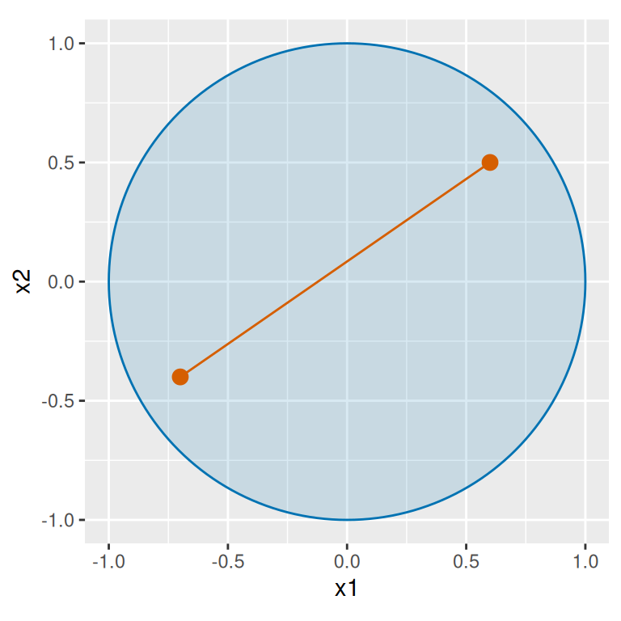
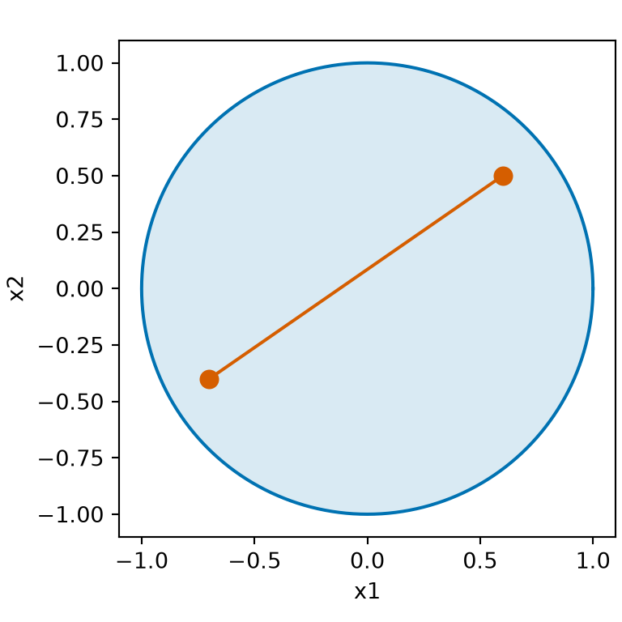
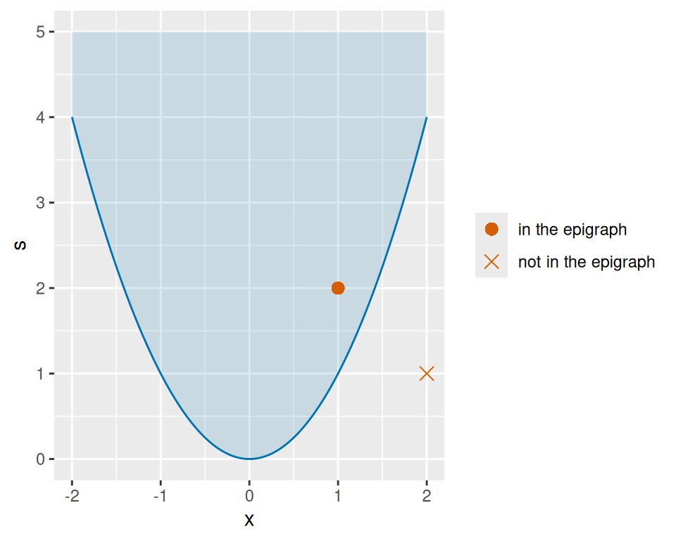
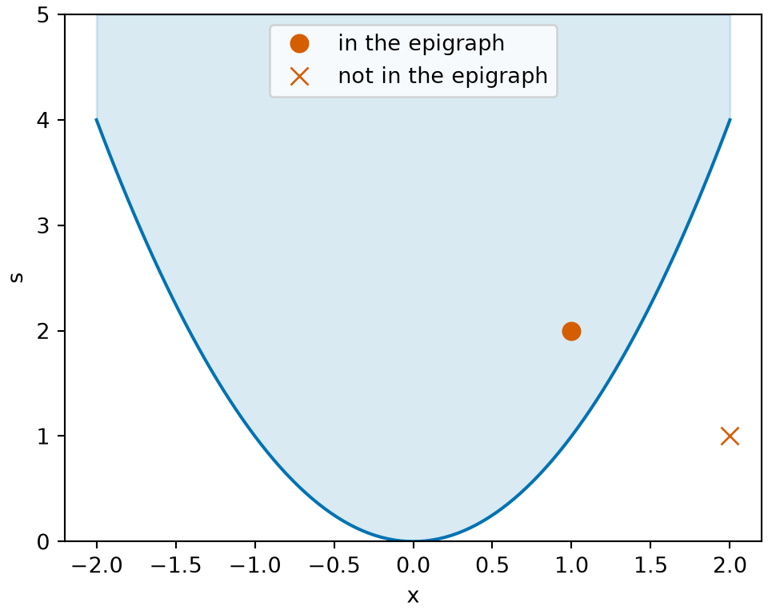
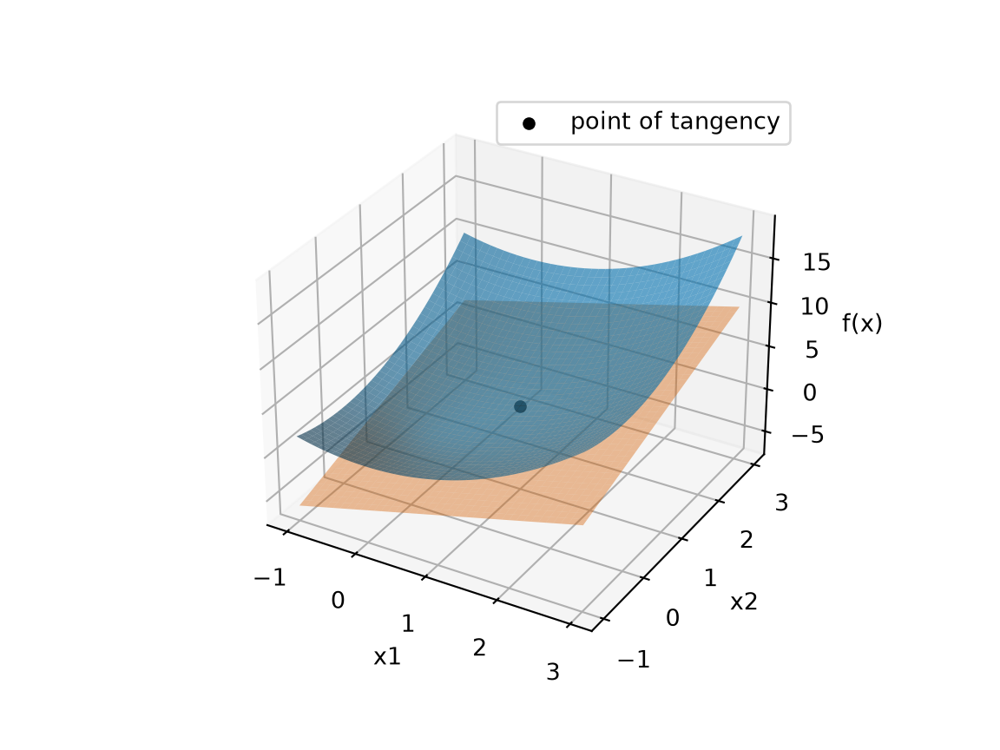
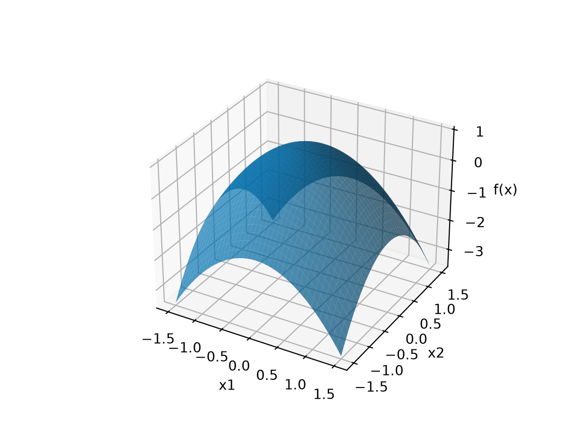

# Convexity in Several Variables

Code

Published

Last modified: 2026-11-12 12:13:04 (PST)

> **NOTE:**
>
> This section is adapted from the convexity part of Zhou [\[1\]](#ref-zhou2024optim), used under the MIT License (see the license text in [Linear Algebra](linear-algebra-subspaces.llms.md#sec-subspaces)). The source states the first-order test (in one direction) and the second-derivative test for convexity without proof; here both directions of the first-order test are proved, and the second-derivative test is proved from the Taylor theorem of [Section  in Critical Points and Optimality Conditions](optimization-critical-points.llms.md#sec-optimality-vector). The source defines both concave and strictly concave as “$-f$ is strictly convex”; here $f$ is concave when $-f$ is convex. The source states that an intersection of convex sets is convex and that a maximum of convex functions is convex for any finite number of them; here each is stated for two and the general case follows by induction. These parts of the source are not part of this section:
>
> - its catalogs of convex sets and convex functions, including the positive semidefinite matrices and $-\log \det$
> - intersections of infinitely many convex sets, and suprema of infinitely many convex functions
> - its examples, exercises and figures, including the multivariate normal maximum likelihood example

> **NOTE:**
>
> **Definition 1 (Convex set)** A set $K \subseteq \mathbb{R}^p$ is **convex** if [\[2\]](#ref-wikipedia_convex_set) for all $\mathord{\smash[b]{\underset{\raise.3ex\hbox{$\scriptstyle\sim$}}{x}}\vphantom{x}}, \mathord{\smash[b]{\underset{\raise.3ex\hbox{$\scriptstyle\sim$}}{y}}\vphantom{y}}\in K$ and all $t \in [0, 1]$, the point $t \mathord{\smash[b]{\underset{\raise.3ex\hbox{$\scriptstyle\sim$}}{x}}\vphantom{x}}+ (1 - t) \mathord{\smash[b]{\underset{\raise.3ex\hbox{$\scriptstyle\sim$}}{y}}\vphantom{y}}$ is in $K$: $K$ contains the whole line segment between any two of its points.

> **NOTE:**
>
> **Example 1 (Convex sets)**  
>
> - $\mathbb{R}^p$ is convex, and so is any set with at most one point.
>
> - The [closed ball](vector-calculus.llms.md#def-closed-ball) $B = \mathopen{}\left\{\mathord{\smash[b]{\underset{\raise.3ex\hbox{$\scriptstyle\sim$}}{x}}\vphantom{x}}: \mathopen{}\left\lVert\mathord{\smash[b]{\underset{\raise.3ex\hbox{$\scriptstyle\sim$}}{x}}\vphantom{x}}\right\rVert\mathclose{} \le r\right\}\mathclose{}$ is convex: for $\mathord{\smash[b]{\underset{\raise.3ex\hbox{$\scriptstyle\sim$}}{x}}\vphantom{x}}, \mathord{\smash[b]{\underset{\raise.3ex\hbox{$\scriptstyle\sim$}}{y}}\vphantom{y}}\in B$ and $t \in [0, 1]$,
>
>   $$\begin{aligned}
>   \mathopen{}\left\lVert t \mathord{\smash[b]{\underset{\raise.3ex\hbox{$\scriptstyle\sim$}}{x}}\vphantom{x}}+ (1 - t) \mathord{\smash[b]{\underset{\raise.3ex\hbox{$\scriptstyle\sim$}}{y}}\vphantom{y}}\right\rVert\mathclose{}
>   &\le \mathopen{}\left\lVert t \mathord{\smash[b]{\underset{\raise.3ex\hbox{$\scriptstyle\sim$}}{x}}\vphantom{x}}\right\rVert\mathclose{} + \mathopen{}\left\lVert(1 - t) \mathord{\smash[b]{\underset{\raise.3ex\hbox{$\scriptstyle\sim$}}{y}}\vphantom{y}}\right\rVert\mathclose{}
>   && \text{(triangle inequality)}
>   \\
>   &= t\,\mathopen{}\left\lVert\mathord{\smash[b]{\underset{\raise.3ex\hbox{$\scriptstyle\sim$}}{x}}\vphantom{x}}\right\rVert\mathclose{} + (1 - t)\,\mathopen{}\left\lVert\mathord{\smash[b]{\underset{\raise.3ex\hbox{$\scriptstyle\sim$}}{y}}\vphantom{y}}\right\rVert\mathclose{}
>   && \text{(norm of a multiple; } t, 1 - t \ge 0 \text{)}
>   \\
>   &\le t\,r + (1 - t)\,r
>   && \text{(} \mathord{\smash[b]{\underset{\raise.3ex\hbox{$\scriptstyle\sim$}}{x}}\vphantom{x}}, \mathord{\smash[b]{\underset{\raise.3ex\hbox{$\scriptstyle\sim$}}{y}}\vphantom{y}}\in B \text{)}
>   \\
>   &= r.
>   && \text{(arithmetic)}
>   \end{aligned}$$
>
>   The first step is the [triangle inequality](linear-algebra-inner-products.llms.md#thm-triangle-inequality), and the second uses [the norm of a multiple](linear-algebra-inner-products.llms.md#thm-norm-properties).

> **NOTE:**
>
> **Example 2 (A set that is not convex)** $K = \mathopen{}\left\{x \in \mathbb{R}: \mathopen{}\left|x\right|\mathclose{} \ge 1\right\}\mathclose{}$ is not convex: $-1$ and $1$ are in $K$, but with $t = \tfrac{1}{2}$ the point $\tfrac{1}{2}(-1) + \tfrac{1}{2}(1) = 0$ is not.

> **NOTE:**
>
> Show code
>
> ``` downlit
> cs_angle_fc <- seq(0, 2 * pi, length.out = 201)
> cs_cos_fc <- cos(cs_angle_fc)
> cs_sin_fc <- sin(cs_angle_fc)
> cs_disk_fc <- tibble::tibble(x1 = cs_cos_fc, x2 = cs_sin_fc)
> cs_points_x1_fc <- c(-0.7, 0.6)
> cs_points_x2_fc <- c(-0.4, 0.5)
> cs_points_fc <- tibble::tibble(x1 = cs_points_x1_fc, x2 = cs_points_x2_fc)
> cs_segment_fc <- tibble::tibble(
>   x1 = -0.7, x2 = -0.4, x1_end = 0.6, x2_end = 0.5
> )
> cs_aes_fc <- ggplot2::aes(x1, x2)
> cs_seg_aes_fc <- ggplot2::aes(xend = x1_end, yend = x2_end)
> ggplot2::ggplot(cs_disk_fc, cs_aes_fc) +
>   ggplot2::geom_polygon(fill = "#0072B2", alpha = 0.15, colour = "#0072B2") +
>   ggplot2::geom_segment(
>     data = cs_segment_fc, mapping = cs_seg_aes_fc, colour = "#D55E00"
>   ) +
>   ggplot2::geom_point(data = cs_points_fc, colour = "#D55E00", size = 3) +
>   ggplot2::coord_fixed() +
>   ggplot2::labs(x = "x1", y = "x2")
> ```
>
> Show code
>
> ``` python
> import matplotlib.pyplot as plt
> import numpy as np
>
> cs_angle_fc = np.linspace(0, 2 * np.pi, 201)
> cs_x1_fc = np.array([-0.7, 0.6])
> cs_x2_fc = np.array([-0.4, 0.5])
> fig, ax = plt.subplots(figsize=(4, 4), layout="constrained")
> ax.fill(np.cos(cs_angle_fc), np.sin(cs_angle_fc), color="#0072B2", alpha=0.15)
> ax.plot(np.cos(cs_angle_fc), np.sin(cs_angle_fc), color="#0072B2")
> ax.plot(cs_x1_fc, cs_x2_fc, "o-", color="#D55E00", markersize=8)
> ax.set_aspect("equal")
> ax.set_xlabel("x1")
> ax.set_ylabel("x2")
> plt.show()
> ```
>
> ## R
>
> [](optimization-convexity_files/figure-html/convex-set-r-1.png "Figure 1: The closed ball of Example 1 in \mathbb{R}^2 with r = 1. The segment between two of its points stays in the ball, as a convex set requires.")
>
> ## Python
>
> [](optimization-convexity_files/figure-html/convex-set-python-1.png "Figure 1: The closed ball of Example 1 in \mathbb{R}^2 with r = 1. The segment between two of its points stays in the ball, as a convex set requires.")
>
> Figure 1: The [closed ball](vector-calculus.llms.md#def-closed-ball) of [Example 1](#exm-convex-set) in $\mathbb{R}^2$ with $r = 1$. The segment between two of its points stays in the ball, as a [convex set](#def-convex-set) requires.

> **NOTE:**
>
> **Definition 2 (Half-space)** Let $\mathord{\smash[b]{\underset{\raise.3ex\hbox{$\scriptstyle\sim$}}{a}}\vphantom{a}} \in \mathbb{R}^p$ be a nonzero vector and $c$ a real number. The set $\mathopen{}\left\{\mathord{\smash[b]{\underset{\raise.3ex\hbox{$\scriptstyle\sim$}}{x}}\vphantom{x}}\in \mathbb{R}^p : \mathord{\smash[b]{\underset{\raise.3ex\hbox{$\scriptstyle\sim$}}{a}}\vphantom{a}} \cdot \mathord{\smash[b]{\underset{\raise.3ex\hbox{$\scriptstyle\sim$}}{x}}\vphantom{x}} \ge c\right\}\mathclose{}$ is a (closed) **half-space**: the points on one side of the boundary $\mathopen{}\left\{\mathord{\smash[b]{\underset{\raise.3ex\hbox{$\scriptstyle\sim$}}{x}}\vphantom{x}}: \mathord{\smash[b]{\underset{\raise.3ex\hbox{$\scriptstyle\sim$}}{a}}\vphantom{a}} \cdot \mathord{\smash[b]{\underset{\raise.3ex\hbox{$\scriptstyle\sim$}}{x}}\vphantom{x}} = c\right\}\mathclose{}$, together with the boundary. In $\mathbb{R}^2$, a half-space is called a **half-plane**.

> **NOTE:**
>
> **Example 3 (The right half-plane)** With $\mathord{\smash[b]{\underset{\raise.3ex\hbox{$\scriptstyle\sim$}}{a}}\vphantom{a}} = {(1, 0)}^{\top}$ and $c = 0$, the half-plane $\mathopen{}\left\{\mathord{\smash[b]{\underset{\raise.3ex\hbox{$\scriptstyle\sim$}}{x}}\vphantom{x}}\in \mathbb{R}^2 : x_1 \ge 0\right\}\mathclose{}$ is the set of points on or to the right of the $x_2$-axis. ${(1, 5)}^{\top}$ is in it, since $1 \ge 0$; ${(0, -3)}^{\top}$ is in it, on the boundary; and ${(-1, 0)}^{\top}$ is not, since $-1 < 0$.

> **NOTE:**
>
> **Theorem 1 (An intersection of convex sets is convex)** If $K_1$ and $K_2$ are convex subsets of $\mathbb{R}^p$ ([Definition 1](#def-convex-set)), then $K_1 \cap K_2$ is convex.

> **NOTE:**
>
> *Proof*. Let $\mathord{\smash[b]{\underset{\raise.3ex\hbox{$\scriptstyle\sim$}}{x}}\vphantom{x}}, \mathord{\smash[b]{\underset{\raise.3ex\hbox{$\scriptstyle\sim$}}{y}}\vphantom{y}}\in K_1 \cap K_2$ and $t \in [0, 1]$. Then $\mathord{\smash[b]{\underset{\raise.3ex\hbox{$\scriptstyle\sim$}}{x}}\vphantom{x}}, \mathord{\smash[b]{\underset{\raise.3ex\hbox{$\scriptstyle\sim$}}{y}}\vphantom{y}}\in K_1$, so $t \mathord{\smash[b]{\underset{\raise.3ex\hbox{$\scriptstyle\sim$}}{x}}\vphantom{x}}+ (1 - t) \mathord{\smash[b]{\underset{\raise.3ex\hbox{$\scriptstyle\sim$}}{y}}\vphantom{y}}\in K_1$, since $K_1$ is convex; in the same way $t \mathord{\smash[b]{\underset{\raise.3ex\hbox{$\scriptstyle\sim$}}{x}}\vphantom{x}}+ (1 - t) \mathord{\smash[b]{\underset{\raise.3ex\hbox{$\scriptstyle\sim$}}{y}}\vphantom{y}}\in K_2$. So $t \mathord{\smash[b]{\underset{\raise.3ex\hbox{$\scriptstyle\sim$}}{x}}\vphantom{x}}+ (1 - t) \mathord{\smash[b]{\underset{\raise.3ex\hbox{$\scriptstyle\sim$}}{y}}\vphantom{y}}\in K_1 \cap K_2$.

> **NOTE:**
>
> **Example 4 (Intersecting a ball with a half-plane)** The closed [unit ball](vector-calculus.llms.md#def-unit-ball) in $\mathbb{R}^2$ is [convex](optimization-convexity.llms.md#def-convex-set) ([Example 1](#exm-convex-set)), and so is the half-plane ([Definition 2](#def-half-space)) $\mathopen{}\left\{\mathord{\smash[b]{\underset{\raise.3ex\hbox{$\scriptstyle\sim$}}{x}}\vphantom{x}}: x_1 \ge 0\right\}\mathclose{}$: if $x_1 \ge 0$ and $y_1 \ge 0$, then $t x_1 + (1 - t) y_1 \ge 0$ for $t \in [0, 1]$. By [Theorem 1](#thm-convex-intersection), the closed half-disk $\mathopen{}\left\{\mathord{\smash[b]{\underset{\raise.3ex\hbox{$\scriptstyle\sim$}}{x}}\vphantom{x}}: \mathopen{}\left\lVert\mathord{\smash[b]{\underset{\raise.3ex\hbox{$\scriptstyle\sim$}}{x}}\vphantom{x}}\right\rVert\mathclose{} \le 1,\ x_1 \ge 0\right\}\mathclose{}$ is convex. A union need not be convex: $\mathopen{}\left\{x \in \mathbb{R}: x \le -1\right\}\mathclose{}$ and $\mathopen{}\left\{x \in \mathbb{R}: x \ge 1\right\}\mathclose{}$ are convex, but their union is the set of [Example 2](#exm-not-convex-set).
>
> [Figure 2](#fig-convex-intersection) shows the half-disk.
>
> > **NOTE:**
> >
> > Show code
> >
> > ``` downlit
> > ci_angle_ci <- seq(-pi / 2, pi / 2, length.out = 101)
> > ci_half_x1_ci <- cos(ci_angle_ci)
> > ci_half_x2_ci <- sin(ci_angle_ci)
> > ci_half_ci <- tibble::tibble(x1 = ci_half_x1_ci, x2 = ci_half_x2_ci)
> > ci_full_angle_ci <- seq(0, 2 * pi, length.out = 201)
> > ci_full_x1_ci <- cos(ci_full_angle_ci)
> > ci_full_x2_ci <- sin(ci_full_angle_ci)
> > ci_full_ci <- tibble::tibble(x1 = ci_full_x1_ci, x2 = ci_full_x2_ci)
> > ci_edge_ci <- tibble::tibble(x1 = 0, x2 = -1, x1_end = 0, x2_end = 1)
> > ci_aes_ci <- ggplot2::aes(x1, x2)
> > ci_seg_aes_ci <- ggplot2::aes(xend = x1_end, yend = x2_end)
> > ci_full_ci |>
> >   ggplot2::ggplot() +
> >   ci_aes_ci +
> >   ggplot2::geom_path(colour = "grey60") +
> >   ggplot2::geom_polygon(
> >     data = ci_half_ci, fill = "#0072B2", alpha = 0.25, colour = "#0072B2"
> >   ) +
> >   ggplot2::geom_segment(
> >     data = ci_edge_ci, mapping = ci_seg_aes_ci,
> >     colour = "#D55E00", linewidth = 1
> >   ) +
> >   ggplot2::coord_fixed() +
> >   ggplot2::labs(x = "x1", y = "x2")
> > ```
> >
> > Show code
> >
> > ``` python
> > import matplotlib.pyplot as plt
> > import numpy as np
> >
> > ci_full_py = np.linspace(0, 2 * np.pi, 201)
> > ci_half_py = np.linspace(-np.pi / 2, np.pi / 2, 101)
> > fig, ax = plt.subplots(figsize=(4, 4), layout="constrained")
> > ax.plot(np.cos(ci_full_py), np.sin(ci_full_py), color="grey")
> > ax.fill(np.cos(ci_half_py), np.sin(ci_half_py), color="#0072B2", alpha=0.25)
> > ax.plot(np.cos(ci_half_py), np.sin(ci_half_py), color="#0072B2")
> > ax.plot([0, 0], [-1, 1], color="#D55E00", linewidth=2)
> > ax.set_aspect("equal")
> > ax.set_xlabel("x1")
> > ax.set_ylabel("x2")
> > plt.show();
> > ```
> >
> > ## R
> >
> > [](optimization-convexity_files/figure-html/convex-intersection-r-3.png "Figure 2: The closed half-disk (blue) is the intersection of the unit ball with the half-plane x_1 \ge 0 of Example 4. The vermilion segment is the edge of the half-plane. The half-disk is convex, as Theorem 1 states.")
> >
> > ## Python
> >
> > [](optimization-convexity_files/figure-html/convex-intersection-python-1.png "Figure 2: The closed half-disk (blue) is the intersection of the unit ball with the half-plane x_1 \ge 0 of Example 4. The vermilion segment is the edge of the half-plane. The half-disk is convex, as Theorem 1 states.")
> >
> > Figure 2: The closed half-disk (blue) is the [intersection](https://morrison-lab.github.io/mcs/sets.html#def-intersection) of the [unit ball](vector-calculus.llms.md#def-unit-ball) with the [half-plane](#def-half-space) $x_1 \ge 0$ of [Example 4](#exm-convex-intersection). The vermilion segment is the edge of the half-plane. The half-disk is [convex](optimization-convexity.llms.md#def-convex-set), as [Theorem 1](#thm-convex-intersection) states.

> **NOTE:**
>
> **Definition 3 (Convex hull, convex envelope)** The **convex hull** (or **convex envelope**) [\[3\]](#ref-wikipedia_convex_hull) of a [set](https://morrison-lab.github.io/mcs/sets.html#def-set) $S \subseteq \mathbb{R}^p$ is the set of points that lie in every [convex set](#def-convex-set) containing $S$:
>
> $$\operatorname{conv}(S) \stackrel{\text{def}}{=}\mathopen{}\left\{\mathord{\smash[b]{\underset{\raise.3ex\hbox{$\scriptstyle\sim$}}{x}}\vphantom{x}}\in \mathbb{R}^p : \mathord{\smash[b]{\underset{\raise.3ex\hbox{$\scriptstyle\sim$}}{x}}\vphantom{x}}\in K \text{ for every convex } K \subseteq \mathbb{R}^p \text{ with } S \subseteq K\right\}\mathclose{}.$$

> **NOTE:**
>
> **Example 5 (The convex hull of three points is a triangle)** Let $S = \mathopen{}\left\{\mathord{\smash[b]{\underset{\raise.3ex\hbox{$\scriptstyle\sim$}}{0}}\vphantom{0}}, \mathord{\smash[b]{\underset{\raise.3ex\hbox{$\scriptstyle\sim$}}{e}}\vphantom{e}}_1, \mathord{\smash[b]{\underset{\raise.3ex\hbox{$\scriptstyle\sim$}}{e}}\vphantom{e}}_2\right\}\mathclose{} \subseteq \mathbb{R}^2$, with $\mathord{\smash[b]{\underset{\raise.3ex\hbox{$\scriptstyle\sim$}}{e}}\vphantom{e}}_1 = {(1, 0)}^{\top}$ and $\mathord{\smash[b]{\underset{\raise.3ex\hbox{$\scriptstyle\sim$}}{e}}\vphantom{e}}_2 = {(0, 1)}^{\top}$, and let $T = \mathopen{}\left\{\mathord{\smash[b]{\underset{\raise.3ex\hbox{$\scriptstyle\sim$}}{x}}\vphantom{x}}\in \mathbb{R}^2 : x_1 \ge 0,\ x_2 \ge 0,\ x_1 + x_2 \le 1\right\}\mathclose{}$, the filled triangle with corners $\mathord{\smash[b]{\underset{\raise.3ex\hbox{$\scriptstyle\sim$}}{0}}\vphantom{0}}$, $\mathord{\smash[b]{\underset{\raise.3ex\hbox{$\scriptstyle\sim$}}{e}}\vphantom{e}}_1$ and $\mathord{\smash[b]{\underset{\raise.3ex\hbox{$\scriptstyle\sim$}}{e}}\vphantom{e}}_2$. Then $\operatorname{conv}(S) = T$: the [convex hull](#def-convex-hull) of $S$ is $T$.
>
> - **Inclusion** $\operatorname{conv}(S) \subseteq T$. $T$ is the [intersection](https://morrison-lab.github.io/mcs/sets.html#def-indexed-intersection) of three [half-planes](#def-half-space), with $\mathord{\smash[b]{\underset{\raise.3ex\hbox{$\scriptstyle\sim$}}{a}}\vphantom{a}} = {(1, 0)}^{\top}$, ${(0, 1)}^{\top}$ and ${(-1, -1)}^{\top}$, and $c = 0$, $0$ and $-1$. Each half-plane $H = \mathopen{}\left\{\mathord{\smash[b]{\underset{\raise.3ex\hbox{$\scriptstyle\sim$}}{x}}\vphantom{x}}: \mathord{\smash[b]{\underset{\raise.3ex\hbox{$\scriptstyle\sim$}}{a}}\vphantom{a}} \cdot \mathord{\smash[b]{\underset{\raise.3ex\hbox{$\scriptstyle\sim$}}{x}}\vphantom{x}} \ge c\right\}\mathclose{}$ is [convex](#def-convex-set): for $\mathord{\smash[b]{\underset{\raise.3ex\hbox{$\scriptstyle\sim$}}{x}}\vphantom{x}}, \mathord{\smash[b]{\underset{\raise.3ex\hbox{$\scriptstyle\sim$}}{y}}\vphantom{y}}\in H$ and $t \in [0, 1]$,
>
>   $$\begin{aligned}
>   \mathord{\smash[b]{\underset{\raise.3ex\hbox{$\scriptstyle\sim$}}{a}}\vphantom{a}} \cdot t \mathord{\smash[b]{\underset{\raise.3ex\hbox{$\scriptstyle\sim$}}{x}}\vphantom{x}}+ (1 - t) \mathord{\smash[b]{\underset{\raise.3ex\hbox{$\scriptstyle\sim$}}{y}}\vphantom{y}}
>   &= t \mathord{\smash[b]{\underset{\raise.3ex\hbox{$\scriptstyle\sim$}}{a}}\vphantom{a}} \cdot \mathord{\smash[b]{\underset{\raise.3ex\hbox{$\scriptstyle\sim$}}{x}}\vphantom{x}} + (1 - t) \mathord{\smash[b]{\underset{\raise.3ex\hbox{$\scriptstyle\sim$}}{a}}\vphantom{a}} \cdot \mathord{\smash[b]{\underset{\raise.3ex\hbox{$\scriptstyle\sim$}}{y}}\vphantom{y}}
>   && \text{(the dot product is linear)}
>   \\
>   &\ge t c + (1 - t) c
>   && \text{(} \mathord{\smash[b]{\underset{\raise.3ex\hbox{$\scriptstyle\sim$}}{x}}\vphantom{x}}, \mathord{\smash[b]{\underset{\raise.3ex\hbox{$\scriptstyle\sim$}}{y}}\vphantom{y}}\in H \text{ and } t, 1 - t \ge 0 \text{)}
>   \\
>   &= c.
>   && \text{(arithmetic)}
>   \end{aligned}$$
>
>   So $T$ is convex, by [Theorem 1](#thm-convex-intersection) applied twice. $T$ contains $S$, so every point of $\operatorname{conv}(S)$ is in $T$.
>
> - **Inclusion** $T \subseteq \operatorname{conv}(S)$. Let $K$ be a [convex set](#def-convex-set) containing $S$, let $\mathord{\smash[b]{\underset{\raise.3ex\hbox{$\scriptstyle\sim$}}{x}}\vphantom{x}}\in T$, and let $s = x_1 + x_2$, so $0 \le s \le 1$. If $s = 0$, then $\mathord{\smash[b]{\underset{\raise.3ex\hbox{$\scriptstyle\sim$}}{x}}\vphantom{x}}= \mathord{\smash[b]{\underset{\raise.3ex\hbox{$\scriptstyle\sim$}}{0}}\vphantom{0}}\in K$. Otherwise $\mathord{\smash[b]{\underset{\raise.3ex\hbox{$\scriptstyle\sim$}}{p}}\vphantom{p}} = \mathord{\smash[b]{\underset{\raise.3ex\hbox{$\scriptstyle\sim$}}{x}}\vphantom{x}}/ s$ has $p_1 + p_2 = 1$ with $p_1, p_2 \ge 0$, so $\mathord{\smash[b]{\underset{\raise.3ex\hbox{$\scriptstyle\sim$}}{p}}\vphantom{p}} = p_1 \mathord{\smash[b]{\underset{\raise.3ex\hbox{$\scriptstyle\sim$}}{e}}\vphantom{e}}_1 + (1 - p_1) \mathord{\smash[b]{\underset{\raise.3ex\hbox{$\scriptstyle\sim$}}{e}}\vphantom{e}}_2$ is in $K$, by convexity with $t = p_1$. Then $\mathord{\smash[b]{\underset{\raise.3ex\hbox{$\scriptstyle\sim$}}{x}}\vphantom{x}}= s \mathord{\smash[b]{\underset{\raise.3ex\hbox{$\scriptstyle\sim$}}{p}}\vphantom{p}} + (1 - s) \mathord{\smash[b]{\underset{\raise.3ex\hbox{$\scriptstyle\sim$}}{0}}\vphantom{0}}$ is in $K$, by convexity with $t = s$. So $\mathord{\smash[b]{\underset{\raise.3ex\hbox{$\scriptstyle\sim$}}{x}}\vphantom{x}}$ is in every convex set containing $S$.
>
> [Figure 3](#fig-convex-hull) shows $S$, $T$ and the two steps for one point of $T$.
>
> > **NOTE:**
> >
> > Show code
> >
> > ``` downlit
> > ch_corner_x1_fc <- c(0, 1, 0)
> > ch_corner_x2_fc <- c(0, 0, 1)
> > ch_corners_fc <- tibble::tibble(x1 = ch_corner_x1_fc, x2 = ch_corner_x2_fc)
> > ch_path_x1_fc <- c(0, 0.2, 0.4)
> > ch_path_x2_fc <- c(0, 0.3, 0.6)
> > ch_path_fc <- tibble::tibble(x1 = ch_path_x1_fc, x2 = ch_path_x2_fc)
> > ch_marks_x1_fc <- c(0.2, 0.4)
> > ch_marks_x2_fc <- c(0.3, 0.6)
> > ch_marks_label_fc <- c("x", "p")
> > ch_marks_fc <- tibble::tibble(
> >   x1 = ch_marks_x1_fc,
> >   x2 = ch_marks_x2_fc,
> >   label = ch_marks_label_fc
> > )
> > ch_aes_fc <- ggplot2::aes(x = x1, y = x2)
> > ch_label_aes_fc <- ggplot2::aes(x = x1, y = x2, label = label)
> > ggplot2::ggplot() +
> >   ggplot2::geom_polygon(
> >     data = ch_corners_fc, mapping = ch_aes_fc,
> >     fill = "#0072B2", alpha = 0.15, colour = "#0072B2"
> >   ) +
> >   ggplot2::geom_point(
> >     data = ch_corners_fc, mapping = ch_aes_fc,
> >     colour = "#0072B2", size = 3
> >   ) +
> >   ggplot2::geom_line(
> >     data = ch_path_fc, mapping = ch_aes_fc,
> >     colour = "#D55E00", linetype = "dashed"
> >   ) +
> >   ggplot2::geom_point(
> >     data = ch_marks_fc, mapping = ch_aes_fc,
> >     colour = "#D55E00", size = 3
> >   ) +
> >   ggplot2::geom_text(
> >     data = ch_marks_fc, mapping = ch_label_aes_fc,
> >     colour = "#D55E00", nudge_x = 0.07
> >   ) +
> >   ggplot2::coord_fixed() +
> >   ggplot2::labs(x = "x1", y = "x2")
> > ```
> >
> > Show code
> >
> > ``` python
> > import matplotlib.pyplot as plt
> >
> > ch_x1_fc = [0, 1, 0]
> > ch_x2_fc = [0, 0, 1]
> > fig, ax = plt.subplots(figsize=(4, 4), layout="constrained")
> > ax.fill(ch_x1_fc, ch_x2_fc, color="#0072B2", alpha=0.15);
> > ax.plot(ch_x1_fc + [0], ch_x2_fc + [0], "o-", color="#0072B2", markersize=8);
> > ax.plot([0, 0.4], [0, 0.6], "--", color="#D55E00");
> > ax.plot([0.2, 0.4], [0.3, 0.6], "o", color="#D55E00", markersize=8);
> > ax.annotate("x", (0.2, 0.3), xytext=(6, 0), textcoords="offset points",
> >             color="#D55E00");
> > ax.annotate("p", (0.4, 0.6), xytext=(6, 0), textcoords="offset points",
> >             color="#D55E00");
> > ax.set_aspect("equal");
> > ax.set_xlabel("x1");
> > ax.set_ylabel("x2");
> > plt.show();
> > ```
> >
> > ## R
> >
> > [](optimization-convexity_files/figure-html/convex-hull-r-3.png "Figure 3: The three blue corners are the set S of Example 5. The shaded triangle T is its convex hull. The point \mathord{\smash[b]{\underset{\raise.3ex\hbox{$\scriptstyle\sim$}}{x}}\vphantom{x}}= {(0.2, 0.3)}^{\top} has s = 0.5. The point \mathord{\smash[b]{\underset{\raise.3ex\hbox{$\scriptstyle\sim$}}{p}}\vphantom{p}} = {(0.4, 0.6)}^{\top} lies on the segment between \mathord{\smash[b]{\underset{\raise.3ex\hbox{$\scriptstyle\sim$}}{e}}\vphantom{e}}_1 and \mathord{\smash[b]{\underset{\raise.3ex\hbox{$\scriptstyle\sim$}}{e}}\vphantom{e}}_2, and \mathord{\smash[b]{\underset{\raise.3ex\hbox{$\scriptstyle\sim$}}{x}}\vphantom{x}} lies on the segment between \mathord{\smash[b]{\underset{\raise.3ex\hbox{$\scriptstyle\sim$}}{0}}\vphantom{0}} and \mathord{\smash[b]{\underset{\raise.3ex\hbox{$\scriptstyle\sim$}}{p}}\vphantom{p}}.")
> >
> > ## Python
> >
> > [](optimization-convexity_files/figure-html/convex-hull-python-1.png "Figure 3: The three blue corners are the set S of Example 5. The shaded triangle T is its convex hull. The point \mathord{\smash[b]{\underset{\raise.3ex\hbox{$\scriptstyle\sim$}}{x}}\vphantom{x}}= {(0.2, 0.3)}^{\top} has s = 0.5. The point \mathord{\smash[b]{\underset{\raise.3ex\hbox{$\scriptstyle\sim$}}{p}}\vphantom{p}} = {(0.4, 0.6)}^{\top} lies on the segment between \mathord{\smash[b]{\underset{\raise.3ex\hbox{$\scriptstyle\sim$}}{e}}\vphantom{e}}_1 and \mathord{\smash[b]{\underset{\raise.3ex\hbox{$\scriptstyle\sim$}}{e}}\vphantom{e}}_2, and \mathord{\smash[b]{\underset{\raise.3ex\hbox{$\scriptstyle\sim$}}{x}}\vphantom{x}} lies on the segment between \mathord{\smash[b]{\underset{\raise.3ex\hbox{$\scriptstyle\sim$}}{0}}\vphantom{0}} and \mathord{\smash[b]{\underset{\raise.3ex\hbox{$\scriptstyle\sim$}}{p}}\vphantom{p}}.")
> >
> > Figure 3: The three blue corners are the [set](https://morrison-lab.github.io/mcs/sets.html#def-set) $S$ of [Example 5](#exm-convex-hull). The shaded triangle $T$ is its [convex hull](#def-convex-hull). The point $\mathord{\smash[b]{\underset{\raise.3ex\hbox{$\scriptstyle\sim$}}{x}}\vphantom{x}}= {(0.2, 0.3)}^{\top}$ has $s = 0.5$. The point $\mathord{\smash[b]{\underset{\raise.3ex\hbox{$\scriptstyle\sim$}}{p}}\vphantom{p}} = {(0.4, 0.6)}^{\top}$ lies on the segment between $\mathord{\smash[b]{\underset{\raise.3ex\hbox{$\scriptstyle\sim$}}{e}}\vphantom{e}}_1$ and $\mathord{\smash[b]{\underset{\raise.3ex\hbox{$\scriptstyle\sim$}}{e}}\vphantom{e}}_2$, and $\mathord{\smash[b]{\underset{\raise.3ex\hbox{$\scriptstyle\sim$}}{x}}\vphantom{x}}$ lies on the segment between $\mathord{\smash[b]{\underset{\raise.3ex\hbox{$\scriptstyle\sim$}}{0}}\vphantom{0}}$ and $\mathord{\smash[b]{\underset{\raise.3ex\hbox{$\scriptstyle\sim$}}{p}}\vphantom{p}}$.

> **NOTE:**
>
> **Definition 4 (Strictly convex function)** A function $f : \mathbb{R}^p \to \mathbb{R}$ is **strictly convex** if $f(t \mathord{\smash[b]{\underset{\raise.3ex\hbox{$\scriptstyle\sim$}}{x}}\vphantom{x}}+ (1 - t) \mathord{\smash[b]{\underset{\raise.3ex\hbox{$\scriptstyle\sim$}}{y}}\vphantom{y}}) < t f(\mathord{\smash[b]{\underset{\raise.3ex\hbox{$\scriptstyle\sim$}}{x}}\vphantom{x}}) + (1 - t) f(\mathord{\smash[b]{\underset{\raise.3ex\hbox{$\scriptstyle\sim$}}{y}}\vphantom{y}})$ for all $\mathord{\smash[b]{\underset{\raise.3ex\hbox{$\scriptstyle\sim$}}{x}}\vphantom{x}}\ne \mathord{\smash[b]{\underset{\raise.3ex\hbox{$\scriptstyle\sim$}}{y}}\vphantom{y}}$ in $\mathbb{R}^p$ and all $t \in (0, 1)$.

> **NOTE:**
>
> **Definition 5 (Concave function)** A function $f : \mathbb{R}^p \to \mathbb{R}$ is **concave** if $-f$ is [convex](algebra-sums.llms.md#def-convex-function).

> **NOTE:**
>
> **Definition 6 (Strictly concave function)** A function $f : \mathbb{R}^p \to \mathbb{R}$ is **strictly concave** if $-f$ is strictly convex ([Definition 4](#def-strictly-convex)).

> **NOTE:**
>
> **Example 6 (Strictly convex, and convex but not strictly)**  
>
> - $f(x) = x^2$ is strictly convex:
>
>   $$\begin{aligned}
>   t x^2 + (1 - t) y^2 - (t x + (1 - t) y)^2
>   &= t x^2 + (1 - t) y^2 - t^2 x^2 - 2 t (1 - t) x y - (1 - t)^2 y^2
>   && \text{(expand the square)}
>   \\
>   &= t (1 - t) x^2 - 2 t (1 - t) x y + t (1 - t) y^2
>   && \text{(} t - t^2 = t (1 - t) \text{, } (1 - t) - (1 - t)^2 = t (1 - t) \text{)}
>   \\
>   &= t (1 - t) (x - y)^2,
>   && \text{(factor)}
>   \end{aligned}$$
>
>   which is positive when $x \ne y$ and $t \in (0, 1)$. At $t \in \mathopen{}\left\{0, 1\right\}\mathclose{}$ or $x = y$ it is $0$, so $x^2$ is also convex.
>
> - $f(x) = 2x + 1$ is convex but not strictly convex:
>
>   $$\begin{aligned}
>   f(t x + (1 - t) y) &= 2 t x + 2 (1 - t) y + 1 \\
>   &= t f(x) + (1 - t) f(y)
>   \end{aligned}$$
>
>   for every $x, y, t$, so the inequality holds, but never strictly. It is also concave.

> **NOTE:**
>
> **Theorem 2 (An open ball is convex)** Let $\mathord{\smash[b]{\underset{\raise.3ex\hbox{$\scriptstyle\sim$}}{x}}\vphantom{x}}_0 \in \mathbb{R}^p$ and $r > 0$. The [open ball](vector-calculus.llms.md#def-ball) of radius $r$ around $\mathord{\smash[b]{\underset{\raise.3ex\hbox{$\scriptstyle\sim$}}{x}}\vphantom{x}}_0$ is a [convex set](#def-convex-set).

> **NOTE:**
>
> *Proof*. Call the [open ball](vector-calculus.llms.md#def-ball) $B$, and let $\mathord{\smash[b]{\underset{\raise.3ex\hbox{$\scriptstyle\sim$}}{x}}\vphantom{x}}, \mathord{\smash[b]{\underset{\raise.3ex\hbox{$\scriptstyle\sim$}}{y}}\vphantom{y}}\in B$ and $t \in [0, 1]$. The [triangle inequality](linear-algebra-inner-products.llms.md#thm-triangle-inequality) and the [absolute homogeneity of the norm](linear-algebra-inner-products.llms.md#thm-norm-properties) give
>
> $$\begin{aligned}
> \mathopen{}\left\lVert t \mathord{\smash[b]{\underset{\raise.3ex\hbox{$\scriptstyle\sim$}}{x}}\vphantom{x}}+ (1 - t) \mathord{\smash[b]{\underset{\raise.3ex\hbox{$\scriptstyle\sim$}}{y}}\vphantom{y}}- \mathord{\smash[b]{\underset{\raise.3ex\hbox{$\scriptstyle\sim$}}{x}}\vphantom{x}}_0\right\rVert\mathclose{}
> &= \mathopen{}\left\lVert t (\mathord{\smash[b]{\underset{\raise.3ex\hbox{$\scriptstyle\sim$}}{x}}\vphantom{x}}- \mathord{\smash[b]{\underset{\raise.3ex\hbox{$\scriptstyle\sim$}}{x}}\vphantom{x}}_0) + (1 - t) (\mathord{\smash[b]{\underset{\raise.3ex\hbox{$\scriptstyle\sim$}}{y}}\vphantom{y}}- \mathord{\smash[b]{\underset{\raise.3ex\hbox{$\scriptstyle\sim$}}{x}}\vphantom{x}}_0)\right\rVert\mathclose{}
> && \text{(} \mathord{\smash[b]{\underset{\raise.3ex\hbox{$\scriptstyle\sim$}}{x}}\vphantom{x}}_0 = t \mathord{\smash[b]{\underset{\raise.3ex\hbox{$\scriptstyle\sim$}}{x}}\vphantom{x}}_0 + (1 - t) \mathord{\smash[b]{\underset{\raise.3ex\hbox{$\scriptstyle\sim$}}{x}}\vphantom{x}}_0 \text{)}
> \\
> &\le t \mathopen{}\left\lVert\mathord{\smash[b]{\underset{\raise.3ex\hbox{$\scriptstyle\sim$}}{x}}\vphantom{x}}- \mathord{\smash[b]{\underset{\raise.3ex\hbox{$\scriptstyle\sim$}}{x}}\vphantom{x}}_0\right\rVert\mathclose{} + (1 - t) \mathopen{}\left\lVert\mathord{\smash[b]{\underset{\raise.3ex\hbox{$\scriptstyle\sim$}}{y}}\vphantom{y}}- \mathord{\smash[b]{\underset{\raise.3ex\hbox{$\scriptstyle\sim$}}{x}}\vphantom{x}}_0\right\rVert\mathclose{}
> && \text{(triangle inequality and } t, 1 - t \ge 0 \text{)}
> \\
> &< r,
> && \text{(weighted mean of two numbers less than } r \text{)}
> \end{aligned}$$
>
> so $t \mathord{\smash[b]{\underset{\raise.3ex\hbox{$\scriptstyle\sim$}}{x}}\vphantom{x}}+ (1 - t) \mathord{\smash[b]{\underset{\raise.3ex\hbox{$\scriptstyle\sim$}}{y}}\vphantom{y}}\in B$.

> **NOTE:**
>
> **Definition 7 (Convex function on a set)** Let $K \subseteq \mathbb{R}^p$ be a [convex set](#def-convex-set). A function $f : \mathbb{R}^p \to \mathbb{R}$ is **convex on** $K$ if
>
> $$f(t \mathord{\smash[b]{\underset{\raise.3ex\hbox{$\scriptstyle\sim$}}{x}}\vphantom{x}}+ (1 - t) \mathord{\smash[b]{\underset{\raise.3ex\hbox{$\scriptstyle\sim$}}{y}}\vphantom{y}}) \le t f(\mathord{\smash[b]{\underset{\raise.3ex\hbox{$\scriptstyle\sim$}}{x}}\vphantom{x}}) + (1 - t) f(\mathord{\smash[b]{\underset{\raise.3ex\hbox{$\scriptstyle\sim$}}{y}}\vphantom{y}})$$
>
> [for all](https://morrison-lab.github.io/mcs/proof-writing.html#def-universal-quantifier) $\mathord{\smash[b]{\underset{\raise.3ex\hbox{$\scriptstyle\sim$}}{x}}\vphantom{x}}, \mathord{\smash[b]{\underset{\raise.3ex\hbox{$\scriptstyle\sim$}}{y}}\vphantom{y}}\in K$ and all $t \in [0, 1]$.

> **NOTE:**
>
> **Example 7 (A function convex on an interval but not on the whole line)** Let $f(x) = {\min\mathopen{}\left(x^2, 1\right)\mathclose{}}$.
>
> - $f$ is [convex on](#def-convex-on) $[-1, 1]$, which is the [closed ball](vector-calculus.llms.md#def-closed-ball) of radius $1$ around $0$ and so [convex](#def-convex-set) by [Example 1](#exm-convex-set). For $x, y \in [-1, 1]$ and $t \in [0, 1]$, the point $t x + (1 - t) y$ is also in $[-1, 1]$, where $f$ agrees with $x^2$, so the defining [inequality](https://morrison-lab.github.io/mcs/proof-writing.html#def-inequality) of $f$ is the defining inequality of $x^2$, which holds by [Example 6](#exm-strictly-convex).
>
> - $f$ is not [convex](algebra-sums.llms.md#def-convex-function) on all of $\mathbb{R}$: with $x = 0$, $y = 2$ and $t = \tfrac{1}{2}$,
>
>   $$\begin{aligned}
>   f\mathopen{}\left(\tfrac{1}{2} \cdot 0 + \tfrac{1}{2} \cdot 2\right)\mathclose{}
>   &= f(1)
>   && \text{(} \tfrac{1}{2} \cdot 0 + \tfrac{1}{2} \cdot 2 = 1 \text{)}
>   \\
>   &= 1,
>   && \text{(} {\min\mathopen{}\left(1, 1\right)\mathclose{}} = 1 \text{)}
>   \end{aligned}$$
>
>   which is greater than $\tfrac{1}{2} f(0) + \tfrac{1}{2} f(2) = \tfrac{1}{2}$, since $f(0) = 0$ and $f(2) = 1$.
>
> In [Figure 4](#fig-convex-on), the [chord](algebra-sums.llms.md#def-chord) from $0$ to $2$ passes below the [graph](https://morrison-lab.github.io/mcs/functions.html#def-graph) at $1$, while every chord with both ends in $[-1, 1]$ lies on or above it.
>
> > **NOTE:**
> >
> > Show code
> >
> > ``` downlit
> > co_x_co <- seq(-2, 2.5, length.out = 451)
> > co_square_co <- co_x_co^2
> > co_f_co <- pmin(co_square_co, 1)
> > co_graph_co <- tibble::tibble(x = co_x_co, f = co_f_co)
> > co_chord_x_co <- c(0, 2)
> > co_chord_f_co <- c(0, 1)
> > co_chord_co <- tibble::tibble(x = co_chord_x_co, f = co_chord_f_co)
> > co_mid_x_co <- c(1, 1)
> > co_mid_f_co <- c(0.5, 1)
> > co_mid_co <- tibble::tibble(x = co_mid_x_co, f = co_mid_f_co)
> > co_mid_cols_co <- c("#D55E00", "#0072B2")
> > co_graph_co |>
> >   ggplot2::ggplot() +
> >   ggplot2::aes(x = x, y = f) +
> >   ggplot2::annotate(
> >     "rect",
> >     xmin = -1, xmax = 1, ymin = -Inf, ymax = Inf,
> >     fill = "#0072B2", alpha = 0.1
> >   ) +
> >   ggplot2::geom_line(colour = "#0072B2") +
> >   ggplot2::geom_line(
> >     data = co_chord_co, colour = "#D55E00", linetype = "dashed"
> >   ) +
> >   ggplot2::geom_point(data = co_chord_co, colour = "#D55E00", size = 2) +
> >   ggplot2::geom_point(data = co_mid_co, colour = co_mid_cols_co, size = 2) +
> >   ggplot2::labs(x = "x", y = "f(x)") +
> >   ggplot2::theme_minimal()
> > ```
> >
> > Show code
> >
> > ``` python
> > import matplotlib.pyplot as plt
> > import numpy as np
> >
> > co_x_py = np.linspace(-2, 2.5, 451)
> > co_f_py = np.minimum(co_x_py**2, 1)
> > fig, ax = plt.subplots(figsize=(6, 3.5))
> > ax.axvspan(-1, 1, color="#0072B2", alpha=0.1)
> > ax.plot(co_x_py, co_f_py, color="#0072B2")
> > ax.plot([0, 2], [0, 1], "--o", color="#D55E00", markersize=4)
> > ax.plot([1], [0.5], "o", color="#D55E00", markersize=4)
> > ax.plot([1], [1], "o", color="#0072B2", markersize=4)
> > ax.set_xlabel("x")
> > ax.set_ylabel("f(x)")
> > plt.show();
> > ```
> >
> > ## R
> >
> > [](optimization-convexity_files/figure-html/convex-on-r-3.png "Figure 4: The graph of f(x) = {\min\mathopen{}\left(x^2, 1\right)\mathclose{}} from Example 7. On the shaded interval [-1, 1], f is x^2 and is convex on it. The dashed chord from 0 to 2 is at \tfrac{1}{2} above x = 1, below f(1) = 1.")
> >
> > ## Python
> >
> > [](optimization-convexity_files/figure-html/convex-on-python-1.png "Figure 4: The graph of f(x) = {\min\mathopen{}\left(x^2, 1\right)\mathclose{}} from Example 7. On the shaded interval [-1, 1], f is x^2 and is convex on it. The dashed chord from 0 to 2 is at \tfrac{1}{2} above x = 1, below f(1) = 1.")
> >
> > Figure 4: The [graph](https://morrison-lab.github.io/mcs/functions.html#def-graph) of $f(x) = {\min\mathopen{}\left(x^2, 1\right)\mathclose{}}$ from [Example 7](#exm-convex-on). On the shaded [interval](https://morrison-lab.github.io/mcs/sets.html#def-interval) $[-1, 1]$, $f$ is $x^2$ and is [convex on](#def-convex-on) it. The dashed [chord](algebra-sums.llms.md#def-chord) from $0$ to $2$ is at $\tfrac{1}{2}$ above $x = 1$, below $f(1) = 1$.

> **NOTE:**
>
> **Definition 8 (Function convex at a point)** Let $f : \mathbb{R}^p \to \mathbb{R}$ and let $\mathord{\smash[b]{\underset{\raise.3ex\hbox{$\scriptstyle\sim$}}{x}}\vphantom{x}}_0 \in \mathbb{R}^p$. $f$ is **convex at** $\mathord{\smash[b]{\underset{\raise.3ex\hbox{$\scriptstyle\sim$}}{x}}\vphantom{x}}_0$ if there is an $r > 0$ such that $f$ is [convex on](#def-convex-on) the [open ball](vector-calculus.llms.md#def-ball) of radius $r$ around $\mathord{\smash[b]{\underset{\raise.3ex\hbox{$\scriptstyle\sim$}}{x}}\vphantom{x}}_0$.

> **NOTE:**
>
> **Example 8 (A function convex at one point and not at another)** Let $f(x) = {\min\mathopen{}\left(x^2, 1\right)\mathclose{}}$, as in [Example 7](#exm-convex-on).
>
> - $f$ is [convex at](#def-convex-at) $0$: the [open ball](vector-calculus.llms.md#def-ball) of radius $1$ around $0$ is $(-1, 1)$, a [subset](https://morrison-lab.github.io/mcs/sets.html#def-subset) of $[-1, 1]$, and $f$ is [convex on](#def-convex-on) $[-1, 1]$ by [Example 7](#exm-convex-on), so the defining [inequality](https://morrison-lab.github.io/mcs/proof-writing.html#def-inequality) holds [for all](https://morrison-lab.github.io/mcs/proof-writing.html#def-universal-quantifier) $x, y \in (-1, 1)$ as well.
>
> - $f$ is not convex at $1$. Take any $r > 0$, let $\varepsilon= \tfrac{1}{2} {\min\mathopen{}\left(r, 1\right)\mathclose{}}$, and take $x = 1 - \varepsilon$, $y = 1 + \varepsilon$ and $t = \tfrac{1}{2}$, so that $x$ and $y$ are in the open ball of radius $r$ around $1$ and $t x + (1 - t) y = 1$. Then $f(1) = 1$, while
>
>   $$\begin{aligned}
>   \tfrac{1}{2} f(1 - \varepsilon) + \tfrac{1}{2} f(1 + \varepsilon)
>   &= \tfrac{1}{2} (1 - \varepsilon)^2 + \tfrac{1}{2} \cdot 1
>   && \text{(} 0 < 1 - \varepsilon< 1 < 1 + \varepsilon\text{)}
>   \\
>   &< \tfrac{1}{2} + \tfrac{1}{2}
>   && \text{(} (1 - \varepsilon)^2 < 1 \text{)}
>   \\
>   &= 1,
>   && \text{(add)}
>   \end{aligned}$$
>
>   so the defining inequality fails on every open ball around $1$.
>
> In [Figure 5](#fig-convex-at), the [chord](algebra-sums.llms.md#def-chord) from $1 - \varepsilon$ to $1 + \varepsilon$ passes below the [graph](https://morrison-lab.github.io/mcs/functions.html#def-graph) at $1$.
>
> > **NOTE:**
> >
> > Show code
> >
> > ``` downlit
> > ca_x_ca <- seq(0.4, 1.6, length.out = 241)
> > ca_square_ca <- ca_x_ca^2
> > ca_f_ca <- pmin(ca_square_ca, 1)
> > ca_graph_ca <- tibble::tibble(x = ca_x_ca, f = ca_f_ca)
> > ca_ends_ca <- c(0.75, 1.25)
> > ca_end_squares_ca <- ca_ends_ca^2
> > ca_end_f_ca <- pmin(ca_end_squares_ca, 1)
> > ca_chord_ca <- tibble::tibble(x = ca_ends_ca, f = ca_end_f_ca)
> > ca_chord_mid_ca <- mean(ca_end_f_ca)
> > ca_mid_x_ca <- c(1, 1)
> > ca_mid_f_ca <- c(ca_chord_mid_ca, 1)
> > ca_mid_ca <- tibble::tibble(x = ca_mid_x_ca, f = ca_mid_f_ca)
> > ca_mid_cols_ca <- c("#D55E00", "#0072B2")
> > ca_graph_ca |>
> >   ggplot2::ggplot() +
> >   ggplot2::aes(x = x, y = f) +
> >   ggplot2::annotate(
> >     "rect",
> >     xmin = 0.5, xmax = 1.5, ymin = -Inf, ymax = Inf,
> >     fill = "#0072B2", alpha = 0.1
> >   ) +
> >   ggplot2::geom_line(colour = "#0072B2") +
> >   ggplot2::geom_line(
> >     data = ca_chord_ca, colour = "#D55E00", linetype = "dashed"
> >   ) +
> >   ggplot2::geom_point(data = ca_chord_ca, colour = "#D55E00", size = 2) +
> >   ggplot2::geom_point(data = ca_mid_ca, colour = ca_mid_cols_ca, size = 2) +
> >   ggplot2::labs(x = "x", y = "f(x)") +
> >   ggplot2::theme_minimal()
> > ```
> >
> > Show code
> >
> > ``` python
> > import matplotlib.pyplot as plt
> > import numpy as np
> >
> > ca_x_py = np.linspace(0.4, 1.6, 241)
> > ca_f_py = np.minimum(ca_x_py**2, 1)
> > ca_ends_py = np.array([0.75, 1.25])
> > ca_end_f_py = np.minimum(ca_ends_py**2, 1)
> > fig, ax = plt.subplots(figsize=(6, 3.5))
> > ax.axvspan(0.5, 1.5, color="#0072B2", alpha=0.1)
> > ax.plot(ca_x_py, ca_f_py, color="#0072B2")
> > ax.plot(ca_ends_py, ca_end_f_py, "--o", color="#D55E00", markersize=4)
> > ax.plot([1], [ca_end_f_py.mean()], "o", color="#D55E00", markersize=4)
> > ax.plot([1], [1], "o", color="#0072B2", markersize=4)
> > ax.set_xlabel("x")
> > ax.set_ylabel("f(x)")
> > plt.show();
> > ```
> >
> > ## R
> >
> > [](optimization-convexity_files/figure-html/convex-at-r-3.png "Figure 5: The graph of f(x) = {\min\mathopen{}\left(x^2, 1\right)\mathclose{}} near 1, from Example 8, with r = \tfrac{1}{2} and \varepsilon= \tfrac{1}{4}. The dashed chord from \tfrac{3}{4} to \tfrac{5}{4} stays inside the shaded open ball of radius r around 1, and is at \tfrac{25}{32} above x = 1, below f(1) = 1.")
> >
> > ## Python
> >
> > [](optimization-convexity_files/figure-html/convex-at-python-1.png "Figure 5: The graph of f(x) = {\min\mathopen{}\left(x^2, 1\right)\mathclose{}} near 1, from Example 8, with r = \tfrac{1}{2} and \varepsilon= \tfrac{1}{4}. The dashed chord from \tfrac{3}{4} to \tfrac{5}{4} stays inside the shaded open ball of radius r around 1, and is at \tfrac{25}{32} above x = 1, below f(1) = 1.")
> >
> > Figure 5: The [graph](https://morrison-lab.github.io/mcs/functions.html#def-graph) of $f(x) = {\min\mathopen{}\left(x^2, 1\right)\mathclose{}}$ near $1$, from [Example 8](#exm-convex-at), with $r = \tfrac{1}{2}$ and $\varepsilon= \tfrac{1}{4}$. The dashed [chord](algebra-sums.llms.md#def-chord) from $\tfrac{3}{4}$ to $\tfrac{5}{4}$ stays inside the shaded [open ball](vector-calculus.llms.md#def-ball) of radius $r$ around $1$, and is at $\tfrac{25}{32}$ above $x = 1$, below $f(1) = 1$.

> **NOTE:**
>
> **Theorem 3 (The maximum of convex functions is convex)** If $f_1$ and $f_2$ are [convex](algebra-sums.llms.md#def-convex-function) functions on $\mathbb{R}^p$, then $f(\mathord{\smash[b]{\underset{\raise.3ex\hbox{$\scriptstyle\sim$}}{x}}\vphantom{x}}) \stackrel{\text{def}}{=}\max\mathopen{}\left\{f_1(\mathord{\smash[b]{\underset{\raise.3ex\hbox{$\scriptstyle\sim$}}{x}}\vphantom{x}}), f_2(\mathord{\smash[b]{\underset{\raise.3ex\hbox{$\scriptstyle\sim$}}{x}}\vphantom{x}})\right\}\mathclose{}$ is convex.

> **NOTE:**
>
> *Proof*. Let $\mathord{\smash[b]{\underset{\raise.3ex\hbox{$\scriptstyle\sim$}}{x}}\vphantom{x}}, \mathord{\smash[b]{\underset{\raise.3ex\hbox{$\scriptstyle\sim$}}{y}}\vphantom{y}}\in \mathbb{R}^p$ and $t \in [0, 1]$. For $i = 1, 2$,
>
> $$\begin{aligned}
> f_i(t \mathord{\smash[b]{\underset{\raise.3ex\hbox{$\scriptstyle\sim$}}{x}}\vphantom{x}}+ (1 - t) \mathord{\smash[b]{\underset{\raise.3ex\hbox{$\scriptstyle\sim$}}{y}}\vphantom{y}})
> &\le t f_i(\mathord{\smash[b]{\underset{\raise.3ex\hbox{$\scriptstyle\sim$}}{x}}\vphantom{x}}) + (1 - t) f_i(\mathord{\smash[b]{\underset{\raise.3ex\hbox{$\scriptstyle\sim$}}{y}}\vphantom{y}})
> && \text{(} f_i \text{ is convex)}
> \\
> &\le t f(\mathord{\smash[b]{\underset{\raise.3ex\hbox{$\scriptstyle\sim$}}{x}}\vphantom{x}}) + (1 - t) f(\mathord{\smash[b]{\underset{\raise.3ex\hbox{$\scriptstyle\sim$}}{y}}\vphantom{y}}).
> && \text{(} f_i \le f \text{, and } t, 1 - t \ge 0 \text{)}
> \end{aligned}$$
>
> Both $f_1$ and $f_2$ at $t \mathord{\smash[b]{\underset{\raise.3ex\hbox{$\scriptstyle\sim$}}{x}}\vphantom{x}}+ (1 - t) \mathord{\smash[b]{\underset{\raise.3ex\hbox{$\scriptstyle\sim$}}{y}}\vphantom{y}}$ are at most $t f(\mathord{\smash[b]{\underset{\raise.3ex\hbox{$\scriptstyle\sim$}}{x}}\vphantom{x}}) + (1 - t) f(\mathord{\smash[b]{\underset{\raise.3ex\hbox{$\scriptstyle\sim$}}{y}}\vphantom{y}})$, so their maximum $f(t \mathord{\smash[b]{\underset{\raise.3ex\hbox{$\scriptstyle\sim$}}{x}}\vphantom{x}}+ (1 - t) \mathord{\smash[b]{\underset{\raise.3ex\hbox{$\scriptstyle\sim$}}{y}}\vphantom{y}})$ is too.

> **NOTE:**
>
> **Example 9 (A maximum is convex; a minimum need not be)**  
>
> - $f_1(x) = x$ is convex, by the computation for $2x + 1$ in [Example 6](#exm-strictly-convex) with $2$ and $1$ replaced by $1$ and $0$, and $f_2(x) = x^2$ is convex by the same example, so $\max\mathopen{}\left\{x, x^2\right\}\mathclose{}$ is convex by [Theorem 3](#thm-convex-max).
>
> - The minimum of two convex functions need not be convex: $g(x) = \min\mathopen{}\left\{x^2, (x - 2)^2\right\}\mathclose{}$ has
>
>   $$\begin{aligned}
>   g(0) &= g(2) \\
>   &= 0,
>   \end{aligned}$$
>
>   but at the midpoint
>
>   $$\begin{aligned}
>   g(1) &= \min\mathopen{}\left\{1, 1\right\}\mathclose{} \\
>   &= 1 \\
>   &> \tfrac{1}{2} g(0) + \tfrac{1}{2} g(2) \\
>   &= 0.
>   \end{aligned}$$

> **NOTE:**
>
> Show code
>
> ``` downlit
> cm_x_fm <- seq(-1, 3, length.out = 201)
> cm_levels_fm <- c("max{x, x^2}", "min{x^2, (x - 2)^2}")
> cm_max_value_fm <- pmax(cm_x_fm, cm_x_fm^2)
> cm_min_value_fm <- pmin(cm_x_fm^2, (cm_x_fm - 2)^2)
> cm_max_fm <- tibble::tibble(
>   x = cm_x_fm, value = cm_max_value_fm, panel = cm_levels_fm[1]
> )
> cm_min_fm <- tibble::tibble(
>   x = cm_x_fm, value = cm_min_value_fm, panel = cm_levels_fm[2]
> )
> cm_main_fm <- dplyr::bind_rows(cm_max_fm, cm_min_fm)
> cm_main_fm$panel <- factor(cm_main_fm$panel, levels = cm_levels_fm)
> cm_square_value_fm <- cm_x_fm^2
> cm_line_fm <- tibble::tibble(
>   x = cm_x_fm, value = cm_x_fm, panel = cm_levels_fm[1], part = "x"
> )
> cm_square_fm <- tibble::tibble(
>   x = cm_x_fm, value = cm_square_value_fm, panel = cm_levels_fm[1],
>   part = "x^2"
> )
> cm_parts_fm <- dplyr::bind_rows(cm_line_fm, cm_square_fm)
> cm_parts_fm$panel <- factor(cm_parts_fm$panel, levels = cm_levels_fm)
> cm_chord_fm <- tibble::tibble(
>   x = 0, xend = 2, value = 0, panel = cm_levels_fm[2]
> )
> cm_chord_fm$panel <- factor(cm_chord_fm$panel, levels = cm_levels_fm)
> cm_mid_fm <- tibble::tibble(x = 1, value = 1, panel = cm_levels_fm[2])
> cm_mid_fm$panel <- factor(cm_mid_fm$panel, levels = cm_levels_fm)
> cm_aes_fm <- ggplot2::aes(x, value)
> cm_parts_aes_fm <- ggplot2::aes(group = part)
> cm_chord_aes_fm <- ggplot2::aes(xend = xend, yend = value)
> ggplot2::ggplot(cm_main_fm, cm_aes_fm) +
>   ggplot2::geom_line(
>     data = cm_parts_fm, mapping = cm_parts_aes_fm,
>     colour = "grey60", linewidth = 0.4
>   ) +
>   ggplot2::geom_line(colour = "#0072B2") +
>   ggplot2::geom_segment(
>     data = cm_chord_fm, mapping = cm_chord_aes_fm, colour = "#D55E00"
>   ) +
>   ggplot2::geom_point(data = cm_mid_fm, colour = "#D55E00", size = 3) +
>   ggplot2::facet_wrap(~panel, scales = "free_y") +
>   ggplot2::labs(x = "x", y = NULL)
> ```
>
> Show code
>
> ``` python
> import matplotlib.pyplot as plt
> import numpy as np
>
> cm_x_fm = np.linspace(-1, 3, 201)
> fig, axes = plt.subplots(1, 2, figsize=(7, 3.5), layout="constrained")
> axes[0].plot(cm_x_fm, cm_x_fm, color="grey", linewidth=0.8)
> axes[0].plot(cm_x_fm, cm_x_fm**2, color="grey", linewidth=0.8)
> axes[0].plot(cm_x_fm, np.maximum(cm_x_fm, cm_x_fm**2), color="#0072B2")
> axes[0].set_title("max{x, x^2}")
> axes[1].plot(cm_x_fm, np.minimum(cm_x_fm**2, (cm_x_fm - 2)**2), color="#0072B2")
> axes[1].plot([0, 2], [0, 0], "o-", color="#D55E00", markersize=6)
> axes[1].plot(1, 1, "o", color="#D55E00", markersize=8)
> axes[1].set_title("min{x^2, (x - 2)^2}")
> for ax in axes:
>     ax.set_xlabel("x")
> plt.show()
> ```
>
> ## R
>
> [](optimization-convexity_files/figure-html/convex-max-r-3.png "Figure 6: The functions of Example 9. The maximum of the two convex functions on the left is again one. The minimum on the right is not: g(1) = 1 is above \tfrac{1}{2} g(0) + \tfrac{1}{2} g(2) = 0, the height of the segment.")
>
> ## Python
>
> [](optimization-convexity_files/figure-html/convex-max-python-1.png "Figure 6: The functions of Example 9. The maximum of the two convex functions on the left is again one. The minimum on the right is not: g(1) = 1 is above \tfrac{1}{2} g(0) + \tfrac{1}{2} g(2) = 0, the height of the segment.")
>
> Figure 6: The [functions](https://morrison-lab.github.io/mcs/functions.html#def-function) of [Example 9](#exm-convex-max). The [maximum](algebra-basics.llms.md#def-maximum) of the two [convex functions](algebra-sums.llms.md#def-convex-function) on the left is again one. The [minimum](algebra-basics.llms.md#def-minimum) on the right is not: $g(1) = 1$ is above $\tfrac{1}{2} g(0) + \tfrac{1}{2} g(2) = 0$, the height of the segment.

> **NOTE:**
>
> **Definition 9 (Epigraph)** The **epigraph** [\[4\]](#ref-wikipedia_epigraph_mathematics) of $f : \mathbb{R}^p \to \mathbb{R}$ is the [set](https://morrison-lab.github.io/mcs/sets.html#def-set) of points on or over its [graph](https://morrison-lab.github.io/mcs/functions.html#def-graph),
>
> $$\operatorname{epi} f \stackrel{\text{def}}{=}\mathopen{}\left\{(\mathord{\smash[b]{\underset{\raise.3ex\hbox{$\scriptstyle\sim$}}{x}}\vphantom{x}}, s) : \mathord{\smash[b]{\underset{\raise.3ex\hbox{$\scriptstyle\sim$}}{x}}\vphantom{x}}\in \mathbb{R}^p,\ s \in \mathbb{R},\ f(\mathord{\smash[b]{\underset{\raise.3ex\hbox{$\scriptstyle\sim$}}{x}}\vphantom{x}}) \le s\right\}\mathclose{}.$$
>
> A pair $(\mathord{\smash[b]{\underset{\raise.3ex\hbox{$\scriptstyle\sim$}}{x}}\vphantom{x}}, s)$ is treated as the $(p + 1)$-vector with entries $x_1, \ldots, x_p, s$, so $\operatorname{epi} f \subseteq \mathbb{R}^{p+1}$, and sums and multiples of pairs are taken entry by entry.

> **NOTE:**
>
> **Example 10 (The epigraph of** $x^2$) For $f(x) = x^2$, $\operatorname{epi} f = \mathopen{}\left\{(x, s) : x^2 \le s\right\}\mathclose{}$, the points $(x, s)$ on the parabola $s = x^2$ or on the side of it where $s$ is larger. $(1, 2)$ is in it, since $1^2 \le 2$; $(2, 1)$ is not, since $2^2 > 1$.

> **NOTE:**
>
> Show code
>
> ``` downlit
> ep_x_fe <- seq(-2, 2, length.out = 201)
> ep_curve_fe <- tibble::tibble(x = ep_x_fe, s = ep_x_fe^2, top = 5)
> ep_marks_x_fe <- c(1, 2)
> ep_marks_s_fe <- c(2, 1)
> ep_marks_kind_fe <- c("in the epigraph", "not in the epigraph")
> ep_marks_fe <- tibble::tibble(
>   x = ep_marks_x_fe, s = ep_marks_s_fe, kind = ep_marks_kind_fe
> )
> ep_aes_fe <- ggplot2::aes(x, s)
> ep_ribbon_aes_fe <- ggplot2::aes(ymin = s, ymax = top)
> ep_marks_aes_fe <- ggplot2::aes(shape = kind)
> ep_shapes_fe <- c("in the epigraph" = 16, "not in the epigraph" = 4)
> ggplot2::ggplot(ep_curve_fe, ep_aes_fe) +
>   ggplot2::geom_ribbon(
>     mapping = ep_ribbon_aes_fe, fill = "#0072B2", alpha = 0.15
>   ) +
>   ggplot2::geom_line(colour = "#0072B2") +
>   ggplot2::geom_point(
>     data = ep_marks_fe, mapping = ep_marks_aes_fe,
>     colour = "#D55E00", size = 3
>   ) +
>   ggplot2::scale_shape_manual(values = ep_shapes_fe) +
>   ggplot2::labs(x = "x", y = "s", shape = NULL)
> ```
>
> Show code
>
> ``` python
> import matplotlib.pyplot as plt
> import numpy as np
>
> ep_x_fe = np.linspace(-2, 2, 201)
> fig, ax = plt.subplots(figsize=(5, 4), layout="constrained")
> ax.fill_between(ep_x_fe, ep_x_fe**2, 5, color="#0072B2", alpha=0.15)
> ax.plot(ep_x_fe, ep_x_fe**2, color="#0072B2")
> ax.plot(1, 2, "o", color="#D55E00", markersize=8, label="in the epigraph")
> ax.plot(2, 1, "x", color="#D55E00", markersize=8, label="not in the epigraph")
> ax.set_ylim(0, 5)
> #> (0.0, 5.0)
> ax.set_xlabel("x")
> ax.set_ylabel("s")
> ax.legend(loc="upper center")
> plt.show()
> ```
>
> ## R
>
> [](optimization-convexity_files/figure-html/epigraph-r-3.png "Figure 7: The epigraph of f(x) = x^2 (Example 10): the shaded points on or above the parabola. (1, 2) is in it, and (2, 1) is not.")
>
> ## Python
>
> [](optimization-convexity_files/figure-html/epigraph-python-1.png "Figure 7: The epigraph of f(x) = x^2 (Example 10): the shaded points on or above the parabola. (1, 2) is in it, and (2, 1) is not.")
>
> Figure 7: The [epigraph](#def-epigraph) of $f(x) = x^2$ ([Example 10](#exm-def-epigraph)): the shaded points on or above the [parabola](algebra-exponentials.llms.md#def-parabola). $(1, 2)$ is in it, and $(2, 1)$ is not.

> **NOTE:**
>
> **Theorem 4 (Convexity through the epigraph)** $f : \mathbb{R}^p \to \mathbb{R}$ is [convex](algebra-sums.llms.md#def-convex-function) if and only if its epigraph ([Definition 9](#def-epigraph)) is convex ([Definition 1](#def-convex-set)).

> **NOTE:**
>
> *Proof*. **If.** Let $\mathord{\smash[b]{\underset{\raise.3ex\hbox{$\scriptstyle\sim$}}{x}}\vphantom{x}}, \mathord{\smash[b]{\underset{\raise.3ex\hbox{$\scriptstyle\sim$}}{y}}\vphantom{y}}\in \mathbb{R}^p$ and $t \in [0, 1]$. The points $(\mathord{\smash[b]{\underset{\raise.3ex\hbox{$\scriptstyle\sim$}}{x}}\vphantom{x}}, f(\mathord{\smash[b]{\underset{\raise.3ex\hbox{$\scriptstyle\sim$}}{x}}\vphantom{x}}))$ and $(\mathord{\smash[b]{\underset{\raise.3ex\hbox{$\scriptstyle\sim$}}{y}}\vphantom{y}}, f(\mathord{\smash[b]{\underset{\raise.3ex\hbox{$\scriptstyle\sim$}}{y}}\vphantom{y}}))$ are in $\operatorname{epi} f$, since $f(\mathord{\smash[b]{\underset{\raise.3ex\hbox{$\scriptstyle\sim$}}{x}}\vphantom{x}}) \le f(\mathord{\smash[b]{\underset{\raise.3ex\hbox{$\scriptstyle\sim$}}{x}}\vphantom{x}})$ and $f(\mathord{\smash[b]{\underset{\raise.3ex\hbox{$\scriptstyle\sim$}}{y}}\vphantom{y}}) \le f(\mathord{\smash[b]{\underset{\raise.3ex\hbox{$\scriptstyle\sim$}}{y}}\vphantom{y}})$. Since $\operatorname{epi} f$ is convex, it contains
>
> $$t\,(\mathord{\smash[b]{\underset{\raise.3ex\hbox{$\scriptstyle\sim$}}{x}}\vphantom{x}}, f(\mathord{\smash[b]{\underset{\raise.3ex\hbox{$\scriptstyle\sim$}}{x}}\vphantom{x}})) + (1 - t)\,(\mathord{\smash[b]{\underset{\raise.3ex\hbox{$\scriptstyle\sim$}}{y}}\vphantom{y}}, f(\mathord{\smash[b]{\underset{\raise.3ex\hbox{$\scriptstyle\sim$}}{y}}\vphantom{y}})) = \mathopen{}\left(t \mathord{\smash[b]{\underset{\raise.3ex\hbox{$\scriptstyle\sim$}}{x}}\vphantom{x}}+ (1 - t) \mathord{\smash[b]{\underset{\raise.3ex\hbox{$\scriptstyle\sim$}}{y}}\vphantom{y}},\ t f(\mathord{\smash[b]{\underset{\raise.3ex\hbox{$\scriptstyle\sim$}}{x}}\vphantom{x}}) + (1 - t) f(\mathord{\smash[b]{\underset{\raise.3ex\hbox{$\scriptstyle\sim$}}{y}}\vphantom{y}})\right)\mathclose{},$$
>
> and by [Definition 9](#def-epigraph) that membership means $f(t \mathord{\smash[b]{\underset{\raise.3ex\hbox{$\scriptstyle\sim$}}{x}}\vphantom{x}}+ (1 - t) \mathord{\smash[b]{\underset{\raise.3ex\hbox{$\scriptstyle\sim$}}{y}}\vphantom{y}}) \le t f(\mathord{\smash[b]{\underset{\raise.3ex\hbox{$\scriptstyle\sim$}}{x}}\vphantom{x}}) + (1 - t) f(\mathord{\smash[b]{\underset{\raise.3ex\hbox{$\scriptstyle\sim$}}{y}}\vphantom{y}})$.
>
> **Only if.** Let $(\mathord{\smash[b]{\underset{\raise.3ex\hbox{$\scriptstyle\sim$}}{x}}\vphantom{x}}, s)$ and $(\mathord{\smash[b]{\underset{\raise.3ex\hbox{$\scriptstyle\sim$}}{y}}\vphantom{y}}, u)$ be in $\operatorname{epi} f$, so $f(\mathord{\smash[b]{\underset{\raise.3ex\hbox{$\scriptstyle\sim$}}{x}}\vphantom{x}}) \le s$ and $f(\mathord{\smash[b]{\underset{\raise.3ex\hbox{$\scriptstyle\sim$}}{y}}\vphantom{y}}) \le u$, and let $t \in [0, 1]$. Then
>
> $$\begin{aligned}
> f(t \mathord{\smash[b]{\underset{\raise.3ex\hbox{$\scriptstyle\sim$}}{x}}\vphantom{x}}+ (1 - t) \mathord{\smash[b]{\underset{\raise.3ex\hbox{$\scriptstyle\sim$}}{y}}\vphantom{y}})
> &\le t f(\mathord{\smash[b]{\underset{\raise.3ex\hbox{$\scriptstyle\sim$}}{x}}\vphantom{x}}) + (1 - t) f(\mathord{\smash[b]{\underset{\raise.3ex\hbox{$\scriptstyle\sim$}}{y}}\vphantom{y}})
> && \text{(} f \text{ is convex)}
> \\
> &\le t s + (1 - t) u,
> && \text{(} f(\mathord{\smash[b]{\underset{\raise.3ex\hbox{$\scriptstyle\sim$}}{x}}\vphantom{x}}) \le s \text{, } f(\mathord{\smash[b]{\underset{\raise.3ex\hbox{$\scriptstyle\sim$}}{y}}\vphantom{y}}) \le u \text{, and } t, 1 - t \ge 0 \text{)}
> \end{aligned}$$
>
> so $t\,(\mathord{\smash[b]{\underset{\raise.3ex\hbox{$\scriptstyle\sim$}}{x}}\vphantom{x}}, s) + (1 - t)\,(\mathord{\smash[b]{\underset{\raise.3ex\hbox{$\scriptstyle\sim$}}{y}}\vphantom{y}}, u) = (t \mathord{\smash[b]{\underset{\raise.3ex\hbox{$\scriptstyle\sim$}}{x}}\vphantom{x}}+ (1 - t) \mathord{\smash[b]{\underset{\raise.3ex\hbox{$\scriptstyle\sim$}}{y}}\vphantom{y}},\ t s + (1 - t) u)$ is in $\operatorname{epi} f$.

> **NOTE:**
>
> **Example 11 (Two epigraphs)**  
>
> - The epigraph of $f(x) = \mathopen{}\left|x\right|\mathclose{}$ is $\mathopen{}\left\{(x, s) : \mathopen{}\left|x\right|\mathclose{} \le s\right\}\mathclose{}$, a wedge. It is the intersection of the half-planes $\mathopen{}\left\{(x, s) : s - x \ge 0\right\}\mathclose{}$ and $\mathopen{}\left\{(x, s) : s + x \ge 0\right\}\mathclose{}$. Each half-plane is convex: if $s_1 - x_1 \ge 0$ and $s_2 - x_2 \ge 0$, then $(t s_1 + (1 - t) s_2) - (t x_1 + (1 - t) x_2) = t (s_1 - x_1) + (1 - t)(s_2 - x_2) \ge 0$, and the same with $+$ for the other. So the wedge is convex ([Theorem 1](#thm-convex-intersection)), and $\mathopen{}\left|x\right|\mathclose{}$ is convex by [Theorem 4](#thm-epigraph).
> - The epigraph of $g(x) = -x^2$ is not convex: $(-1, -1)$ and $(1, -1)$ are in it, since $g(\pm 1) = -1$, but their midpoint $(0, -1)$ is not, since $g(0) = 0 > -1$. So $-x^2$ is not convex.

> **NOTE:**
>
> **Definition 10 (Tangent plane)** Let $f : \mathbb{R}^p \to \mathbb{R}$ have a [gradient](vector-calculus.llms.md#def-vector-derivative) at $\mathord{\smash[b]{\underset{\raise.3ex\hbox{$\scriptstyle\sim$}}{y}}\vphantom{y}}$. The **tangent plane** [\[5\]](#ref-wikipedia_tangent_space) to the [graph](https://morrison-lab.github.io/mcs/functions.html#def-graph) of $f$ at $\mathord{\smash[b]{\underset{\raise.3ex\hbox{$\scriptstyle\sim$}}{y}}\vphantom{y}}$ is the graph of the function
>
> $$\mathord{\smash[b]{\underset{\raise.3ex\hbox{$\scriptstyle\sim$}}{x}}\vphantom{x}}\mapsto f(\mathord{\smash[b]{\underset{\raise.3ex\hbox{$\scriptstyle\sim$}}{y}}\vphantom{y}}) + {\mathopen{}\left(\frac{\partial}{\partial \mathord{\smash[b]{\underset{\raise.3ex\hbox{$\scriptstyle\sim$}}{x}}\vphantom{x}}} f(\mathord{\smash[b]{\underset{\raise.3ex\hbox{$\scriptstyle\sim$}}{y}}\vphantom{y}})\right)\mathclose{}}^{\top} (\mathord{\smash[b]{\underset{\raise.3ex\hbox{$\scriptstyle\sim$}}{x}}\vphantom{x}}- \mathord{\smash[b]{\underset{\raise.3ex\hbox{$\scriptstyle\sim$}}{y}}\vphantom{y}}),$$
>
> which takes the value $f(\mathord{\smash[b]{\underset{\raise.3ex\hbox{$\scriptstyle\sim$}}{y}}\vphantom{y}})$ at $\mathord{\smash[b]{\underset{\raise.3ex\hbox{$\scriptstyle\sim$}}{x}}\vphantom{x}}= \mathord{\smash[b]{\underset{\raise.3ex\hbox{$\scriptstyle\sim$}}{y}}\vphantom{y}}$ and has the same gradient as $f$ there.

> **NOTE:**
>
> **Example 12 (A tangent line and a tangent plane)**  
>
> - For $f(x) = x^2$ at $y = 1$, $f(1) = 1$ and $f'(1) = 2$, so the tangent line is
>
>   $$\begin{aligned}
>   s
>   &= 1 + 2\,(x - 1)
>   && \text{(substitute } f(1) \text{ and } f'(1) \text{)}
>   \\
>   &= 1 + 2x - 2
>   && \text{(distribute)}
>   \\
>   &= 2x - 1.
>   && \text{(} 1 - 2 = -1 \text{)}
>   \end{aligned}$$
>
> - For $f(\mathord{\smash[b]{\underset{\raise.3ex\hbox{$\scriptstyle\sim$}}{x}}\vphantom{x}}) = x_1^2 + x_2^2$ at $\mathord{\smash[b]{\underset{\raise.3ex\hbox{$\scriptstyle\sim$}}{y}}\vphantom{y}}= {(1, 1)}^{\top}$, $f(\mathord{\smash[b]{\underset{\raise.3ex\hbox{$\scriptstyle\sim$}}{y}}\vphantom{y}}) = 2$ and the [gradient](vector-calculus.llms.md#def-vector-derivative) is $\nabla f(\mathord{\smash[b]{\underset{\raise.3ex\hbox{$\scriptstyle\sim$}}{y}}\vphantom{y}}) = {(2 y_1,\ 2 y_2)}^{\top} = {(2, 2)}^{\top}$, so the [tangent plane](#def-tangent-plane) is
>
>   $$\begin{aligned}
>   s
>   &= 2 + 2\,(x_1 - 1) + 2\,(x_2 - 1)
>   && \text{(substitute } f(\mathord{\smash[b]{\underset{\raise.3ex\hbox{$\scriptstyle\sim$}}{y}}\vphantom{y}}) \text{ and the gradient)}
>   \\
>   &= 2 + 2 x_1 - 2 + 2 x_2 - 2
>   && \text{(distribute)}
>   \\
>   &= 2 x_1 + 2 x_2 - 2.
>   && \text{(} 2 - 2 - 2 = -2 \text{)}
>   \end{aligned}$$
>
> [Figure 8](#fig-tangent-plane) shows the tangent plane of the second bullet.
>
> > **NOTE:**
> >
> > Show code
> >
> > ``` downlit
> > tp_x_tp <- seq(-1, 3, length.out = 41)
> > tp_square_tp <- tp_x_tp^2
> > tp_double_tp <- 2 * tp_x_tp
> > tp_bowl_tp <- outer(tp_square_tp, tp_square_tp, "+")
> > tp_sum_tp <- outer(tp_double_tp, tp_double_tp, "+")
> > tp_plane_tp <- tp_sum_tp - 2
> > tp_point_tp <- tibble::tibble(x1 = 1, x2 = 1, z = 2)
> > tp_black_tp <- list(color = "#000000", size = 5)
> > tp_stops_tp <- c(0, 1)
> > tp_blue_cols_tp <- c("#CCE0F0", "#0072B2")
> > tp_red_cols_tp <- c("#D55E00", "#D55E00")
> > tp_blue_tp <- list(tp_stops_tp, tp_blue_cols_tp)
> > tp_red_tp <- list(tp_stops_tp, tp_red_cols_tp)
> > tp_eye_tp <- list(x = 1.6, y = -1.6, z = 0.9)
> > tp_camera_tp <- list(eye = tp_eye_tp)
> > tp_xaxis_tp <- list(title = "x1")
> > tp_yaxis_tp <- list(title = "x2")
> > tp_zaxis_tp <- list(title = "f(x)")
> > tp_scene_tp <- list(
> >   xaxis = tp_xaxis_tp,
> >   yaxis = tp_yaxis_tp,
> >   zaxis = tp_zaxis_tp,
> >   camera = tp_camera_tp
> > )
> > tp_legend_tp <- list(orientation = "h")
> > plotly::plot_ly() |>
> >   plotly::add_surface(
> >     x = tp_x_tp,
> >     y = tp_x_tp,
> >     z = tp_bowl_tp,
> >     colorscale = tp_blue_tp,
> >     showscale = FALSE,
> >     opacity = 0.8
> >   ) |>
> >   plotly::add_surface(
> >     x = tp_x_tp,
> >     y = tp_x_tp,
> >     z = tp_plane_tp,
> >     colorscale = tp_red_tp,
> >     showscale = FALSE,
> >     opacity = 0.5
> >   ) |>
> >   plotly::add_trace(
> >     data = tp_point_tp,
> >     x = ~x1,
> >     y = ~x2,
> >     z = ~z,
> >     type = "scatter3d",
> >     mode = "markers",
> >     marker = tp_black_tp,
> >     name = "point of tangency"
> >   ) |>
> >   plotly::layout(scene = tp_scene_tp, legend = tp_legend_tp)
> > ```
> >
> > Show code
> >
> > ``` python
> > import matplotlib.pyplot as plt
> > import numpy as np
> >
> > tp_x1_py, tp_x2_py = np.meshgrid(np.linspace(-1, 3, 41),
> >                                  np.linspace(-1, 3, 41))
> > tp_bowl_py = tp_x1_py**2 + tp_x2_py**2
> > tp_plane_py = 2 * tp_x1_py + 2 * tp_x2_py - 2
> > fig = plt.figure(figsize=(6, 4.5))
> > ax = fig.add_subplot(projection="3d")
> > ax.plot_surface(tp_x1_py, tp_x2_py, tp_bowl_py, color="#0072B2", alpha=0.6)
> > ax.plot_surface(tp_x1_py, tp_x2_py, tp_plane_py, color="#D55E00", alpha=0.4)
> > ax.scatter([1], [1], [2], color="black", label="point of tangency")
> > ax.set_xlabel("x1")
> > ax.set_ylabel("x2")
> > ax.set_zlabel("f(x)")
> > ax.legend(loc="upper right")
> > plt.show();
> > ```
> >
> > ## R
> >
> > [](optimization-convexity_files/figure-html/tangent-plane-python-1.png "Figure 8: The tangent plane (vermilion) of the bowl f(\mathord{\smash[b]{\underset{\raise.3ex\hbox{$\scriptstyle\sim$}}{x}}\vphantom{x}}) = x_1^2 + x_2^2 of Example 12 touches it at {(1, 1)}^{\top} and lies below it.")
> >
> > ## Python
> >
> > Figure 8: The [tangent plane](#def-tangent-plane) (vermilion) of the bowl $f(\mathord{\smash[b]{\underset{\raise.3ex\hbox{$\scriptstyle\sim$}}{x}}\vphantom{x}}) = x_1^2 + x_2^2$ of [Example 12](#exm-tangent-plane) touches it at ${(1, 1)}^{\top}$ and lies below it.

> **NOTE:**
>
> *Remark 1* (The tangent plane in one variable). For $p = 1$ the tangent plane is the [tangent line](calculus-derivatives.llms.md#def-tangent-line) $s = f(y) + f'(y)\,(x - y)$, the line through $(y, f(y))$ with slope $f'(y)$.

> **NOTE:**
>
> **Theorem 5 (First-order characterization of convexity)** Let $f : \mathbb{R}^p \to \mathbb{R}$ have first partial derivatives that are [continuous on](vector-calculus.llms.md#def-continuous-on) $\mathbb{R}^p$. Then $f$ is [convex](algebra-sums.llms.md#def-convex-function) if and only if
>
> $$f(\mathord{\smash[b]{\underset{\raise.3ex\hbox{$\scriptstyle\sim$}}{x}}\vphantom{x}}) \ge f(\mathord{\smash[b]{\underset{\raise.3ex\hbox{$\scriptstyle\sim$}}{y}}\vphantom{y}}) + {\mathopen{}\left(\frac{\partial}{\partial \mathord{\smash[b]{\underset{\raise.3ex\hbox{$\scriptstyle\sim$}}{x}}\vphantom{x}}} f(\mathord{\smash[b]{\underset{\raise.3ex\hbox{$\scriptstyle\sim$}}{y}}\vphantom{y}})\right)\mathclose{}}^{\top} (\mathord{\smash[b]{\underset{\raise.3ex\hbox{$\scriptstyle\sim$}}{x}}\vphantom{x}}- \mathord{\smash[b]{\underset{\raise.3ex\hbox{$\scriptstyle\sim$}}{y}}\vphantom{y}})
> \qquad \text{for all } \mathord{\smash[b]{\underset{\raise.3ex\hbox{$\scriptstyle\sim$}}{x}}\vphantom{x}}, \mathord{\smash[b]{\underset{\raise.3ex\hbox{$\scriptstyle\sim$}}{y}}\vphantom{y}}\in \mathbb{R}^p:
> \tag{1}$$
>
> every tangent plane ([Definition 10](#def-tangent-plane)) lies on or under the graph. If the inequality is strict whenever $\mathord{\smash[b]{\underset{\raise.3ex\hbox{$\scriptstyle\sim$}}{x}}\vphantom{x}}\ne \mathord{\smash[b]{\underset{\raise.3ex\hbox{$\scriptstyle\sim$}}{y}}\vphantom{y}}$, then $f$ is strictly convex ([Definition 4](#def-strictly-convex)).

> **NOTE:**
>
> *Proof*. **Only if.** Let $\mathord{\smash[b]{\underset{\raise.3ex\hbox{$\scriptstyle\sim$}}{x}}\vphantom{x}}, \mathord{\smash[b]{\underset{\raise.3ex\hbox{$\scriptstyle\sim$}}{y}}\vphantom{y}}\in \mathbb{R}^p$, let $\mathord{\smash[b]{\underset{\raise.3ex\hbox{$\scriptstyle\sim$}}{d}}\vphantom{d}} \stackrel{\text{def}}{=}\mathord{\smash[b]{\underset{\raise.3ex\hbox{$\scriptstyle\sim$}}{x}}\vphantom{x}}- \mathord{\smash[b]{\underset{\raise.3ex\hbox{$\scriptstyle\sim$}}{y}}\vphantom{y}}$, and let $g(t) \stackrel{\text{def}}{=}f(\mathord{\smash[b]{\underset{\raise.3ex\hbox{$\scriptstyle\sim$}}{y}}\vphantom{y}}+ t \mathord{\smash[b]{\underset{\raise.3ex\hbox{$\scriptstyle\sim$}}{d}}\vphantom{d}})$. The [inner function](https://morrison-lab.github.io/mcs/functions.html#def-inner-function) $t \mapsto \mathord{\smash[b]{\underset{\raise.3ex\hbox{$\scriptstyle\sim$}}{y}}\vphantom{y}}+ t \mathord{\smash[b]{\underset{\raise.3ex\hbox{$\scriptstyle\sim$}}{d}}\vphantom{d}}$ has [derivative](vector-calculus.llms.md#def-vector-valued-derivative) ${\mathord{\smash[b]{\underset{\raise.3ex\hbox{$\scriptstyle\sim$}}{d}}\vphantom{d}}}^{\top}$, so the [vector chain rule](vector-calculus.llms.md#thm-chain-vec) gives
>
> $$\begin{aligned}
> g'(0)
> &= {\mathord{\smash[b]{\underset{\raise.3ex\hbox{$\scriptstyle\sim$}}{d}}\vphantom{d}}}^{\top}\,\frac{\partial}{\partial \mathord{\smash[b]{\underset{\raise.3ex\hbox{$\scriptstyle\sim$}}{x}}\vphantom{x}}} f(\mathord{\smash[b]{\underset{\raise.3ex\hbox{$\scriptstyle\sim$}}{y}}\vphantom{y}})
> && \text{(vector chain rule)}
> \\
> &= {\mathopen{}\left(\frac{\partial}{\partial \mathord{\smash[b]{\underset{\raise.3ex\hbox{$\scriptstyle\sim$}}{x}}\vphantom{x}}} f(\mathord{\smash[b]{\underset{\raise.3ex\hbox{$\scriptstyle\sim$}}{y}}\vphantom{y}})\right)\mathclose{}}^{\top} \mathord{\smash[b]{\underset{\raise.3ex\hbox{$\scriptstyle\sim$}}{d}}\vphantom{d}}.
> && \text{(a } 1 \times 1 \text{ matrix equals its transpose)}
> \end{aligned}$$
>
> For $t \in (0, 1]$, $\mathord{\smash[b]{\underset{\raise.3ex\hbox{$\scriptstyle\sim$}}{y}}\vphantom{y}}+ t \mathord{\smash[b]{\underset{\raise.3ex\hbox{$\scriptstyle\sim$}}{d}}\vphantom{d}} = t \mathord{\smash[b]{\underset{\raise.3ex\hbox{$\scriptstyle\sim$}}{x}}\vphantom{x}}+ (1 - t) \mathord{\smash[b]{\underset{\raise.3ex\hbox{$\scriptstyle\sim$}}{y}}\vphantom{y}}$, so
>
> $$\begin{aligned}
> g(t) - g(0)
> &= f(t \mathord{\smash[b]{\underset{\raise.3ex\hbox{$\scriptstyle\sim$}}{x}}\vphantom{x}}+ (1 - t) \mathord{\smash[b]{\underset{\raise.3ex\hbox{$\scriptstyle\sim$}}{y}}\vphantom{y}}) - f(\mathord{\smash[b]{\underset{\raise.3ex\hbox{$\scriptstyle\sim$}}{y}}\vphantom{y}})
> && \text{(definition of } g \text{)}
> \\
> &\le t f(\mathord{\smash[b]{\underset{\raise.3ex\hbox{$\scriptstyle\sim$}}{x}}\vphantom{x}}) + (1 - t) f(\mathord{\smash[b]{\underset{\raise.3ex\hbox{$\scriptstyle\sim$}}{y}}\vphantom{y}}) - f(\mathord{\smash[b]{\underset{\raise.3ex\hbox{$\scriptstyle\sim$}}{y}}\vphantom{y}})
> && \text{(} f \text{ is convex)}
> \\
> &= t\,(f(\mathord{\smash[b]{\underset{\raise.3ex\hbox{$\scriptstyle\sim$}}{x}}\vphantom{x}}) - f(\mathord{\smash[b]{\underset{\raise.3ex\hbox{$\scriptstyle\sim$}}{y}}\vphantom{y}})),
> && \text{(collect terms)}
> \end{aligned}$$
>
> and dividing by $t > 0$, $\dfrac{g(t) - g(0)}{t} \le f(\mathord{\smash[b]{\underset{\raise.3ex\hbox{$\scriptstyle\sim$}}{x}}\vphantom{x}}) - f(\mathord{\smash[b]{\underset{\raise.3ex\hbox{$\scriptstyle\sim$}}{y}}\vphantom{y}})$. As $t \to 0$ from the right, the left side tends to $g'(0)$ ($g$ is differentiable at $0$, so the one-sided limit equals the two-sided derivative), and a limit of numbers that are all at most $f(\mathord{\smash[b]{\underset{\raise.3ex\hbox{$\scriptstyle\sim$}}{x}}\vphantom{x}}) - f(\mathord{\smash[b]{\underset{\raise.3ex\hbox{$\scriptstyle\sim$}}{y}}\vphantom{y}})$ is at most $f(\mathord{\smash[b]{\underset{\raise.3ex\hbox{$\scriptstyle\sim$}}{x}}\vphantom{x}}) - f(\mathord{\smash[b]{\underset{\raise.3ex\hbox{$\scriptstyle\sim$}}{y}}\vphantom{y}})$. So ${\mathopen{}\left(\frac{\partial}{\partial \mathord{\smash[b]{\underset{\raise.3ex\hbox{$\scriptstyle\sim$}}{x}}\vphantom{x}}} f(\mathord{\smash[b]{\underset{\raise.3ex\hbox{$\scriptstyle\sim$}}{y}}\vphantom{y}})\right)\mathclose{}}^{\top} (\mathord{\smash[b]{\underset{\raise.3ex\hbox{$\scriptstyle\sim$}}{x}}\vphantom{x}}- \mathord{\smash[b]{\underset{\raise.3ex\hbox{$\scriptstyle\sim$}}{y}}\vphantom{y}}) \le f(\mathord{\smash[b]{\underset{\raise.3ex\hbox{$\scriptstyle\sim$}}{x}}\vphantom{x}}) - f(\mathord{\smash[b]{\underset{\raise.3ex\hbox{$\scriptstyle\sim$}}{y}}\vphantom{y}})$, which rearranges to [Equation 1](#eq-supporting-hyperplane).
>
> **If.** Let $\mathord{\smash[b]{\underset{\raise.3ex\hbox{$\scriptstyle\sim$}}{x}}\vphantom{x}}, \mathord{\smash[b]{\underset{\raise.3ex\hbox{$\scriptstyle\sim$}}{y}}\vphantom{y}}\in \mathbb{R}^p$, $t \in [0, 1]$, $\mathord{\smash[b]{\underset{\raise.3ex\hbox{$\scriptstyle\sim$}}{z}}\vphantom{z}} \stackrel{\text{def}}{=}t \mathord{\smash[b]{\underset{\raise.3ex\hbox{$\scriptstyle\sim$}}{x}}\vphantom{x}}+ (1 - t) \mathord{\smash[b]{\underset{\raise.3ex\hbox{$\scriptstyle\sim$}}{y}}\vphantom{y}}$, and $\mathord{\smash[b]{\underset{\raise.3ex\hbox{$\scriptstyle\sim$}}{g}}\vphantom{g}} \stackrel{\text{def}}{=}\frac{\partial}{\partial \mathord{\smash[b]{\underset{\raise.3ex\hbox{$\scriptstyle\sim$}}{x}}\vphantom{x}}} f(\mathord{\smash[b]{\underset{\raise.3ex\hbox{$\scriptstyle\sim$}}{z}}\vphantom{z}})$. Applying [Equation 1](#eq-supporting-hyperplane) at the point $\mathord{\smash[b]{\underset{\raise.3ex\hbox{$\scriptstyle\sim$}}{z}}\vphantom{z}}$, once toward $\mathord{\smash[b]{\underset{\raise.3ex\hbox{$\scriptstyle\sim$}}{x}}\vphantom{x}}$ and once toward $\mathord{\smash[b]{\underset{\raise.3ex\hbox{$\scriptstyle\sim$}}{y}}\vphantom{y}}$,
>
> $$f(\mathord{\smash[b]{\underset{\raise.3ex\hbox{$\scriptstyle\sim$}}{x}}\vphantom{x}}) \ge f(\mathord{\smash[b]{\underset{\raise.3ex\hbox{$\scriptstyle\sim$}}{z}}\vphantom{z}}) + {\mathord{\smash[b]{\underset{\raise.3ex\hbox{$\scriptstyle\sim$}}{g}}\vphantom{g}}}^{\top} (\mathord{\smash[b]{\underset{\raise.3ex\hbox{$\scriptstyle\sim$}}{x}}\vphantom{x}}- \mathord{\smash[b]{\underset{\raise.3ex\hbox{$\scriptstyle\sim$}}{z}}\vphantom{z}}),
> \qquad
> f(\mathord{\smash[b]{\underset{\raise.3ex\hbox{$\scriptstyle\sim$}}{y}}\vphantom{y}}) \ge f(\mathord{\smash[b]{\underset{\raise.3ex\hbox{$\scriptstyle\sim$}}{z}}\vphantom{z}}) + {\mathord{\smash[b]{\underset{\raise.3ex\hbox{$\scriptstyle\sim$}}{g}}\vphantom{g}}}^{\top} (\mathord{\smash[b]{\underset{\raise.3ex\hbox{$\scriptstyle\sim$}}{y}}\vphantom{y}}- \mathord{\smash[b]{\underset{\raise.3ex\hbox{$\scriptstyle\sim$}}{z}}\vphantom{z}}).$$
>
> Multiplying the first by $t \ge 0$ and the second by $1 - t \ge 0$ and adding,
>
> $$\begin{aligned}
> t f(\mathord{\smash[b]{\underset{\raise.3ex\hbox{$\scriptstyle\sim$}}{x}}\vphantom{x}}) + (1 - t) f(\mathord{\smash[b]{\underset{\raise.3ex\hbox{$\scriptstyle\sim$}}{y}}\vphantom{y}})
> &\ge t \mathopen{}\left(f(\mathord{\smash[b]{\underset{\raise.3ex\hbox{$\scriptstyle\sim$}}{z}}\vphantom{z}}) + {\mathord{\smash[b]{\underset{\raise.3ex\hbox{$\scriptstyle\sim$}}{g}}\vphantom{g}}}^{\top} (\mathord{\smash[b]{\underset{\raise.3ex\hbox{$\scriptstyle\sim$}}{x}}\vphantom{x}}- \mathord{\smash[b]{\underset{\raise.3ex\hbox{$\scriptstyle\sim$}}{z}}\vphantom{z}})\right)\mathclose{} + (1 - t) \mathopen{}\left(f(\mathord{\smash[b]{\underset{\raise.3ex\hbox{$\scriptstyle\sim$}}{z}}\vphantom{z}}) + {\mathord{\smash[b]{\underset{\raise.3ex\hbox{$\scriptstyle\sim$}}{g}}\vphantom{g}}}^{\top} (\mathord{\smash[b]{\underset{\raise.3ex\hbox{$\scriptstyle\sim$}}{y}}\vphantom{y}}- \mathord{\smash[b]{\underset{\raise.3ex\hbox{$\scriptstyle\sim$}}{z}}\vphantom{z}})\right)\mathclose{}
> && \text{(multiply by } t, 1 - t \ge 0 \text{ and add)}
> \\
> &= (t + (1 - t))\,f(\mathord{\smash[b]{\underset{\raise.3ex\hbox{$\scriptstyle\sim$}}{z}}\vphantom{z}}) + t\,{\mathord{\smash[b]{\underset{\raise.3ex\hbox{$\scriptstyle\sim$}}{g}}\vphantom{g}}}^{\top} (\mathord{\smash[b]{\underset{\raise.3ex\hbox{$\scriptstyle\sim$}}{x}}\vphantom{x}}- \mathord{\smash[b]{\underset{\raise.3ex\hbox{$\scriptstyle\sim$}}{z}}\vphantom{z}}) + (1 - t)\,{\mathord{\smash[b]{\underset{\raise.3ex\hbox{$\scriptstyle\sim$}}{g}}\vphantom{g}}}^{\top} (\mathord{\smash[b]{\underset{\raise.3ex\hbox{$\scriptstyle\sim$}}{y}}\vphantom{y}}- \mathord{\smash[b]{\underset{\raise.3ex\hbox{$\scriptstyle\sim$}}{z}}\vphantom{z}})
> && \text{(distribute } t \text{ and } 1 - t \text{)}
> \\
> &= f(\mathord{\smash[b]{\underset{\raise.3ex\hbox{$\scriptstyle\sim$}}{z}}\vphantom{z}}) + t\,{\mathord{\smash[b]{\underset{\raise.3ex\hbox{$\scriptstyle\sim$}}{g}}\vphantom{g}}}^{\top} (\mathord{\smash[b]{\underset{\raise.3ex\hbox{$\scriptstyle\sim$}}{x}}\vphantom{x}}- \mathord{\smash[b]{\underset{\raise.3ex\hbox{$\scriptstyle\sim$}}{z}}\vphantom{z}}) + (1 - t)\,{\mathord{\smash[b]{\underset{\raise.3ex\hbox{$\scriptstyle\sim$}}{g}}\vphantom{g}}}^{\top} (\mathord{\smash[b]{\underset{\raise.3ex\hbox{$\scriptstyle\sim$}}{y}}\vphantom{y}}- \mathord{\smash[b]{\underset{\raise.3ex\hbox{$\scriptstyle\sim$}}{z}}\vphantom{z}})
> && \text{(} t + (1 - t) = 1 \text{)}
> \\
> &= f(\mathord{\smash[b]{\underset{\raise.3ex\hbox{$\scriptstyle\sim$}}{z}}\vphantom{z}}) + {\mathord{\smash[b]{\underset{\raise.3ex\hbox{$\scriptstyle\sim$}}{g}}\vphantom{g}}}^{\top} \mathopen{}\left(t (\mathord{\smash[b]{\underset{\raise.3ex\hbox{$\scriptstyle\sim$}}{x}}\vphantom{x}}- \mathord{\smash[b]{\underset{\raise.3ex\hbox{$\scriptstyle\sim$}}{z}}\vphantom{z}}) + (1 - t) (\mathord{\smash[b]{\underset{\raise.3ex\hbox{$\scriptstyle\sim$}}{y}}\vphantom{y}}- \mathord{\smash[b]{\underset{\raise.3ex\hbox{$\scriptstyle\sim$}}{z}}\vphantom{z}})\right)\mathclose{}
> && \text{(factor out } {\mathord{\smash[b]{\underset{\raise.3ex\hbox{$\scriptstyle\sim$}}{g}}\vphantom{g}}}^{\top} \text{; matrix products distribute)}
> \\
> &= f(\mathord{\smash[b]{\underset{\raise.3ex\hbox{$\scriptstyle\sim$}}{z}}\vphantom{z}}) + {\mathord{\smash[b]{\underset{\raise.3ex\hbox{$\scriptstyle\sim$}}{g}}\vphantom{g}}}^{\top} \mathopen{}\left(t \mathord{\smash[b]{\underset{\raise.3ex\hbox{$\scriptstyle\sim$}}{x}}\vphantom{x}}+ (1 - t) \mathord{\smash[b]{\underset{\raise.3ex\hbox{$\scriptstyle\sim$}}{y}}\vphantom{y}}- \mathord{\smash[b]{\underset{\raise.3ex\hbox{$\scriptstyle\sim$}}{z}}\vphantom{z}}\right)\mathclose{}
> && \text{(collect terms)}
> \\
> &= f(\mathord{\smash[b]{\underset{\raise.3ex\hbox{$\scriptstyle\sim$}}{z}}\vphantom{z}}).
> && \text{(definition of } \mathord{\smash[b]{\underset{\raise.3ex\hbox{$\scriptstyle\sim$}}{z}}\vphantom{z}} \text{)}
> \end{aligned}$$
>
> That inequality is the defining inequality of a [convex function](algebra-sums.llms.md#def-convex-function). If [Equation 1](#eq-supporting-hyperplane) is strict for distinct points, and $\mathord{\smash[b]{\underset{\raise.3ex\hbox{$\scriptstyle\sim$}}{x}}\vphantom{x}}\ne \mathord{\smash[b]{\underset{\raise.3ex\hbox{$\scriptstyle\sim$}}{y}}\vphantom{y}}$ and $t \in (0, 1)$, then:
>
> - $\mathord{\smash[b]{\underset{\raise.3ex\hbox{$\scriptstyle\sim$}}{z}}\vphantom{z}}$ differs from both $\mathord{\smash[b]{\underset{\raise.3ex\hbox{$\scriptstyle\sim$}}{x}}\vphantom{x}}$ and $\mathord{\smash[b]{\underset{\raise.3ex\hbox{$\scriptstyle\sim$}}{y}}\vphantom{y}}$, since $\mathord{\smash[b]{\underset{\raise.3ex\hbox{$\scriptstyle\sim$}}{x}}\vphantom{x}}- \mathord{\smash[b]{\underset{\raise.3ex\hbox{$\scriptstyle\sim$}}{z}}\vphantom{z}} = (1 - t)(\mathord{\smash[b]{\underset{\raise.3ex\hbox{$\scriptstyle\sim$}}{x}}\vphantom{x}}- \mathord{\smash[b]{\underset{\raise.3ex\hbox{$\scriptstyle\sim$}}{y}}\vphantom{y}}) \ne \mathord{\smash[b]{\underset{\raise.3ex\hbox{$\scriptstyle\sim$}}{0}}\vphantom{0}}$ and $\mathord{\smash[b]{\underset{\raise.3ex\hbox{$\scriptstyle\sim$}}{y}}\vphantom{y}}- \mathord{\smash[b]{\underset{\raise.3ex\hbox{$\scriptstyle\sim$}}{z}}\vphantom{z}} = t (\mathord{\smash[b]{\underset{\raise.3ex\hbox{$\scriptstyle\sim$}}{y}}\vphantom{y}}- \mathord{\smash[b]{\underset{\raise.3ex\hbox{$\scriptstyle\sim$}}{x}}\vphantom{x}}) \ne \mathord{\smash[b]{\underset{\raise.3ex\hbox{$\scriptstyle\sim$}}{0}}\vphantom{0}}$;
> - so both inequalities at $\mathord{\smash[b]{\underset{\raise.3ex\hbox{$\scriptstyle\sim$}}{z}}\vphantom{z}}$ are strict;
> - both multipliers $t$ and $1 - t$ are positive, so the first step of the display is strict, and $f$ is strictly convex.

> **NOTE:**
>
> **Example 13 (Tangent lines under a parabola)** For $f(x) = x^2$, the right side of [Equation 1](#eq-supporting-hyperplane) is $y^2 + 2y (x - y) = 2xy - y^2$, and
>
> $$\begin{aligned}
> f(x) - (2xy - y^2)
> &= x^2 - 2xy + y^2 \\
> &= (x - y)^2 \\
> &\ge 0,
> \end{aligned}$$
>
> with equality only at $x = y$, confirming that $x^2$ is strictly convex. For $g(x) = -x^2$ the inequality fails: at $y = 0$ the tangent line is $s = 0$, and $g(1) = -1 < 0$.

> **NOTE:**
>
> Show code
>
> ``` downlit
> tl_x_ft <- seq(-1, 3, length.out = 201)
> tl_curve_ft <- tibble::tibble(x = tl_x_ft, s = tl_x_ft^2)
> tl_line_ft <- tibble::tibble(x = tl_x_ft, s = 2 * tl_x_ft - 1)
> tl_point_ft <- tibble::tibble(x = 1, s = 1)
> tl_aes_ft <- ggplot2::aes(x, s)
> ggplot2::ggplot(tl_curve_ft, tl_aes_ft) +
>   ggplot2::geom_line(colour = "#0072B2") +
>   ggplot2::geom_line(
>     data = tl_line_ft, colour = "#D55E00", linetype = "dashed"
>   ) +
>   ggplot2::geom_point(data = tl_point_ft, colour = "#D55E00", size = 3) +
>   ggplot2::labs(x = "x", y = "s")
> ```
>
> Show code
>
> ``` python
> import matplotlib.pyplot as plt
> import numpy as np
>
> tl_x_ft = np.linspace(-1, 3, 201)
> fig, ax = plt.subplots(figsize=(5, 4), layout="constrained")
> ax.plot(tl_x_ft, tl_x_ft**2, color="#0072B2", label="f(x) = x^2")
> ax.plot(tl_x_ft, 2 * tl_x_ft - 1, "--", color="#D55E00",
>         label="tangent line at 1")
> ax.plot(1, 1, "o", color="#D55E00", markersize=8)
> ax.set_xlabel("x")
> ax.set_ylabel("s")
> ax.legend(loc="upper center")
> plt.show()
> ```
>
> ## R
>
> [](optimization-convexity_files/figure-html/tangent-line-r-3.png "Figure 9: The tangent line s = 2x - 1 of f(x) = x^2 at y = 1 (Example 12). It touches the graph at (1, 1) and lies below it everywhere else, as in Example 13.")
>
> ## Python
>
> [](optimization-convexity_files/figure-html/tangent-line-python-1.png "Figure 9: The tangent line s = 2x - 1 of f(x) = x^2 at y = 1 (Example 12). It touches the graph at (1, 1) and lies below it everywhere else, as in Example 13.")
>
> Figure 9: The [tangent line](calculus-derivatives.llms.md#def-tangent-line) $s = 2x - 1$ of $f(x) = x^2$ at $y = 1$ ([Example 12](#exm-tangent-plane)). It touches the [graph](https://morrison-lab.github.io/mcs/functions.html#def-graph) at $(1, 1)$ and lies below it everywhere else, as in [Example 13](#exm-convex-first-order).

> **NOTE:**
>
> **Theorem 6 (Second-derivative test for convexity)** Let $f : \mathbb{R}^p \to \mathbb{R}$ have first and second partial derivatives that are [continuous on](vector-calculus.llms.md#def-continuous-on) $\mathbb{R}^p$.
>
> 1.  If $\mathbf{H}_f(\mathord{\smash[b]{\underset{\raise.3ex\hbox{$\scriptstyle\sim$}}{x}}\vphantom{x}})$ is [positive semidefinite](linear-algebra-special-matrices.llms.md#def-positive-semidefinite) for every $\mathord{\smash[b]{\underset{\raise.3ex\hbox{$\scriptstyle\sim$}}{x}}\vphantom{x}}$, then $f$ is [convex](algebra-sums.llms.md#def-convex-function).
> 2.  If $\mathbf{H}_f(\mathord{\smash[b]{\underset{\raise.3ex\hbox{$\scriptstyle\sim$}}{x}}\vphantom{x}})$ is [positive definite](linear-algebra-special-matrices.llms.md#def-positive-definite) for every $\mathord{\smash[b]{\underset{\raise.3ex\hbox{$\scriptstyle\sim$}}{x}}\vphantom{x}}$, then $f$ is strictly convex ([Definition 4](#def-strictly-convex)).

> **NOTE:**
>
> *Proof*. Let $\mathord{\smash[b]{\underset{\raise.3ex\hbox{$\scriptstyle\sim$}}{x}}\vphantom{x}}, \mathord{\smash[b]{\underset{\raise.3ex\hbox{$\scriptstyle\sim$}}{y}}\vphantom{y}}\in \mathbb{R}^p$. By [Theorem 6 in Critical Points and Optimality Conditions](optimization-critical-points.llms.md#thm-taylor-mv) with $\mathord{\smash[b]{\underset{\raise.3ex\hbox{$\scriptstyle\sim$}}{z}}\vphantom{z}} = \mathord{\smash[b]{\underset{\raise.3ex\hbox{$\scriptstyle\sim$}}{y}}\vphantom{y}}$ and $\mathord{\smash[b]{\underset{\raise.3ex\hbox{$\scriptstyle\sim$}}{h}}\vphantom{h}} = \mathord{\smash[b]{\underset{\raise.3ex\hbox{$\scriptstyle\sim$}}{x}}\vphantom{x}}- \mathord{\smash[b]{\underset{\raise.3ex\hbox{$\scriptstyle\sim$}}{y}}\vphantom{y}}$, there is a $\tau\in (0, 1)$ such that, with $\mathord{\smash[b]{\underset{\raise.3ex\hbox{$\scriptstyle\sim$}}{w}}\vphantom{w}} \stackrel{\text{def}}{=}\mathord{\smash[b]{\underset{\raise.3ex\hbox{$\scriptstyle\sim$}}{y}}\vphantom{y}}+ \tau(\mathord{\smash[b]{\underset{\raise.3ex\hbox{$\scriptstyle\sim$}}{x}}\vphantom{x}}- \mathord{\smash[b]{\underset{\raise.3ex\hbox{$\scriptstyle\sim$}}{y}}\vphantom{y}})$,
>
> $$\begin{aligned}
> f(\mathord{\smash[b]{\underset{\raise.3ex\hbox{$\scriptstyle\sim$}}{x}}\vphantom{x}})
> &= f(\mathord{\smash[b]{\underset{\raise.3ex\hbox{$\scriptstyle\sim$}}{y}}\vphantom{y}}) + {\mathopen{}\left(\frac{\partial}{\partial \mathord{\smash[b]{\underset{\raise.3ex\hbox{$\scriptstyle\sim$}}{x}}\vphantom{x}}} f(\mathord{\smash[b]{\underset{\raise.3ex\hbox{$\scriptstyle\sim$}}{y}}\vphantom{y}})\right)\mathclose{}}^{\top} (\mathord{\smash[b]{\underset{\raise.3ex\hbox{$\scriptstyle\sim$}}{x}}\vphantom{x}}- \mathord{\smash[b]{\underset{\raise.3ex\hbox{$\scriptstyle\sim$}}{y}}\vphantom{y}}) + \frac{1}{2}\,{(\mathord{\smash[b]{\underset{\raise.3ex\hbox{$\scriptstyle\sim$}}{x}}\vphantom{x}}- \mathord{\smash[b]{\underset{\raise.3ex\hbox{$\scriptstyle\sim$}}{y}}\vphantom{y}})}^{\top}\,\mathbf{H}_f(\mathord{\smash[b]{\underset{\raise.3ex\hbox{$\scriptstyle\sim$}}{w}}\vphantom{w}})\,(\mathord{\smash[b]{\underset{\raise.3ex\hbox{$\scriptstyle\sim$}}{x}}\vphantom{x}}- \mathord{\smash[b]{\underset{\raise.3ex\hbox{$\scriptstyle\sim$}}{y}}\vphantom{y}})
> && \text{(}\href{optimization-critical-points.qmd#thm-taylor-mv}{\text{Theorem~6 in Critical Points and Optimality Conditions}}\text{)}
> \\
> &\ge f(\mathord{\smash[b]{\underset{\raise.3ex\hbox{$\scriptstyle\sim$}}{y}}\vphantom{y}}) + {\mathopen{}\left(\frac{\partial}{\partial \mathord{\smash[b]{\underset{\raise.3ex\hbox{$\scriptstyle\sim$}}{x}}\vphantom{x}}} f(\mathord{\smash[b]{\underset{\raise.3ex\hbox{$\scriptstyle\sim$}}{y}}\vphantom{y}})\right)\mathclose{}}^{\top} (\mathord{\smash[b]{\underset{\raise.3ex\hbox{$\scriptstyle\sim$}}{x}}\vphantom{x}}- \mathord{\smash[b]{\underset{\raise.3ex\hbox{$\scriptstyle\sim$}}{y}}\vphantom{y}}).
> && \text{(} \mathbf{H}_f(\mathord{\smash[b]{\underset{\raise.3ex\hbox{$\scriptstyle\sim$}}{w}}\vphantom{w}}) \text{ is positive semidefinite)}
> \end{aligned}$$
>
> This inequality is [Equation 1](#eq-supporting-hyperplane), so $f$ is convex by [Theorem 5](#thm-convex-first-order). Under the hypothesis of part 2 and with $\mathord{\smash[b]{\underset{\raise.3ex\hbox{$\scriptstyle\sim$}}{x}}\vphantom{x}}\ne \mathord{\smash[b]{\underset{\raise.3ex\hbox{$\scriptstyle\sim$}}{y}}\vphantom{y}}$, the quadratic-form term is positive, so the inequality is strict, and $f$ is strictly convex by the last sentence of [Theorem 5](#thm-convex-first-order).

> **NOTE:**
>
> **Example 14 (Using the Hessian to show convexity)**  
>
> - For a symmetric positive semidefinite $\mathbf{A}$, $f(\mathord{\smash[b]{\underset{\raise.3ex\hbox{$\scriptstyle\sim$}}{x}}\vphantom{x}}) = {\mathord{\smash[b]{\underset{\raise.3ex\hbox{$\scriptstyle\sim$}}{x}}\vphantom{x}}}^{\top} \mathbf{A} \mathord{\smash[b]{\underset{\raise.3ex\hbox{$\scriptstyle\sim$}}{x}}\vphantom{x}}$ has [Hessian](vector-calculus.llms.md#def-hessian) $2 \mathbf{A}$ (by the [Hessian of a quadratic form](vector-calculus.llms.md#thm-hessian-quadratic)), which is positive semidefinite because ${\mathord{\smash[b]{\underset{\raise.3ex\hbox{$\scriptstyle\sim$}}{h}}\vphantom{h}}}^{\top} (2 \mathbf{A}) \mathord{\smash[b]{\underset{\raise.3ex\hbox{$\scriptstyle\sim$}}{h}}\vphantom{h}} = 2\,{\mathord{\smash[b]{\underset{\raise.3ex\hbox{$\scriptstyle\sim$}}{h}}\vphantom{h}}}^{\top} \mathbf{A} \mathord{\smash[b]{\underset{\raise.3ex\hbox{$\scriptstyle\sim$}}{h}}\vphantom{h}} \ge 0$; so $f$ is convex.
>
> - $f(\mathord{\smash[b]{\underset{\raise.3ex\hbox{$\scriptstyle\sim$}}{x}}\vphantom{x}}) = x_1^2 + x_2^2 - 2 x_1$ has Hessian $2 \mathbf{I}_2$ ([Example 16 in Critical Points and Optimality Conditions](optimization-critical-points.llms.md#exm-second-order-condition)), which is positive definite, so $f$ is strictly convex.
>
> - $f(\mathord{\smash[b]{\underset{\raise.3ex\hbox{$\scriptstyle\sim$}}{x}}\vphantom{x}}) = e^{2x_1 + x_2} - x_1$ has Hessian $e^{u} \begin{bmatrix} 4 & 2 \\ 2 & 1 \end{bmatrix}$ with $u = 2x_1 + x_2$ (the [Hessian example](vector-calculus.llms.md#exm-hessian)), and
>
>   $$\begin{aligned}
>   {\mathord{\smash[b]{\underset{\raise.3ex\hbox{$\scriptstyle\sim$}}{h}}\vphantom{h}}}^{\top}\,\mathbf{H}_f(\mathord{\smash[b]{\underset{\raise.3ex\hbox{$\scriptstyle\sim$}}{x}}\vphantom{x}})\,\mathord{\smash[b]{\underset{\raise.3ex\hbox{$\scriptstyle\sim$}}{h}}\vphantom{h}}
>   &= e^{u} (4 h_1^2 + 4 h_1 h_2 + h_2^2) \\
>   &= e^{u} (2 h_1 + h_2)^2 \\
>   &\ge 0,
>   \end{aligned}$$
>
>   so $f$ is convex. The Hessian is not positive definite ($\mathord{\smash[b]{\underset{\raise.3ex\hbox{$\scriptstyle\sim$}}{h}}\vphantom{h}} = {(1, -2)}^{\top}$ gives $0$), so part 2 does not apply, and in fact $f$ is not strictly convex: along $\mathord{\smash[b]{\underset{\raise.3ex\hbox{$\scriptstyle\sim$}}{x}}\vphantom{x}}= t\,{(1, -2)}^{\top}$,
>
>   $$\begin{aligned}
>   u &= 2t - 2t \\
>   &= 0
>   \end{aligned}$$
>
>   and $f = 1 - t$ is linear in $t$, so the convexity inequality holds with equality there.

> **NOTE:**
>
> Show code
>
> ``` downlit
> ch_x1_ch <- seq(-1, 1, length.out = 101)
> ch_x2_ch <- seq(-3, 3, length.out = 101)
> ch_grid_ch <- tidyr::expand_grid(x1 = ch_x1_ch, x2 = ch_x2_ch)
> ch_u_ch <- 2 * ch_grid_ch$x1 + ch_grid_ch$x2
> ch_grid_ch$z <- exp(ch_u_ch) - ch_grid_ch$x1
> ch_line_x1_ch <- c(-1, 1)
> ch_line_x2_ch <- c(2, -2)
> ch_line_ch <- tibble::tibble(x1 = ch_line_x1_ch, x2 = ch_line_x2_ch)
> ch_aes_ch <- ggplot2::aes(x1, x2)
> ch_z_aes_ch <- ggplot2::aes(z = z)
> ggplot2::ggplot(ch_grid_ch, ch_aes_ch) +
>   ggplot2::geom_contour(ch_z_aes_ch, colour = "#0072B2", bins = 12) +
>   ggplot2::geom_line(
>     data = ch_line_ch, colour = "#D55E00", linetype = "dashed"
>   ) +
>   ggplot2::labs(x = "x1", y = "x2")
> ```
>
> Show code
>
> ``` python
> import matplotlib.pyplot as plt
> import numpy as np
>
> ch_x1_ax = np.linspace(-1, 1, 101)
> ch_x2_ax = np.linspace(-3, 3, 101)
> ch_xx_ax, ch_yy_ax = np.meshgrid(ch_x1_ax, ch_x2_ax)
> ch_z_ax = np.exp(2 * ch_xx_ax + ch_yy_ax) - ch_xx_ax
> fig, ax = plt.subplots(figsize=(5, 4), layout="constrained")
> ax.contour(ch_xx_ax, ch_yy_ax, ch_z_ax, levels=12, colors="#0072B2")
> ax.plot([-1, 1], [2, -2], "--", color="#D55E00")
> ax.set_xlabel("x1")
> ax.set_ylabel("x2")
> plt.show();
> ```
>
> ## R
>
> [](optimization-convexity_files/figure-html/convex-hessian-fig-r-3.png "Figure 10: Level curves of the third function in Example 14. Along the dashed line through the origin in the direction {(1, -2)}^{\top} the function is linear, so the function is convex but not strictly convex.")
>
> ## Python
>
> [](optimization-convexity_files/figure-html/convex-hessian-fig-python-1.png "Figure 10: Level curves of the third function in Example 14. Along the dashed line through the origin in the direction {(1, -2)}^{\top} the function is linear, so the function is convex but not strictly convex.")
>
> Figure 10: [Level curves](vector-calculus.llms.md#def-level-set) of the third [function](https://morrison-lab.github.io/mcs/functions.html#def-function) in [Example 14](#exm-convex-hessian). Along the dashed line through the origin in the [direction](vector-calculus.llms.md#def-direction) ${(1, -2)}^{\top}$ the function is [linear](algebra-exponentials.llms.md#def-linear-function), so the function is [convex](algebra-sums.llms.md#def-convex-function) but not [strictly convex](#def-strictly-convex).

> **NOTE:**
>
> Show code
>
> ``` downlit
> ch_x1_sf <- seq(-1, 1, length.out = 101)
> ch_x2_sf <- seq(-3, 3, length.out = 101)
> ch_grid_sf <- tidyr::expand_grid(x1 = ch_x1_sf, x2 = ch_x2_sf)
> ch_u_sf <- 2 * ch_grid_sf$x1 + ch_grid_sf$x2
> ch_value_sf <- exp(ch_u_sf) - ch_grid_sf$x1
> ch_n2_sf <- length(ch_x2_sf)
> ch_z_sf <- matrix(ch_value_sf, nrow = ch_n2_sf)
> ch_l_x1_sf <- seq(-1, 1, length.out = 21)
> ch_line_sf <- tibble::tibble(x1 = ch_l_x1_sf)
> ch_line_sf$x2 <- -2 * ch_line_sf$x1
> ch_lu_sf <- 2 * ch_line_sf$x1 + ch_line_sf$x2
> ch_line_sf$z <- exp(ch_lu_sf) - ch_line_sf$x1
> ch_dash_sf <- list(color = "#D55E00", dash = "dash", width = 5)
> ch_stops_sf <- c(0, 1)
> ch_cols_sf <- c("#CCE0F0", "#0072B2")
> ch_scale_sf <- list(ch_stops_sf, ch_cols_sf)
> ch_eye_sf <- list(x = 1.6, y = -1.6, z = 0.9)
> ch_camera_sf <- list(eye = ch_eye_sf)
> ch_xaxis_sf <- list(title = "x1")
> ch_yaxis_sf <- list(title = "x2")
> ch_zaxis_sf <- list(title = "f(x)")
> ch_scene_sf <- list(
>   xaxis = ch_xaxis_sf,
>   yaxis = ch_yaxis_sf,
>   zaxis = ch_zaxis_sf,
>   camera = ch_camera_sf
> )
> ch_legend_sf <- list(orientation = "h")
> plotly::plot_ly() |>
>   plotly::add_surface(
>     x = ch_x1_sf,
>     y = ch_x2_sf,
>     z = ch_z_sf,
>     colorscale = ch_scale_sf,
>     showscale = FALSE,
>     opacity = 0.8
>   ) |>
>   plotly::add_trace(
>     data = ch_line_sf,
>     x = ~x1,
>     y = ~x2,
>     z = ~z,
>     type = "scatter3d",
>     mode = "lines",
>     line = ch_dash_sf,
>     name = "f is linear"
>   ) |>
>   plotly::layout(scene = ch_scene_sf, legend = ch_legend_sf)
> ```
>
> Show code
>
> ``` python
> import html
> import numpy as np
> import plotly.graph_objects as go
>
> fig_alt = (
>     "Surface plot of f(x) = exp(2 x1 + x2) - x1 for x1 from -1 to 1 and x2 from "
>     "-3 to 3. The surface is a trough that rises steeply toward the upper "
>     "right, where 2 x1 plus x2 is large, and is nearly flat on the lower left. "
>     "A dashed vermilion straight line along the direction (1, -2) through the "
>     "origin lies on the surface, because f is linear there."
> )
>
> ch_x1_3d = np.linspace(-1, 1, 101)
> ch_x2_3d = np.linspace(-3, 3, 101)
> ch_xx_3d, ch_yy_3d = np.meshgrid(ch_x1_3d, ch_x2_3d)
> ch_z_3d = np.exp(2 * ch_xx_3d + ch_yy_3d) - ch_xx_3d
> ch_line_x1_3d = np.linspace(-1, 1, 21)
> ch_line_x2_3d = -2 * ch_line_x1_3d
> ch_line_z_3d = np.exp(2 * ch_line_x1_3d + ch_line_x2_3d) - ch_line_x1_3d
> fig = go.Figure(data=[
>     go.Surface(
>         x=ch_x1_3d,
>         y=ch_x2_3d,
>         z=ch_z_3d,
>         colorscale=[[0, "#CCE0F0"], [1, "#0072B2"]],
>         showscale=False,
>         opacity=0.6,
>         showlegend=False,
>     ),
>     go.Scatter3d(x=ch_line_x1_3d, y=ch_line_x2_3d, z=ch_line_z_3d,
>                  mode="lines",
>                  line=dict(color="#D55E00", width=5, dash="dash"),
>                  name="f is linear"),
> ])
> fig.update_layout(
>     scene=dict(
>         xaxis_title="x1",
>         yaxis_title="x2",
>         zaxis_title="f(x)",
>         camera=dict(eye=dict(x=1.6, y=-1.6, z=0.9)),
>     ),
>     legend=dict(orientation="h"),
> );
> print(
>     "```{=html}\n"
>     + f'<div role="img" aria-label="{html.escape(fig_alt)}">\n'
>     + fig.to_html(full_html=False, include_plotlyjs="cdn")
>     + "\n</div>\n```"
> )
> ```
>
> ## R
>
> ## Python
>
> Figure 11: The [graph](https://morrison-lab.github.io/mcs/functions.html#def-graph) of the third [function](https://morrison-lab.github.io/mcs/functions.html#def-function) in [Example 14](#exm-convex-hessian), the surface whose [level curves](vector-calculus.llms.md#def-level-set) are in [Figure 10](#fig-convex-hessian). Along the dashed line through the origin in the [direction](vector-calculus.llms.md#def-direction) ${(1, -2)}^{\top}$ the surface is a straight line, so the function is [linear](algebra-exponentials.llms.md#def-linear-function) there. The function is therefore [convex](algebra-sums.llms.md#def-convex-function) but not [strictly convex](#def-strictly-convex).

> **NOTE:**
>
> **Example 15 (Strictly convex with a singular Hessian)** Part 2 is sufficient but not necessary. $f(x) = x^4$ has
>
> $$\begin{aligned}
> f''(0) &= 12 \cdot 0^2 \\
> &= 0,
> \end{aligned}$$
>
> so $\mathbf{H}_f(0) = [0]$ is [singular](linear-algebra-special-matrices.llms.md#def-invertible-matrix) and not positive definite. Yet $f$ is strictly convex, by the strict form of [Equation 1](#eq-supporting-hyperplane): for $x \ne y$,
>
> $$\begin{aligned}
> x^4 - y^4 - 4 y^3 (x - y)
> &= (x - y)(x^3 + x^2 y + x y^2 + y^3) - 4 y^3 (x - y)
> && \text{(factor } x^4 - y^4 \text{)}
> \\
> &= (x - y)(x^3 + x^2 y + x y^2 - 3 y^3)
> && \text{(collect the } y^3 \text{ terms)}
> \\
> &= (x - y)^2 (x^2 + 2 x y + 3 y^2)
> && \text{(} (x - y)(x^2 + 2 x y + 3 y^2) = x^3 + x^2 y + x y^2 - 3 y^3 \text{)}
> \\
> &= (x - y)^2 \mathopen{}\left((x + y)^2 + 2 y^2\right)\mathclose{},
> && \text{(complete the square)}
> \end{aligned}$$
>
> which is positive: $(x - y)^2 > 0$, and $(x + y)^2 + 2 y^2 = 0$ would need $y = 0$ and then
>
> $$\begin{aligned}
> x &= 0 \\
> &= y.
> \end{aligned}$$

> **NOTE:**
>
> **Theorem 7 (A convex function has a positive semidefinite Hessian)** Let $f : \mathbb{R}^p \to \mathbb{R}$ have first and [second partial derivatives](vector-calculus.llms.md#def-second-partial-derivative) that are [continuous on](vector-calculus.llms.md#def-continuous-on) $\mathbb{R}^p$. If $f$ is [convex](algebra-sums.llms.md#def-convex-function), then the Hessian $\mathbf{H}_f(\mathord{\smash[b]{\underset{\raise.3ex\hbox{$\scriptstyle\sim$}}{x}}\vphantom{x}})$ is [positive semidefinite](linear-algebra-special-matrices.llms.md#def-positive-semidefinite) for every $\mathord{\smash[b]{\underset{\raise.3ex\hbox{$\scriptstyle\sim$}}{x}}\vphantom{x}}\in \mathbb{R}^p$.

> **NOTE:**
>
> *Proof*. Fix $\mathord{\smash[b]{\underset{\raise.3ex\hbox{$\scriptstyle\sim$}}{x}}\vphantom{x}}, \mathord{\smash[b]{\underset{\raise.3ex\hbox{$\scriptstyle\sim$}}{v}}\vphantom{v}} \in \mathbb{R}^p$. Let $h > 0$. By [Theorem 6 in Critical Points and Optimality Conditions](optimization-critical-points.llms.md#thm-taylor-mv) applied with $\mathord{\smash[b]{\underset{\raise.3ex\hbox{$\scriptstyle\sim$}}{z}}\vphantom{z}} = \mathord{\smash[b]{\underset{\raise.3ex\hbox{$\scriptstyle\sim$}}{x}}\vphantom{x}}$ and $\mathord{\smash[b]{\underset{\raise.3ex\hbox{$\scriptstyle\sim$}}{h}}\vphantom{h}} = h\mathord{\smash[b]{\underset{\raise.3ex\hbox{$\scriptstyle\sim$}}{v}}\vphantom{v}}$, and again with $\mathord{\smash[b]{\underset{\raise.3ex\hbox{$\scriptstyle\sim$}}{h}}\vphantom{h}} = -h\mathord{\smash[b]{\underset{\raise.3ex\hbox{$\scriptstyle\sim$}}{v}}\vphantom{v}}$, there are $\tau_+, \tau_- \in (0, 1)$ with
>
> $$\begin{aligned}
> f(\mathord{\smash[b]{\underset{\raise.3ex\hbox{$\scriptstyle\sim$}}{x}}\vphantom{x}}+ h\mathord{\smash[b]{\underset{\raise.3ex\hbox{$\scriptstyle\sim$}}{v}}\vphantom{v}})
> &= f(\mathord{\smash[b]{\underset{\raise.3ex\hbox{$\scriptstyle\sim$}}{x}}\vphantom{x}}) + h\,{\mathopen{}\left(\frac{\partial}{\partial \mathord{\smash[b]{\underset{\raise.3ex\hbox{$\scriptstyle\sim$}}{x}}\vphantom{x}}} f(\mathord{\smash[b]{\underset{\raise.3ex\hbox{$\scriptstyle\sim$}}{x}}\vphantom{x}})\right)\mathclose{}}^{\top} \mathord{\smash[b]{\underset{\raise.3ex\hbox{$\scriptstyle\sim$}}{v}}\vphantom{v}} + \frac{h^2}{2}\,{\mathord{\smash[b]{\underset{\raise.3ex\hbox{$\scriptstyle\sim$}}{v}}\vphantom{v}}}^{\top}\,\mathbf{H}_f(\mathord{\smash[b]{\underset{\raise.3ex\hbox{$\scriptstyle\sim$}}{w}}\vphantom{w}}_+)\,\mathord{\smash[b]{\underset{\raise.3ex\hbox{$\scriptstyle\sim$}}{v}}\vphantom{v}}
> && \text{(}\href{optimization-critical-points.qmd#thm-taylor-mv}{\text{Theorem~6 in Critical Points and Optimality Conditions}}\text{)}
> \\
> f(\mathord{\smash[b]{\underset{\raise.3ex\hbox{$\scriptstyle\sim$}}{x}}\vphantom{x}}- h\mathord{\smash[b]{\underset{\raise.3ex\hbox{$\scriptstyle\sim$}}{v}}\vphantom{v}})
> &= f(\mathord{\smash[b]{\underset{\raise.3ex\hbox{$\scriptstyle\sim$}}{x}}\vphantom{x}}) - h\,{\mathopen{}\left(\frac{\partial}{\partial \mathord{\smash[b]{\underset{\raise.3ex\hbox{$\scriptstyle\sim$}}{x}}\vphantom{x}}} f(\mathord{\smash[b]{\underset{\raise.3ex\hbox{$\scriptstyle\sim$}}{x}}\vphantom{x}})\right)\mathclose{}}^{\top} \mathord{\smash[b]{\underset{\raise.3ex\hbox{$\scriptstyle\sim$}}{v}}\vphantom{v}} + \frac{h^2}{2}\,{\mathord{\smash[b]{\underset{\raise.3ex\hbox{$\scriptstyle\sim$}}{v}}\vphantom{v}}}^{\top}\,\mathbf{H}_f(\mathord{\smash[b]{\underset{\raise.3ex\hbox{$\scriptstyle\sim$}}{w}}\vphantom{w}}_-)\,\mathord{\smash[b]{\underset{\raise.3ex\hbox{$\scriptstyle\sim$}}{v}}\vphantom{v}},
> && \text{(}\href{optimization-critical-points.qmd#thm-taylor-mv}{\text{Theorem~6 in Critical Points and Optimality Conditions}}\text{)}
> \end{aligned}$$
>
> where $\mathord{\smash[b]{\underset{\raise.3ex\hbox{$\scriptstyle\sim$}}{w}}\vphantom{w}}_\pm = \mathord{\smash[b]{\underset{\raise.3ex\hbox{$\scriptstyle\sim$}}{x}}\vphantom{x}}\pm \tau_\pm h\mathord{\smash[b]{\underset{\raise.3ex\hbox{$\scriptstyle\sim$}}{v}}\vphantom{v}}$. Adding the two equations cancels the first-order summands:
>
> $$f(\mathord{\smash[b]{\underset{\raise.3ex\hbox{$\scriptstyle\sim$}}{x}}\vphantom{x}}+ h\mathord{\smash[b]{\underset{\raise.3ex\hbox{$\scriptstyle\sim$}}{v}}\vphantom{v}}) + f(\mathord{\smash[b]{\underset{\raise.3ex\hbox{$\scriptstyle\sim$}}{x}}\vphantom{x}}- h\mathord{\smash[b]{\underset{\raise.3ex\hbox{$\scriptstyle\sim$}}{v}}\vphantom{v}}) - 2 f(\mathord{\smash[b]{\underset{\raise.3ex\hbox{$\scriptstyle\sim$}}{x}}\vphantom{x}})
> = \frac{h^2}{2}\,{\mathord{\smash[b]{\underset{\raise.3ex\hbox{$\scriptstyle\sim$}}{v}}\vphantom{v}}}^{\top}\mathopen{}\left(\mathbf{H}_f(\mathord{\smash[b]{\underset{\raise.3ex\hbox{$\scriptstyle\sim$}}{w}}\vphantom{w}}_+) + \mathbf{H}_f(\mathord{\smash[b]{\underset{\raise.3ex\hbox{$\scriptstyle\sim$}}{w}}\vphantom{w}}_-)\right)\mathclose{}\mathord{\smash[b]{\underset{\raise.3ex\hbox{$\scriptstyle\sim$}}{v}}\vphantom{v}}.$$
>
> Since $f$ is [convex](algebra-sums.llms.md#def-convex-function) and $\mathord{\smash[b]{\underset{\raise.3ex\hbox{$\scriptstyle\sim$}}{x}}\vphantom{x}}= \frac{1}{2}(\mathord{\smash[b]{\underset{\raise.3ex\hbox{$\scriptstyle\sim$}}{x}}\vphantom{x}}+ h\mathord{\smash[b]{\underset{\raise.3ex\hbox{$\scriptstyle\sim$}}{v}}\vphantom{v}}) + \frac{1}{2}(\mathord{\smash[b]{\underset{\raise.3ex\hbox{$\scriptstyle\sim$}}{x}}\vphantom{x}}- h\mathord{\smash[b]{\underset{\raise.3ex\hbox{$\scriptstyle\sim$}}{v}}\vphantom{v}})$,
>
> $$f(\mathord{\smash[b]{\underset{\raise.3ex\hbox{$\scriptstyle\sim$}}{x}}\vphantom{x}}) \le \frac{1}{2} f(\mathord{\smash[b]{\underset{\raise.3ex\hbox{$\scriptstyle\sim$}}{x}}\vphantom{x}}+ h\mathord{\smash[b]{\underset{\raise.3ex\hbox{$\scriptstyle\sim$}}{v}}\vphantom{v}}) + \frac{1}{2} f(\mathord{\smash[b]{\underset{\raise.3ex\hbox{$\scriptstyle\sim$}}{x}}\vphantom{x}}- h\mathord{\smash[b]{\underset{\raise.3ex\hbox{$\scriptstyle\sim$}}{v}}\vphantom{v}}),$$
>
> so the left side of the previous display is nonnegative. Dividing by $h^2 / 2$ gives
>
> $${\mathord{\smash[b]{\underset{\raise.3ex\hbox{$\scriptstyle\sim$}}{v}}\vphantom{v}}}^{\top}\mathopen{}\left(\mathbf{H}_f(\mathord{\smash[b]{\underset{\raise.3ex\hbox{$\scriptstyle\sim$}}{w}}\vphantom{w}}_+) + \mathbf{H}_f(\mathord{\smash[b]{\underset{\raise.3ex\hbox{$\scriptstyle\sim$}}{w}}\vphantom{w}}_-)\right)\mathclose{}\mathord{\smash[b]{\underset{\raise.3ex\hbox{$\scriptstyle\sim$}}{v}}\vphantom{v}} \ge 0
> \qquad \text{for every } h > 0.$$
>
> As $h \to 0$, both $\mathord{\smash[b]{\underset{\raise.3ex\hbox{$\scriptstyle\sim$}}{w}}\vphantom{w}}_+$ and $\mathord{\smash[b]{\underset{\raise.3ex\hbox{$\scriptstyle\sim$}}{w}}\vphantom{w}}_-$ approach $\mathord{\smash[b]{\underset{\raise.3ex\hbox{$\scriptstyle\sim$}}{x}}\vphantom{x}}$, and the entries of $\mathbf{H}_f$ are [continuous](vector-calculus.llms.md#def-continuous-several), so the left side approaches $2\,{\mathord{\smash[b]{\underset{\raise.3ex\hbox{$\scriptstyle\sim$}}{v}}\vphantom{v}}}^{\top}\,\mathbf{H}_f(\mathord{\smash[b]{\underset{\raise.3ex\hbox{$\scriptstyle\sim$}}{x}}\vphantom{x}})\,\mathord{\smash[b]{\underset{\raise.3ex\hbox{$\scriptstyle\sim$}}{v}}\vphantom{v}}$. Therefore ${\mathord{\smash[b]{\underset{\raise.3ex\hbox{$\scriptstyle\sim$}}{v}}\vphantom{v}}}^{\top}\,\mathbf{H}_f(\mathord{\smash[b]{\underset{\raise.3ex\hbox{$\scriptstyle\sim$}}{x}}\vphantom{x}})\,\mathord{\smash[b]{\underset{\raise.3ex\hbox{$\scriptstyle\sim$}}{v}}\vphantom{v}} \ge 0$ for every $\mathord{\smash[b]{\underset{\raise.3ex\hbox{$\scriptstyle\sim$}}{v}}\vphantom{v}}$.

> **NOTE:**
>
> **Corollary 1 (Convex if and only if the Hessian is positive semidefinite)** Let $f : \mathbb{R}^p \to \mathbb{R}$ have first and [second partial derivatives](vector-calculus.llms.md#def-second-partial-derivative) that are [continuous on](vector-calculus.llms.md#def-continuous-on) $\mathbb{R}^p$. Then $f$ is [convex](algebra-sums.llms.md#def-convex-function) [if and only if](https://morrison-lab.github.io/mcs/proof-writing.html#def-iff) the [Hessian](vector-calculus.llms.md#def-hessian) $\mathbf{H}_f(\mathord{\smash[b]{\underset{\raise.3ex\hbox{$\scriptstyle\sim$}}{x}}\vphantom{x}})$ is [positive semidefinite](linear-algebra-special-matrices.llms.md#def-positive-semidefinite) for every $\mathord{\smash[b]{\underset{\raise.3ex\hbox{$\scriptstyle\sim$}}{x}}\vphantom{x}}\in \mathbb{R}^p$.

> **NOTE:**
>
> *Proof*. Part 1 of [Theorem 6](#thm-convex-hessian) proves that a [positive semidefinite](linear-algebra-special-matrices.llms.md#def-positive-semidefinite) [Hessian](vector-calculus.llms.md#def-hessian) at every point makes $f$ [convex](algebra-sums.llms.md#def-convex-function), and [Theorem 7](#thm-convex-hessian-converse) proves that a convex $f$ has a positive semidefinite Hessian at every point.

> **NOTE:**
>
> **Theorem 8 (Second-derivative test for concavity)** Let $f : \mathbb{R}^p \to \mathbb{R}$ have first and [second partial derivatives](vector-calculus.llms.md#def-second-partial-derivative) that are [continuous on](vector-calculus.llms.md#def-continuous-on) $\mathbb{R}^p$.
>
> 1.  $f$ is [concave](#def-concave) [if and only if](https://morrison-lab.github.io/mcs/proof-writing.html#def-iff) $-\mathbf{H}_f(\mathord{\smash[b]{\underset{\raise.3ex\hbox{$\scriptstyle\sim$}}{x}}\vphantom{x}})$ is [positive semidefinite](linear-algebra-special-matrices.llms.md#def-positive-semidefinite) for every $\mathord{\smash[b]{\underset{\raise.3ex\hbox{$\scriptstyle\sim$}}{x}}\vphantom{x}}\in \mathbb{R}^p$.
> 2.  If $-\mathbf{H}_f(\mathord{\smash[b]{\underset{\raise.3ex\hbox{$\scriptstyle\sim$}}{x}}\vphantom{x}})$ is [positive definite](linear-algebra-special-matrices.llms.md#def-positive-definite) for every $\mathord{\smash[b]{\underset{\raise.3ex\hbox{$\scriptstyle\sim$}}{x}}\vphantom{x}}\in \mathbb{R}^p$, then $f$ is [strictly concave](#def-strictly-concave).

> **NOTE:**
>
> *Proof*. Its negative $-f$ has the [second partial derivatives](vector-calculus.llms.md#def-second-partial-derivative) $-\frac{\partial}{\partial x_j}\frac{\partial}{\partial x_k} f$, which are [continuous on](vector-calculus.llms.md#def-continuous-on) $\mathbb{R}^p$, so its [Hessian](vector-calculus.llms.md#def-hessian) is $\mathbf{H}_{-f}(\mathord{\smash[b]{\underset{\raise.3ex\hbox{$\scriptstyle\sim$}}{x}}\vphantom{x}}) = -\mathbf{H}_f(\mathord{\smash[b]{\underset{\raise.3ex\hbox{$\scriptstyle\sim$}}{x}}\vphantom{x}})$.
>
> 1.  By [Definition 5](#def-concave), $f$ is [concave](#def-concave) [if and only if](https://morrison-lab.github.io/mcs/proof-writing.html#def-iff) $-f$ is [convex](algebra-sums.llms.md#def-convex-function). By [Corollary 1](#cor-convex-iff-hessian) applied to $-f$, that holds [if and only if](https://morrison-lab.github.io/mcs/proof-writing.html#def-iff) $-\mathbf{H}_f(\mathord{\smash[b]{\underset{\raise.3ex\hbox{$\scriptstyle\sim$}}{x}}\vphantom{x}})$ is [positive semidefinite](linear-algebra-special-matrices.llms.md#def-positive-semidefinite) for every $\mathord{\smash[b]{\underset{\raise.3ex\hbox{$\scriptstyle\sim$}}{x}}\vphantom{x}}$.
> 2.  Part 2 of [Theorem 6](#thm-convex-hessian), applied to $-f$, makes $-f$ [strictly convex](#def-strictly-convex), so $f$ is [strictly concave](#def-strictly-concave) by [Definition 6](#def-strictly-concave).

> **NOTE:**
>
> **Example 16 (A strictly concave quadratic function)** Let $f(\mathord{\smash[b]{\underset{\raise.3ex\hbox{$\scriptstyle\sim$}}{x}}\vphantom{x}}) = 1 - x_1^2 - x_2^2$ for $\mathord{\smash[b]{\underset{\raise.3ex\hbox{$\scriptstyle\sim$}}{x}}\vphantom{x}}= {(x_1, x_2)}^{\top}$. Its [Hessian](vector-calculus.llms.md#def-hessian) is $\mathbf{H}_f(\mathord{\smash[b]{\underset{\raise.3ex\hbox{$\scriptstyle\sim$}}{x}}\vphantom{x}}) = -2 \mathbf{I}_2$ at every $\mathord{\smash[b]{\underset{\raise.3ex\hbox{$\scriptstyle\sim$}}{x}}\vphantom{x}}$, so $-\mathbf{H}_f(\mathord{\smash[b]{\underset{\raise.3ex\hbox{$\scriptstyle\sim$}}{x}}\vphantom{x}}) = 2 \mathbf{I}_2$. For every $\mathord{\smash[b]{\underset{\raise.3ex\hbox{$\scriptstyle\sim$}}{v}}\vphantom{v}} \ne \mathord{\smash[b]{\underset{\raise.3ex\hbox{$\scriptstyle\sim$}}{0}}\vphantom{0}}$,
>
> $$\begin{aligned}
> {\mathord{\smash[b]{\underset{\raise.3ex\hbox{$\scriptstyle\sim$}}{v}}\vphantom{v}}}^{\top} \mathopen{}\left(2 \mathbf{I}_2\right)\mathclose{} \mathord{\smash[b]{\underset{\raise.3ex\hbox{$\scriptstyle\sim$}}{v}}\vphantom{v}}
> &= 2 {\mathord{\smash[b]{\underset{\raise.3ex\hbox{$\scriptstyle\sim$}}{v}}\vphantom{v}}}^{\top} \mathord{\smash[b]{\underset{\raise.3ex\hbox{$\scriptstyle\sim$}}{v}}\vphantom{v}}
> && \text{(} \mathbf{I}_2 \mathord{\smash[b]{\underset{\raise.3ex\hbox{$\scriptstyle\sim$}}{v}}\vphantom{v}} = \mathord{\smash[b]{\underset{\raise.3ex\hbox{$\scriptstyle\sim$}}{v}}\vphantom{v}} \text{)}
> \\
> &= 2 \mathopen{}\left\lVert\mathord{\smash[b]{\underset{\raise.3ex\hbox{$\scriptstyle\sim$}}{v}}\vphantom{v}}\right\rVert\mathclose{}^2
> && \text{(} {\mathord{\smash[b]{\underset{\raise.3ex\hbox{$\scriptstyle\sim$}}{v}}\vphantom{v}}}^{\top} \mathord{\smash[b]{\underset{\raise.3ex\hbox{$\scriptstyle\sim$}}{v}}\vphantom{v}} = \mathopen{}\left\lVert\mathord{\smash[b]{\underset{\raise.3ex\hbox{$\scriptstyle\sim$}}{v}}\vphantom{v}}\right\rVert\mathclose{}^2 \text{)}
> \\
> &> 0,
> && \text{(} \mathord{\smash[b]{\underset{\raise.3ex\hbox{$\scriptstyle\sim$}}{v}}\vphantom{v}} \ne \mathord{\smash[b]{\underset{\raise.3ex\hbox{$\scriptstyle\sim$}}{0}}\vphantom{0}}\text{)}
> \end{aligned}$$
>
> so $-\mathbf{H}_f(\mathord{\smash[b]{\underset{\raise.3ex\hbox{$\scriptstyle\sim$}}{x}}\vphantom{x}})$ is [positive definite](linear-algebra-special-matrices.llms.md#def-positive-definite), and $f$ is [strictly concave](#def-strictly-concave) by part 2 of [Theorem 8](#thm-concave-hessian). [Figure 12](#fig-concave-hessian) shows the dome that its [graph](https://morrison-lab.github.io/mcs/functions.html#def-graph) forms.
>
> > **NOTE:**
> >
> > Show code
> >
> > ``` downlit
> > cc_x_cc <- seq(-1.5, 1.5, length.out = 41)
> > cc_square_cc <- cc_x_cc^2
> > cc_sum_cc <- outer(cc_square_cc, cc_square_cc, "+")
> > cc_dome_cc <- 1 - cc_sum_cc
> > cc_stops_cc <- c(0, 1)
> > cc_blue_cols_cc <- c("#CCE0F0", "#0072B2")
> > cc_blue_cc <- list(cc_stops_cc, cc_blue_cols_cc)
> > cc_eye_cc <- list(x = 1.6, y = -1.6, z = 0.9)
> > cc_camera_cc <- list(eye = cc_eye_cc)
> > cc_xaxis_cc <- list(title = "x1")
> > cc_yaxis_cc <- list(title = "x2")
> > cc_zaxis_cc <- list(title = "f(x)")
> > cc_scene_cc <- list(
> >   xaxis = cc_xaxis_cc,
> >   yaxis = cc_yaxis_cc,
> >   zaxis = cc_zaxis_cc,
> >   camera = cc_camera_cc
> > )
> > plotly::plot_ly() |>
> >   plotly::add_surface(
> >     x = cc_x_cc,
> >     y = cc_x_cc,
> >     z = cc_dome_cc,
> >     colorscale = cc_blue_cc,
> >     showscale = FALSE
> >   ) |>
> >   plotly::layout(scene = cc_scene_cc)
> > ```
> >
> > Show code
> >
> > ``` python
> > import matplotlib.pyplot as plt
> > import numpy as np
> >
> > cc_x1_py, cc_x2_py = np.meshgrid(np.linspace(-1.5, 1.5, 41),
> >                                  np.linspace(-1.5, 1.5, 41))
> > cc_dome_py = 1 - cc_x1_py**2 - cc_x2_py**2
> > fig = plt.figure(figsize=(6, 4.5))
> > ax = fig.add_subplot(projection="3d")
> > ax.plot_surface(cc_x1_py, cc_x2_py, cc_dome_py, color="#0072B2", alpha=0.7)
> > ax.set_xlabel("x1")
> > ax.set_ylabel("x2")
> > ax.set_zlabel("f(x)")
> > plt.show();
> > ```
> >
> > ## R
> >
> > [](optimization-convexity_files/figure-html/concave-hessian-python-1.png "Figure 12: The graph of the strictly concave function f(\mathord{\smash[b]{\underset{\raise.3ex\hbox{$\scriptstyle\sim$}}{x}}\vphantom{x}}) = 1 - x_1^2 - x_2^2 of Example 16 is a dome with its highest point at \mathord{\smash[b]{\underset{\raise.3ex\hbox{$\scriptstyle\sim$}}{0}}\vphantom{0}}.")
> >
> > ## Python
> >
> > Figure 12: The [graph](https://morrison-lab.github.io/mcs/functions.html#def-graph) of the [strictly concave function](#def-strictly-concave) $f(\mathord{\smash[b]{\underset{\raise.3ex\hbox{$\scriptstyle\sim$}}{x}}\vphantom{x}}) = 1 - x_1^2 - x_2^2$ of [Example 16](#exm-concave-hessian) is a dome with its highest point at $\mathord{\smash[b]{\underset{\raise.3ex\hbox{$\scriptstyle\sim$}}{0}}\vphantom{0}}$.

> **NOTE:**
>
> **Corollary 2 (Stationary points of a convex function are global minimizers)** If $f$ is as in [Theorem 5](#thm-convex-first-order) and convex, then every stationary point $\mathord{\smash[b]{\underset{\raise.3ex\hbox{$\scriptstyle\sim$}}{x}}\vphantom{x}}^*$ of $f$ ([Definition 4 in Critical Points and Optimality Conditions](optimization-critical-points.llms.md#def-stationary-point)) is a [global minimizer](algebra-basics.llms.md#def-global-minimizer).

> **NOTE:**
>
> *Proof*. For every $\mathord{\smash[b]{\underset{\raise.3ex\hbox{$\scriptstyle\sim$}}{x}}\vphantom{x}}$,
>
> $$\begin{aligned}
> f(\mathord{\smash[b]{\underset{\raise.3ex\hbox{$\scriptstyle\sim$}}{x}}\vphantom{x}})
> &\ge f(\mathord{\smash[b]{\underset{\raise.3ex\hbox{$\scriptstyle\sim$}}{x}}\vphantom{x}}^*) + {\mathopen{}\left(\frac{\partial}{\partial \mathord{\smash[b]{\underset{\raise.3ex\hbox{$\scriptstyle\sim$}}{x}}\vphantom{x}}} f(\mathord{\smash[b]{\underset{\raise.3ex\hbox{$\scriptstyle\sim$}}{x}}\vphantom{x}}^*)\right)\mathclose{}}^{\top} (\mathord{\smash[b]{\underset{\raise.3ex\hbox{$\scriptstyle\sim$}}{x}}\vphantom{x}}- \mathord{\smash[b]{\underset{\raise.3ex\hbox{$\scriptstyle\sim$}}{x}}\vphantom{x}}^*)
> && \text{(}\href{#eq-supporting-hyperplane}{\text{Equation~1}}\text{ with } \mathord{\smash[b]{\underset{\raise.3ex\hbox{$\scriptstyle\sim$}}{y}}\vphantom{y}}= \mathord{\smash[b]{\underset{\raise.3ex\hbox{$\scriptstyle\sim$}}{x}}\vphantom{x}}^* \text{)}
> \\
> &= f(\mathord{\smash[b]{\underset{\raise.3ex\hbox{$\scriptstyle\sim$}}{x}}\vphantom{x}}^*) + {\mathord{\smash[b]{\underset{\raise.3ex\hbox{$\scriptstyle\sim$}}{0}}\vphantom{0}}}^{\top} (\mathord{\smash[b]{\underset{\raise.3ex\hbox{$\scriptstyle\sim$}}{x}}\vphantom{x}}- \mathord{\smash[b]{\underset{\raise.3ex\hbox{$\scriptstyle\sim$}}{x}}\vphantom{x}}^*)
> && \text{(} \mathord{\smash[b]{\underset{\raise.3ex\hbox{$\scriptstyle\sim$}}{x}}\vphantom{x}}^* \text{ is stationary)}
> \\
> &= f(\mathord{\smash[b]{\underset{\raise.3ex\hbox{$\scriptstyle\sim$}}{x}}\vphantom{x}}^*).
> && \text{(} \mathord{\smash[b]{\underset{\raise.3ex\hbox{$\scriptstyle\sim$}}{0}}\vphantom{0}} \cdot \mathord{\smash[b]{\underset{\raise.3ex\hbox{$\scriptstyle\sim$}}{v}}\vphantom{v}} = 0 \text{)}
> \end{aligned}$$

> **NOTE:**
>
> **Example 17 (A convex function, and a non-convex one)**  
>
> - $f(\mathord{\smash[b]{\underset{\raise.3ex\hbox{$\scriptstyle\sim$}}{x}}\vphantom{x}}) = x_1^2 + x_2^2 - 2 x_1$ is convex by [Theorem 6](#thm-convex-hessian), since its Hessian is $2 \mathbf{I}_2$ ([Example 16 in Critical Points and Optimality Conditions](optimization-critical-points.llms.md#exm-second-order-condition)), so its stationary point ${(1, 0)}^{\top}$ ([Example 8 in Critical Points and Optimality Conditions](optimization-critical-points.llms.md#exm-stationary-point)) is a global minimizer, as completing the square showed in [Example 9 in Critical Points and Optimality Conditions](optimization-critical-points.llms.md#exm-first-order-condition).
> - Without convexity, a stationary point need not be a minimizer at all: $x_1^2 - x_2^2$ has the stationary point $\mathord{\smash[b]{\underset{\raise.3ex\hbox{$\scriptstyle\sim$}}{0}}\vphantom{0}}$, which is not a minimizer ([Example 9 in Critical Points and Optimality Conditions](optimization-critical-points.llms.md#exm-first-order-condition)).
> - The corollary says nothing about whether a minimizer exists: $e^{2x_1 + x_2} - x_1$ is convex ([Example 14](#exm-convex-hessian)) but has no stationary point, and so no local minimizer ([Example 9 in Critical Points and Optimality Conditions](optimization-critical-points.llms.md#exm-first-order-condition)).

> **NOTE:**
>
> **Definition 11 (Convex optimization problem, convex problem)** A [minimization problem](optimization-constrained.llms.md#def-minimization-problem) whose [objective function](optimization-constrained.llms.md#def-objective-function) is [convex](algebra-sums.llms.md#def-convex-function) and whose [feasible set](optimization-constrained.llms.md#def-feasible-set) is a [convex set](#def-convex-set) is a **convex optimization problem** (or **convex problem**) [\[6\]](#ref-wikipedia_convex_optimization).

> **NOTE:**
>
> **Example 18 (Minimizing over a line, and over a circle)** Let $f(\mathord{\smash[b]{\underset{\raise.3ex\hbox{$\scriptstyle\sim$}}{x}}\vphantom{x}}) = x_1^2 + x_2^2$. Its [Hessian](vector-calculus.llms.md#def-hessian) is $2 \mathbf{I}_2$ at every $\mathord{\smash[b]{\underset{\raise.3ex\hbox{$\scriptstyle\sim$}}{x}}\vphantom{x}}$, which is [positive semidefinite](linear-algebra-special-matrices.llms.md#def-positive-semidefinite), so $f$ is [convex](algebra-sums.llms.md#def-convex-function) by part 1 of [Theorem 6](#thm-convex-hessian).
>
> - Minimizing $f$ subject to $3 x_1 + 4 x_2 = 5$, as in [the example of a minimization problem](optimization-constrained.llms.md#exm-minimization-problem), is a [convex problem](#def-convex-optimization-problem). Its [feasible set](optimization-constrained.llms.md#def-feasible-set) $L = \mathopen{}\left\{\mathord{\smash[b]{\underset{\raise.3ex\hbox{$\scriptstyle\sim$}}{x}}\vphantom{x}}\in \mathbb{R}^2 : 3 x_1 + 4 x_2 = 5\right\}\mathclose{}$ is a [convex set](#def-convex-set): for $\mathord{\smash[b]{\underset{\raise.3ex\hbox{$\scriptstyle\sim$}}{x}}\vphantom{x}}, \mathord{\smash[b]{\underset{\raise.3ex\hbox{$\scriptstyle\sim$}}{y}}\vphantom{y}}\in L$ and $t \in [0, 1]$,
>
>   $$\begin{aligned}
>   3 \mathopen{}\left(t x_1 + (1 - t) y_1\right)\mathclose{} + 4 \mathopen{}\left(t x_2 + (1 - t) y_2\right)\mathclose{}
>   &= t \mathopen{}\left(3 x_1 + 4 x_2\right)\mathclose{} + (1 - t) \mathopen{}\left(3 y_1 + 4 y_2\right)\mathclose{}
>   && \text{(distribute and regroup)}
>   \\
>   &= 5 t + 5 (1 - t)
>   && \text{(} \mathord{\smash[b]{\underset{\raise.3ex\hbox{$\scriptstyle\sim$}}{x}}\vphantom{x}}, \mathord{\smash[b]{\underset{\raise.3ex\hbox{$\scriptstyle\sim$}}{y}}\vphantom{y}}\in L \text{)}
>   \\
>   &= 5,
>   && \text{(arithmetic)}
>   \end{aligned}$$
>
>   so $t \mathord{\smash[b]{\underset{\raise.3ex\hbox{$\scriptstyle\sim$}}{x}}\vphantom{x}}+ (1 - t) \mathord{\smash[b]{\underset{\raise.3ex\hbox{$\scriptstyle\sim$}}{y}}\vphantom{y}}\in L$.
>
> - Minimizing the same $f$ subject to $x_1^2 + x_2^2 = 1$ is not a [convex problem](#def-convex-optimization-problem), because its [feasible set](optimization-constrained.llms.md#def-feasible-set), the [unit circle](algebra-trigonometry.llms.md#def-unit-circle) $C$, is not a [convex set](#def-convex-set): ${(1, 0)}^{\top}$ and ${(-1, 0)}^{\top}$ are in $C$, but with $t = \tfrac{1}{2}$ the point $\mathord{\smash[b]{\underset{\raise.3ex\hbox{$\scriptstyle\sim$}}{0}}\vphantom{0}}$ is not, since $0^2 + 0^2 = 0 \ne 1$.
>
> [Figure 13](#fig-convex-optimization-problem) shows both feasible sets.
>
> > **NOTE:**
> >
> > Show code
> >
> > ``` downlit
> > cop_x1_fc <- seq(-1.5, 2.5, length.out = 2)
> > cop_x2_fc <- (5 - 3 * cop_x1_fc) / 4
> > cop_line_fc <- tibble::tibble(x1 = cop_x1_fc, x2 = cop_x2_fc)
> > cop_angle_fc <- seq(0, 2 * pi, length.out = 201)
> > cop_cos_fc <- cos(cop_angle_fc)
> > cop_sin_fc <- sin(cop_angle_fc)
> > cop_circle_fc <- tibble::tibble(x1 = cop_cos_fc, x2 = cop_sin_fc)
> > cop_line_pts_x1_fc <- c(-1, 1)
> > cop_line_pts_x2_fc <- c(2, 0.5)
> > cop_line_pts_fc <- tibble::tibble(
> >   x1 = cop_line_pts_x1_fc,
> >   x2 = cop_line_pts_x2_fc
> > )
> > cop_circle_pts_x1_fc <- c(-1, 1)
> > cop_circle_pts_x2_fc <- c(0, 0)
> > cop_circle_pts_fc <- tibble::tibble(
> >   x1 = cop_circle_pts_x1_fc,
> >   x2 = cop_circle_pts_x2_fc
> > )
> > cop_origin_fc <- tibble::tibble(x1 = 0, x2 = 0)
> > cop_aes_fc <- ggplot2::aes(x = x1, y = x2)
> > ggplot2::ggplot() +
> >   ggplot2::geom_line(
> >     data = cop_line_fc, mapping = cop_aes_fc, colour = "#0072B2"
> >   ) +
> >   ggplot2::geom_point(
> >     data = cop_line_pts_fc, mapping = cop_aes_fc,
> >     colour = "#0072B2", size = 3
> >   ) +
> >   ggplot2::geom_path(
> >     data = cop_circle_fc, mapping = cop_aes_fc, colour = "#D55E00"
> >   ) +
> >   ggplot2::geom_line(
> >     data = cop_circle_pts_fc, mapping = cop_aes_fc,
> >     colour = "#D55E00", linetype = "dashed"
> >   ) +
> >   ggplot2::geom_point(
> >     data = cop_circle_pts_fc, mapping = cop_aes_fc,
> >     colour = "#D55E00", size = 3
> >   ) +
> >   ggplot2::geom_point(
> >     data = cop_origin_fc, mapping = cop_aes_fc,
> >     colour = "#D55E00", shape = 21, fill = "white", size = 3
> >   ) +
> >   ggplot2::coord_fixed() +
> >   ggplot2::labs(x = "x1", y = "x2")
> > ```
> >
> > Show code
> >
> > ``` python
> > import matplotlib.pyplot as plt
> > import numpy as np
> >
> > cop_x1_fc = np.array([-1.5, 2.5])
> > cop_angle_fc = np.linspace(0, 2 * np.pi, 201)
> > fig, ax = plt.subplots(figsize=(4.5, 4.5), layout="constrained")
> > ax.plot(cop_x1_fc, (5 - 3 * cop_x1_fc) / 4, color="#0072B2");
> > ax.plot([-1, 1], [2, 0.5], "o", color="#0072B2", markersize=8);
> > ax.plot(np.cos(cop_angle_fc), np.sin(cop_angle_fc), color="#D55E00");
> > ax.plot([-1, 1], [0, 0], "o--", color="#D55E00", markersize=8);
> > ax.plot(0, 0, "o", color="#D55E00", markerfacecolor="white", markersize=8);
> > ax.set_aspect("equal");
> > ax.set_xlabel("x1");
> > ax.set_ylabel("x2");
> > plt.show();
> > ```
> >
> > ## R
> >
> > [](optimization-convexity_files/figure-html/convex-optimization-problem-r-3.png "Figure 13: The two feasible sets of Example 18. The segment between two points of the line stays on the line, so minimizing over the line is a convex problem. The segment between two points of the circle leaves it, through \mathord{\smash[b]{\underset{\raise.3ex\hbox{$\scriptstyle\sim$}}{0}}\vphantom{0}}, so minimizing over the circle is not.")
> >
> > ## Python
> >
> > [](optimization-convexity_files/figure-html/convex-optimization-problem-python-1.png "Figure 13: The two feasible sets of Example 18. The segment between two points of the line stays on the line, so minimizing over the line is a convex problem. The segment between two points of the circle leaves it, through \mathord{\smash[b]{\underset{\raise.3ex\hbox{$\scriptstyle\sim$}}{0}}\vphantom{0}}, so minimizing over the circle is not.")
> >
> > Figure 13: The two [feasible sets](optimization-constrained.llms.md#def-feasible-set) of [Example 18](#exm-convex-optimization-problem). The segment between two points of the line stays on the line, so minimizing over the line is a [convex problem](#def-convex-optimization-problem). The segment between two points of the circle leaves it, through $\mathord{\smash[b]{\underset{\raise.3ex\hbox{$\scriptstyle\sim$}}{0}}\vphantom{0}}$, so minimizing over the circle is not.

> **NOTE:**
>
> **Theorem 9 (The exponential function lies above its tangent line at zero)** For every [real](https://morrison-lab.github.io/mcs/number-systems.html#def-real-numbers) $x$,
>
> $${\operatorname{exp}\mathopen{}\left\{x\right\}\mathclose{}} \ge 1 + x,$$
>
> with equality exactly when $x = 0$.

> **NOTE:**
>
> *Proof*. Let $g(x) = {\operatorname{exp}\mathopen{}\left\{x\right\}\mathclose{}} - 1 - x$. The [exponential function](algebra-exponentials.llms.md#def-exponential-function) has [second derivative](calculus-derivatives.llms.md#def-second-derivative) ${\operatorname{exp}\mathopen{}\left\{x\right\}\mathclose{}} > 0$ at every $x$, so it is [convex](algebra-sums.llms.md#def-convex-function) by [Theorem 6](#thm-convex-hessian). The [function](https://morrison-lab.github.io/mcs/functions.html#def-function) $g$ differs from it by a [linear function](algebra-exponentials.llms.md#def-linear-function), so $g$ is convex too. The [derivative](calculus-derivatives.llms.md#def-derivative) of $g$ is $\frac{d g(x)}{d x} = {\operatorname{exp}\mathopen{}\left\{x\right\}\mathclose{}} - 1$, which is $0$ at $x = 0$. By [Corollary 2](#cor-convex-stationary), $0$ is a [global minimizer](algebra-basics.llms.md#def-global-minimizer) of $g$, and $g(0) = 0$, so $g(x) \ge 0$ for every $x$.
>
> Suppose $g(x) = 0$ for some $x$. Then $x$ is also a global minimizer of $g$, and so a [local minimizer](algebra-basics.llms.md#def-local-minimizer). [Fermat’s theorem](optimization-critical-points.llms.md#thm-fermat) gives $\frac{d g(x)}{d x} = {\operatorname{exp}\mathopen{}\left\{x\right\}\mathclose{}} - 1 = 0$. Then ${\operatorname{exp}\mathopen{}\left\{x\right\}\mathclose{}} = 1 = {\operatorname{exp}\mathopen{}\left\{0\right\}\mathclose{}}$, which gives $x = 0$ because the exponential function is injective.

> **NOTE:**
>
> **Corollary 3 (The natural logarithm lies below its tangent line at one)** For every $t > 0$,
>
> $${\operatorname{log}\mathopen{}\left\{t\right\}\mathclose{}} \le t - 1,$$
>
> with equality exactly when $t = 1$.

> **NOTE:**
>
> *Proof*. Put $x = {\operatorname{log}\mathopen{}\left\{t\right\}\mathclose{}}$, so that ${\operatorname{exp}\mathopen{}\left\{x\right\}\mathclose{}} = t$ by the [inverse relation of the logarithm and the exponential](algebra-exponentials.llms.md#thm-exp-log-inverse). By [Theorem 9](#thm-exp-above-tangent), $t = {\operatorname{exp}\mathopen{}\left\{x\right\}\mathclose{}} \ge 1 + x = 1 + {\operatorname{log}\mathopen{}\left\{t\right\}\mathclose{}}$, which is ${\operatorname{log}\mathopen{}\left\{t\right\}\mathclose{}} \le t - 1$. Equality holds exactly when $x = 0$, that is, when ${\operatorname{log}\mathopen{}\left\{t\right\}\mathclose{}} = 0$, that is, when $t = 1$.

> **NOTE:**
>
> **Example 19 (Two values of the bounds)**  
>
> At $x = 1$, ${\operatorname{exp}\mathopen{}\left\{1\right\}\mathclose{}} = \text{e}\approx 2.718$, which is at least $1 + 1 = 2$. At $t = 2$, ${\operatorname{log}\mathopen{}\left\{2\right\}\mathclose{}} \approx 0.693$, which is at most $2 - 1 = 1$. Neither is an equality, because $x \ne 0$ and $t \ne 1$.

# Definitions on this page

- [Definition 1 (Convex set)](#def-convex-set)
- [Definition 2 (Half-space)](#def-half-space)
- [Definition 3 (Convex hull, convex envelope)](#def-convex-hull)
- [Definition 4 (Strictly convex function)](#def-strictly-convex)
- [Definition 5 (Concave function)](#def-concave)
- [Definition 6 (Strictly concave function)](#def-strictly-concave)
- [Definition 7 (Convex function on a set)](#def-convex-on)
- [Definition 8 (Function convex at a point)](#def-convex-at)
- [Definition 9 (Epigraph)](#def-epigraph)
- [Definition 10 (Tangent plane)](#def-tangent-plane)
- [Definition 11 (Convex optimization problem, convex problem)](#def-convex-optimization-problem)

Back to top

## References

\[1\]

H. Zhou, “Optimization and multivariate calculus.” Lecture notes for Biostat 216, Mathematical Methods for Biostatistics, University of California, Los Angeles, 2024. Accessed: Oct. 05, 2026. \[Online\]. Available: <https://ucla-biostat-216.github.io/2024fall/slides/13-optim/13-optim.html>

\[2\]

Wikipedia contributors, “Convex set — Wikipedia, the free encyclopedia.” 2026. Available: <https://en.wikipedia.org/wiki/Convex_set>

\[3\]

Wikipedia contributors, “Convex hull — Wikipedia, the free encyclopedia.” 2026. Available: <https://en.wikipedia.org/wiki/Convex_hull>

\[4\]

Wikipedia contributors, “Epigraph (mathematics) — Wikipedia, the free encyclopedia.” 2026. Available: <https://en.wikipedia.org/wiki/Epigraph_(mathematics)>

\[5\]

Wikipedia contributors, “Tangent space — Wikipedia, the free encyclopedia.” 2026. Available: <https://en.wikipedia.org/wiki/Tangent_space>

\[6\]

Wikipedia contributors, “Convex optimization — Wikipedia, the free encyclopedia.” 2026. Available: <https://en.wikipedia.org/wiki/Convex_optimization>
