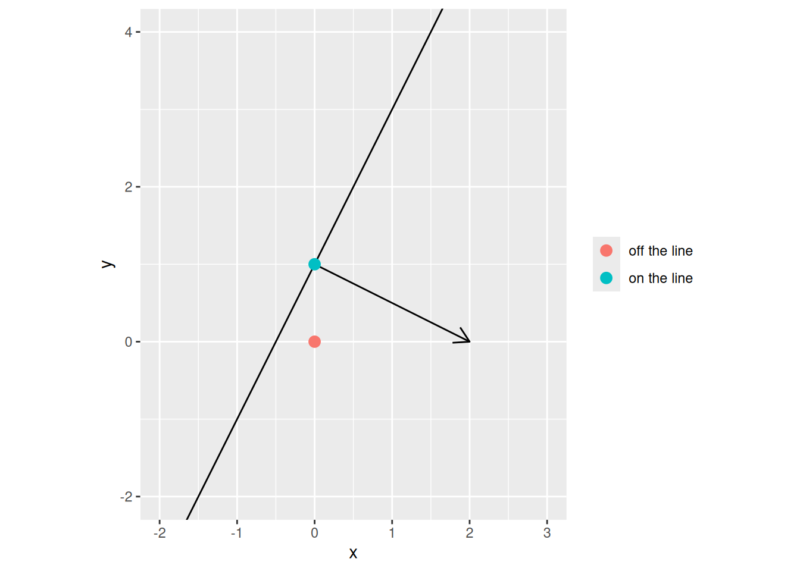

# Affine Subspaces and Half-Spaces

Code

- [Show All Code](javascript:void(0))

- [Hide All Code](javascript:void(0))

- 

  ------------------------------------------------------------------------

- [View Source](javascript:void(0))

Published

Last modified: 2026-11-20 17:19:06 (PST)

# 1 Affine subspaces and half-spaces

> **NOTE:**
>
> **Definition 1 (Affine subspace)** An **affine subspace** [\[1\]](#ref-wikipedia_affine_space) of $\mathbb{R}^p$ is a set of the form
>
> $$\mathopen{}\left\{\mathord{\smash[b]{\underset{\raise.3ex\hbox{$\scriptstyle\sim$}}{x}}\vphantom{x}}_0 + \mathord{\smash[b]{\underset{\raise.3ex\hbox{$\scriptstyle\sim$}}{s}}\vphantom{s}} : \mathord{\smash[b]{\underset{\raise.3ex\hbox{$\scriptstyle\sim$}}{s}}\vphantom{s}} \in \mathcal{S}\right\}\mathclose{}$$
>
> for some vector $\mathord{\smash[b]{\underset{\raise.3ex\hbox{$\scriptstyle\sim$}}{x}}\vphantom{x}}_0 \in \mathbb{R}^p$ and some subspace $\mathcal{S}$ of $\mathbb{R}^p$ ([Definition 4 in Subspaces and Rank](linear-algebra-subspaces.llms.md#def-subspace)): the [image](https://morrison-lab.github.io/mcs/functions.html#def-image) of $\mathcal{S}$ under the translation by $\mathord{\smash[b]{\underset{\raise.3ex\hbox{$\scriptstyle\sim$}}{x}}\vphantom{x}}_0$ ([Definition 6 in Linear and Affine Maps](linear-algebra-linear-maps.llms.md#def-translation)).

> **NOTE:**
>
> **Example 1 (A line that misses the origin is an affine subspace)** The line $\mathcal{T} = \mathopen{}\left\{(x, 1) : x \in \mathbb{R}\right\}\mathclose{}$ of [Example 4 in Subspaces and Rank](linear-algebra-subspaces.llms.md#exm-not-subspace) is not a subspace, but it is an affine subspace, with $\mathord{\smash[b]{\underset{\raise.3ex\hbox{$\scriptstyle\sim$}}{x}}\vphantom{x}}_0 = (0, 1)$ and $\mathcal{S} = \operatorname{span}\mathopen{}\left\{(1, 0)\right\}\mathclose{}$ ([Definition 5 in Subspaces and Rank](linear-algebra-subspaces.llms.md#def-span)):
>
> $$\begin{aligned}
> (0, 1) + c\,(1, 0)
> &= (0 + c,\; 1 + 0)
> && \text{(}\href{linear-algebra-matrices.qmd#def-scalar-mult}{\text{Definition~9 in Matrices}}\text{, }\href{linear-algebra-vectors.qmd#def-vector-addition}{\text{Definition~9 in Vectors}}\text{)}
> \\
> &= (c, 1),
> && \text{(add)}
> \end{aligned}$$
>
> and as $c$ ranges over $\mathbb{R}$, $(c, 1)$ ranges over all of $\mathcal{T}$. Every subspace $\mathcal{S}$ is also an affine subspace, with $\mathord{\smash[b]{\underset{\raise.3ex\hbox{$\scriptstyle\sim$}}{x}}\vphantom{x}}_0 = \mathord{\smash[b]{\underset{\raise.3ex\hbox{$\scriptstyle\sim$}}{0}}\vphantom{0}}$.

> **NOTE:**
>
> **Exercise 1 (Writing a line as an affine subspace)** A line such as $y = 2x + 3$ in $\mathbb{R}^2$ misses the origin, so it is not a [subspace](linear-algebra-subspaces.llms.md#def-subspace), but it is an [affine subspace](#def-affine-subspace). Let $\mathcal{T} = \mathopen{}\left\{(x, 2x + 3) : x \in \mathbb{R}\right\}\mathclose{}$.
>
> Find a vector $\mathord{\smash[b]{\underset{\raise.3ex\hbox{$\scriptstyle\sim$}}{x}}\vphantom{x}}_0$ and a subspace $\mathcal{S}$ with $\mathcal{T} = \mathopen{}\left\{\mathord{\smash[b]{\underset{\raise.3ex\hbox{$\scriptstyle\sim$}}{x}}\vphantom{x}}_0 + \mathord{\smash[b]{\underset{\raise.3ex\hbox{$\scriptstyle\sim$}}{s}}\vphantom{s}} : \mathord{\smash[b]{\underset{\raise.3ex\hbox{$\scriptstyle\sim$}}{s}}\vphantom{s}} \in \mathcal{S}\right\}\mathclose{}$.
>
> > **TIP:**
> >
> > Take $\mathord{\smash[b]{\underset{\raise.3ex\hbox{$\scriptstyle\sim$}}{x}}\vphantom{x}}_0$ to be the point of $\mathcal{T}$ with $x = 0$, and see what is left of $(x, 2x + 3)$ once you subtract it.

> **NOTE:**
>
> *Solution 1*. Take $\mathord{\smash[b]{\underset{\raise.3ex\hbox{$\scriptstyle\sim$}}{x}}\vphantom{x}}_0 = (0, 3)$, and let $\mathcal{S} = \operatorname{span}\mathopen{}\left\{(1, 2)\right\}\mathclose{}$ be the [span](linear-algebra-subspaces.llms.md#def-span) of $(1, 2)$. For any $c \in \mathbb{R}$,
>
> $$(0, 3) + c\,(1, 2) = (c, 2c + 3),$$
>
> so every $c \in \mathbb{R}$ gives a point $(c, 2c + 3)$ of $\mathcal{T}$, and every point of $\mathcal{T}$ arises this way.

> **NOTE:**
>
> **Theorem 1 (A hyperplane is a translated subspace of dimension** $p - 1$) Let $\mathord{\smash[b]{\underset{\raise.3ex\hbox{$\scriptstyle\sim$}}{w}}\vphantom{w}} \in \mathbb{R}^p$ be nonzero, let $b \in \mathbb{R}$, let $\mathcal{H} = \mathopen{}\left\{\mathord{\smash[b]{\underset{\raise.3ex\hbox{$\scriptstyle\sim$}}{x}}\vphantom{x}}\in \mathbb{R}^p : \mathord{\smash[b]{\underset{\raise.3ex\hbox{$\scriptstyle\sim$}}{w}}\vphantom{w}}^{\top} \mathord{\smash[b]{\underset{\raise.3ex\hbox{$\scriptstyle\sim$}}{x}}\vphantom{x}}+ b = 0\right\}\mathclose{}$ be the hyperplane with normal vector $\mathord{\smash[b]{\underset{\raise.3ex\hbox{$\scriptstyle\sim$}}{w}}\vphantom{w}}$ and offset $b$ ([Definition 10 in Linear and Affine Maps](linear-algebra-linear-maps.llms.md#def-hyperplane)), and let $\mathcal{H}_0 = \mathopen{}\left\{\mathord{\smash[b]{\underset{\raise.3ex\hbox{$\scriptstyle\sim$}}{x}}\vphantom{x}}\in \mathbb{R}^p : \mathord{\smash[b]{\underset{\raise.3ex\hbox{$\scriptstyle\sim$}}{w}}\vphantom{w}}^{\top} \mathord{\smash[b]{\underset{\raise.3ex\hbox{$\scriptstyle\sim$}}{x}}\vphantom{x}}= 0\right\}\mathclose{}$ be the hyperplane with the same normal vector and offset $0$.
>
> 1.  $\mathcal{H}_0$ is a subspace of $\mathbb{R}^p$ ([Definition 4 in Subspaces and Rank](linear-algebra-subspaces.llms.md#def-subspace)) of dimension $p - 1$ ([Definition 4 in Bases and Dimension](linear-algebra-bases.llms.md#def-dimension)).
> 2.  $\mathcal{H}$ is not empty, and for any $\mathord{\smash[b]{\underset{\raise.3ex\hbox{$\scriptstyle\sim$}}{x}}\vphantom{x}}_0 \in \mathcal{H}$, $\mathcal{H} = \mathopen{}\left\{\mathord{\smash[b]{\underset{\raise.3ex\hbox{$\scriptstyle\sim$}}{x}}\vphantom{x}}_0 + \mathord{\smash[b]{\underset{\raise.3ex\hbox{$\scriptstyle\sim$}}{s}}\vphantom{s}} : \mathord{\smash[b]{\underset{\raise.3ex\hbox{$\scriptstyle\sim$}}{s}}\vphantom{s}} \in \mathcal{H}_0\right\}\mathclose{}$, so $\mathcal{H}$ is an affine subspace ([Definition 1](#def-affine-subspace)).
> 3.  For any $\mathord{\smash[b]{\underset{\raise.3ex\hbox{$\scriptstyle\sim$}}{x}}\vphantom{x}}, \mathord{\smash[b]{\underset{\raise.3ex\hbox{$\scriptstyle\sim$}}{y}}\vphantom{y}}\in \mathcal{H}$, the normal vector is orthogonal to their difference: $\mathord{\smash[b]{\underset{\raise.3ex\hbox{$\scriptstyle\sim$}}{w}}\vphantom{w}} \perp (\mathord{\smash[b]{\underset{\raise.3ex\hbox{$\scriptstyle\sim$}}{x}}\vphantom{x}}- \mathord{\smash[b]{\underset{\raise.3ex\hbox{$\scriptstyle\sim$}}{y}}\vphantom{y}})$ ([Definition 22 in Vectors](linear-algebra-vectors.llms.md#def-orthogonal-vectors)).

> **NOTE:**
>
> *Proof*. Here $\mathord{\smash[b]{\underset{\raise.3ex\hbox{$\scriptstyle\sim$}}{w}}\vphantom{w}}^{\top}$ is a $1 \times p$ matrix, and $\mathord{\smash[b]{\underset{\raise.3ex\hbox{$\scriptstyle\sim$}}{w}}\vphantom{w}}^{\top} \mathord{\smash[b]{\underset{\raise.3ex\hbox{$\scriptstyle\sim$}}{x}}\vphantom{x}}= \mathord{\smash[b]{\underset{\raise.3ex\hbox{$\scriptstyle\sim$}}{w}}\vphantom{w}} \cdot \mathord{\smash[b]{\underset{\raise.3ex\hbox{$\scriptstyle\sim$}}{x}}\vphantom{x}}$ ([Example 3 in Matrix Multiplication](linear-algebra-matrix-multiplication.llms.md#exm-dot-product-matmul)).
>
> **Part 1.** $\mathcal{H}_0$ is the null space $\mathcal{N}(\mathord{\smash[b]{\underset{\raise.3ex\hbox{$\scriptstyle\sim$}}{w}}\vphantom{w}}^{\top})$ ([Definition 3 in Column Space and Null Space](linear-algebra-column-null-space.llms.md#def-null-space)), so it is a subspace ([Theorem 2 in Column Space and Null Space](linear-algebra-column-null-space.llms.md#thm-null-space-subspace)). The $p$ columns of $\mathord{\smash[b]{\underset{\raise.3ex\hbox{$\scriptstyle\sim$}}{w}}\vphantom{w}}^{\top}$ are the numbers $w_1, \ldots, w_p$. Some $w_j \ne 0$, because $\mathord{\smash[b]{\underset{\raise.3ex\hbox{$\scriptstyle\sim$}}{w}}\vphantom{w}} \ne \mathord{\smash[b]{\underset{\raise.3ex\hbox{$\scriptstyle\sim$}}{0}}\vphantom{0}}$, and that column on its own is linearly independent ($c\,w_j = 0$ forces $c = 0$), so $\operatorname{rank}(\mathord{\smash[b]{\underset{\raise.3ex\hbox{$\scriptstyle\sim$}}{w}}\vphantom{w}}^{\top}) \ge 1$ ([Definition 2 in Subspaces and Rank](linear-algebra-subspaces.llms.md#def-rank)); and $\operatorname{rank}(\mathord{\smash[b]{\underset{\raise.3ex\hbox{$\scriptstyle\sim$}}{w}}\vphantom{w}}^{\top}) \le \min\mathopen{}\left\{1, p\right\}\mathclose{} = 1$ ([Corollary 1 in Rank-Nullity and Rank Factorization](linear-algebra-rank-nullity.llms.md#cor-rank-bound)). So
>
> $$\begin{aligned}
> \dim(\mathcal{H}_0)
> &= \operatorname{nullity}(\mathord{\smash[b]{\underset{\raise.3ex\hbox{$\scriptstyle\sim$}}{w}}\vphantom{w}}^{\top})
> && \text{(}\href{linear-algebra-rank-nullity.qmd#def-nullity}{\text{Definition~1 in Rank-Nullity and Rank Factorization}}\text{)}
> \\
> &= p - \operatorname{rank}(\mathord{\smash[b]{\underset{\raise.3ex\hbox{$\scriptstyle\sim$}}{w}}\vphantom{w}}^{\top})
> && \text{(}\href{linear-algebra-rank-nullity.qmd#thm-rank-nullity}{\text{Theorem~2 in Rank-Nullity and Rank Factorization}}\text{, for the } p \text{ columns of } \mathord{\smash[b]{\underset{\raise.3ex\hbox{$\scriptstyle\sim$}}{w}}\vphantom{w}}^{\top} \text{)}
> \\
> &= p - 1.
> && \text{(the rank is } 1 \text{)}
> \end{aligned}$$
>
> **Part 2.** $\mathord{\smash[b]{\underset{\raise.3ex\hbox{$\scriptstyle\sim$}}{w}}\vphantom{w}} \cdot \mathord{\smash[b]{\underset{\raise.3ex\hbox{$\scriptstyle\sim$}}{w}}\vphantom{w}} = w_1^2 + \cdots + w_p^2 > 0$, because some $w_j \ne 0$. So $\mathord{\smash[b]{\underset{\raise.3ex\hbox{$\scriptstyle\sim$}}{x}}\vphantom{x}}^* \stackrel{\text{def}}{=}-\frac{b}{\mathord{\smash[b]{\underset{\raise.3ex\hbox{$\scriptstyle\sim$}}{w}}\vphantom{w}} \cdot \mathord{\smash[b]{\underset{\raise.3ex\hbox{$\scriptstyle\sim$}}{w}}\vphantom{w}}}\,\mathord{\smash[b]{\underset{\raise.3ex\hbox{$\scriptstyle\sim$}}{w}}\vphantom{w}}$ is defined, and
>
> $$\begin{aligned}
> \mathord{\smash[b]{\underset{\raise.3ex\hbox{$\scriptstyle\sim$}}{w}}\vphantom{w}}^{\top} \mathord{\smash[b]{\underset{\raise.3ex\hbox{$\scriptstyle\sim$}}{x}}\vphantom{x}}^* + b
> &= -\frac{b}{\mathord{\smash[b]{\underset{\raise.3ex\hbox{$\scriptstyle\sim$}}{w}}\vphantom{w}} \cdot \mathord{\smash[b]{\underset{\raise.3ex\hbox{$\scriptstyle\sim$}}{w}}\vphantom{w}}}\,(\mathord{\smash[b]{\underset{\raise.3ex\hbox{$\scriptstyle\sim$}}{w}}\vphantom{w}}^{\top} \mathord{\smash[b]{\underset{\raise.3ex\hbox{$\scriptstyle\sim$}}{w}}\vphantom{w}}) + b
> && \text{(homogeneity of } \mathord{\smash[b]{\underset{\raise.3ex\hbox{$\scriptstyle\sim$}}{x}}\vphantom{x}}\mapsto \mathord{\smash[b]{\underset{\raise.3ex\hbox{$\scriptstyle\sim$}}{w}}\vphantom{w}}^{\top} \mathord{\smash[b]{\underset{\raise.3ex\hbox{$\scriptstyle\sim$}}{x}}\vphantom{x}}\text{, }\href{linear-algebra-linear-maps.qmd#thm-matrix-map-linear}{\text{Theorem~2 in Linear and Affine Maps}}\text{)}
> \\
> &= -b + b
> && \text{(} \mathord{\smash[b]{\underset{\raise.3ex\hbox{$\scriptstyle\sim$}}{w}}\vphantom{w}}^{\top} \mathord{\smash[b]{\underset{\raise.3ex\hbox{$\scriptstyle\sim$}}{w}}\vphantom{w}} = \mathord{\smash[b]{\underset{\raise.3ex\hbox{$\scriptstyle\sim$}}{w}}\vphantom{w}} \cdot \mathord{\smash[b]{\underset{\raise.3ex\hbox{$\scriptstyle\sim$}}{w}}\vphantom{w}} \text{)}
> \\
> &= 0,
> && \text{(arithmetic)}
> \end{aligned}$$
>
> so $\mathord{\smash[b]{\underset{\raise.3ex\hbox{$\scriptstyle\sim$}}{x}}\vphantom{x}}^* \in \mathcal{H}$, and $\mathcal{H}$ is not empty. Now take any $\mathord{\smash[b]{\underset{\raise.3ex\hbox{$\scriptstyle\sim$}}{x}}\vphantom{x}}_0 \in \mathcal{H}$, so $\mathord{\smash[b]{\underset{\raise.3ex\hbox{$\scriptstyle\sim$}}{w}}\vphantom{w}}^{\top} \mathord{\smash[b]{\underset{\raise.3ex\hbox{$\scriptstyle\sim$}}{x}}\vphantom{x}}_0 = -b$. For any $\mathord{\smash[b]{\underset{\raise.3ex\hbox{$\scriptstyle\sim$}}{x}}\vphantom{x}}\in \mathbb{R}^p$,
>
> $$\begin{aligned}
> \mathord{\smash[b]{\underset{\raise.3ex\hbox{$\scriptstyle\sim$}}{w}}\vphantom{w}}^{\top} (\mathord{\smash[b]{\underset{\raise.3ex\hbox{$\scriptstyle\sim$}}{x}}\vphantom{x}}- \mathord{\smash[b]{\underset{\raise.3ex\hbox{$\scriptstyle\sim$}}{x}}\vphantom{x}}_0)
> &= \mathord{\smash[b]{\underset{\raise.3ex\hbox{$\scriptstyle\sim$}}{w}}\vphantom{w}}^{\top} \mathord{\smash[b]{\underset{\raise.3ex\hbox{$\scriptstyle\sim$}}{x}}\vphantom{x}}- \mathord{\smash[b]{\underset{\raise.3ex\hbox{$\scriptstyle\sim$}}{w}}\vphantom{w}}^{\top} \mathord{\smash[b]{\underset{\raise.3ex\hbox{$\scriptstyle\sim$}}{x}}\vphantom{x}}_0
> && \text{(}\href{linear-algebra-subspaces.qmd#thm-matvec-linear}{\text{Theorem~4 in Subspaces and Rank}}\text{, with coefficients } 1 \text{ and } -1 \text{)}
> \\
> &= \mathord{\smash[b]{\underset{\raise.3ex\hbox{$\scriptstyle\sim$}}{w}}\vphantom{w}}^{\top} \mathord{\smash[b]{\underset{\raise.3ex\hbox{$\scriptstyle\sim$}}{x}}\vphantom{x}}- (-b)
> && \text{(} \mathord{\smash[b]{\underset{\raise.3ex\hbox{$\scriptstyle\sim$}}{x}}\vphantom{x}}_0 \in \mathcal{H} \text{)}
> \\
> &= \mathord{\smash[b]{\underset{\raise.3ex\hbox{$\scriptstyle\sim$}}{w}}\vphantom{w}}^{\top} \mathord{\smash[b]{\underset{\raise.3ex\hbox{$\scriptstyle\sim$}}{x}}\vphantom{x}}+ b,
> && \text{(arithmetic)}
> \end{aligned}$$
>
> so $\mathord{\smash[b]{\underset{\raise.3ex\hbox{$\scriptstyle\sim$}}{x}}\vphantom{x}}\in \mathcal{H}$ exactly when $\mathord{\smash[b]{\underset{\raise.3ex\hbox{$\scriptstyle\sim$}}{x}}\vphantom{x}}- \mathord{\smash[b]{\underset{\raise.3ex\hbox{$\scriptstyle\sim$}}{x}}\vphantom{x}}_0 \in \mathcal{H}_0$, that is, exactly when $\mathord{\smash[b]{\underset{\raise.3ex\hbox{$\scriptstyle\sim$}}{x}}\vphantom{x}}= \mathord{\smash[b]{\underset{\raise.3ex\hbox{$\scriptstyle\sim$}}{x}}\vphantom{x}}_0 + \mathord{\smash[b]{\underset{\raise.3ex\hbox{$\scriptstyle\sim$}}{s}}\vphantom{s}}$ with $\mathord{\smash[b]{\underset{\raise.3ex\hbox{$\scriptstyle\sim$}}{s}}\vphantom{s}} = \mathord{\smash[b]{\underset{\raise.3ex\hbox{$\scriptstyle\sim$}}{x}}\vphantom{x}}- \mathord{\smash[b]{\underset{\raise.3ex\hbox{$\scriptstyle\sim$}}{x}}\vphantom{x}}_0 \in \mathcal{H}_0$. $\mathcal{H}_0$ is a subspace (part 1), so $\mathcal{H}$ has the form in [Definition 1](#def-affine-subspace).
>
> **Part 3.** For $\mathord{\smash[b]{\underset{\raise.3ex\hbox{$\scriptstyle\sim$}}{x}}\vphantom{x}}, \mathord{\smash[b]{\underset{\raise.3ex\hbox{$\scriptstyle\sim$}}{y}}\vphantom{y}}\in \mathcal{H}$, both $\mathord{\smash[b]{\underset{\raise.3ex\hbox{$\scriptstyle\sim$}}{w}}\vphantom{w}}^{\top} \mathord{\smash[b]{\underset{\raise.3ex\hbox{$\scriptstyle\sim$}}{x}}\vphantom{x}}$ and $\mathord{\smash[b]{\underset{\raise.3ex\hbox{$\scriptstyle\sim$}}{w}}\vphantom{w}}^{\top} \mathord{\smash[b]{\underset{\raise.3ex\hbox{$\scriptstyle\sim$}}{y}}\vphantom{y}}$ equal $-b$, so
>
> $$\begin{aligned}
> \mathord{\smash[b]{\underset{\raise.3ex\hbox{$\scriptstyle\sim$}}{w}}\vphantom{w}} \cdot (\mathord{\smash[b]{\underset{\raise.3ex\hbox{$\scriptstyle\sim$}}{x}}\vphantom{x}}- \mathord{\smash[b]{\underset{\raise.3ex\hbox{$\scriptstyle\sim$}}{y}}\vphantom{y}})
> &= \mathord{\smash[b]{\underset{\raise.3ex\hbox{$\scriptstyle\sim$}}{w}}\vphantom{w}}^{\top} \mathord{\smash[b]{\underset{\raise.3ex\hbox{$\scriptstyle\sim$}}{x}}\vphantom{x}}- \mathord{\smash[b]{\underset{\raise.3ex\hbox{$\scriptstyle\sim$}}{w}}\vphantom{w}}^{\top} \mathord{\smash[b]{\underset{\raise.3ex\hbox{$\scriptstyle\sim$}}{y}}\vphantom{y}}
> && \text{(}\href{linear-algebra-subspaces.qmd#thm-matvec-linear}{\text{Theorem~4 in Subspaces and Rank}}\text{, with coefficients } 1 \text{ and } -1 \text{)}
> \\
> &= (-b) - (-b)
> && \text{(} \mathord{\smash[b]{\underset{\raise.3ex\hbox{$\scriptstyle\sim$}}{x}}\vphantom{x}}, \mathord{\smash[b]{\underset{\raise.3ex\hbox{$\scriptstyle\sim$}}{y}}\vphantom{y}}\in \mathcal{H} \text{)}
> \\
> &= 0.
> && \text{(arithmetic)}
> \end{aligned}$$

> **NOTE:**
>
> **Example 2 (The plane** $x_1 + x_2 + x_3 = 1$ in $\mathbb{R}^3$) Take $\mathord{\smash[b]{\underset{\raise.3ex\hbox{$\scriptstyle\sim$}}{w}}\vphantom{w}} = (1, 1, 1)$ and $b = -1$, so $\mathcal{H} = \mathopen{}\left\{\mathord{\smash[b]{\underset{\raise.3ex\hbox{$\scriptstyle\sim$}}{x}}\vphantom{x}}: x_1 + x_2 + x_3 - 1 = 0\right\}\mathclose{}$, the plane that [Example 5 in Subspaces and Rank](linear-algebra-subspaces.llms.md#exm-subspace-zero) showed is not a subspace. By part 1, $\mathcal{H}_0 = \mathopen{}\left\{\mathord{\smash[b]{\underset{\raise.3ex\hbox{$\scriptstyle\sim$}}{x}}\vphantom{x}}: x_1 + x_2 + x_3 = 0\right\}\mathclose{}$ is a subspace of dimension $3 - 1 = 2$.
>
> - $\mathord{\smash[b]{\underset{\raise.3ex\hbox{$\scriptstyle\sim$}}{x}}\vphantom{x}}_0 = (1, 0, 0)$ is in $\mathcal{H}$, since $1 + 0 + 0 - 1 = 0$, and so is $\mathord{\smash[b]{\underset{\raise.3ex\hbox{$\scriptstyle\sim$}}{y}}\vphantom{y}}= (0, 1, 0)$.
>
> - Their difference $\mathord{\smash[b]{\underset{\raise.3ex\hbox{$\scriptstyle\sim$}}{y}}\vphantom{y}}- \mathord{\smash[b]{\underset{\raise.3ex\hbox{$\scriptstyle\sim$}}{x}}\vphantom{x}}_0 = (-1, 1, 0)$ has entries summing to $-1 + 1 + 0 = 0$, so it is in $\mathcal{H}_0$, and $\mathord{\smash[b]{\underset{\raise.3ex\hbox{$\scriptstyle\sim$}}{y}}\vphantom{y}}= \mathord{\smash[b]{\underset{\raise.3ex\hbox{$\scriptstyle\sim$}}{x}}\vphantom{x}}_0 + (-1, 1, 0)$, as part 2 says.
>
> - $$\begin{aligned}
>   \mathord{\smash[b]{\underset{\raise.3ex\hbox{$\scriptstyle\sim$}}{w}}\vphantom{w}} \cdot (-1, 1, 0) &= -1 + 1 + 0 \\
>   &= 0,
>   \end{aligned}$$
>
>   as part 3 says.
>
> - The point built in the proof is
>
>   $$\begin{aligned}
>   \mathord{\smash[b]{\underset{\raise.3ex\hbox{$\scriptstyle\sim$}}{x}}\vphantom{x}}^* &= -\frac{-1}{3}\,(1, 1, 1) \\
>   &= \mathopen{}\left(\tfrac{1}{3}, \tfrac{1}{3}, \tfrac{1}{3}\right)\mathclose{},
>   \end{aligned}$$
>
>   and $\tfrac{1}{3} + \tfrac{1}{3} + \tfrac{1}{3} - 1 = 0$.

> **NOTE:**
>
> **Exercise 2 (Checking that a normal vector is orthogonal to a hyperplane)** Part 3 of [Theorem 1](#thm-hyperplane-subspace) says that, for a [hyperplane](linear-algebra-linear-maps.llms.md#def-hyperplane), its [normal vector](linear-algebra-linear-maps.llms.md#def-normal-vector) is [orthogonal](linear-algebra-vectors.llms.md#def-orthogonal-vectors) to the difference of any two of its points. Let $\mathcal{H} = \mathopen{}\left\{\mathord{\smash[b]{\underset{\raise.3ex\hbox{$\scriptstyle\sim$}}{x}}\vphantom{x}}\in \mathbb{R}^3 : 2 x_1 - x_2 + x_3 - 4 = 0\right\}\mathclose{}$, with normal vector $\mathord{\smash[b]{\underset{\raise.3ex\hbox{$\scriptstyle\sim$}}{w}}\vphantom{w}} = (2, -1, 1)$. The points $\mathord{\smash[b]{\underset{\raise.3ex\hbox{$\scriptstyle\sim$}}{x}}\vphantom{x}}= (2, 0, 0)$ and $\mathord{\smash[b]{\underset{\raise.3ex\hbox{$\scriptstyle\sim$}}{y}}\vphantom{y}}= (0, 0, 4)$ are both in $\mathcal{H}$.
>
> Check that $\mathord{\smash[b]{\underset{\raise.3ex\hbox{$\scriptstyle\sim$}}{w}}\vphantom{w}} \cdot (\mathord{\smash[b]{\underset{\raise.3ex\hbox{$\scriptstyle\sim$}}{x}}\vphantom{x}}- \mathord{\smash[b]{\underset{\raise.3ex\hbox{$\scriptstyle\sim$}}{y}}\vphantom{y}}) = 0$.
>
> > **TIP:**
> >
> > Compute $\mathord{\smash[b]{\underset{\raise.3ex\hbox{$\scriptstyle\sim$}}{x}}\vphantom{x}}- \mathord{\smash[b]{\underset{\raise.3ex\hbox{$\scriptstyle\sim$}}{y}}\vphantom{y}}$ first.

> **NOTE:**
>
> *Solution 2*. Here $\mathord{\smash[b]{\underset{\raise.3ex\hbox{$\scriptstyle\sim$}}{x}}\vphantom{x}}- \mathord{\smash[b]{\underset{\raise.3ex\hbox{$\scriptstyle\sim$}}{y}}\vphantom{y}}= (2, 0, -4)$, and
>
> $$\mathord{\smash[b]{\underset{\raise.3ex\hbox{$\scriptstyle\sim$}}{w}}\vphantom{w}} \cdot (\mathord{\smash[b]{\underset{\raise.3ex\hbox{$\scriptstyle\sim$}}{x}}\vphantom{x}}- \mathord{\smash[b]{\underset{\raise.3ex\hbox{$\scriptstyle\sim$}}{y}}\vphantom{y}}) = 2 \cdot 2 + (-1) \cdot 0 + 1 \cdot(-4) = 0,$$
>
> as part 3 of [Theorem 1](#thm-hyperplane-subspace) says.

> **NOTE:**
>
> **Theorem 2 (Where a hyperplane passes, and its shape in** $\mathbb{R}^2$ and $\mathbb{R}^3$) Let $\mathcal{H} = \mathopen{}\left\{\mathord{\smash[b]{\underset{\raise.3ex\hbox{$\scriptstyle\sim$}}{x}}\vphantom{x}}\in \mathbb{R}^p : \mathord{\smash[b]{\underset{\raise.3ex\hbox{$\scriptstyle\sim$}}{w}}\vphantom{w}} \cdot \mathord{\smash[b]{\underset{\raise.3ex\hbox{$\scriptstyle\sim$}}{x}}\vphantom{x}} + b = 0\right\}\mathclose{}$ be a hyperplane ([Definition 10 in Linear and Affine Maps](linear-algebra-linear-maps.llms.md#def-hyperplane)).
>
> 1.  $\mathcal{H}$ contains the origin $\mathord{\smash[b]{\underset{\raise.3ex\hbox{$\scriptstyle\sim$}}{0}}\vphantom{0}}$ exactly when $b = 0$.
> 2.  If $p = 2$, then $\mathcal{H}$ is a line: $\mathcal{H} = \mathopen{}\left\{\mathord{\smash[b]{\underset{\raise.3ex\hbox{$\scriptstyle\sim$}}{x}}\vphantom{x}}_0 + t\,\mathord{\smash[b]{\underset{\raise.3ex\hbox{$\scriptstyle\sim$}}{v}}\vphantom{v}} : t \in \mathbb{R}\right\}\mathclose{}$ for some $\mathord{\smash[b]{\underset{\raise.3ex\hbox{$\scriptstyle\sim$}}{x}}\vphantom{x}}_0 \in \mathbb{R}^2$ and some nonzero $\mathord{\smash[b]{\underset{\raise.3ex\hbox{$\scriptstyle\sim$}}{v}}\vphantom{v}} \in \mathbb{R}^2$.
> 3.  If $p = 3$, then $\mathcal{H}$ is a plane: $\mathcal{H} = \mathopen{}\left\{\mathord{\smash[b]{\underset{\raise.3ex\hbox{$\scriptstyle\sim$}}{x}}\vphantom{x}}_0 + s\,\mathord{\smash[b]{\underset{\raise.3ex\hbox{$\scriptstyle\sim$}}{v}}\vphantom{v}}_1 + t\,\mathord{\smash[b]{\underset{\raise.3ex\hbox{$\scriptstyle\sim$}}{v}}\vphantom{v}}_2 : s, t \in \mathbb{R}\right\}\mathclose{}$ for some $\mathord{\smash[b]{\underset{\raise.3ex\hbox{$\scriptstyle\sim$}}{x}}\vphantom{x}}_0 \in \mathbb{R}^3$ and some linearly independent $\mathord{\smash[b]{\underset{\raise.3ex\hbox{$\scriptstyle\sim$}}{v}}\vphantom{v}}_1, \mathord{\smash[b]{\underset{\raise.3ex\hbox{$\scriptstyle\sim$}}{v}}\vphantom{v}}_2 \in \mathbb{R}^3$.

> **NOTE:**
>
> *Proof*. **Part 1.** Since $\mathord{\smash[b]{\underset{\raise.3ex\hbox{$\scriptstyle\sim$}}{w}}\vphantom{w}} \cdot \mathord{\smash[b]{\underset{\raise.3ex\hbox{$\scriptstyle\sim$}}{0}}\vphantom{0}} = 0$,
>
> $$\begin{aligned}
> \mathord{\smash[b]{\underset{\raise.3ex\hbox{$\scriptstyle\sim$}}{w}}\vphantom{w}} \cdot \mathord{\smash[b]{\underset{\raise.3ex\hbox{$\scriptstyle\sim$}}{0}}\vphantom{0}} + b
> &= 0 + b
> && \text{(the dot product with } \mathord{\smash[b]{\underset{\raise.3ex\hbox{$\scriptstyle\sim$}}{0}}\vphantom{0}}\text{ is } 0 \text{)}
> \\
> &= b,
> && \text{(}\href{algebra-sums.qmd#thm-add-ident}{\text{Theorem~1 in Sums, Products and Quotients}}\text{)}
> \end{aligned}$$
>
> so $\mathord{\smash[b]{\underset{\raise.3ex\hbox{$\scriptstyle\sim$}}{0}}\vphantom{0}}\in \mathcal{H}$ exactly when $b = 0$.
>
> **Parts 2 and 3.** By [Theorem 1](#thm-hyperplane-subspace), $\mathcal{H} = \mathopen{}\left\{\mathord{\smash[b]{\underset{\raise.3ex\hbox{$\scriptstyle\sim$}}{x}}\vphantom{x}}_0 + \mathord{\smash[b]{\underset{\raise.3ex\hbox{$\scriptstyle\sim$}}{s}}\vphantom{s}} : \mathord{\smash[b]{\underset{\raise.3ex\hbox{$\scriptstyle\sim$}}{s}}\vphantom{s}} \in \mathcal{H}_0\right\}\mathclose{}$ for any $\mathord{\smash[b]{\underset{\raise.3ex\hbox{$\scriptstyle\sim$}}{x}}\vphantom{x}}_0 \in \mathcal{H}$, where $\mathcal{H}_0$ is a subspace of $\mathbb{R}^p$ of dimension $p - 1$.
>
> For $p = 2$, $\mathcal{H}_0$ has dimension $1$, so it has a basis ([Definition 1 in Bases and Dimension](linear-algebra-bases.llms.md#def-basis)) with one vector $\mathord{\smash[b]{\underset{\raise.3ex\hbox{$\scriptstyle\sim$}}{v}}\vphantom{v}}$. That vector is nonzero, and $\mathcal{H}_0 = \mathopen{}\left\{t\,\mathord{\smash[b]{\underset{\raise.3ex\hbox{$\scriptstyle\sim$}}{v}}\vphantom{v}} : t \in \mathbb{R}\right\}\mathclose{}$.
>
> For $p = 3$, $\mathcal{H}_0$ has dimension $2$, so it has a basis with two vectors $\mathord{\smash[b]{\underset{\raise.3ex\hbox{$\scriptstyle\sim$}}{v}}\vphantom{v}}_1$ and $\mathord{\smash[b]{\underset{\raise.3ex\hbox{$\scriptstyle\sim$}}{v}}\vphantom{v}}_2$. They are linearly independent, and $\mathcal{H}_0 = \mathopen{}\left\{s\,\mathord{\smash[b]{\underset{\raise.3ex\hbox{$\scriptstyle\sim$}}{v}}\vphantom{v}}_1 + t\,\mathord{\smash[b]{\underset{\raise.3ex\hbox{$\scriptstyle\sim$}}{v}}\vphantom{v}}_2 : s, t \in \mathbb{R}\right\}\mathclose{}$.

> **NOTE:**
>
> **Example 3 (A line in** $\mathbb{R}^2$ and a plane in $\mathbb{R}^3$, checked on a grid of points) In $\mathbb{R}^2$, take $\mathord{\smash[b]{\underset{\raise.3ex\hbox{$\scriptstyle\sim$}}{w}}\vphantom{w}} = (1, 1)$ and $b = -1$, the line of [Example 11 in Linear and Affine Maps](linear-algebra-linear-maps.llms.md#exm-hyperplane). The point $\mathord{\smash[b]{\underset{\raise.3ex\hbox{$\scriptstyle\sim$}}{x}}\vphantom{x}}_0 = -\frac{b}{\mathord{\smash[b]{\underset{\raise.3ex\hbox{$\scriptstyle\sim$}}{w}}\vphantom{w}} \cdot \mathord{\smash[b]{\underset{\raise.3ex\hbox{$\scriptstyle\sim$}}{w}}\vphantom{w}}}\,\mathord{\smash[b]{\underset{\raise.3ex\hbox{$\scriptstyle\sim$}}{w}}\vphantom{w}}$ is on it, and the vector $\mathord{\smash[b]{\underset{\raise.3ex\hbox{$\scriptstyle\sim$}}{v}}\vphantom{v}} = (-w_2, w_1)$ is nonzero with $\mathord{\smash[b]{\underset{\raise.3ex\hbox{$\scriptstyle\sim$}}{w}}\vphantom{w}} \cdot \mathord{\smash[b]{\underset{\raise.3ex\hbox{$\scriptstyle\sim$}}{v}}\vphantom{v}} = 0$, so it spans the subspace $\mathcal{H}_0$ of [Theorem 1](#thm-hyperplane-subspace). In $\mathbb{R}^3$, take $\mathord{\smash[b]{\underset{\raise.3ex\hbox{$\scriptstyle\sim$}}{w}}\vphantom{w}} = (1, 1, 1)$ and $b = -1$, the plane of [Example 2](#exm-hyperplane-subspace), with the independent vectors $\mathord{\smash[b]{\underset{\raise.3ex\hbox{$\scriptstyle\sim$}}{v}}\vphantom{v}}_1 = (1, -1, 0)$ and $\mathord{\smash[b]{\underset{\raise.3ex\hbox{$\scriptstyle\sim$}}{v}}\vphantom{v}}_2 = (0, 1, -1)$ in $\mathcal{H}_0$. The code evaluates $\mathord{\smash[b]{\underset{\raise.3ex\hbox{$\scriptstyle\sim$}}{w}}\vphantom{w}} \cdot \mathord{\smash[b]{\underset{\raise.3ex\hbox{$\scriptstyle\sim$}}{x}}\vphantom{x}} + b$ at the origin and at points $\mathord{\smash[b]{\underset{\raise.3ex\hbox{$\scriptstyle\sim$}}{x}}\vphantom{x}}_0 + t\,\mathord{\smash[b]{\underset{\raise.3ex\hbox{$\scriptstyle\sim$}}{v}}\vphantom{v}}$ and $\mathord{\smash[b]{\underset{\raise.3ex\hbox{$\scriptstyle\sim$}}{x}}\vphantom{x}}_0 + s\,\mathord{\smash[b]{\underset{\raise.3ex\hbox{$\scriptstyle\sim$}}{v}}\vphantom{v}}_1 + t\,\mathord{\smash[b]{\underset{\raise.3ex\hbox{$\scriptstyle\sim$}}{v}}\vphantom{v}}_2$.
>
> ``` downlit
> level <- function(w, b, x) sum(w * x) + b
>
> w2 <- c(1, 1)
> b2 <- -1
> point_line <- -b2 / sum(w2 * w2) * w2
> v <- c(-w2[2], w2[1])
> line_levels <- sapply(-2:2, function(t) level(w2, b2, point_line + t * v))
>
> w3 <- c(1, 1, 1)
> b3 <- -1
> point_plane <- -b3 / sum(w3 * w3) * w3
> v1 <- c(1, -1, 0)
> v2 <- c(0, 1, -1)
> grid <- expand.grid(s = -2:2, t = -2:2)
> plane_levels <- mapply(
>   function(s, t) level(w3, b3, point_plane + s * v1 + t * v2),
>   grid$s, grid$t
> )
>
> c(
>   origin_in_R2 = level(w2, b2, c(0, 0)),
>   origin_in_R3 = level(w3, b3, c(0, 0, 0)),
>   origin_with_b0 = level(w3, 0, c(0, 0, 0))
> )
> #>   origin_in_R2   origin_in_R3 origin_with_b0 
> #>             -1             -1              0
> ```
>
> At the origin the left side equals the offset, so the origin is on the line only if $b$ is $0$: it gives -1 for the line and -1 for the plane, and 0 once the offset is changed to $0$. All 5 points $\mathord{\smash[b]{\underset{\raise.3ex\hbox{$\scriptstyle\sim$}}{x}}\vphantom{x}}_0 + t\,\mathord{\smash[b]{\underset{\raise.3ex\hbox{$\scriptstyle\sim$}}{v}}\vphantom{v}}$ on the line and all 25 points $\mathord{\smash[b]{\underset{\raise.3ex\hbox{$\scriptstyle\sim$}}{x}}\vphantom{x}}_0 + s\,\mathord{\smash[b]{\underset{\raise.3ex\hbox{$\scriptstyle\sim$}}{v}}\vphantom{v}}_1 + t\,\mathord{\smash[b]{\underset{\raise.3ex\hbox{$\scriptstyle\sim$}}{v}}\vphantom{v}}_2$ on the plane satisfy the equation up to rounding error: 30 of the 30 points have $\mathopen{}\left|\mathord{\smash[b]{\underset{\raise.3ex\hbox{$\scriptstyle\sim$}}{w}}\vphantom{w}} \cdot \mathord{\smash[b]{\underset{\raise.3ex\hbox{$\scriptstyle\sim$}}{x}}\vphantom{x}} + b\right|\mathclose{} < 10^{-10}$.

> **NOTE:**
>
> **Exercise 3 (Describing a line in** $\mathbb{R}^2$ by a point and a vector) Part 2 of [Theorem 2](#thm-hyperplane-origin) says that a [hyperplane](linear-algebra-linear-maps.llms.md#def-hyperplane) in $\mathbb{R}^2$ is a line $\mathopen{}\left\{\mathord{\smash[b]{\underset{\raise.3ex\hbox{$\scriptstyle\sim$}}{x}}\vphantom{x}}_0 + t\,\mathord{\smash[b]{\underset{\raise.3ex\hbox{$\scriptstyle\sim$}}{v}}\vphantom{v}} : t \in \mathbb{R}\right\}\mathclose{}$ for a point $\mathord{\smash[b]{\underset{\raise.3ex\hbox{$\scriptstyle\sim$}}{x}}\vphantom{x}}_0$ and a nonzero vector $\mathord{\smash[b]{\underset{\raise.3ex\hbox{$\scriptstyle\sim$}}{v}}\vphantom{v}}$. Let $\mathcal{H} = \mathopen{}\left\{\mathord{\smash[b]{\underset{\raise.3ex\hbox{$\scriptstyle\sim$}}{x}}\vphantom{x}}\in \mathbb{R}^2 : 2 x_1 + x_2 - 4 = 0\right\}\mathclose{}$.
>
> Find a point $\mathord{\smash[b]{\underset{\raise.3ex\hbox{$\scriptstyle\sim$}}{x}}\vphantom{x}}_0$ and a nonzero vector $\mathord{\smash[b]{\underset{\raise.3ex\hbox{$\scriptstyle\sim$}}{v}}\vphantom{v}}$ with $\mathcal{H} = \mathopen{}\left\{\mathord{\smash[b]{\underset{\raise.3ex\hbox{$\scriptstyle\sim$}}{x}}\vphantom{x}}_0 + t\,\mathord{\smash[b]{\underset{\raise.3ex\hbox{$\scriptstyle\sim$}}{v}}\vphantom{v}} : t \in \mathbb{R}\right\}\mathclose{}$.
>
> > **TIP:**
> >
> > Find one point of $\mathcal{H}$ by setting $x_2 = 0$, and take $\mathord{\smash[b]{\underset{\raise.3ex\hbox{$\scriptstyle\sim$}}{v}}\vphantom{v}} = (-w_2, w_1)$ as in [Example 3](#exm-hyperplane-origin).

> **NOTE:**
>
> *Solution 3*. Setting $x_2 = 0$ gives $x_1 = 2$, so $\mathord{\smash[b]{\underset{\raise.3ex\hbox{$\scriptstyle\sim$}}{x}}\vphantom{x}}_0 = (2, 0)$ is in $\mathcal{H}$. With $\mathord{\smash[b]{\underset{\raise.3ex\hbox{$\scriptstyle\sim$}}{w}}\vphantom{w}} = (2, 1)$, take $\mathord{\smash[b]{\underset{\raise.3ex\hbox{$\scriptstyle\sim$}}{v}}\vphantom{v}} = (-1, 2)$. Then $\mathord{\smash[b]{\underset{\raise.3ex\hbox{$\scriptstyle\sim$}}{x}}\vphantom{x}}_0 + t\,\mathord{\smash[b]{\underset{\raise.3ex\hbox{$\scriptstyle\sim$}}{v}}\vphantom{v}} = (2 - t, 2t)$, and
>
> $$2\,(2 - t) + 2t - 4 = 0$$
>
> for every $t$. Conversely, a point $(x_1, x_2)$ of $\mathcal{H}$ has $x_2 = 4 - 2 x_1$, so it is $\mathord{\smash[b]{\underset{\raise.3ex\hbox{$\scriptstyle\sim$}}{x}}\vphantom{x}}_0 + t\,\mathord{\smash[b]{\underset{\raise.3ex\hbox{$\scriptstyle\sim$}}{v}}\vphantom{v}}$ with $t = 2 - x_1$.

> **NOTE:**
>
> **Theorem 3 (The graph of an affine function is a hyperplane)** Let $\mathord{\smash[b]{\underset{\raise.3ex\hbox{$\scriptstyle\sim$}}{w}}\vphantom{w}}\in \mathbb{R}^p$, $b \in \mathbb{R}$. The [graph](https://morrison-lab.github.io/mcs/functions.html#def-graph) of the [function](https://morrison-lab.github.io/mcs/functions.html#def-function) $\mathord{\smash[b]{\underset{\raise.3ex\hbox{$\scriptstyle\sim$}}{x}}\vphantom{x}}\mapsto \mathord{\smash[b]{\underset{\raise.3ex\hbox{$\scriptstyle\sim$}}{w}}\vphantom{w}} \cdot \mathord{\smash[b]{\underset{\raise.3ex\hbox{$\scriptstyle\sim$}}{x}}\vphantom{x}} + b$ is the [set](https://morrison-lab.github.io/mcs/sets.html#def-set)
>
> $$\mathopen{}\left\{\begin{bmatrix}\mathord{\smash[b]{\underset{\raise.3ex\hbox{$\scriptstyle\sim$}}{x}}\vphantom{x}}\\ y\end{bmatrix} \in \mathbb{R}^{p+1} : y = \mathord{\smash[b]{\underset{\raise.3ex\hbox{$\scriptstyle\sim$}}{w}}\vphantom{w}} \cdot \mathord{\smash[b]{\underset{\raise.3ex\hbox{$\scriptstyle\sim$}}{x}}\vphantom{x}} + b\right\}\mathclose{}.$$
>
> This set is a [hyperplane](linear-algebra-linear-maps.llms.md#def-hyperplane) in $\mathbb{R}^{p+1}$, with [normal vector](linear-algebra-linear-maps.llms.md#def-normal-vector) $\begin{bmatrix}\mathord{\smash[b]{\underset{\raise.3ex\hbox{$\scriptstyle\sim$}}{w}}\vphantom{w}}\\ -1\end{bmatrix}$.

> **NOTE:**
>
> *Proof*. For $\begin{bmatrix}\mathord{\smash[b]{\underset{\raise.3ex\hbox{$\scriptstyle\sim$}}{x}}\vphantom{x}}\\ y\end{bmatrix} \in \mathbb{R}^{p+1}$,
>
> $$\begin{aligned}
> y = \mathord{\smash[b]{\underset{\raise.3ex\hbox{$\scriptstyle\sim$}}{w}}\vphantom{w}} \cdot \mathord{\smash[b]{\underset{\raise.3ex\hbox{$\scriptstyle\sim$}}{x}}\vphantom{x}} + b
> &\iff \mathord{\smash[b]{\underset{\raise.3ex\hbox{$\scriptstyle\sim$}}{w}}\vphantom{w}} \cdot \mathord{\smash[b]{\underset{\raise.3ex\hbox{$\scriptstyle\sim$}}{x}}\vphantom{x}} - y + b = 0
> && \text{(subtract } y \text{ from both sides)}
> \\
> &\iff \begin{bmatrix}\mathord{\smash[b]{\underset{\raise.3ex\hbox{$\scriptstyle\sim$}}{w}}\vphantom{w}}\\ -1\end{bmatrix} \cdot \begin{bmatrix}\mathord{\smash[b]{\underset{\raise.3ex\hbox{$\scriptstyle\sim$}}{x}}\vphantom{x}}\\ y\end{bmatrix} + b = 0.
> && \text{(dot product of stacked vectors)}
> \end{aligned}$$
>
> So the [set](https://morrison-lab.github.io/mcs/sets.html#def-set) is the solution set of the equation of a [hyperplane](linear-algebra-linear-maps.llms.md#def-hyperplane), with [normal vector](linear-algebra-linear-maps.llms.md#def-normal-vector) $\begin{bmatrix}\mathord{\smash[b]{\underset{\raise.3ex\hbox{$\scriptstyle\sim$}}{w}}\vphantom{w}}\\ -1\end{bmatrix}$. That vector is nonzero, because its last entry is $-1$.

> **NOTE:**
>
> **Example 4 (The graph of a line is a line in the plane)** Take $p = 1$, $\mathord{\smash[b]{\underset{\raise.3ex\hbox{$\scriptstyle\sim$}}{w}}\vphantom{w}}= 2$, $b = 1$. The [graph](https://morrison-lab.github.io/mcs/functions.html#def-graph) of $y = 2x + 1$ is the [set](https://morrison-lab.github.io/mcs/sets.html#def-set) of points $(x, y)$ in $\mathbb{R}^2$ with $2x - y + 1 = 0$. By [Theorem 3](#thm-hyperplane-graph), this is a [hyperplane](linear-algebra-linear-maps.llms.md#def-hyperplane) with [normal vector](linear-algebra-linear-maps.llms.md#def-normal-vector) $(2, -1)$. The point $(0, 1)$ is on it, since $2 \cdot 0 - 1 + 1 = 0$. The point $(0, 0)$ is off it, since $2 \cdot 0 - 0 + 1 = 1 \ne 0$. [Figure 1](#fig-hyperplane-graph) shows the line, the two points, and the normal vector drawn from $(0, 1)$.
>
> Show code
>
> ``` downlit
> arrow_length <- grid::unit(0.15, "inches")
> normal_arrow <- grid::arrow(length = arrow_length)
> point_x <- c(0, 0)
> point_y <- c(1, 0)
> point_label <- c("on the line", "off the line")
> points <- tibble::tibble(x = point_x, y = point_y, label = point_label)
> normal <- tibble::tibble(x = 0, y = 1, xend = 2, yend = 0)
> normal_aes <- ggplot2::aes(x = x, y = y, xend = xend, yend = yend)
> x_limits <- c(-2, 3)
> y_limits <- c(-2, 4)
> ggplot2::ggplot(points) +
>   ggplot2::aes(x = x, y = y, colour = label) +
>   ggplot2::geom_abline(intercept = 1, slope = 2) +
>   ggplot2::geom_segment(
>     mapping = normal_aes,
>     data = normal,
>     arrow = normal_arrow,
>     inherit.aes = FALSE
>   ) +
>   ggplot2::geom_point(size = 3) +
>   ggplot2::coord_fixed(xlim = x_limits, ylim = y_limits) +
>   ggplot2::labs(x = "x", y = "y", colour = NULL)
> ```
>
> > **NOTE:**
> >
> > [](linear-algebra-affine-subspaces_files/figure-html/fig-hyperplane-graph-1.png "Figure 1: The graph of y = 2x + 1, a line in the plane, with its normal vector (2, -1) drawn from the point (0, 1) on it and the point (0, 0) off it")
> >
> > Figure 1: The graph of $y = 2x + 1$, a line in the plane, with its normal vector $(2, -1)$ drawn from the point $(0, 1)$ on it and the point $(0, 0)$ off it

> **NOTE:**
>
> **Exercise 4 (Finding the normal vector of the graph of a regression surface)** [Theorem 3](#thm-hyperplane-graph) says that the [graph](https://morrison-lab.github.io/mcs/functions.html#def-graph) of $\mathord{\smash[b]{\underset{\raise.3ex\hbox{$\scriptstyle\sim$}}{x}}\vphantom{x}}\mapsto \mathord{\smash[b]{\underset{\raise.3ex\hbox{$\scriptstyle\sim$}}{w}}\vphantom{w}} \cdot \mathord{\smash[b]{\underset{\raise.3ex\hbox{$\scriptstyle\sim$}}{x}}\vphantom{x}} + b$ is a [hyperplane](linear-algebra-linear-maps.llms.md#def-hyperplane) in $\mathbb{R}^{p+1}$. Let $f(x_1, x_2) = 3 x_1 - x_2 + 2$, a regression surface with two features.
>
> Find a [normal vector](linear-algebra-linear-maps.llms.md#def-normal-vector) for the graph of $f$ in $\mathbb{R}^3$.
>
> > **TIP:**
> >
> > Read off $\mathord{\smash[b]{\underset{\raise.3ex\hbox{$\scriptstyle\sim$}}{w}}\vphantom{w}}$ and use the [normal vector](linear-algebra-linear-maps.llms.md#def-normal-vector) $\begin{bmatrix}\mathord{\smash[b]{\underset{\raise.3ex\hbox{$\scriptstyle\sim$}}{w}}\vphantom{w}}\\ -1\end{bmatrix}$ from [Theorem 3](#thm-hyperplane-graph).

> **NOTE:**
>
> *Solution 4*. Here $\mathord{\smash[b]{\underset{\raise.3ex\hbox{$\scriptstyle\sim$}}{w}}\vphantom{w}}= (3, -1)$ and $b = 2$. By [Theorem 3](#thm-hyperplane-graph), the [graph](https://morrison-lab.github.io/mcs/functions.html#def-graph) of $f$ is a [hyperplane](linear-algebra-linear-maps.llms.md#def-hyperplane) in $\mathbb{R}^3$ with [normal vector](linear-algebra-linear-maps.llms.md#def-normal-vector) $(3, -1, -1)$: it holds the points $(x_1, x_2, y)$ with $3 x_1 - x_2 - y + 2 = 0$.

> **NOTE:**
>
> **Definition 2 (Open half-space)** Let $\mathcal{H} = \mathopen{}\left\{\mathord{\smash[b]{\underset{\raise.3ex\hbox{$\scriptstyle\sim$}}{x}}\vphantom{x}}\in \mathbb{R}^p : \mathord{\smash[b]{\underset{\raise.3ex\hbox{$\scriptstyle\sim$}}{w}}\vphantom{w}} \cdot \mathord{\smash[b]{\underset{\raise.3ex\hbox{$\scriptstyle\sim$}}{x}}\vphantom{x}} + b = 0\right\}\mathclose{}$ be a hyperplane ([Definition 10 in Linear and Affine Maps](linear-algebra-linear-maps.llms.md#def-hyperplane)). The two **open half-spaces** [\[2\]](#ref-wikipedia_half_space_geometry) of $\mathcal{H}$ are
>
> $$\mathcal{H}^+ \stackrel{\text{def}}{=}\mathopen{}\left\{\mathord{\smash[b]{\underset{\raise.3ex\hbox{$\scriptstyle\sim$}}{x}}\vphantom{x}}\in \mathbb{R}^p : \mathord{\smash[b]{\underset{\raise.3ex\hbox{$\scriptstyle\sim$}}{w}}\vphantom{w}} \cdot \mathord{\smash[b]{\underset{\raise.3ex\hbox{$\scriptstyle\sim$}}{x}}\vphantom{x}} + b > 0\right\}\mathclose{}
> \quad \text{and} \quad
> \mathcal{H}^- \stackrel{\text{def}}{=}\mathopen{}\left\{\mathord{\smash[b]{\underset{\raise.3ex\hbox{$\scriptstyle\sim$}}{x}}\vphantom{x}}\in \mathbb{R}^p : \mathord{\smash[b]{\underset{\raise.3ex\hbox{$\scriptstyle\sim$}}{w}}\vphantom{w}} \cdot \mathord{\smash[b]{\underset{\raise.3ex\hbox{$\scriptstyle\sim$}}{x}}\vphantom{x}} + b < 0\right\}\mathclose{}.
> \tag{1}$$

> **NOTE:**
>
> **Definition 3 (Closed half-space)** The **closed half-spaces** of the hyperplane $\mathcal{H}$ of [Definition 2](#def-half-space) also include $\mathcal{H}$ itself: $\mathcal{H}^+ \cup \mathcal{H}$ and $\mathcal{H}^- \cup \mathcal{H}$.

> **NOTE:**
>
> *Remark*. Replacing $(\mathord{\smash[b]{\underset{\raise.3ex\hbox{$\scriptstyle\sim$}}{w}}\vphantom{w}}, b)$ by $(-\mathord{\smash[b]{\underset{\raise.3ex\hbox{$\scriptstyle\sim$}}{w}}\vphantom{w}}, -b)$ describes the same hyperplane but swaps the names $\mathcal{H}^+$ and $\mathcal{H}^-$. The sign of $\mathord{\smash[b]{\underset{\raise.3ex\hbox{$\scriptstyle\sim$}}{w}}\vphantom{w}} \cdot \mathord{\smash[b]{\underset{\raise.3ex\hbox{$\scriptstyle\sim$}}{x}}\vphantom{x}} + b$ tells you which side of the hyperplane $\mathord{\smash[b]{\underset{\raise.3ex\hbox{$\scriptstyle\sim$}}{x}}\vphantom{x}}$ is on. A linear classifier uses this sign to assign one of two labels.

> **NOTE:**
>
> **Example 5 (Half-spaces of a line in the plane)** Let $\mathcal{H}$ be the line in $\mathbb{R}^2$ with $\mathord{\smash[b]{\underset{\raise.3ex\hbox{$\scriptstyle\sim$}}{w}}\vphantom{w}} = (1, 2)$ and $b = -2$ ([Definition 10 in Linear and Affine Maps](linear-algebra-linear-maps.llms.md#def-hyperplane)), so $\mathcal{H} = \mathopen{}\left\{\mathord{\smash[b]{\underset{\raise.3ex\hbox{$\scriptstyle\sim$}}{x}}\vphantom{x}}: x_1 + 2 x_2 - 2 = 0\right\}\mathclose{}$. Evaluate $\mathord{\smash[b]{\underset{\raise.3ex\hbox{$\scriptstyle\sim$}}{w}}\vphantom{w}} \cdot \mathord{\smash[b]{\underset{\raise.3ex\hbox{$\scriptstyle\sim$}}{x}}\vphantom{x}} + b$ at three points ([Definition 2](#def-half-space)):
>
> - At $(0, 0)$ it equals $0 + 0 - 2 = -2 < 0$, so $(0, 0) \in \mathcal{H}^-$.
> - At $(2, 0)$ it equals $2 + 0 - 2 = 0$, so $(2, 0) \in \mathcal{H}$.
> - At $(2, 1)$ it equals $2 + 2 - 2 = 2 > 0$, so $(2, 1) \in \mathcal{H}^+$.
>
> Moving from $(2, 0)$ in the direction $\mathord{\smash[b]{\underset{\raise.3ex\hbox{$\scriptstyle\sim$}}{w}}\vphantom{w}} = (1, 2)$ gives $(3, 2)$, where the value is $3 + 4 - 2 = 5 > 0$. So the direction $\mathord{\smash[b]{\underset{\raise.3ex\hbox{$\scriptstyle\sim$}}{w}}\vphantom{w}}$ leads into $\mathcal{H}^+$.

> **NOTE:**
>
> **Exercise 5 (Finding which open half-space holds a point)** The sign of $\mathord{\smash[b]{\underset{\raise.3ex\hbox{$\scriptstyle\sim$}}{w}}\vphantom{w}} \cdot \mathord{\smash[b]{\underset{\raise.3ex\hbox{$\scriptstyle\sim$}}{x}}\vphantom{x}} + b$ tells which [open half-space](#def-half-space) of a [hyperplane](linear-algebra-linear-maps.llms.md#def-hyperplane) a [point](linear-algebra-vectors.llms.md#def-real-coordinate-space) $\mathord{\smash[b]{\underset{\raise.3ex\hbox{$\scriptstyle\sim$}}{x}}\vphantom{x}}$ lies in. Let $\mathcal{H}$ be the line in $\mathbb{R}^2$ with $\mathord{\smash[b]{\underset{\raise.3ex\hbox{$\scriptstyle\sim$}}{w}}\vphantom{w}} = (2, -1)$ and $b = -1$.
>
> Decide whether $(0, 0)$ is in $\mathcal{H}^+$ or in $\mathcal{H}^-$.
>
> > **TIP:**
> >
> > Evaluate $\mathord{\smash[b]{\underset{\raise.3ex\hbox{$\scriptstyle\sim$}}{w}}\vphantom{w}} \cdot \mathord{\smash[b]{\underset{\raise.3ex\hbox{$\scriptstyle\sim$}}{x}}\vphantom{x}} + b$ at $(0, 0)$.

> **NOTE:**
>
> *Solution 5*. At $(0, 0)$, $\mathord{\smash[b]{\underset{\raise.3ex\hbox{$\scriptstyle\sim$}}{w}}\vphantom{w}} \cdot \mathord{\smash[b]{\underset{\raise.3ex\hbox{$\scriptstyle\sim$}}{x}}\vphantom{x}} + b = 0 + 0 - 1 = -1 < 0$, so $(0, 0)$ is in the [open half-space](#def-half-space) $\mathcal{H}^-$.

> **NOTE:**
>
> **Exercise 6 (Testing whether a point is in a closed half-space)** A [closed half-space](#def-closed-half-space) adds the [hyperplane](linear-algebra-linear-maps.llms.md#def-hyperplane) itself to an [open half-space](#def-half-space). Let $\mathcal{H}$ be the line in $\mathbb{R}^2$ with $\mathord{\smash[b]{\underset{\raise.3ex\hbox{$\scriptstyle\sim$}}{w}}\vphantom{w}} = (2, -1)$ and $b = -3$.
>
> Decide whether the point $(2, 1)$ is in the closed half-space $\mathcal{H}^+ \cup \mathcal{H}$.
>
> > **TIP:**
> >
> > Evaluate $\mathord{\smash[b]{\underset{\raise.3ex\hbox{$\scriptstyle\sim$}}{w}}\vphantom{w}} \cdot \mathord{\smash[b]{\underset{\raise.3ex\hbox{$\scriptstyle\sim$}}{x}}\vphantom{x}} + b$ at $(2, 1)$.

> **NOTE:**
>
> *Solution 6*. At $(2, 1)$, $\mathord{\smash[b]{\underset{\raise.3ex\hbox{$\scriptstyle\sim$}}{w}}\vphantom{w}} \cdot \mathord{\smash[b]{\underset{\raise.3ex\hbox{$\scriptstyle\sim$}}{x}}\vphantom{x}} + b = 4 - 1 - 3 = 0$, so $(2, 1) \in \mathcal{H}$. It is therefore in the [closed half-space](#def-closed-half-space) $\mathcal{H}^+ \cup \mathcal{H}$, though not in the [open half-space](#def-half-space) $\mathcal{H}^+$.

> **NOTE:**
>
> *Remark 1* (The two sides of a hyperplane). Every point of $\mathbb{R}^p$ is in exactly one of $\mathcal{H}^+$, $\mathcal{H}$ and $\mathcal{H}^-$, because the number $\mathord{\smash[b]{\underset{\raise.3ex\hbox{$\scriptstyle\sim$}}{w}}\vphantom{w}} \cdot \mathord{\smash[b]{\underset{\raise.3ex\hbox{$\scriptstyle\sim$}}{x}}\vphantom{x}} + b$ is positive, zero or negative. The vector $\mathord{\smash[b]{\underset{\raise.3ex\hbox{$\scriptstyle\sim$}}{w}}\vphantom{w}}$ points into $\mathcal{H}^+$: the number $\mathord{\smash[b]{\underset{\raise.3ex\hbox{$\scriptstyle\sim$}}{w}}\vphantom{w}} \cdot \mathord{\smash[b]{\underset{\raise.3ex\hbox{$\scriptstyle\sim$}}{x}}\vphantom{x}} + b$ goes up when $\mathord{\smash[b]{\underset{\raise.3ex\hbox{$\scriptstyle\sim$}}{x}}\vphantom{x}}$ moves in the direction $\mathord{\smash[b]{\underset{\raise.3ex\hbox{$\scriptstyle\sim$}}{w}}\vphantom{w}}$.

> **NOTE:**
>
> **Theorem 4 (Differences of points in a hyperplane and in a half-space)** Let $\mathord{\smash[b]{\underset{\raise.3ex\hbox{$\scriptstyle\sim$}}{w}}\vphantom{w}} \in \mathbb{R}^p$ be nonzero, let $b \in \mathbb{R}$, and let $\mathcal{H}$, $\mathcal{H}^+$ be the hyperplane and open half-space of [Definition 2](#def-half-space). For a set $S \subseteq \mathbb{R}^p$, let $D(S) \stackrel{\text{def}}{=}\mathopen{}\left\{\mathord{\smash[b]{\underset{\raise.3ex\hbox{$\scriptstyle\sim$}}{y}}\vphantom{y}}- \mathord{\smash[b]{\underset{\raise.3ex\hbox{$\scriptstyle\sim$}}{x}}\vphantom{x}}: \mathord{\smash[b]{\underset{\raise.3ex\hbox{$\scriptstyle\sim$}}{x}}\vphantom{x}}, \mathord{\smash[b]{\underset{\raise.3ex\hbox{$\scriptstyle\sim$}}{y}}\vphantom{y}}\in S\right\}\mathclose{}$ be the set of differences of its points.
>
> 1.  $D(\mathcal{H}) = \mathopen{}\left\{\mathord{\smash[b]{\underset{\raise.3ex\hbox{$\scriptstyle\sim$}}{s}}\vphantom{s}} : \mathord{\smash[b]{\underset{\raise.3ex\hbox{$\scriptstyle\sim$}}{w}}\vphantom{w}} \cdot \mathord{\smash[b]{\underset{\raise.3ex\hbox{$\scriptstyle\sim$}}{s}}\vphantom{s}} = 0\right\}\mathclose{}$, a subspace of dimension $p - 1$.
> 2.  $D(\mathcal{H}^+) = \mathbb{R}^p$, a subspace of dimension $p$.
>
> The same holds for $\mathcal{H}^-$.

> **NOTE:**
>
> *Proof*. **Part 1.** Let $\mathord{\smash[b]{\underset{\raise.3ex\hbox{$\scriptstyle\sim$}}{x}}\vphantom{x}}, \mathord{\smash[b]{\underset{\raise.3ex\hbox{$\scriptstyle\sim$}}{y}}\vphantom{y}}\in \mathcal{H}$. By [Theorem 1](#thm-hyperplane-subspace) part 3, $\mathord{\smash[b]{\underset{\raise.3ex\hbox{$\scriptstyle\sim$}}{w}}\vphantom{w}} \cdot (\mathord{\smash[b]{\underset{\raise.3ex\hbox{$\scriptstyle\sim$}}{y}}\vphantom{y}}- \mathord{\smash[b]{\underset{\raise.3ex\hbox{$\scriptstyle\sim$}}{x}}\vphantom{x}}) = 0$, so $\mathord{\smash[b]{\underset{\raise.3ex\hbox{$\scriptstyle\sim$}}{y}}\vphantom{y}}- \mathord{\smash[b]{\underset{\raise.3ex\hbox{$\scriptstyle\sim$}}{x}}\vphantom{x}}\in \mathcal{H}_0 = \mathopen{}\left\{\mathord{\smash[b]{\underset{\raise.3ex\hbox{$\scriptstyle\sim$}}{s}}\vphantom{s}} : \mathord{\smash[b]{\underset{\raise.3ex\hbox{$\scriptstyle\sim$}}{w}}\vphantom{w}} \cdot \mathord{\smash[b]{\underset{\raise.3ex\hbox{$\scriptstyle\sim$}}{s}}\vphantom{s}} = 0\right\}\mathclose{}$. Conversely, take any $\mathord{\smash[b]{\underset{\raise.3ex\hbox{$\scriptstyle\sim$}}{x}}\vphantom{x}}_0 \in \mathcal{H}$ ([Theorem 1](#thm-hyperplane-subspace) part 2 gives such a point). For any $\mathord{\smash[b]{\underset{\raise.3ex\hbox{$\scriptstyle\sim$}}{s}}\vphantom{s}} \in \mathcal{H}_0$, the point $\mathord{\smash[b]{\underset{\raise.3ex\hbox{$\scriptstyle\sim$}}{x}}\vphantom{x}}_0 + \mathord{\smash[b]{\underset{\raise.3ex\hbox{$\scriptstyle\sim$}}{s}}\vphantom{s}}$ is in $\mathcal{H}$ by the same part, and $(\mathord{\smash[b]{\underset{\raise.3ex\hbox{$\scriptstyle\sim$}}{x}}\vphantom{x}}_0 + \mathord{\smash[b]{\underset{\raise.3ex\hbox{$\scriptstyle\sim$}}{s}}\vphantom{s}}) - \mathord{\smash[b]{\underset{\raise.3ex\hbox{$\scriptstyle\sim$}}{x}}\vphantom{x}}_0 = \mathord{\smash[b]{\underset{\raise.3ex\hbox{$\scriptstyle\sim$}}{s}}\vphantom{s}}$. So $D(\mathcal{H}) = \mathcal{H}_0$, which has dimension $p - 1$ by [Theorem 1](#thm-hyperplane-subspace) part 1.
>
> **Part 2.** Every difference is in $\mathbb{R}^p$, so $D(\mathcal{H}^+) \subseteq \mathbb{R}^p$. For the reverse inclusion, take any $\mathord{\smash[b]{\underset{\raise.3ex\hbox{$\scriptstyle\sim$}}{x}}\vphantom{x}}_0 \in \mathcal{H}$. Take any $\mathord{\smash[b]{\underset{\raise.3ex\hbox{$\scriptstyle\sim$}}{v}}\vphantom{v}} \in \mathbb{R}^p$. For a number $t > 0$ to be chosen, let $\mathord{\smash[b]{\underset{\raise.3ex\hbox{$\scriptstyle\sim$}}{x}}\vphantom{x}}_t \stackrel{\text{def}}{=}\mathord{\smash[b]{\underset{\raise.3ex\hbox{$\scriptstyle\sim$}}{x}}\vphantom{x}}_0 + t\,\mathord{\smash[b]{\underset{\raise.3ex\hbox{$\scriptstyle\sim$}}{w}}\vphantom{w}}$. Then
>
> $$\begin{aligned}
> \mathord{\smash[b]{\underset{\raise.3ex\hbox{$\scriptstyle\sim$}}{w}}\vphantom{w}} \cdot \mathord{\smash[b]{\underset{\raise.3ex\hbox{$\scriptstyle\sim$}}{x}}\vphantom{x}}_t + b
> &= \mathopen{}\left(\mathord{\smash[b]{\underset{\raise.3ex\hbox{$\scriptstyle\sim$}}{w}}\vphantom{w}} \cdot \mathord{\smash[b]{\underset{\raise.3ex\hbox{$\scriptstyle\sim$}}{x}}\vphantom{x}}_0 + b\right)\mathclose{} + t\,\mathord{\smash[b]{\underset{\raise.3ex\hbox{$\scriptstyle\sim$}}{w}}\vphantom{w}} \cdot \mathord{\smash[b]{\underset{\raise.3ex\hbox{$\scriptstyle\sim$}}{w}}\vphantom{w}}
> && \text{(linearity of } \mathord{\smash[b]{\underset{\raise.3ex\hbox{$\scriptstyle\sim$}}{x}}\vphantom{x}}\mapsto \mathord{\smash[b]{\underset{\raise.3ex\hbox{$\scriptstyle\sim$}}{w}}\vphantom{w}} \cdot \mathord{\smash[b]{\underset{\raise.3ex\hbox{$\scriptstyle\sim$}}{x}}\vphantom{x}} \text{)}
> \\
> &= t\,\mathord{\smash[b]{\underset{\raise.3ex\hbox{$\scriptstyle\sim$}}{w}}\vphantom{w}} \cdot \mathord{\smash[b]{\underset{\raise.3ex\hbox{$\scriptstyle\sim$}}{w}}\vphantom{w}},
> && \text{(} \mathord{\smash[b]{\underset{\raise.3ex\hbox{$\scriptstyle\sim$}}{x}}\vphantom{x}}_0 \in \mathcal{H} \text{)}
> \end{aligned}$$
>
> which is positive, so $\mathord{\smash[b]{\underset{\raise.3ex\hbox{$\scriptstyle\sim$}}{x}}\vphantom{x}}_t \in \mathcal{H}^+$. Next,
>
> $$\begin{aligned}
> \mathord{\smash[b]{\underset{\raise.3ex\hbox{$\scriptstyle\sim$}}{w}}\vphantom{w}} \cdot (\mathord{\smash[b]{\underset{\raise.3ex\hbox{$\scriptstyle\sim$}}{x}}\vphantom{x}}_t + \mathord{\smash[b]{\underset{\raise.3ex\hbox{$\scriptstyle\sim$}}{v}}\vphantom{v}}) + b
> &= \mathopen{}\left(\mathord{\smash[b]{\underset{\raise.3ex\hbox{$\scriptstyle\sim$}}{w}}\vphantom{w}} \cdot \mathord{\smash[b]{\underset{\raise.3ex\hbox{$\scriptstyle\sim$}}{x}}\vphantom{x}}_t + b\right)\mathclose{} + \mathord{\smash[b]{\underset{\raise.3ex\hbox{$\scriptstyle\sim$}}{w}}\vphantom{w}} \cdot \mathord{\smash[b]{\underset{\raise.3ex\hbox{$\scriptstyle\sim$}}{v}}\vphantom{v}}
> && \text{(linearity of } \mathord{\smash[b]{\underset{\raise.3ex\hbox{$\scriptstyle\sim$}}{x}}\vphantom{x}}\mapsto \mathord{\smash[b]{\underset{\raise.3ex\hbox{$\scriptstyle\sim$}}{w}}\vphantom{w}} \cdot \mathord{\smash[b]{\underset{\raise.3ex\hbox{$\scriptstyle\sim$}}{x}}\vphantom{x}} \text{)}
> \\
> &= t\,\mathord{\smash[b]{\underset{\raise.3ex\hbox{$\scriptstyle\sim$}}{w}}\vphantom{w}} \cdot \mathord{\smash[b]{\underset{\raise.3ex\hbox{$\scriptstyle\sim$}}{w}}\vphantom{w}} + \mathord{\smash[b]{\underset{\raise.3ex\hbox{$\scriptstyle\sim$}}{w}}\vphantom{w}} \cdot \mathord{\smash[b]{\underset{\raise.3ex\hbox{$\scriptstyle\sim$}}{v}}\vphantom{v}}.
> && \text{(the display above)}
> \end{aligned}$$
>
> Because $\mathord{\smash[b]{\underset{\raise.3ex\hbox{$\scriptstyle\sim$}}{w}}\vphantom{w}} \cdot \mathord{\smash[b]{\underset{\raise.3ex\hbox{$\scriptstyle\sim$}}{w}}\vphantom{w}} > 0$, this is positive once $t > -\mathord{\smash[b]{\underset{\raise.3ex\hbox{$\scriptstyle\sim$}}{w}}\vphantom{w}} \cdot \mathord{\smash[b]{\underset{\raise.3ex\hbox{$\scriptstyle\sim$}}{v}}\vphantom{v}} / \mathord{\smash[b]{\underset{\raise.3ex\hbox{$\scriptstyle\sim$}}{w}}\vphantom{w}} \cdot \mathord{\smash[b]{\underset{\raise.3ex\hbox{$\scriptstyle\sim$}}{w}}\vphantom{w}}$. Choose such a $t > 0$. Then $\mathord{\smash[b]{\underset{\raise.3ex\hbox{$\scriptstyle\sim$}}{x}}\vphantom{x}}_t$ and $\mathord{\smash[b]{\underset{\raise.3ex\hbox{$\scriptstyle\sim$}}{x}}\vphantom{x}}_t + \mathord{\smash[b]{\underset{\raise.3ex\hbox{$\scriptstyle\sim$}}{v}}\vphantom{v}}$ are both in $\mathcal{H}^+$, and their difference is $\mathord{\smash[b]{\underset{\raise.3ex\hbox{$\scriptstyle\sim$}}{v}}\vphantom{v}}$. So $\mathord{\smash[b]{\underset{\raise.3ex\hbox{$\scriptstyle\sim$}}{v}}\vphantom{v}} \in D(\mathcal{H}^+)$. The whole space $\mathbb{R}^p$ is a subspace of dimension $p$ ([Definition 4 in Bases and Dimension](linear-algebra-bases.llms.md#def-dimension)).
>
> The proof for $\mathcal{H}^-$ is the same with $-\mathord{\smash[b]{\underset{\raise.3ex\hbox{$\scriptstyle\sim$}}{w}}\vphantom{w}}$ and $-b$ in place of $\mathord{\smash[b]{\underset{\raise.3ex\hbox{$\scriptstyle\sim$}}{w}}\vphantom{w}}$ and $b$.

> **NOTE:**
>
> **Example 6 (Two iris species on either side of a line)** The `iris` data set in R has the petal length and petal width, in centimeters, of 150 irises. Take the 100 flowers of the species versicolor and virginica, and let $\mathord{\smash[b]{\underset{\raise.3ex\hbox{$\scriptstyle\sim$}}{x}}\vphantom{x}}= (x_1, x_2)$ be the petal length and petal width of one flower. A logistic regression of the species on $\mathord{\smash[b]{\underset{\raise.3ex\hbox{$\scriptstyle\sim$}}{x}}\vphantom{x}}$ gives a coefficient vector $\mathord{\smash[b]{\underset{\raise.3ex\hbox{$\scriptstyle\sim$}}{w}}\vphantom{w}}$ and an intercept $b$. The line $\mathord{\smash[b]{\underset{\raise.3ex\hbox{$\scriptstyle\sim$}}{w}}\vphantom{w}} \cdot \mathord{\smash[b]{\underset{\raise.3ex\hbox{$\scriptstyle\sim$}}{x}}\vphantom{x}} + b = 0$ is a hyperplane in $\mathbb{R}^2$ ([Definition 10 in Linear and Affine Maps](linear-algebra-linear-maps.llms.md#def-hyperplane)), and the two species mostly fall in its two open half-spaces ([Definition 2](#def-half-space)). [Figure 2](#fig-half-space-iris) shows the line and the flowers.
>
> Show code
>
> ``` downlit
> two_species <- dplyr::filter(iris, Species != "setosa") |> droplevels()
> fit <- glm(
>   Species ~ Petal.Length + Petal.Width,
>   family = binomial,
>   data = two_species
> )
> w <- coef(fit)[c("Petal.Length", "Petal.Width")]
> b <- coef(fit)[["(Intercept)"]]
> two_species$score <- as.vector(
>   as.matrix(two_species[c("Petal.Length", "Petal.Width")]) %*% w + b
> )
> two_species$side <- ifelse(two_species$score > 0, "positive", "negative")
> ggplot2::ggplot(two_species) +
>   ggplot2::aes(x = Petal.Length, y = Petal.Width, colour = Species) +
>   ggplot2::geom_point() +
>   ggplot2::geom_abline(intercept = -b / w[[2]], slope = -w[[1]] / w[[2]]) +
>   ggplot2::labs(x = "Petal length (cm)", y = "Petal width (cm)")
> ```
>
> > **NOTE:**
> >
> > [](linear-algebra-affine-subspaces_files/figure-html/fig-half-space-iris-1.png "Figure 2: Petal length and width of versicolor and virginica irises, with the line where a logistic regression is indifferent between the two species")
> >
> > Figure 2: Petal length and width of versicolor and virginica irises, with the line where a logistic regression is indifferent between the two species
>
> ``` downlit
> table(two_species$Species, two_species$side)
> #>             
> #>              negative positive
> #>   versicolor       47        3
> #>   virginica         3       47
> ```
>
> The vector $\mathord{\smash[b]{\underset{\raise.3ex\hbox{$\scriptstyle\sim$}}{w}}\vphantom{w}}$ points toward the virginica side, so the positive half-space $\mathcal{H}^+$ holds 50 of the 100 flowers, and 47 of them are virginica. The line is a set of dimension $p - 1 = 1$, and each side is a region of the plane of dimension $p = 2$ ([Theorem 4](#thm-half-space-dimension)).

> **NOTE:**
>
> **Exercise 7 (Which side of the plane?)** Let $\mathcal{H}$ be the plane in $\mathbb{R}^3$ with $\mathord{\smash[b]{\underset{\raise.3ex\hbox{$\scriptstyle\sim$}}{w}}\vphantom{w}} = (1, 1, 1)$ and $b = -1$ ([Example 2](#exm-hyperplane-subspace)).
>
> 1.  For each point, say whether it is in $\mathcal{H}^+$, $\mathcal{H}$ or $\mathcal{H}^-$ ([Definition 2](#def-half-space)): $(0, 0, 0)$, $(1, 0, 0)$ and $(1, 1, 1)$.
> 2.  Write the plane and its half-spaces using $-\mathord{\smash[b]{\underset{\raise.3ex\hbox{$\scriptstyle\sim$}}{w}}\vphantom{w}}$ and $-b$. Which points from part 1 change sides?
> 3.  State the dimension of $D(\mathcal{H})$ and of $D(\mathcal{H}^+)$ ([Theorem 4](#thm-half-space-dimension)).

> **NOTE:**
>
> *Solution 7*.
>
> 1.  Compute $\mathord{\smash[b]{\underset{\raise.3ex\hbox{$\scriptstyle\sim$}}{w}}\vphantom{w}} \cdot \mathord{\smash[b]{\underset{\raise.3ex\hbox{$\scriptstyle\sim$}}{x}}\vphantom{x}} + b = x_1 + x_2 + x_3 - 1$ at each point.
>
>     - At $(0, 0, 0)$ it equals $0 + 0 + 0 - 1 = -1 < 0$, so the point is in $\mathcal{H}^-$.
>     - At $(1, 0, 0)$ it equals $1 + 0 + 0 - 1 = 0$, so the point is in $\mathcal{H}$.
>     - At $(1, 1, 1)$ it equals $1 + 1 + 1 - 1 = 2 > 0$, so the point is in $\mathcal{H}^+$.
>
> 2.  With $-\mathord{\smash[b]{\underset{\raise.3ex\hbox{$\scriptstyle\sim$}}{w}}\vphantom{w}} = (-1, -1, -1)$ and $-b = 1$, the equation is $-x_1 - x_2 - x_3 + 1 = 0$. Multiplying both sides by $-1$ gives the original equation, so it is the same plane. The new expression is the negative of the old one at every point, so the new positive half-space is the old $\mathcal{H}^-$ and the new negative half-space is the old $\mathcal{H}^+$. The origin $(0, 0, 0)$ is now in the positive half-space, and $(1, 1, 1)$ is now in the negative half-space. The point $(1, 0, 0)$ stays on the plane. So the origin and $(1, 1, 1)$ both change names, and the point on the plane does not.
>
> 3.  Here $p = 3$. $D(\mathcal{H})$ is the subspace $\mathopen{}\left\{\mathord{\smash[b]{\underset{\raise.3ex\hbox{$\scriptstyle\sim$}}{s}}\vphantom{s}} : s_1 + s_2 + s_3 = 0\right\}\mathclose{}$, which has dimension $p - 1 = 2$. $D(\mathcal{H}^+) = \mathbb{R}^3$ has dimension $p = 3$.

# Definitions on this page

- [Definition 1 (Affine subspace)](#def-affine-subspace)
- [Definition 2 (Open half-space)](#def-half-space)
- [Definition 3 (Closed half-space)](#def-closed-half-space)

Back to top

## References

\[1\]

Wikipedia contributors, “Affine space — Wikipedia, the free encyclopedia.” 2026. Available: <https://en.wikipedia.org/wiki/Affine_space>

\[2\]

Wikipedia contributors, “Half-space (geometry) — Wikipedia, the free encyclopedia.” 2026. Available: <https://en.wikipedia.org/wiki/Half-space_(geometry)>
